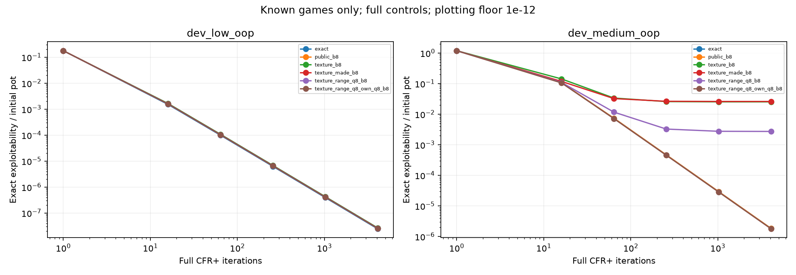
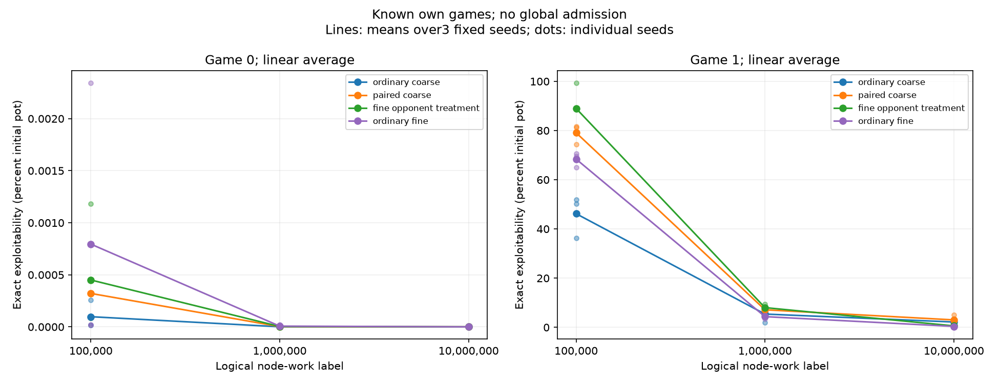
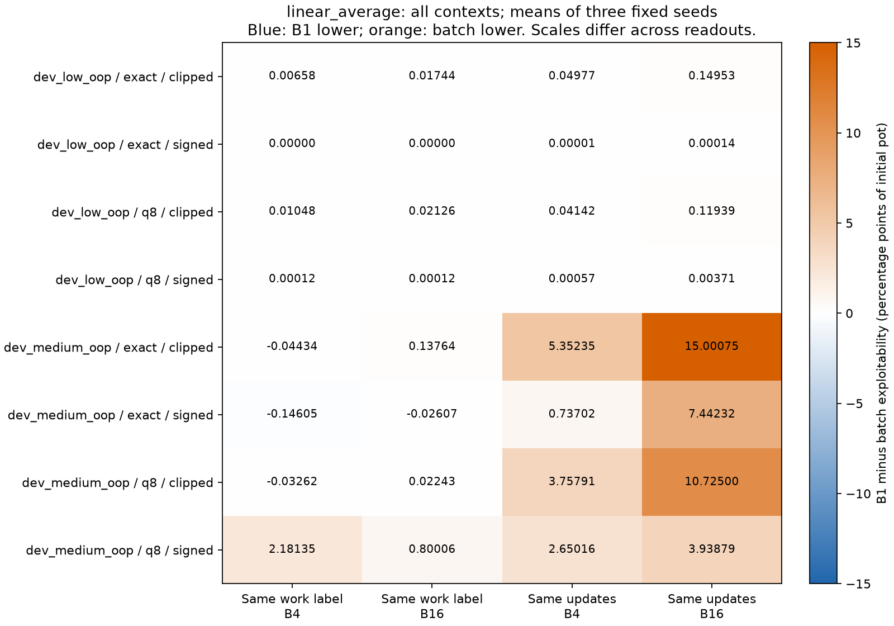
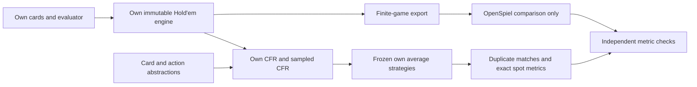
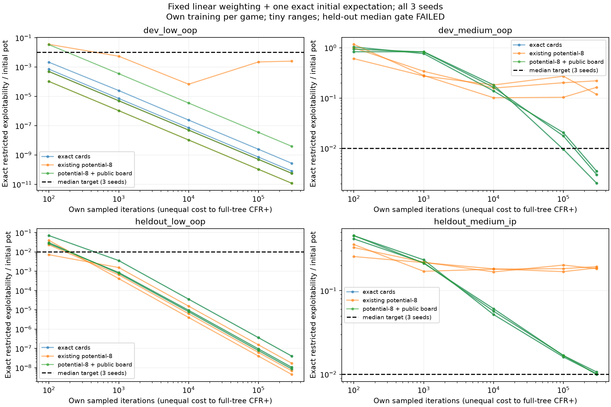
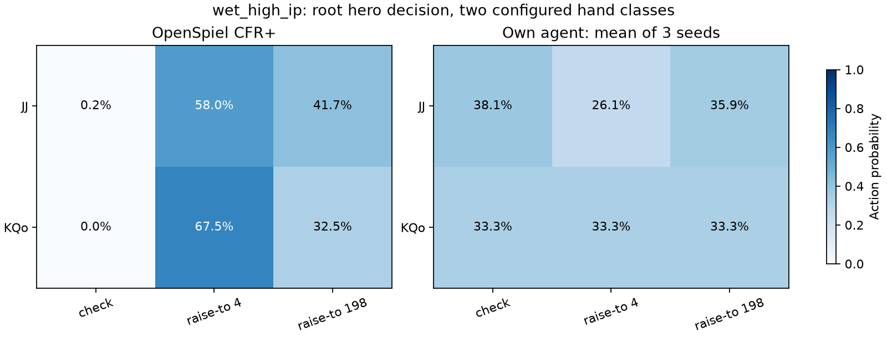
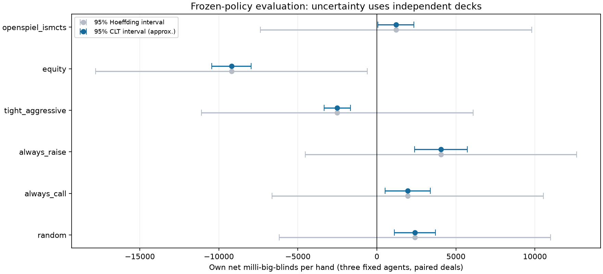
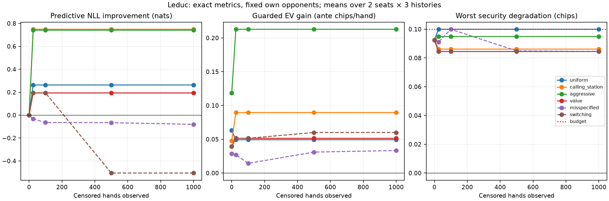
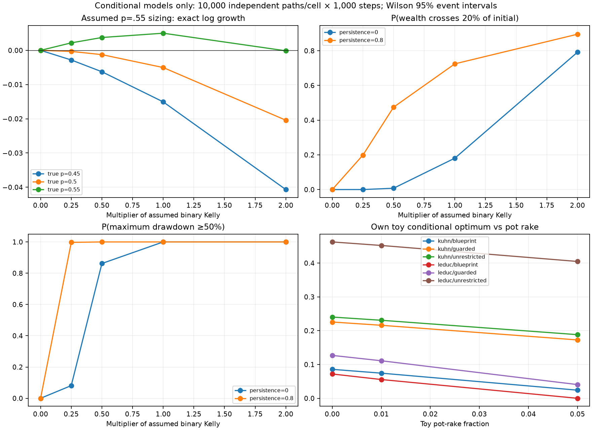
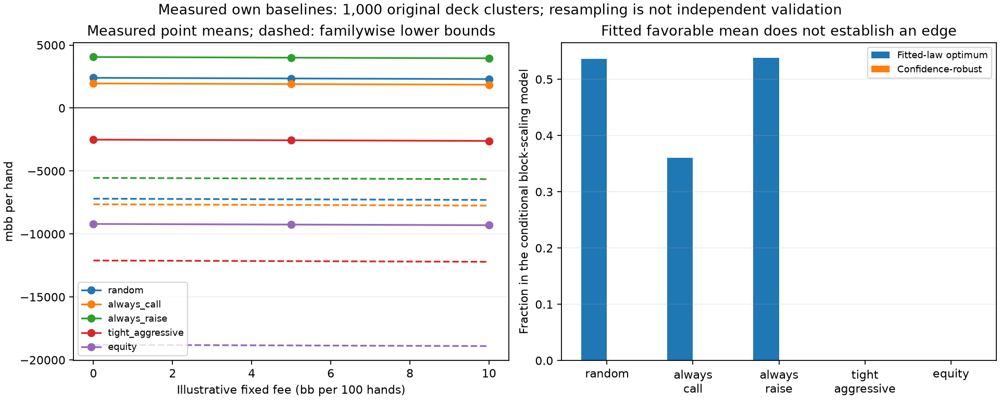

# Poker AI

[](https://github.com/jimmy-sim/poker-ai/actions/workflows/ci.yml)

Follow the [work log](docs/work-log.md),
[open research issues](https://github.com/jimmy-sim/poker-ai/issues), and
[pull requests](https://github.com/jimmy-sim/poker-ai/pulls) for current progress.

New to the project? Start with the [plain-English learning journal](docs/learning-journal.md)
for the ideas, examples, results, and lessons in the order they were built.

A poker AI research project built from first principles, emphasizing expected
value, variance, statistical testing, and game-theoretic reasoning. Implementations
will be validated independently before any performance claims are published.

The foundation includes card IDs, bitmasks, immutable decks, a
[five-card evaluator](docs/phase1-five-card.md), and
[six/seven-card best-five selection](docs/phase1-best-five.md). See the
[encoding contract and full phase acceptance gate](docs/phase1-cards.md).
Profile-guided direct evaluation and [heads-up equity](docs/phase1-equity.md)
are implemented, together with the [2–6-seat Hold’em engine](docs/phase1-engine.md).
[Phase 1 verification](docs/phase1-verification.md) and
[Phase 2 exact toy-game solvers](docs/phase2-solvers.md) are complete.
[Phase 3 bounded sampled-CFR agents](docs/phase3-verification.md) are implemented
and trained. [Phase 3.5 solver validation](docs/solver_validation.md) is
[complete](docs/phase3.5-verification.md) and has measured substantial postflop
strategy gaps. [Phase 4 evaluation](docs/phase4-verification.md) is complete,
including duplicate matches and a small public API pilot.
[Phase 5 Bayesian and risk extensions](docs/phase5-verification.md) are complete
within their declared scope. A new [own postflop learning diagnostic](docs/holdem-strength-v2.md)
identifies public-card aliasing, but its held-out performance gate narrowly fails.
A later [fresh procedure check](docs/fresh-validation.md) passes all four newly
selected restricted games after freezing the method and inputs in advance.
No competitive playing-strength result has been established.
All gameplay is restricted to simulation and permitted public bot benchmarks.

**Latest research — November 12:** the compact blocker-aware description passes
its fixed **full-control admission** on both known turn games. At4,096 full
CFR+ iterations, linear-average policies give:

| Game | Exact exploitability (% pot) | Compact candidate (% pot) | Candidate / raw-public rows |
|---|---:|---:|---:|
| Low |0.0000024545|0.0000025771|130 /364 (35.7%)|
| Medium |0.00018229|0.00017718|1,770 /3,336 (53.1%)|

All72 saved policies pass own replay and independent OpenSpiel value/BOTH-BR
checks (maximum error1.35e-13 chips). Own/audit complete commands take50.7/25.0s
inside unchanged900/900s caps. **Key strings are larger**, so fewer rows do not
establish whole-memory savings. These are two known, separately trained games;
sampled learning, fresh/global strength and the default agent remain unchanged.
[Full method and all controls](docs/compact-full-control.md),
[complete tables](results/compact-full-control/report/tables.md), and
[journal100](docs/learning-journal.md#100-check-the-test-before-trusting-the-new-description)
explain the result.



**Previous sampled research — November 11:** training the unchanged coarse learner against
finer **own** opponents improves the harder known turn spot. At 10 million
charged node visits, final linear averages over all three fixed seeds give:

| Method | Mean exact exploitability (% initial pot; lower is better) |
| --- | ---: |
| Ordinary coarse self-play | 2.173 |
| Paired coarse control | 3.028 |
| Finer-opponent treatment | 0.597 |
| Ordinary fine self-play | 0.383 |

The treatment's medium-spot median/worst are 0.553%/1.036%, within the original
1%/2.5% limits. Two seeds improve and one worsens. **The overall predeclared
superiority gate still fails:** median improvement in the already-near-zero low
spot is zero, rather than strictly positive. No agent default changes. All 432
policies and 1,152 fixed conditions agree with OpenSpiel within 1.85e-13 chips;
reference outputs are comparison-only. These are two separately trained known
games, not evidence of general Hold'em strength. [Full method, all seeds and
limits](docs/own-opponent-learning.md), [all-control heatmaps](results/opponent-information/report/fixed-gain.png)
and learning-journal step94 explain the result.

A [complete saved-river diagnosis](docs/river-range-reweighting.md) finds that
betting-conditioned opponent ranges explain some shared-group action conflicts,
while others persist because later opponent responses differ. All 24 saved
profiles and both own continuations are retained; this is a local diagnostic,
not a trained improvement. [All-case plots and tables](results/river-range-report/tables.md)
and learning-journal step97 explain the distinction.

The [two-sided blocker follow-up](docs/two-sided-blockers.md) finds that public
removal from our own alternative range separates 19 of 23 conflicting groups in
the previously weak river case (four remain). Local disagreement cost falls
0.386739→0.046621 chips per weighted decision. All 24 profiles/960 grouped panels
are retained; this is a saved-data diagnostic, not a trained strength gain.
[Journal step 98](docs/learning-journal.md#98-ask-which-hands-each-player-can-still-represent) and the [terminal exercise](docs/terminal-two-sided-lab.md) explain how to
browse the masks and remaining conflicts.

The [compact candidate definition](docs/compact-public-range.md) pools public
own-range removal and hand categories into one30-bit river word, appended to the
existing range-aware key. Its own full-control measurement above follows the
prospective gates; it does not inherit the preceding diagnostic's conflict count.
The separately specified fixed-work sampled comparison remains a later step.



**Previous research — November 10:** the complete private-deal stratification
experiment passes independent numerical validation but fails its primary
accuracy target. At10million visited nodes in the known deeper compressed game
(B4, signed regrets, linear average; all three fixed seeds):

| Method | Mean exact exploitability (% initial pot; lower is better) |
| --- | ---: |
| Original B1 control |4.354032 |
| Existing IID B4 |2.172684 |
| New stratified B4 |3.350775 |

The new median3.245725% and worst4.494858% exceed the unchanged1%/2.5% limits.
Every seed and control is retained; no agent default changes. All432 new policy
readouts and1,152 fixed conditions agree with OpenSpiel within2.07e-13chips.
These are two known small games, not general Hold'em playing strength.
[Methods, complete outcome and limits](docs/private-prefix-pipeline.md),
[all-case heatmaps](results/private-prefix/study/report/linear_average.png),
and learning-journal steps69–75 explain the result.

The [saved-decision report](docs/private-prefix-decisions.md) follows the failed
result down to individual hands, retaining all three seeds and both controls.
Browse the checked report without training with
`.venv/bin/python scripts/inspect_private_prefix_decisions.py --interactive`.
Use n/p for groups, s for seeds, o for methods, t for the responding seat and q
to quit. Learning-journal steps 77–79 explain what the numbers mean.

A [controlled continuation check](docs/private-prefix-continuations.md) shows
how changing later river choices can change the value of a turn call against
a fixed saved opponent. The [nine-snapshot figure](results/private-prefix/continuations-figure/call-versus-fold.png)
and learning-journal steps 80–81 explain this saved-position result; no new
agent was trained in that diagnostic.

The [static river-refinement check](docs/river-refinement-diagnosis.md) keeps all
29,808 river-row records across those nine snapshots and both seats. Exact
static range probabilities and ordered combo outcomes add **zero new groups**
and leave every measured local sharing cost unchanged. Both runtimes reproduce
all twelve numeric files byte for byte. This rules out those two refinements as
a repair for this known test, without claiming a training improvement. Journal
steps 82–83 explain the result; the original failed strength gate remains.

The original batch source's compute forecast fails **7201.49s vs7200s** and stays
unadmitted. A profiled array-dispatch change preserves all checked paths and
passes the same formula at6953.92s. The [completed fixed-work study](docs/reduced-batch-study.md)
runs72 paths and independently checks480 profiles, with maximum scalar/root error
1.57e-13chips. Its primary B4 mean improves4.35%→2.17% of initial pot in one
known compressed game, but one seed worsens and the clipped result remains mixed.
The global agent/default is unchanged. See learning-journal steps35–38; all earlier
failures and every seed remain in the record.

A [saved-current diagnosis](docs/batch-current-diagnosis.md) now independently
checks216 latest policies and1,728 fixed-opponent targets within2.07e-13chips.
Latest policies remain far more self-exploitable in the harder known game, yet
often do better against the unchanged original opponents. Those are different
tests; neither establishes competitive full-game strength. Journal step39
explains the distinction and links the plots and offline replay command.

You can now [browse saved action tables in Terminal](docs/batch-strategy-viewer.md).
The [matched-update study](docs/matched-update-batches.md) now completes its
prescribed24-context/48-target comparison and independent audit. The earlier
[toy-only archive proof](docs/matched-prefix-capture.md) remains software evidence.
Journal steps40–68 explain the commands, gates, failures and completed result.

The completed [two-axis tables and terminal browser](docs/matched-update-viewer.md)
retain every seed/readout and actual work/update count. Both strategies are our
own; the independent solver checks scalar calculations. At equal updates B1
uses much less work, so this does not isolate a pure variance effect or establish
a stronger default. [Complete comparison table](results/matched-update-viewer/report/tables.md).



## Architecture and current strength work



The new bounded study uses four turn-river games, two physical combos per seat,
three fixed seeds and all four weighting/initialization controls. Preserving the
public board lowers median restricted exploitability from **16.43% to 0.30% of
the pot** in one medium-SPR development game and **18.72% to 1.0153%** in the
medium-SPR held-out game. The latter misses the preset **1%** median target.
These are separate per-game self-play learners, not a measured upgrade to the
global Hold'em agent. The preregistered global comparison has not run.

All **378 frozen policy records** pass independent value/exploitability checks.
`make report-holdem-learning` replays the committed policies and regenerates
[tables](results/holdem-learning/report/tables.md) and plots without retraining.
`make validate-holdem-learning` repeats the fixed experiment in ignored staging;
it returns nonzero if the performance gate fails. See [methods and retained
failures](docs/holdem-strength-v2.md), the [technical brief](docs/research-brief.pdf),
and [verified resume claims and interview answers](docs/interview-guide.md).



The [river-integration follow-up](docs/river-fixed-work.md) completes all four
known development games at matched work thresholds. At 10 million node-work,
integration lowers the medium-IP median from **0.9433% to 0.7109% of the pot**,
but raises medium-OOP from **0.2463% to 0.7612%**; its final median is higher in
three of four games. Both methods pass the declared final development limits,
and all **80 frozen policies** pass independent value/best-response checks.
This mixed result changes no global-agent default or playing-strength claim.
`make report-river-integration` replays the [tables and plots](results/river-integration/report/tables.md)
offline; `make study-river-integration` reproduces the full bounded study.

The [fresh validation study](docs/fresh-validation.md) retains ordinary sampling
and passes its final accuracy/average-coverage limits on **4/4** preregistered
cases at 10 million node-work. The closest case has median exploitability
**0.9670% of the pot**, versus a fixed **1%** median limit. All **44 frozen
strategies** pass independent value/best-response checks. Each case receives
separate training on tiny explicit ranges; this does not establish a global
upgrade or erase the older failed experiment. Initial-only coverage remains
visible. At frozen revision `d587b81`, `make report-fresh-games` replays the
[tables and plots](results/fresh-validation/report/tables.md);
`make validate-fresh-games` reproduces the frozen study in ignored staging.
Later source changes intentionally require that historical checkout.

[Issue #4's public-board protocol](docs/public-board-abstraction.md) adds optional
suit-canonical and coarse texture keys with correctness tests. The completed
[fixed-work comparison](docs/public-board-comparison.md) finds a compression/accuracy
tradeoff: texture cuts strategy rows from **3,336 to 1,392** on the medium game,
but final median exploitability is **7.37% of pot**, versus **0.234%** for the
raw-public control, missing the fixed **1%** limit. The candidate gate fails;
no global default changes. All **150 frozen policies**, **800 ordered final
cross-play profiles**, and **90 checkpoint pairs** pass independent/replay checks.
`make report-public-boards` regenerates the [tables and four figures](results/public-board/report/tables.md)
offline; `make study-public-boards` repeats the fixed grid from clean source.
Inspect a board's features locally with
`.venv/bin/python scripts/inspect_public_board.py Ac Kc 2d 7c 7d`.

The [collision-diagnosis follow-up](docs/board-collision-diagnosis.md) identifies
concrete merged decisions and tests one richer made-hand-category history.
It still fails full-control admission: medium exploitability is **2.59% of pot**,
versus **2.52%** for old texture at the same 4,096 full-tree iterations. All
**48 saved strategies** pass native value/best-response checks. No sampled run
or default change follows. Read [journal step 17](docs/learning-journal.md#17-find-which-shared-decisions-need-different-treatment)
and the [tables/two figures](results/made-category-admission/report/tables.md).

The [saved-strategy response diagnosis](docs/candidate-best-response.md) finds
that the medium category candidate is nearly stable within its compressed game:
**0.000169% of pot** response gain within the partition, plus **2.593490%** from
exact information. All **32 response roots and 32 own reply-profile values** pass
native checks. This diagnoses fixed saved policies; it does not prove a training
upgrade or an unavoidable abstraction limit. Inspect with
`.venv/bin/python scripts/inspect_saved_reply.py`, or read
[journal step 18](docs/learning-journal.md#18-ask-how-a-counterstrategy-exploits-the-saved-agent)
and the [tables/figures](results/saved-replies/report/tables.md).

The [river-distinction diagnosis](docs/river-distinction-diagnosis.md) finds
same-category relative-strength differences and same-rank blockers. In the medium
category strategy, **24 strict reachable merged-row conflicts** under the exact
prefix leave **4** unresolved after a static range-outcome probe. This is a
known-case diagnostic count, not a trained improvement. All **64 own hybrid
profile values** pass native checks. Inspect the full-house/blocker example with
`.venv/bin/python scripts/inspect_river_distinction.py --rank 2`, and read
[journal step 19](docs/learning-journal.md#19-find-the-river-details-the-compressed-strategy-misses)
or the [tables/figures](results/river-distinctions/report/tables.md).

The [range-mass candidate](docs/range-mass-representation.md) now passes its
**full-control admission on both known games**. At 4,096 full-tree iterations,
medium exploitability falls from category's **2.593658% to 0.271640% pot**;
exact is **0.000182290%**. It uses **1,662/3,336** raw-public strategy rows, but
longer keys mean this is not a total-memory saving. All **60 frozen policies**
pass native checks. The subsequent [fixed-work sampled comparison](docs/range-mass-sampled.md)
retains all **90 policies** and **fails** the deeper-game gate: candidate median
**4.480481% pot**, worst **5.506634%**, versus fixed 1%/2.5% limits. It improves
on category (median **6.722857%**) but trails exact/raw-public (**0.233819%**).
All 90 checkpoint/visit pairs and native checks pass. Fresh/global work stops
here; [journal step 22](docs/learning-journal.md#22-check-whether-the-improvement-survives-sampled-learning)
and the [sampled plots/tables](results/range-mass-sampled/report/tables.md) explain the result.
Read [journal step 21](docs/learning-journal.md#21-test-whether-the-range-aware-description-is-accurate-enough)
and the [tables/two figures](results/range-mass-admission/report/tables.md).
Try `.venv/bin/python scripts/inspect_range_feature.py 9h` and repeat with `9d`.

The [saved-profile diagnosis](docs/range-mass-reply-diagnosis.md) now checks all
40 final sampled/full profiles. Medium range-mass **mean** exploitability is
**4.354032% pot = 0.243207% within-partition gain + 4.110824% extra exact-information
value**. The earlier median remains 4.480481%. The same representation's full
control is much less vulnerable, so this is not a universal abstraction floor or
a measured retraining gain. All **160 native response roots and 160 achieved own
reply values** pass checks. Read [journal step 23](docs/learning-journal.md#23-separate-unfinished-learning-from-missing-distinctions)
or try `.venv/bin/python scripts/inspect_range_reply.py --seat 1`.

The [fixed-policy follow-up](docs/frozen-policy-swaps.md) locates most of the
medium gap change in the saved river continuation. Mean extra-information gap is
**0.271466% pot** for full/full, **0.254886%** for sampled-turn/full-river,
**3.361794%** for full-turn/sampled-river and **4.110824%** for sampled/sampled.
All 160 crossed profiles and 120 street hybrids pass independent value/response
checks. This is a saved-policy intervention, not a retraining improvement or proof
that sampling alone caused the weakness. See [journal step 24](docs/learning-journal.md#24-hold-the-opponent-fixed-and-swap-saved-decisions)
or run `.venv/bin/python scripts/inspect_policy_swap.py`.

The [original controlled training comparison](docs/controlled-learning-comparison.md)
is complete: **140 runs / 840 checkpoints**, zero own replay error, all independent
native value/response checks within **1.71e-13 chips**. At the 10m work label in
the medium range-mass game, holding regret weights linear gives these sampled
mean exploitabilities (% initial pot; all three fixed seeds):

| Strategy-average weight | Signed regrets | Clipped regrets |
|---|---:|---:|
| linear | 4.354032 | 2.501852 |
| uniform | 2.664089 | 3.525759 |

This reversal shows an averaging/clipping interaction. A lower extra-information
gap can accompany a larger response gain within the compressed game. No recipe
is selected or deployed; the older failed gate and global default remain.
Read [journal step 31](docs/learning-journal.md#31-run-a-fair-comparison-of-the-training-choices)
and [all endpoint tables](results/controlled-learning/report/tables.md), or run
`.venv/bin/python scripts/report_controlled_learning.py --no-plots` without retraining.
Fresh reproduction at recorded revision `c45b463` uses
`make compare-controlled-learning`; later modules do not extend that learning admission. See the
[protocol, runtime and limits](docs/controlled-learning-comparison.md).

The [saved-policy follow-up](docs/controlled-reply-diagnosis.md) retains all 64
final source pairs and 256 ordered crosses. The clipped within-game weakness
persists against fixed opponents, especially for seat 1, and appears with exact
information too. All 512 target checks pass independent scalar audit (max
2.42e-13 chips); this diagnoses a weakness without selecting a stronger default.
Read [journal step 32](docs/learning-journal.md#32-separate-our-decisions-from-the-opponents-behavior)
or try `.venv/bin/python scripts/inspect_controlled_reply.py --seat 1`.

The [averaging-history diagnosis](docs/averaging-history.md#completed-diagnosis--november-9)
recovers all 192 original checkpoints and checks 512 saved current/average profiles.
In the medium range-mass sampled game, with clipped regrets and linear time
weights, the latest policy remains vulnerable. Three-seed mean exploitability,
as percent of initial pot (lower is better):

| Whole average | Current at 10m | 5m–10m average | 9m–10m average |
|---:|---:|---:|---:|
| 2.501852 | 9.519793 | 2.531900 | 4.888556 |

Late windows can improve EV against old fixed opponents without becoming safer
against a best response. All 512 self profiles and 2,048 fixed target conditions
pass independent scalar audit; six numerical files reproduce byte-for-byte on
base Python 3.12. This diagnoses the original known trajectories, without a new
stronger agent or default change. See [all modes/seeds and six figures](results/averaging-history/report/tables.md),
[journal step 33](docs/learning-journal.md#33-look-at-current-play-and-older-averages),
or run `.venv/bin/python scripts/report_averaging_history.py --no-plots`.
At frozen revision `7080163`, `make study-averaging-history` repeats the admitted
study into new ignored outputs; later modules do not receive fresh admission.

The [zero-weight fallback intervention](docs/window-fallback.md#completed-saved-policy-intervention--november-9)
keeps learned rows fixed and fills only missing late rows from the same own whole
average. All 32 full windows preserve realized play and values exactly. In the
medium range-mass clipped/linear sampled case, half-window mean total changes
**2.531900→2.531738% pot** and short-window **4.888556→4.869954%**. Some raw
conditions worsen. All 512 profiles /2,048 fixed conditions pass independent
audit; seven numerical files reproduce byte-for-byte on base Python 3.12.
This specific fill does little to remove the main weakness and is not deployed.
Read [journal step 34](docs/learning-journal.md#34-ask-what-happens-at-late-rows-with-no-weight)
or replay with `.venv/bin/python scripts/report_window_fallback.py --no-plots`.
At frozen `e91f8f2`, `make diagnose-window-fallback` repeats the saved-policy study.

## Development

New work follows the [issue-to-PR contribution workflow](CONTRIBUTING.md), with
actual checks and evidence recorded alongside each change.

Requirements: Git, Make, and [uv](https://docs.astral.sh/uv/getting-started/installation/)
0.13.5. uv can provision the Python version selected by `.python-version`.

From the repository root:

```sh
uv --version
make setup
make check
make hooks
```

`uv.lock` fixes resolved dependencies. `--locked` rejects stale declarations
rather than silently changing the lockfile. The Python baseline is 3.11; CI tests
3.11 and 3.12 on Ubuntu. Local hooks run the same locked Ruff installation as CI.

```sh
make format                              # Apply lint fixes and formatting
uv run --locked pre-commit run --all-files
```

## Layout

- `src/poker_ai/`: installable, typed Python package.
- `tests/`: unit, property, and reference-validation tests as phases progress.
- `configs/`: versioned experiment inputs.
- `scripts/`: reproducible experiment and validation entry points.
- `results/`: reviewed metrics and figures with provenance.
- `docs/`: roadmap, design decisions, and phase verification records.

The `src/` layout and pytest import mode check the installed package rather than
implicitly importing source from the working directory.

## Validation and results

The Phase 0 smoke test checks distribution installation and inclusion of the
`py.typed` marker. It makes no claim about poker correctness or playing strength.
The five-card evaluator has been checked against Treys over **2,598,960 hands**,
with **zero disagreements** across all **7,462 distinct ranks**. The category
census also matches independent combinatorial formulas. Reproduce with
`make validate-five`; see [the protocol](docs/phase1-five-card.md) and
[raw validation report](results/five-card-exhaustive.json). Full enumeration is
deterministic and uses no RNG.

Six/seven-card best-five selection matched Treys on
**2,000,000 seeded sampled hands** with **zero disagreements**:

| Cards | Sampled hands | Seed | Disagreements |
| --- | ---: | ---: | ---: |
| 6 | 1,000,000 | 20261103 | 0 |
| 7 | 1,000,000 | 20261104 | 0 |

Reproduce with `make validate-best`; see
[the protocol and limits](docs/phase1-best-five.md) and
[raw report](results/best-five-validation.json). These are sampled checks,
not exhaustive six/seven-card coverage. Engine validation is recorded below.

The current direct rank-mask evaluator preserves the subset implementation as
`evaluate_best_reference`. It passed a separate two-million-hand revalidation;
see [performance methodology and paired measurements](docs/evaluator-performance.md)
and [direct validation evidence](results/best-five-direct-validation.json).
`make validate-best` now targets that direct evaluator report.

Exact and Monte Carlo [heads-up equity](docs/phase1-equity.md) passed five
predeclared reference cases. Exact outcome counts matched Treys; each configured
Monte Carlo interval covered its exact counterpart. Reproduce with
`make validate-equity`; see [raw counts and intervals](results/equity-validation.json).

The engine completed **1,000 seeded independent traces / 10,039 actions**, including
**471 side-pot hands**, with no unexplained mismatches in the declared comparison
scope. This compares shared actions and rational terminal shares; short-blind,
short-raise, free-fold, and integer-rounding differences are explicitly documented.
See [rules and limitations](docs/phase1-engine.md) and
[raw evidence](results/engine-validation.json). Run `make validate-engine`.

Exact CFR, CFR+, Linear and Discounted CFR passed matched OpenSpiel checks on
Kuhn (10,000 iterations) and Leduc (1,000 iterations). Leduc final exploitability
was **0.0118178 / 0.000257152 / 0.00482613 / 0.000143468** ante chips per hand,
respectively. Maximum matched-iteration exploitability disagreement across the
experiment was **1.39e-16**. These are toy-game results, not Hold’em win rates.
Run `make validate-cfr`; see [methodology and limits](docs/phase2-solvers.md),
[raw evidence](results/cfr-validation.json), and [convergence plot](results/cfr-convergence.png).

Phase 3 now has tested external/outcome sampling and exact checkpoint resumption.
An [18-run compute pilot](docs/phase3-training.md) records toy-game convergence
and small fixed-limit runs. Card models have [measured reconstruction errors](results/card-abstraction.json).
Twelve abstracted fixed-limit runs produced 36 checkpoints through 500 iterations,
and 12 bounded no-limit runs produced another 36 checkpoints through 300 iterations.
These are bounded research runs with no playing-strength claim. Reproduce with
`make train-mccfr-pilot`, `make build-card-abstraction`, `make train-limit`, and
`make train-no-limit`.

Long validation sweeps use explicit configurations/seeds or deterministic complete
enumeration, with saved reports, separately from fast CI checks.

See [the roadmap](docs/roadmap.md), [design decisions](docs/decisions.md), and
[contributor instructions](AGENTS.md). Local setup verification is recorded in
[the Phase 0 report](docs/phase0-verification.md). The first
[hosted baseline CI](https://github.com/jimmy-sim/poker-ai/actions/runs/41746694808)
passed on Python 3.11 and 3.12; the badge above shows current default-branch CI.

<!-- SOLVER_VALIDATION_RESULTS_BEGIN -->
### Reproduced external-solver comparison

Exact-game CFR variants matched OpenSpiel 2.0.2 within **1.39e-16 ante chips/hand** exploitability at matched iterations.

Five **turn subgames**, two physical combos per player, matched full-pot/all-in actions. Primary own agent: eight potential buckets, 1,000 global self-play iterations, three fixed seeds. Entries below are seed means; raw reports include seed ranges, node frequencies, hand-class EVs and all ablations.

| Turn subgame | Action gap (pp) | Turn / river (pp) | Own exploit. / pot | Hero EV gap vs ref. / pot | Trained-policy reach |
| --- | ---: | ---: | ---: | ---: | ---: |
| dry_high_oop | 37.23 | 37.23 / 37.83 | 10.6715 | -0.5874 | 58.3% |
| wet_high_ip | 34.64 | 34.64 / 37.24 | 11.0141 | -0.2263 | 58.3% |
| dry_low_oop | 49.98 | 49.98 / 34.15 | 0.1650 | -0.0930 | 8.3% |
| wet_medium_oop | 31.05 | 31.19 / 30.81 | 1.2075 | -0.3209 | 5.1% |
| dry_medium_ip | 31.29 | 44.44 / 24.92 | 0.4896 | -0.1930 | 0.0% |

Action gap is reference-reach-weighted per-node action MAE, in percentage points. Exploitability is NashConv/2; EV compares the hero policy against the same reference opponent. Pot-normalized EV gaps use root-pot units. These are exact restricted-game expectations, not measured full-game win rates.

Own restricted exploitability exceeds the reference in 5/5 spots; hero EV against the same reference opponent is lower in 5/5. Trained-policy coverage spans 0.0–58.3% of reference decision reach; the rest uses explicit uniform fallbacks. Three training seeds do not establish a population confidence interval.



Reproduce: `make validate-solvers` (minutes on the recorded Mac; optional solver/evaluator/plot dependencies are installed from the lockfile). No commercial solver data are used. See [the technical writeup](docs/solver_validation.md) for methodology, licenses, convergence, diagnostics and limits.
<!-- SOLVER_VALIDATION_RESULTS_END -->

<!-- EVALUATION_RESULTS_BEGIN -->
### Local duplicate-deal evaluation

**36,000 simulated hands**, six fixed opponents, 3 frozen own training seeds. The same **1,000 independently drawn decks** are reused across both seats, fixed agents and opponents; each comparison has N=1,000 independent clusters. It does not have one independent sample per hand or per training seed. Stakes: 100bb; matched full-pot/all-in grid.

| Opponent | mbb/hand | Approx. 95% CLT CI | Conservative 95% Hoeffding CI | Adjusted p bound | Paired variance ratio |
| --- | ---: | ---: | ---: | ---: | ---: |
| random | +2400.6 | [+1100.4, +3700.8] | [-6188.8, +10990.0] | 1 | 0.505 |
| always_call | +1953.5 | [+517.9, +3389.1] | [-6635.9, +10542.9] | 1 | 0.192 |
| always_raise | +4051.6 | [+2373.4, +5729.8] | [-4537.8, +12641.0] | 1 | 0.418 |
| tight_aggressive | -2508.6 | [-3349.9, -1667.3] | [-11098.0, +6080.8] | 1 | 0.729 |
| equity | -9201.3 | [-10447.1, -7955.6] | [-17790.7, -611.9] | 0.174 | 0.511 |
| openspiel_ismcts | +1206.8 | [+63.9, +2349.7] | [-7382.6, +9796.2] | 1 | 0.457 |

Predeclared six-opponent family test: **0/6 positive advantages and 0/6 nonzero means pass** the conservative Bonferroni–Hoeffding criterion. Pointwise approximate CLT intervals suggest differences, but they are not the predeclared primary significance rule. Failure of that test does not establish zero advantage; its worst-case bound has low power at this N. Point-estimate losses occur against tight_aggressive, equity. The small ISMCTS opponent is a limited search baseline, not an equilibrium strategy or competitive poker benchmark.

Estimated paired/covariance-omitted variance ratios: **0.192–0.729**. This is the documented variance-reduction alternative to AIVAT; no AIVAT estimator or independent unpaired-match experiment is claimed. All raw hand records, own fallback counts, seed results and failures are retained.



Reproduce with `make evaluate-agents`; `make report-evaluation` re-audits and renders existing raw results without replaying matches. See [the evaluation writeup](docs/phase4-evaluation.md) for policy definitions, reference license/rule checks and limitations. No real-money client is used.
<!-- EVALUATION_RESULTS_END -->

<!-- PUBLIC_PILOT_BEGIN -->
### Public Slumbot protocol pilot

The predeclared **100-hand** anonymous 200bb pilot completed with **-345.50bb net** (**-3,455 mbb/hand**). The approximate IID 95% interval is [-11,315, 4,405] mbb/hand; the much wider conditional-IID Hoeffding interval is [-57,779, 50,869]. Both contain zero. Server independence is unverified: this is an API and translation pilot, not evidence of a winning agent.

All 100 settlements replay offline, including 95 independently checked fold settlements. The remaining showdown outcomes use server net winnings; no opponent-card showdown verification is claimed. Saved average rows were found at 141/155 decisions (91.0%); 11 unseen and 3 unaveraged rows used fallback. There were no shadow/depth failures, 0 decisions with clipped raises and 0 with unavailable raise mass. However, 73/155 decisions had nonzero history-size approximation, and 55/141 decoded distributions had nonzero output-grid approximation. Legal translation does not preserve strategy or EV.

The server controls deals and its unreported policy version, so the live outcomes cannot be reproduced from client seeds. Sanitized logs reproduce recorded accounting and statistics. No API results train or update the agent; this pilot remains separate from open-source solver validation and the 100bb duplicate study.

Recorded evidence: `results/slumbot/public-pilots/pilot-20261103T072514.940829Z.json`. Re-render and verify without network: `uv run --locked python scripts/render_public_pilot.py --report results/slumbot/public-pilots/pilot-20261103T072514.940829Z.json`.
<!-- PUBLIC_PILOT_END -->

<!-- EXTENSIONS_BEGIN -->
### Selected quantitative extensions

Own finite-type Bayesian models: **72,000 censored toy hands**, **360 exact checkpoint profiles**. Each table cell is the final-checkpoint mean over both seats and three training histories. Positive NLL improvement means better held-out public-transcript prediction under a fixed blueprint logging policy. EV gains are exact **ante chips/hand versus the same own scripted opponent**, relative to the own CFR+ blueprint. Those gains include exploitation already available from the prior; they do not isolate the benefit of learning.

| Game | Opponent scenario | NLL improvement (nats) | Guarded EV gain | Unrestricted EV gain |
| --- | --- | ---: | ---: | ---: |
| kuhn | uniform | +0.0441 | +0.0738 | +0.3101 |
| kuhn | calling_station | +0.4407 | +0.1103 | +0.1517 |
| kuhn | aggressive | +0.4961 | +0.1479 | +0.2185 |
| kuhn | value | +0.0979 | +0.0456 | +0.1398 |
| kuhn | misspecified | +0.0622 | +0.0438 | +0.1352 |
| kuhn | switching | -0.0040 | +0.0161 | +0.0697 |
| leduc | uniform | +0.2628 | +0.0493 | +1.6662 |
| leduc | calling_station | +0.7489 | +0.0895 | +0.8345 |
| leduc | aggressive | +0.7410 | +0.2128 | +1.9847 |
| leduc | value | +0.1930 | +0.0514 | +1.0290 |
| leduc | misspecified | -0.0808 | +0.0333 | +0.6661 |
| leduc | switching | -0.5055 | +0.0600 | +1.2003 |

The model improves predictions on included stationary types but can worsen them under misspecification or drift. A root-level exploitation mixture is certified to lose at most **0.1 chip/hand** of blueprint worst-case security in these exact games. This permits some degradation; it is not a Hold'em guarantee or a game-value safety claim.



Conditional bankroll study: **120 cells**, 10,000 independent paths per cell, 1,000 steps/path. In the synthetic binary p=.55 model with sizing chosen at that assumed edge, persistence 0: threshold crossing 18.1%; persistence 0.8: threshold crossing 72.5%. The specified uncertainty set gives a robust fraction of **0**. All fixed-stake Monte Carlo controls match finite-horizon exact ruin probabilities within the predeclared reported tolerance. Fractional threshold crossing is not literal bankruptcy. Return laws, fees, stationarity and stake scaling are model assumptions; no positive real-world edge or bankroll recommendation follows.



`make analyze-extensions` reproduces both studies, posterior audit, tables and figures offline. No external solver or public benchmark outputs enter learning. See [methods, limitations and interview answers](docs/phase5-extensions.md).

### Measured-return risk and fee sensitivity

All five own scripted opponents are included; OpenSpiel and Slumbot outcomes are excluded. Each fitted law contains 1,000 original deck clusters, each retaining three frozen own policies × two seats. A simulated step is one **six-hand block**, not one independent hand.

| Own opponent | Gross mbb/hand | Five-opponent lower bound | Fitted fraction | Robust fraction |
| --- | ---: | ---: | ---: | ---: |
| random | +2,400.6 | -7,196.5 | 0.5361 | 0.0000 |
| always_call | +1,953.5 | -7,643.6 | 0.3607 | 0.0000 |
| always_raise | +4,051.6 | -5,545.5 | 0.5384 | 0.0000 |
| tight_aggressive | -2,508.6 | -12,105.6 | 0.0000 | 0.0000 |
| equity | -9,201.3 | -18,798.4 | 0.0000 | 0.0000 |

**5/5 confidence-robust fractions are zero before fees.** The positive fitted fractions in some matchups depend on the empirical return law being correct; resampling does not independently establish its mean. The study includes half/full fitted sizing and confidence-robust sizing across 45 cells, each with 10,000 paths of 1,000 blocks. Five-opponent one-sided Bonferroni–Hoeffding bounds cover the same fixed target as the original duplicate study, not a population of training seeds.

The 0/5/10 bb/100 fixed costs are illustrative, not a real site's pot-rake schedule. No positive edge was established by the primary match test even before fees; positive fee-adjusted point estimates cannot prove an edge survives realistic rake.


<!-- EXTENSIONS_END -->
