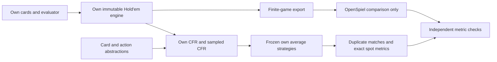

# Poker AI

[](https://github.com/jimmy-sim/poker-ai/actions/workflows/ci.yml)

I'm developing poker-ai as an ongoing project in poker simulation and strategy
learning. I want to make the Hold'em model stronger through reproducible
experiments and understand the decisions it learns.

The project covers the path from cards and betting rules to learned strategies,
independent comparisons, and evaluation. **Competitive full-game Hold'em strength
has not been established.** The working agents are research prototypes; most
strategy experiments use small, explicitly specified games.

## What currently works

| Component | What it does |
| --- | --- |
| [Poker mechanics](docs/phase1-verification.md) | Card/deck representations, 5–7-card evaluation, exact and Monte Carlo equity, and an immutable 2–6-seat Hold'em engine with side pots. |
| [Strategy learning](docs/phase3-training.md) | CFR variants for Kuhn and Leduc, sampled CFR for heads-up Hold'em, card/action abstractions, and resumable checkpoints. |
| [Independent comparisons](docs/solver_validation.md) | OpenSpiel checks on exact toy games and fully specified postflop subgames. |
| [Evaluation](docs/phase4-evaluation.md) | Duplicate-deal matches against fixed opponents, uncertainty estimates, and a recorded public API pilot. |
| [Quantitative extensions](docs/phase5-extensions.md) | Bayesian opponent models in toy games and conditional bankroll/risk analysis. |

<a id="architecture-and-current-strength-work"></a>

## Architecture



The research agents play heads-up even though the engine supports more seats.
Reference libraries are used for validation and comparison; their strategies do
not enter the agent's training. The [roadmap](docs/roadmap.md) explains the original
phase sequence and the continuing research plan.

## Validation and results

A few examples show both what has been checked and where the model still falls
short. The linked reports contain the complete controls, configurations, failures,
and reproduction instructions.

| Study | Recorded result | Scope |
| --- | --- | --- |
| [Hand evaluation](docs/phase1-verification.md) | Zero disagreements with Treys across all 2,598,960 five-card hands and 2,000,000 seeded six/seven-card samples. | The six/seven-card checks are sampled, not exhaustive. |
| [Exact toy-game solvers](docs/phase2-solvers.md) | Maximum matched-iteration exploitability disagreement with OpenSpiel: 1.39e-16 ante chips/hand. | Kuhn and Leduc under the recorded rules and checkpoints. |
| [Compact sampled representation](docs/compact-sampled.md) | Harder known game's median exploitability: 2.390% of the initial pot, exceeding the fixed 1% target. | Separately trained restricted games at a fixed work budget; the candidate failed its accuracy criterion. |
| [Duplicate-deal evaluation](docs/phase4-evaluation.md) | 36,000 simulated hands from 1,000 independent deck clusters; no positive advantage confirmed across six opponents by the primary familywise test. | The conservative test has low power; this does not prove the true advantages are zero. |

Exploitability measures vulnerability to a best response in the specified game;
lower is better. Here it is NashConv/2, with postflop percentages normalized by
the starting pot. It is different from a full-game win rate. The risk studies
also depend on their assumed return laws and do not establish a real-world edge.
All gameplay is limited to simulation and permitted public bot benchmarks.

## Development

Install Git, Make, and [uv](https://docs.astral.sh/uv/getting-started/installation/)
**0.13.5**. uv can provision the Python version in `.python-version`.

```sh
git clone https://github.com/jimmy-sim/poker-ai.git
cd poker-ai
make setup
make check
```

`make setup` installs the locked development environment. `make check` runs lint,
formatting, strict typing, and the normal test suite; long validation sweeps are
separate. The project supports Python 3.11+, with pinned 3.11 and 3.12 environments
in CI. `uv.lock` and `--locked` keep dependency resolution reproducible.

For development, `make hooks` installs the local checks and `make format` applies
Ruff fixes and formatting. The [contribution workflow](CONTRIBUTING.md) describes
how changes, experiments, and verification are published.

### Explore the project

Inspect a public board's representation:

```sh
.venv/bin/python scripts/inspect_public_board.py Ac Kc 2d 7c 7d
```

Browse saved decisions from the compact-representation study:

```sh
.venv/bin/python scripts/inspect_compact_information.py --interactive
```

The browser reads saved evidence without training. It prints its controls; use
`q` to quit. The [learning journal](docs/learning-journal.md) explains the examples
and includes more terminal exercises.

Each research report gives its reproduction command, optional dependencies, and
any required historical checkout. Some experiment commands intentionally return
nonzero when a recorded acceptance criterion fails; those outcomes remain part
of the research record.

## Layout

| Path | Contents |
| --- | --- |
| `src/poker_ai/` | Typed Python package: mechanics, learning, and evaluation. |
| `tests/` | Unit, property, and reference-validation checks. |
| `configs/` | Versioned experiment inputs and declared comparison designs. |
| `scripts/` | Experiment entry points, validation, reporting, and offline browsers. |
| `results/` | Reviewed evidence and figures; generated runs/checkpoints are normally ignored. |
| `docs/` | Explanations, methods, decisions, and dated verification records. |

## Current work and research history

[Issue #4](https://github.com/jimmy-sim/poker-ai/issues/4) investigates how card and
range representations interact with sampled learning at fixed work. Recent work
also measures validation overhead before the next proposed training comparison.
The [publication-helper diagnostic](docs/source-helper-trace.md) follows that
question without changing the playing strategy.

- [Learning journal](docs/learning-journal.md): explanations in development order,
  with separately recorded personal practice notes.
- [Work log](docs/work-log.md): dated changes, experiment outcomes, checks, and PRs.
- [Roadmap](docs/roadmap.md): phase contracts and continuing research direction.
- [Solver-validation report](docs/solver_validation.md): methodology, reference
  licenses, detailed comparisons, and limitations.
- [Interview guide](docs/interview-guide.md): project-level claim drafts and
  technical explanations, with contribution/assistance context.
- [Original packaging record](docs/phase6-verification.md): the dated technical
  brief and original phase reports. These are historical snapshots; current CI
  and publication status are in [Actions](https://github.com/jimmy-sim/poker-ai/actions).

The [verification-record correction](docs/ci-runtime-correction.md) documents
mislabeled historical interpreter records. Original evidence and failed outcomes
remain available rather than being replaced by later checks.

## Assistance and references

Codex has assisted with implementation, testing, experiment execution, and
writing. Specific historical assistance notes remain in the journal and work log;
recorded personal practice is kept separate from automated work.

Treys and PokerKit provide independent mechanics checks; OpenSpiel provides
reference algorithms and game calculations. Versions, third-party licenses,
and comparison limits are recorded in the
[mechanics reports](docs/phase1-verification.md) and
[solver-validation report](docs/solver_validation.md).

## Recorded study summaries

The sections below are maintained by the existing report generators. They keep
complete summary tables and their qualifications available without making the
front page a running experiment log.

<details>
<summary>Expand generated solver, evaluation, public-pilot, and extension summaries</summary>

<!-- SOLVER_VALIDATION_RESULTS_BEGIN -->
### Reproduced external-solver comparison

Exact-game CFR variants matched OpenSpiel 2.0.2 within **1.39e-16 ante chips/hand** exploitability at matched iterations.

Five **turn subgames**, two physical combos per player, matched full-pot/all-in actions. Primary own agent: eight potential buckets, 1,000 global self-play iterations, three fixed seeds. Entries below are seed means; raw reports include seed ranges, node frequencies, hand-class EVs and all ablations.

| Turn subgame | Action gap (pp) | Turn / river (pp) | Own exploit. / pot | Hero EV gap vs ref. / pot | Trained-policy reach |
| --- | ---: | ---: | ---: | ---: | ---: |
| dry_high_oop | 37.23 | 37.23 / 37.83 | 10.6715 | -0.5874 | 58.3% |
| wet_high_ip | 34.64 | 34.64 / 37.24 | 11.0141 | -0.2263 | 58.3% |
| dry_low_oop | 49.98 | 49.98 / 34.15 | 0.1650 | -0.0930 | 8.3% |
| wet_medium_oop | 31.05 | 31.19 / 30.81 | 1.2075 | -0.3209 | 5.1% |
| dry_medium_ip | 31.29 | 44.44 / 24.92 | 0.4896 | -0.1930 | 0.0% |

Action gap is reference-reach-weighted per-node action MAE, in percentage points. Exploitability is NashConv/2; EV compares the hero policy against the same reference opponent. Pot-normalized EV gaps use root-pot units. These are exact restricted-game expectations, not measured full-game win rates.

Own restricted exploitability exceeds the reference in 5/5 spots; hero EV against the same reference opponent is lower in 5/5. Trained-policy coverage spans 0.0–58.3% of reference decision reach; the rest uses explicit uniform fallbacks. Three training seeds do not establish a population confidence interval.


Reproduce: `make validate-solvers` (minutes on the recorded Mac; optional solver/evaluator/plot dependencies are installed from the lockfile). No commercial solver data are used. See [the technical writeup](docs/solver_validation.md) for methodology, licenses, convergence, diagnostics and limits.
<!-- SOLVER_VALIDATION_RESULTS_END -->

<!-- EVALUATION_RESULTS_BEGIN -->
### Local duplicate-deal evaluation

**36,000 simulated hands**, six fixed opponents, 3 frozen own training seeds. The same **1,000 independently drawn decks** are reused across both seats, fixed agents and opponents; each comparison has N=1,000 independent clusters. It does not have one independent sample per hand or per training seed. Stakes: 100bb; matched full-pot/all-in grid.

| Opponent | mbb/hand | Approx. 95% CLT CI | Conservative 95% Hoeffding CI | Adjusted p bound | Paired variance ratio |
| --- | ---: | ---: | ---: | ---: | ---: |
| random | +2400.6 | [+1100.4, +3700.8] | [-6188.8, +10990.0] | 1 | 0.505 |
| always_call | +1953.5 | [+517.9, +3389.1] | [-6635.9, +10542.9] | 1 | 0.192 |
| always_raise | +4051.6 | [+2373.4, +5729.8] | [-4537.8, +12641.0] | 1 | 0.418 |
| tight_aggressive | -2508.6 | [-3349.9, -1667.3] | [-11098.0, +6080.8] | 1 | 0.729 |
| equity | -9201.3 | [-10447.1, -7955.6] | [-17790.7, -611.9] | 0.174 | 0.511 |
| openspiel_ismcts | +1206.8 | [+63.9, +2349.7] | [-7382.6, +9796.2] | 1 | 0.457 |

Predeclared six-opponent family test: **0/6 positive advantages and 0/6 nonzero means pass** the conservative Bonferroni–Hoeffding criterion. Pointwise approximate CLT intervals suggest differences, but they are not the predeclared primary significance rule. Failure of that test does not establish zero advantage; its worst-case bound has low power at this N. Point-estimate losses occur against tight_aggressive, equity. The small ISMCTS opponent is a limited search baseline, not an equilibrium strategy or competitive poker benchmark.

Estimated paired/covariance-omitted variance ratios: **0.192–0.729**. This is the documented variance-reduction alternative to AIVAT; no AIVAT estimator or independent unpaired-match experiment is claimed. All raw hand records, own fallback counts, seed results and failures are retained.


Reproduce with `make evaluate-agents`; `make report-evaluation` re-audits and renders existing raw results without replaying matches. See [the evaluation writeup](docs/phase4-evaluation.md) for policy definitions, reference license/rule checks and limitations. No real-money client is used.
<!-- EVALUATION_RESULTS_END -->

<!-- PUBLIC_PILOT_BEGIN -->
### Public Slumbot protocol pilot

The predeclared **100-hand** anonymous 200bb pilot completed with **-345.50bb net** (**-3,455 mbb/hand**). The approximate IID 95% interval is [-11,315, 4,405] mbb/hand; the much wider conditional-IID Hoeffding interval is [-57,779, 50,869]. Both contain zero. Server independence is unverified: this is an API and translation pilot, not evidence of a winning agent.

All 100 settlements replay offline, including 95 independently checked fold settlements. The remaining showdown outcomes use server net winnings; no opponent-card showdown verification is claimed. Saved average rows were found at 141/155 decisions (91.0%); 11 unseen and 3 unaveraged rows used fallback. There were no shadow/depth failures, 0 decisions with clipped raises and 0 with unavailable raise mass. However, 73/155 decisions had nonzero history-size approximation, and 55/141 decoded distributions had nonzero output-grid approximation. Legal translation does not preserve strategy or EV.

The server controls deals and its unreported policy version, so the live outcomes cannot be reproduced from client seeds. Sanitized logs reproduce recorded accounting and statistics. No API results train or update the agent; this pilot remains separate from open-source solver validation and the 100bb duplicate study.

Recorded evidence: `results/slumbot/public-pilots/pilot-20261103T072514.940829Z.json`. Re-render and verify without network: `uv run --locked python scripts/render_public_pilot.py --report results/slumbot/public-pilots/pilot-20261103T072514.940829Z.json`.
<!-- PUBLIC_PILOT_END -->

<!-- EXTENSIONS_BEGIN -->
### Selected quantitative extensions

Own finite-type Bayesian models: **72,000 censored toy hands**, **360 exact checkpoint profiles**. Each table cell is the final-checkpoint mean over both seats and three training histories. Positive NLL improvement means better held-out public-transcript prediction under a fixed blueprint logging policy. EV gains are exact **ante chips/hand versus the same own scripted opponent**, relative to the own CFR+ blueprint. Those gains include exploitation already available from the prior; they do not isolate the benefit of learning.

| Game | Opponent scenario | NLL improvement (nats) | Guarded EV gain | Unrestricted EV gain |
| --- | --- | ---: | ---: | ---: |
| kuhn | uniform | +0.0441 | +0.0738 | +0.3101 |
| kuhn | calling_station | +0.4407 | +0.1103 | +0.1517 |
| kuhn | aggressive | +0.4961 | +0.1479 | +0.2185 |
| kuhn | value | +0.0979 | +0.0456 | +0.1398 |
| kuhn | misspecified | +0.0622 | +0.0438 | +0.1352 |
| kuhn | switching | -0.0040 | +0.0161 | +0.0697 |
| leduc | uniform | +0.2628 | +0.0493 | +1.6662 |
| leduc | calling_station | +0.7489 | +0.0895 | +0.8345 |
| leduc | aggressive | +0.7410 | +0.2128 | +1.9847 |
| leduc | value | +0.1930 | +0.0514 | +1.0290 |
| leduc | misspecified | -0.0808 | +0.0333 | +0.6661 |
| leduc | switching | -0.5055 | +0.0600 | +1.2003 |

The model improves predictions on included stationary types but can worsen them under misspecification or drift. A root-level exploitation mixture is certified to lose at most **0.1 chip/hand** of blueprint worst-case security in these exact games. This permits some degradation; it is not a Hold'em guarantee or a game-value safety claim.


Conditional bankroll study: **120 cells**, 10,000 independent paths per cell, 1,000 steps/path. In the synthetic binary p=.55 model with sizing chosen at that assumed edge, persistence 0: threshold crossing 18.1%; persistence 0.8: threshold crossing 72.5%. The specified uncertainty set gives a robust fraction of **0**. All fixed-stake Monte Carlo controls match finite-horizon exact ruin probabilities within the predeclared reported tolerance. Fractional threshold crossing is not literal bankruptcy. Return laws, fees, stationarity and stake scaling are model assumptions; no positive real-world edge or bankroll recommendation follows.


`make analyze-extensions` reproduces both studies, posterior audit, tables and figures offline. No external solver or public benchmark outputs enter learning. See [methods, limitations and interview answers](docs/phase5-extensions.md).

### Measured-return risk and fee sensitivity

All five own scripted opponents are included; OpenSpiel and Slumbot outcomes are excluded. Each fitted law contains 1,000 original deck clusters, each retaining three frozen own policies × two seats. A simulated step is one **six-hand block**, not one independent hand.

| Own opponent | Gross mbb/hand | Five-opponent lower bound | Fitted fraction | Robust fraction |
| --- | ---: | ---: | ---: | ---: |
| random | +2,400.6 | -7,196.5 | 0.5361 | 0.0000 |
| always_call | +1,953.5 | -7,643.6 | 0.3607 | 0.0000 |
| always_raise | +4,051.6 | -5,545.5 | 0.5384 | 0.0000 |
| tight_aggressive | -2,508.6 | -12,105.6 | 0.0000 | 0.0000 |
| equity | -9,201.3 | -18,798.4 | 0.0000 | 0.0000 |

**5/5 confidence-robust fractions are zero before fees.** The positive fitted fractions in some matchups depend on the empirical return law being correct; resampling does not independently establish its mean. The study includes half/full fitted sizing and confidence-robust sizing across 45 cells, each with 10,000 paths of 1,000 blocks. Five-opponent one-sided Bonferroni–Hoeffding bounds cover the same fixed target as the original duplicate study, not a population of training seeds.

The 0/5/10 bb/100 fixed costs are illustrative, not a real site's pot-rake schedule. No positive edge was established by the primary match test even before fees; positive fee-adjusted point estimates cannot prove an edge survives realistic rake.


<!-- EXTENSIONS_END -->

</details>
