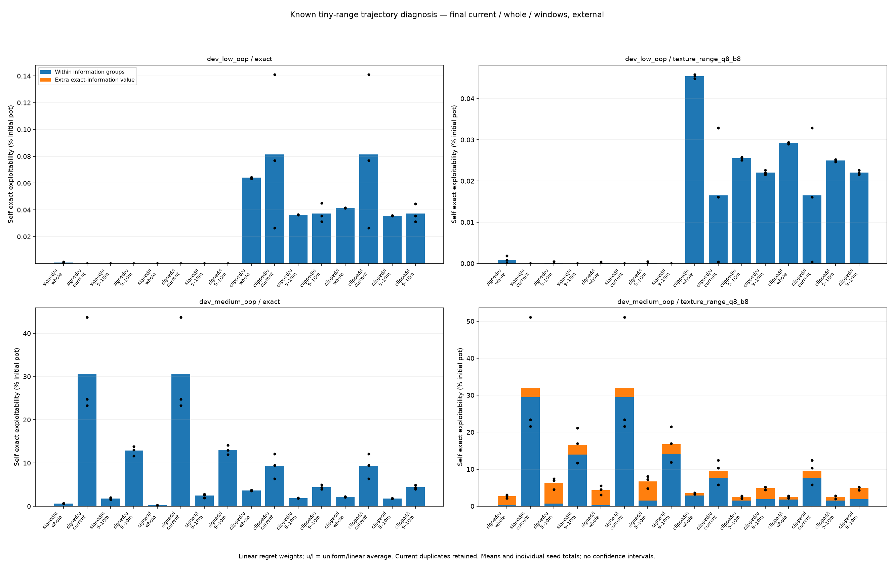

# Inspect current policies and the history of their averages

Issue [#4](https://github.com/jimmy-sim/poker-ai/issues/4), November 8, 2026.
Prospective follow-up to PR #29, before implementation or new trajectory outcomes.
Codex-assisted; human hands-on time is not recorded.

## Question and scope

The fixed-opponent diagnosis finds a larger clipped within-partition weakness,
especially for seat 1, even with exact information. Changing only average time
weights can alter the final average without changing raw regrets/current policies
in the software checks. Are the current policies also weak, or does the stored
average retain weak earlier play? Check this before changing a learner.

This is diagnostic replay of the original known trajectories, not a new learning
rule or a proposal to deploy the best-looking snapshot. It does not extend the
10m work budget, revise the old failed gate or admit fresh/global training. There
are no reference strategies, hand-tuned targets, selected seeds or new features.
The configuration fixes selection, outputs and tests before outcomes.

## Complete trajectory and observation set

Retain the same 64 final source cases as PR #29: both games, exact/range-mass,
full controls once and every external seed (20261301/2/3), signed/clipped regrets
and uniform/linear average weights. Regret time weights stay linear, bridge stays
common, and exact simultaneous warm initialization is charged to work. The
existing node/full backends, random generator, update sequence and all rules
remain frozen. Three spawned workers use sorted source identity modulo three.

Replay from initialization because the old archive stores average policies, not
resumable regrets. At original work labels 100k/1m/10m, require all **192 original
average/state fingerprints**, exact iterations and work to match the archived
source case. The recorded Python 3.11.17 / NumPy 2.4.6 runtime is required for this
bit-level prefix gate. No mismatch is repaired by loosening tolerances or dropping
a case. Base Python 3.12 numerical report replay is a separate check, not proof of
bit-identical training on every platform.

Read current policies at first complete-iteration crossings of work labels
100k/1m/5m/9m/10m: **320 current profiles**. The two average-weight cases otherwise
share a raw learning path; verify their current policies match at every label and
label duplicated currents explicitly. They are not independent samples.

At 5m and 9m, copy cumulative `strategy_sum` without changing the solver. At 10m,
subtract each copy from the final cumulative sum, then normalize legal rows using
the unchanged uniform fallback for zero-mass rows. This gives **128 suffix
profiles** across windows (5m,10m] and (9m,10m]. Original iteration time weights
are retained; their clock is not reset. Boundaries mean actual first complete
iterations and their actual work, including overshoots. Warm initialization is
excluded by subtraction. Report zero-window-mass row fractions and uniform-reach
coverage overall and on the river; original warm average coverage is a different
quantity. No epsilon, negative clipping or reference-derived fallback is allowed.

Retain **192 cumulative-mass records** at 5m/9m/10m, with legal unnormalized
weights, menus, source/state/work bindings and exact archive digests. Whole and
suffix averages must reconstruct from these archived boundaries without training.
This storage clarification precedes new poker replay or diagnostic outcomes and
changes no selection, window, metric, seed, cap or admission gate.

Retain each recaptured whole final average as a control: **64 profiles**. Together
there are **512 self profiles**, all scored and archived with legal menus, exact
identities and raw seeds. Store own response fingerprints, never native strategy
outputs. Observations must preserve raw arrays, policies, RNG, keys and charged
work. Test against an unobserved toy path and frozen indexed implementations.

## Scores and fixed opponents

For every self profile, retain own exact exploitability, within-partition gain,
extra exact-information value, root values and achieved OWN reply fingerprints.
All use the existing own scorer, with source-bound replay. Values are player-zero
chips; unilateral replies use the target's sign. Half-summed self exploitability
and unilateral fixed-opponent gains must be labeled separately; percentages use
each game's initial pot. Extra information plus within gain equals exact total.

At the final work label, compare four own variants: whole average, current,
5m–10m suffix and 9m–10m suffix. For each of the four original source modes, hold
each of the four original saved opponent modes fixed, in each game/encoding/
traversal/seed group, for both seats. Keep **2,048 target conditions**. An own
variant replaces only its responding seat; the opponent always stays frozen.
Require constant within-BR root for a fixed opponent, achieved own reply/root
agreement, and gain differences equal negative target-EV differences. Reuse and
verify the archived OWN response to the fixed opponent, not a native strategy.

Every self profile and fixed-opponent target requires independent scalar checks
with pinned OpenSpiel 2.0.2 / Apache-2.0, license bytes rechecked against the existing
record. Native games use own exports, so agreement does not independently verify
every engine rule. The reference is comparison only: no native training, strategy
export or target enters any agent. All 512 self profiles and 2,048 fixed-opponent
targets must pass; partial grids cannot complete the study.

## Admission, budget and reproducibility

Before new poker trajectory replay: publish this plan/config, implement meaningful
observer/window/loader/accounting/failure tests, complete relevant local base and
optional checks and both hosted code CI jobs, then publish source-bound toy
correctness and compute admission. The correctness receipt must demonstrate that
observing current/sums and extracting suffixes does not change training. No new
poker learning is permitted in the correctness or forecast stage.

Forecast from the original complete `phase=trained` cell durations for the exact
64 selected identities. Partition them in the same fixed three-worker order.
The predetermined planning formula is:

`2 × (2 × maximum partition sum of original cell wall seconds + 600 seconds)`.

The inner factor allows more observations, the fixed allowance covers new parent
IO/report/replay/setup, and the outer factor is a planning guard. This must be
strictly below the unchanged **7,200s own cap** or stop before replaying poker.
This is a forecast, not a measured runtime, confidence bound or personal work time.
It can be wrong; the actual deadline remains binding and partial runs are retained.

The separate **900s native cap** includes own input replay and IO. Chip comparisons
use 1e-9; unitless support reductions use 1e-12. Counts, identities, source bindings,
same-runtime prefixes and target inventories remain exact. Record clean published
source/config/lock hashes, environment/hardware, wall and parent/reaped-child CPU.
Publish own outcomes before independent comparison for the recorded study.
Fresh one-command reproduction may retain immutable ignored own staging. Refuse
overwrites and retain failure reasons, partial snapshots and worker outcomes.

## Reporting and decision rule

Keep all raw cases, checkpoints, windows, original prefix checks, controls and
target matches. Full controls run once; sampled reports show individual fixed
seeds and arithmetic means without confidence intervals. Six fixed figures:

1. Current exact-exploitability curves, full controls.
2. Current curves, sampled means and raw seed points.
3. Final whole/current/suffix within-plus-extra bars, full controls.
4. Final bars, sampled means and raw seed points.
5. Fixed-opponent gain differences against whole averages, full, both seats.
6. The same fixed-opponent differences, sampled means, both seats.

Current/window behavior can distinguish weak endpoints from weak stored history
in these finite trajectories. Neither a favorable current snapshot nor a suffix
score proves convergence, a better general averaging rule or a repair. A noisy
current path and its average can have different vulnerabilities. Keep unfavorable
outcomes and do not select an arm, checkpoint, window or seed after inspection.
Any later proposed method and performance admission need a separate protocol.

Done means all original-prefix/observer/current-pair/accounting checks, complete
own/native receipts and replay, all six inspected plots and raw tables, methodology
and limitations, three interview answers, work log, README/journal updates and
green final CI. Implementation and every new outcome are pending at publication.

## Completed diagnosis — November 9

The original plan above preceded implementation and outcomes. All 64 trajectories
and **192 original average/state/work prefixes match exactly**. The archive keeps
512 self profiles and 192 raw cumulative boundaries; every whole/suffix policy
reconstructs without training. All 160 otherwise-identical current pairs match
bit-for-bit across average weights. These duplicated readouts are not independent
experiments. Own archive replay has zero chip, unitless and fixed-identity error.

Own stage: **1136.768864s**, below 7200s. Independent comparison: **237.653849s**,
below 900s, including 99.214009s own input replay. All **512 self profiles and
2048 fixed target conditions pass**; maximum discrepancy is
**2.4158453015843406e-13 chips**, below 1e-9. All 128 fixed-opponent/target reply
identities are checked before reuse. Native outputs remain comparison-only.
OpenSpiel 2.0.2 / Apache-2.0 and installed license bytes match the previously
read [license record](solver_validation.md).

Source and ordering: prospective `2b4f54e`, raw-boundary clarification `888a838`,
checked code `432908e`, correctness `6b56229`, admission `3e64238`, complete own
publication `c0df957` **before** native publication `7080163`. Both
[code CI jobs](https://github.com/jimmy-sim/poker-ai/actions/runs/42584867420)
passed before correctness/admission and the replay. The fixed forecast was
5328.971368s, a planning estimate, not the measured runtime above.

### The current endpoint is also vulnerable

The motivating medium range-mass sampled game keeps linear regret weights.
Entries below are arithmetic means of the three declared seeds, in **percent of
initial pot**; lower total exploitability is better. All modes remain in the
[complete raw tables](../results/averaging-history/report/tables.md).

| Regret / average | Whole average | Current at 10m | 5m–10m suffix | 9m–10m suffix |
|---|---:|---:|---:|---:|
| Signed / uniform | 2.664089 | 31.999117 | 6.334095 | 16.609958 |
| Signed / linear | 4.354032 | 31.999117 | 6.719436 | 16.793465 |
| Clipped / uniform | 3.525759 | 9.519793 | 2.541802 | 4.901764 |
| Clipped / linear | 2.501852 | 9.519793 | 2.531900 | 4.888556 |

Changing average weights leaves current policies unchanged, as required; it
changes the averages. The sampled endpoint remains vulnerable, including inside
its own information groups. Weak earlier history alone does not explain that
endpoint weakness. Nor do the fixed late windows provide a general repair.

For the original linear-average context, the decomposition is:

| Regrets | Variant | Total | Within groups | Extra exact information |
|---|---|---:|---:|---:|
| Signed | Whole | 4.354032 | 0.243207 | 4.110824 |
| Signed | Current | 31.999117 | 29.448281 | 2.550836 |
| Signed | 5m–10m | 6.719436 | 1.511858 | 5.207578 |
| Signed | 9m–10m | 16.793465 | 14.150266 | 2.643198 |
| Clipped | Whole | 2.501852 | 1.811454 | 0.690398 |
| Clipped | Current | 9.519793 | 7.593282 | 1.926510 |
| Clipped | 5m–10m | 2.531900 | 1.510004 | 1.021896 |
| Clipped | 9m–10m | 4.888556 | 1.931953 | 2.956603 |

The clipped half-window reduces within gain but increases extra-information
value; its total is slightly worse than the whole average. Its raw seed outcomes
also disagree about the direction of total change. The final short window is
worse in all three seeds. Current total and within gain are worse in every seed:

| Seed | Whole total | Current total | 5m–10m total | 9m–10m total |
|---|---:|---:|---:|---:|
| 20261301 | 2.771207 | 12.452142 | 2.811565 | 5.114898 |
| 20261302 | 2.140962 | 10.327011 | 1.987388 | 4.382175 |
| 20261303 | 2.593388 | 5.780225 | 2.796746 | 5.168594 |

The corresponding **full clipped control** has zero current and both suffix
exploitabilities at the recorded precision, while its whole average is
0.050297% pot. Retained early history matters there. Full signed currents also
move non-monotonically; a changing current policy is not unique to sampling.
No endpoint or suffix is selected as a new strategy.



### Better against old opponents can still mean less secure

For clipped/linear sampled own policies, each row below spans the **four
opponent-specific means** in the medium range-mass game. Values are changes in
unilateral within-group gain, in percentage points of initial pot, relative to
the matching whole average. Negative gain change means higher own EV against that
fixed opponent. The opponent's BR root stays constant.

| Own variant | Responding seat | Range of mean gain changes |
|---|---:|---:|
| Current | 0 | -0.172775 to -0.026136 |
| Current | 1 | -1.134451 to -1.013782 |
| 5m–10m | 0 | -0.066839 to -0.058550 |
| 5m–10m | 1 | -0.430257 to -0.399724 |
| 9m–10m | 0 | -0.052706 to -0.047970 |
| 9m–10m | 1 | -0.546483 to -0.485529 |

All four means improve here, but this is not every raw seed: current seat 0 and
short-window seat 0 each have four unfavorable raw conditions out of twelve.
All conditions remain in `fixed-targets.csv`. More favorable EV against these
saved opponents does not imply lower exploitability against an optimal response.
The self-profile table above shows that distinction directly.

### Late support needs its own interpretation

Clipped linear-average suffixes have mean river uniform-reach mass coverage
**90.366892%** (5m–10m) and **81.962027%** (9m–10m). Signed suffixes have
48.976803% and 42.430034%. Zero-window-mass rows use the original uniform legal
fallback. Whole coverage is 100%, which includes warm/earlier mass and is a
different question. Current policies have no average-mass coverage statistic.

Coverage alone does not establish a cause: the full clipped suffix has only
38.424117% river uniform-reach coverage yet zero measured exploitability. Some
missing-mass rows can be unreachable under the strategy itself. A useful next
saved-policy intervention would change only the zero-window-mass fallback and
test its effect, keeping positive-mass rows fixed, before attributing the gap to
missing updates. That intervention requires its own prospective plan and checks.

## Reproduce and inspect

Read-only replay checks all profiles/windows and the archived native audit,
without new training or an installed reference runtime:

```sh
.venv/bin/python scripts/report_averaging_history.py --no-plots --output results/runs/my-averaging-report
.venv/bin/python -m pytest -q -m 'not slow' tests/test_averaging_history*.py
open results/averaging-history/report/current-curves-external.png
open results/averaging-history/report/final-averages-external.png
open results/averaging-history/report/fixed-opponent-differences-external.png
```

For a fresh trajectory reproduction, use an isolated checkout at `7080163`
(complete immutable source/admission/data), uv 0.13.5 and the pinned Python
3.11.17 / NumPy 2.4.6 environment, then `make study-averaging-history`. It creates
new ignored own/native/report outputs and refuses overwrites. Later added source
modules intentionally do not receive fresh admission; archived read-only replay
allows them while checking every recorded original source hash. Python 3.12
report replay checks numerical compatibility, not bit-identical 3.12 training.

## Limits and interview questions

These are known, tiny-range games and original trajectories, with one full run
and three fixed sampled seeds per context. Points/windows share training history;
currents also duplicate across average-weight modes. There are no confidence
intervals, fresh-game admission, general win rate or convergence proof. Native
games use own exports: scalar agreement does not independently revalidate every
engine rule. Old failed strength limits and the default agent remain unchanged.

1. **Why not deploy the latest policy?** In the motivating clipped context its
   mean total is 9.519793% pot versus the whole average's 2.501852%. Current play
   can change substantially; one snapshot is not a convergence or strength proof.
2. **Why retain raw cumulative weights?** A late average is the difference of
   unnormalized weight sums, then normalized with the original time weights.
   Differences of normalized probabilities do not recover that average. The
   retained boundaries let every suffix reconstruct without retraining.
3. **Why keep opponents fixed as well as measuring exploitability?** Changing
   only our seat isolates our conditional EV change. It can improve against old
   opponents while becoming easier for a best response to exploit. The two
   measurements answer different questions; neither licenses a global default.
