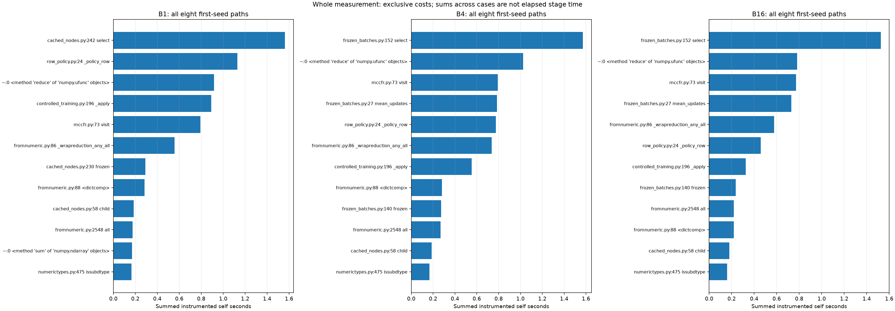
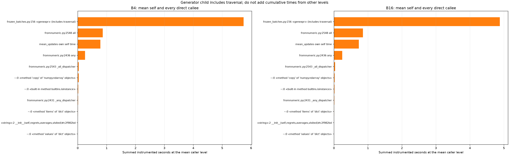

# Where does batch time go? Prospective cost profile

November 9, 2026, issue #4. This plan and [config](../configs/batch-overhead.json)
precede implementation and new measurements. Codex-assisted; developer hands-on
time is not recorded.

The [previous fixed gate](frozen-pass-batches.md#retained-compute-gate-failure--november-9)
fails: 7201.492439 forecast seconds versus the unchanged 7200 limit. The actual
timing stage took 55.257181 seconds. Its narrow margin does not justify changing
the rule or retrying unchanged timings until a favorable run appears. No long
comparison, quality score or new agent was admitted.

## Question and definition of done

Measure which functions account for time before considering an execution
optimization. A profiler records how many times each function runs and how long
it spends. It can slow the program, so its durations will not be substituted
into the old planning formula or used to admit learning.

Done means all 48 plain/instrumented endpoints match their archived original
states exactly, all 24 complete function/caller profiles are retained, numerical
reports and two plots reproduce from saved data, failure/serialization checks
and local/hosted checks pass, and the interpretation distinguishes measured cost
from playing strength. This step introduces no optimizer or new long admission.

## Fixed selection and work

Use every first-seed path from the previous grid: B1/B4/B16, both known games,
exact/q8 encodings and signed/clipped regrets, seed 20261301. That is 24 paths,
not a favorable subset selected by their measured speed or poker outcomes.
The other two seeds stay in the old timing evidence; this cost diagnosis cannot
establish a general speed ratio across seeds or machines.

Three spawned workers receive sorted selected local indices modulo three. Each
runs an ordinary control and a `cProfile`-instrumented copy, in that order. Call
the old `frozen_batch_profile.measure` unchanged: same explicit RNG, simultaneous
exact warm initialization charged 2N nodes, then at least 100k additional visits
at a whole-iteration crossing. All 48 endpoints must match the archived path's
guard hash, both average hashes, raw work/iteration/traversal counts and prefix
checks exactly. The 32 repeated B1 checks cover 16 original readout identities
twice. Timing values are intentionally excluded from state equality.

The separate 900-second cap includes input validation, process/context setup,
training prefixes, profiler collection, replay, tables, plots and IO. Original
scientific caps, seeds, work, gates, code and the failed outcome stay frozen.
New short prefixes are learning work, not a no-training check. No EV or strength
scores are computed.

## Interpretation fixed before measurement

Instrument the **whole old measurement call**, including construction, warm
initialization, observations and final fingerprint exports. Report that scope;
do not call it an isolated traversal-loop profile.

Retain every function's primitive/total call counts, self time, cumulative time
and direct callers. Self time excludes called functions. Cumulative time includes
them, so nested cumulative percentages overlap and cannot be added as shares.
`mean_updates` consumes a generator that performs the external traversal. Its
cumulative time therefore includes traversal and RNG work; it is not a measure
of validation cost. Inspect its self time and direct callees separately.

Check recorded call counts against work: `external_updates` calls equal sampled
traversals; its recursive `visit` calls equal incremental visited nodes; batch
mean calls equal twice the post-warm update count for B4/B16 and zero for B1.
Keep complete frames/caller edges, not only a chosen hot-function list. Portable
frame names preserve source lines and distinguish repository, standard-library
and installed-package code.

The first plot summarizes function self time, with the complete raw ledger
behind any displayed top rows. The second shows all direct mean callees and its
self time, clearly labeling their scope. Summing self time across independent
cases describes aggregate instrumented work, not wall time, personal hours or
an uninstrumented speedup. Instrumentation overhead and fixed-order effects
limit comparisons. Three seeds are not population confidence intervals; this
stage uses only the declared first seed.

## Validation and next decision

Before real profiling: meaningful real tiny-game profiling and process tests,
state/RNG/work/observer identity, function/caller schema, partial grids, nonfinite
times, wrong source bindings and retained failure tests; relevant complete local
base/optional checks and both hosted source-bound CI jobs. Test fixtures must
remain explicitly labeled as software, not Hold'em or independent solver results.

Read-only replay must recompute source/identity/count/report accounting without
constructing a learner or reference solver. Publish own complete or failing
evidence before choosing an optimization. A later change needs its own plan and
exact behavior proof against the frozen implementation, followed by the same
complete 216-row forecast grid and unchanged limits. It cannot erase or admit
the old failed experiment. No commercial or reference strategies enter training.

## Tested implementation checkpoint

The runner calls the frozen measure unchanged and checks both final states and
profiler call counts. It retains all self/cumulative/caller entries, records
attempted versus completed work on failures, refuses overwrites, and renders the
complete numerical reports and two figures. Replay constructs no learner or
reference solver. The old helper's derived extrapolation is omitted in both
modes; all raw durations remain, and no instrumented value becomes a forecast.
Tree/context preparation stays outside the instrumented call and inside the
overall stage cap.

51 focused fast checks pass. All five relevant integration checks pass on both
optional runtimes (57.30/67.82s while full suites also ran). The complete explicit
nonuniform-Kuhn exercise runs all 48 endpoints/24 real function profiles with
exact state and call/work identities. Four numerical files reproduce byte for
byte; full runner serialization, two software-only plots and offline reader
checks pass. cProfile recursion tests distinguish function `(primitive,total)`
counts from caller `(total,primitive)` counts. Synthetic source/CI and caller
ledgers test contracts only and are not independently observed research evidence.

Full base/optional suites and hosted complete-code CI are pending. No actual
Hold'em cost-profile outcomes or optimized backend exist at this checkpoint.

Review before real measurement caught generated functions sharing one standard
profiler file/line/name label. The collector now retains every raw cProfile
entry and caller edge, with portable structural code identities and separate
entry identifiers even for identical generated code. No self cost is overwritten
by a label collision. Regression tests cover both different and identical code
with colliding labels. Full checks and hosted CI must pass on this corrected
collector before the Hold'em cost run. Earlier software-only timing summaries
are not poker evidence or permission to reuse the old code gate.


## Corrected source admitted for cost prefixes

Both [hosted code jobs](https://github.com/jimmy-sim/poker-ai/actions/runs/42616172811)
passed on `0a86ca8963f5babf45ccb4c1be8f6572b63c7775`. The
[checked-source receipt](../results/batch-overhead/code-checks.json) binds source
inventory SHA `24b862efae132bae5c1aa8000655e215a41ff0cfbd333799c7d669cda5d53972`.
Corrected local base checks: 1,700 passed and 24 skipped on each runtime
(262.53/261.63s); optional checks: 1,733 passed each (302.11/290.95s).
Five slow integrations pass on each (57.44/54.58s), with Ruff, formatting
483 files and strict typing 394 files. The corrected real tiny-game exercise
retains all raw frames, and both software-only figures have been inspected.

This receipt permits only the fixed 48 short cost endpoints. It does not admit
long learning or replace the previous failed forecast. Actual Hold'em cost
outcomes are still pending at this publication checkpoint.


## Measured outcome — November 9

The [complete own receipt](../results/batch-overhead/profile.json) finishes in
**21.733298041 seconds** against the unchanged 900-second cap, including
3.984089250 seconds validating old inputs. All 24 plain and 24 instrumented
endpoints exactly reproduce their archived guard, both average books, work,
iteration, traversal and prefix identities. All 32 repeated B1 checks pass.
The 24 raw function ledgers retain **3,456 function rows and 5,896 caller edges**.
No strength scores, native solver, optimizer or long trajectory was run.

[Tables](../results/batch-overhead/report/tables.md),
[all cases](../results/batch-overhead/report/cases.csv),
[all functions](../results/batch-overhead/report/functions.csv) and
[all caller edges](../results/batch-overhead/report/callers.csv) retain the data.
A base Python 3.12 offline replay constructs no learner/reference solver and
reproduces all four numerical files byte for byte. Both real figures were
inspected after rendering.

| Batch | Summed instrumented self seconds | Mean own self seconds | Direct mean all/any callee seconds |
|---|---:|---:|---:|
| 1 | 9.126921417 | not called | not called |
| 4 | 9.399425253 | 0.784954127 | 1.121221560 |
| 16 | 8.082637081 | 0.731213644 | 1.097186194 |

Each row aggregates the eight declared first-seed paths. These are sums across
instrumented cases, **not stage wall time, an uninstrumented speedup, or personal
hours**. The last column includes the NumPy reductions called directly by the
mean, not only wrapper dispatch. Inclusive mean time is mostly the traversal
generator: 5.740231627 / 4.878545173 seconds for B4/B16. It must not be labeled
validation-only cost. Action sampling is the largest individual self-time frame
in all three groups. No claim follows that reduction checks explain all cost.





The evidence justifies testing a narrow dispatch optimization: perform the same
finite/nonnegative reductions through array methods, retaining every check and
all arithmetic. It does not yet establish a speed gain. That change requires a
separate prospective plan, failure/behavior proof and complete fixed forecast.
The original **7201.492438542 > 7200** gate remains failed; these instrumented
costs cannot admit a long study, a stronger/default agent or fresh/global cases.

Reproduce the saved reports without learning:

```sh
.venv/bin/python scripts/report_batch_overhead.py --no-plots
```

With the research plotting extra installed, omit `--no-plots` to render both
figures. Generated output goes to `results/runs/batch-overhead-report`.

### Interview practice

1. **Why profile before changing training?** A slow function's total time can
   include its callees. Here the mean consumes a traversal generator, so its
   inclusive time would wrongly blame the mean for traversal. Self costs and
   direct edges identify a narrower candidate.
2. **How do you know profiling did not change the learned states?** Every plain
   and instrumented endpoint exactly matches old random state, both average
   books, regrets and charged work through source-bound fingerprints and raw
   counters. This proves these checked endpoints, not every future trajectory.
3. **Why not retry the narrowly failed forecast?** Unchanged retries could select
   favorable noise. The failed result stays. A genuine implementation change
   needs exact equivalence checks and the full predeclared forecast again.
