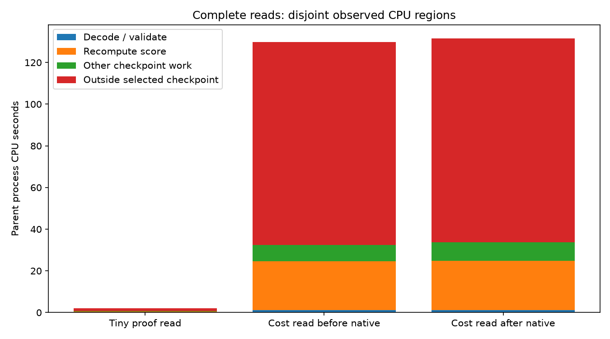
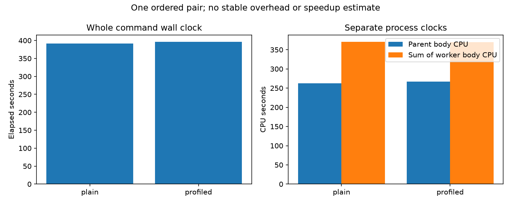

# Where checkpoint replay spends CPU

The latest complete audit forecast is **912.54 seconds against a 900-second
limit**. Before changing another part of validation, this investigation asks how
much CPU the current checkpoint reader spends decoding saved policies,
recomputing scores, and doing the remaining checkpoint work.

[The prospective plan in issue #4](https://github.com/jimmy-sim/poker-ai/issues/4#issuecomment-6910138688)
was published on November 15, before implementation or outcomes. The preceding
[complete pipeline report](compact-suit-pipeline.md) retains the failed forecast.
This is a measurement tool, with no change to poker decisions or training.

## What the measurement shows

CPU seconds in the instrumented pass, rounded to four decimal places:

| Complete read | Decode / validate | Recompute score | Other checkpoint | Outside selected root | Total read |
| --- | ---: | ---: | ---: | ---: | ---: |
| Software archive (432 profiles) | 0.0367 | 0.4974 | 0.1112 | 1.3701 | 2.0153 |
| Cost archive before reference | 1.2532 | 23.4232 | 7.6809 | 97.3711 | 129.7285 |
| Cost archive after reference | 1.1346 | 23.7438 | 8.7405 | 97.9693 | 131.5882 |

Scoring is the largest part inside the selected checkpoint. Most whole-read CPU
lies outside that callsite. The outside bucket includes input loading and other
replay/validation callers; this measurement does not split those costs. The next
useful question is which current loader/replay phases account for that work,
before choosing an optimization.



The first bar is the earlier complete software archive, not the new eight-case
observer proof. Only the instrumented pass has a category breakdown. Zeros in
the plain pass's selected columns mean those timers were disabled.

| Pass | Complete wall seconds | Parent body CPU seconds | Sum of worker body CPU seconds |
| --- | ---: | ---: | ---: |
| plain | 391.3073 | 262.4950 | 370.2056 |
| profiled | 395.8944 | 267.2456 | 369.9279 |



Worker CPU sums activity across parallel processes and cannot be added to wall
time. Timer/capture overhead is part of the observed regions. One ordered pair
cannot establish a stable overhead estimate, causal speedup or production-cost
forecast. The earlier **912.5424664160237 / 900-second forecast remains failed**;
the known-game **2.390% versus 1%** accuracy result also remains unchanged.

[All numerical exports](../results/checkpoint-replay-cpu/pair/report/summary.json)
reproduce byte-for-byte on actual Python 3.11.17/NumPy 2.4.6 and
Python 3.12.15/NumPy 2.5.4 with game construction, scoring, replay, training and
reference execution blocked after static import setup. The initial guard setup
failure and corrected check are kept in [verification history](../results/checkpoint-replay-cpu/report-verification/manifest.json).

## What is measured

A checkpoint is a saved strategy and its recorded results. Replaying it checks
that the same strategy still produces those results.

The observer starts at the own-archive reader's `replay_snapshot` callsite. It
measures `learning_artifacts.decode` and `ScoringContext.score` only inside that
call. Other callers keep their original function. Three complete reads each
contain 432 checkpoints, with one decode and one score apiece: **3,888 selected
calls**, below the fixed 4,096-call limit.

The three inner regions are reported without double counting:

- Decode and validation CPU.
- Score recomputation CPU.
- Remaining checkpoint CPU after subtracting those two selected children.

The remainder includes any other checkpoint work and observer overhead. It does
not identify serializer self time. CPU outside the selected checkpoint is also
reported. Parent CPU, worker CPU and whole-command elapsed time stay separate.

## Correctness before collection

The private entry, support and config add three files to the preserved 433-file
scientific source identity. Tests check actual tiny checkpoint encoding/replay
against independent terminal sums and exhaustive pure choices. Other tests cover
arguments, return/error identity, alias and descriptor restoration, nested CPU
accounting, malformed records, process/thread ownership, recursion, call limits,
timeouts and failed writes. Synthetic clock fixtures are explicitly test data.

The initial November 16 development snapshot passed **134 focused tests on
Python 3.11.17**. At that point, complete local/hosted checks were pending and
no formal observer proof or measured pair had run. Later source checks and
results are recorded below.

The prescribed sequence is unchanged: publish all six source-check receipts and
operators; publish a fresh own-only proof within 180 seconds; run one complete
ordinary/profiled audit pair; publish raw evidence; then analyze it. Each child
keeps its 900-second cap, with 1,800 seconds shared. Failed and partial outcomes
remain; there is no favorable retry or smaller replacement workload. OpenSpiel
2.0.2 remains a pinned, licensed scalar comparison only.

The installed Apache-2.0 license was read in both optional environments before
new optional validation. Both copies have SHA256
`cfc7749b96f63bd31c3c42b5c471bf756814053e847c10f3eb003417bc523d30`;
the pinned license record remains in [solver validation](solver_validation.md).

## Explore the tests

From the project directory:

```sh
.venv/bin/python -m pytest -q tests/test_checkpoint_observer.py tests/test_checkpoint_cpu.py
```

The tests exercise software fixtures and saved data. They do not start the formal
measurement or authorize the blocked training comparison. A single ordered pair
will not establish stable timing overhead, production savings or stronger play.


## Report reproduction check — November 16

The first local cohort passes both complete bases (4,799 tests each) and both
relevant optional suites (1,702 each). [Its raw logs](../results/checkpoint-replay-cpu/qualification-history/pre-report-output-04dbb78/manifest.json)
remain separate because review then added a fresh report-output directory option.
That correction preserves saved inputs while recreating identical numerical
exports. All 136 focused tests pass on Python 3.11.17 in 23.73 seconds. The
corrected source still needed complete local and hosted checks at that checkpoint.

Once raw measurements have been published, a saved-data report can be reproduced
into a fresh directory with:

```sh
uv run --locked --extra research python scripts/profile_checkpoint_cpu.py report \
  --output results/checkpoint-replay-cpu/pair \
  --report-output results/runs/checkpoint-cpu-report-local
```

This command requires the complete published pair; it is not available as a
result before that pair has been collected and verified.

## Checked source, before measurement — November 16

All six roles pass on `899ad05`, with the complete 436-file source identity
`81ea769018500d50c2dfcc48b0ced099d6fe424c8cff7f235540f14620da32ca`.
All 433 predecessor scientific files remain unchanged.

| Check | Python 3.11.17 / NumPy 2.4.6 | Python 3.12.15 / NumPy 2.5.4 |
| --- | --- | --- |
| Full local base | 4,801 passed; 65 skipped; 150 deselected; 621.86 s | 4,801 passed; 65 skipped; 150 deselected; 594.09 s |
| Relevant optional | 1,704 passed; 311.83 s | 1,704 passed; 252.73 s |
| Hosted base | 4,801 passed; 65 skipped; 150 deselected; 1,076.80 s | 4,801 passed; 65 skipped; 150 deselected; 1,425.28 s |

[The six raw records and exact operators](../results/checkpoint-replay-cpu/checks.json)
retain the runtime assertions, every uv selection and the full GitHub-tested
tree. Both hosted jobs have the existing historical replay-roundoff warning,
within its unchanged 1e-12 limit.

Six small process fixtures test the launcher's success, nonzero exit, timeout,
interruption, separately grouped child cleanup and failure before launch. Four
filesystem cases check exact retention, refusal to overwrite and unrelated-file
preservation; ten synthetic cases check the publication boundary. Their invented
headers are test inputs, never timing results.

This source checkpoint precedes the fresh own-only proof and measured pair.

## Own-only proof — November 16

[Eight actual tiny checkpoints](../results/checkpoint-replay-cpu/software/child.json)
pass independent terminal/pure-choice checks with maximum error **0.0**. Three
reads record **72 selected calls**, with exact original/instrumented results and
complete restoration. Whole CLI time is **0.9871026249893475 seconds**; the
[inner complete-child measurement](../results/checkpoint-replay-cpu/software/measurement.json)
is 0.920909083011793 seconds, within the original 180-second limit.

[All raw files](../results/checkpoint-replay-cpu/software-raw-manifest.json) are
retained at the own-before-reference publication boundary. No reference was
constructed and no Hold'em training ran. These are fictional-game software
checks; saved-publication verification precedes the measured audit pair.

## Complete raw pair — November 16

[All 27 raw files](../results/checkpoint-replay-cpu/pair-raw-manifest.json) are
retained before analysis. The ordinary complete child took
391.30728316598106 seconds; the instrumented child took 395.89443708298495 seconds.
The outer complete CLI took 788.0160884579818 seconds, within the fixed child /
shared limits of 900 / 1,800 seconds.

Both passes retain all three reads, 432 profiles and 1,152 fixed conditions,
with exact complete scalar/computed-replay identity. The instrumented pass
records all 3,888 selected calls and full restoration. Both outputs explicitly
reject base-family admission. Saved-publication verification and analysis
came after this raw boundary; these clocks cannot replace production costs.

## Three questions

**Why subtract decode and score CPU from the checkpoint total?** They are nested
inside it. Adding their inclusive times to the checkpoint time would count them
twice. The remainder covers all other checkpoint work, including observation
overhead; it does not identify serializer self time.

**How was unchanged behavior checked?** The complete ordinary and instrumented
passes match on every scalar, computed replay, worker summary and semantic
normalization/cache counter. All 3,888 expected selected calls are present and
all temporary bindings are restored. Independent tiny-game calculations check
the observer first; those checks do not establish full-game playing strength.

**Can these times admit more training?** This is a diagnostic, with extra
observation work and one ordered pair. A later optimization still needs its own
correctness checks, fresh complete production costs and the original forecast
criteria. The existing budget failure remains a failure.
