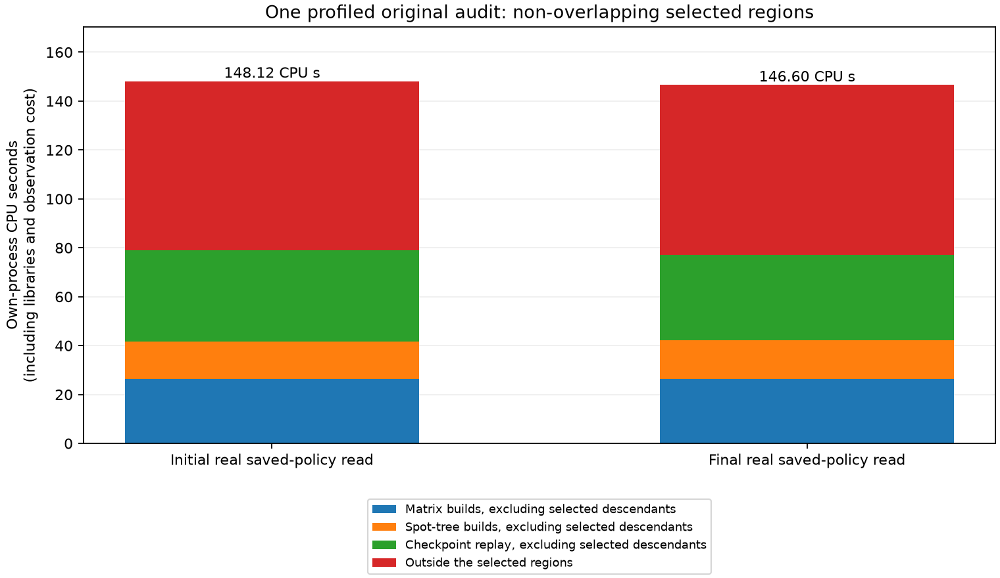

# Locate CPU work inside saved-policy validation

Registered November 14, 2026 in [issue #4](https://github.com/jimmy-sim/poker-ai/issues/4#issuecomment-6890391633),
before implementation or timing data. This follows the [original-context audit](original-audit-helpers.md)
from [PR #72](https://github.com/jimmy-sim/poker-ai/pull/72). Implementation and evidence
are in [PR #73](https://github.com/jimmy-sim/poker-ai/pull/73).

## Question and fixed scope

The current original audit spends about 141–158 seconds of own-process CPU in a
real saved-policy read, while child-helper counters stay below one second.
Which broad operations account for that process work?

The older [elapsed profile](compact-native-wall-profile.md) supplies three leads:
`MatrixTree.build` (184 historical calls), `SpotTree.build` (52), and
`learning_training.replay_snapshot` (1,296). Those are historical counts and
wait-inclusive frame times, not present CPU measurements or a required current
inventory. A previous global CPU-callback profiler exceeded its 900-second cap;
that failure remains retained. This instrument times only the selected coarse
boundaries and installs no cProfile or global per-function callback.

Run one ordered **control / profiled** pair through the unchanged original audit
child in `uncached` mode. Keep its tiny pre-read, shared recall-proof cache,
disabled-reuse card wrappers, nested original reader observers, complete initial
and final mathematical reads, native workers, source checks, own-publication
checks and scalar verification. Both arms preload the same target modules;
only the profiled arm adds selected wrappers during each reader call. This is
a controlled current context, not an exact reconstruction of historical machine
or process state, and one order cannot estimate pure observer overhead.

## Instrument and units

Record process CPU and wall clocks at selected entry/exit, category, read index,
parent, process/thread identity, full start/end events and failures. Preserve
class-method descriptors, subclass binding, original arguments/results and
primary exception identity. Replace known loaded module aliases, capture late
imports from the patched defining attribute, and restore original descriptors
and initial alias objects plus equivalent late aliases. This covers the named
attributes and module aliases, not arbitrary hidden closure or native references.

Only a serial main-thread call stack is supported. Reject reentrant capture,
changed threads/processes, incomplete events, invalid nesting or clock order,
and more than 4,096 selected calls over the three reads. Require all three
categories somewhere in the completed inventory. A complete empty selected-call
ledger for an individual read is valid; an incomplete ledger is never zero work.
Keep partial files and original exceptions on failures.

Inclusive CPU includes selected descendants. Derive **selected-exclusive CPU**
by subtracting immediate selected children, and compute the selected union from
root intervals. Outside-selected read CPU is the remaining inner-read CPU.
These are process/library CPU observed during regions, including observation
cost and any library threads, not instruction samples or pure function self CPU.
Selected-exclusive means exclusive of these three selected regions only.
Preserve floating residuals; a 1e-9 CPU-second roundoff allowance validates
subtraction, without changing any poker-score tolerance. Never sum overlapping
inclusive regions, worker CPU or CPU clocks into a wall-time partition.

## Source, limits and acceptance

[Config](../configs/coarse-reader-cpu.json) pins 37 inputs, selected categories,
original Python 3.11.17 / NumPy 2.4.6, locked extras and Darwin utilities.
The new private entry/config preserve all 402 prior source files and form a
404-file effective map, without changing the frozen all-src aggregate.
No algorithm, seed, accepted policy, original output, scientific cap or gate
changes. OpenSpiel 2.0.2 remains the pinned Apache-2.0 scalar-only reference;
its installed license and the existing read record stay bound by the original
adapter. Reference strategies never enter the agent.

Both complete children must fit **900 seconds** each and **1,800 seconds** shared,
including startup, source/qualification/input checks, all original work,
capture/extraction/writes and final validation; keep 120 seconds of operator
saving reserve. One attempt, fresh ignored destinations, no favorable retry,
smaller workload or cap extension. Retain and publish partial/failing outcomes.
The unchanged supervisor times each complete spawned command through reaping;
its own measurement-receipt write belongs to parent orchestration rather than
the child-command clock. Parent orchestration and final pair verification are
charged to the shared clock. Canonical copying/publication is administrative
preservation outside these clocks, retaining the original ignored outputs.
Diagnostic data remain rejected as base-family admission and cannot replace
the failed 933.89/900 forecast or the old CPU-profiler/card-cache failures.

Require exact original 432-profile, 1,152-condition, three-replay, worker and
card-counter identity against the historical original control and both halves;
all original resources; complete selected events and restoration; valid CPU/wall
nesting inside each read. The first 70 fixtures cover nested accounting,
clock/schema changes, aliases/descriptors/subclasses/late imports, primary
exceptions, unsupported coverage, caps, partial retention and data-only reports.

Full local bases and relevant optional suites on both supported versions, then
both same-source hosted jobs with actual runtimes/uv/head verified, precede
qualification publication and the one pair. Finish local implementation/review
and checks before the initial source push. Publish exact qualification and
operators before collection, then raw evidence before analysis. Keep one PR
through these required boundaries; routine progress edits its description.

## Interpretation and next decision

Report the complete or partial inventory, inclusive/selected-exclusive/union
CPU, outside-selected CPU, control/profiled read/body/worker clocks, exact
identity, raw provenance and limits. Do not select an optimizer from missing or
invalid coverage. A complete result supplies a measured region for a separately
specified optimization; it does not itself improve the agent or admit training.
The old child-CPU discrepancy remains unresolved.

The initial and final real reads replay the same saved own strategies around
independent reference work. They are repeated validation, not new training or
independent playing-strength samples. Differences in their timings describe
this execution; they do not show the strategy improving between reads.

Current authorization permits continued issue #4 work after this bounded step,
using each verified result to define the next question. It creates no future
automation, permits no C++/Rust core without approval, and changes no research
acceptance rule. Codex assistance and actual dates are recorded; personal hours,
mastery and independent human review are not inferred.

## Three questions

**Why use coarse boundaries?** They require far fewer callbacks than timing every
Python frame. The complete command cap still decides whether the instrument is
usable; the earlier global CPU-profiler failure remains a failure.

**Can inclusive CPU values be added?** Only after removing nested selected
children. Report the union of selected roots and the outside remainder, while
retaining the original inclusive values and their nesting.

**Does the largest region automatically name the remedy?** It identifies a lead.
An optimization still needs its own correctness, source, cost and acceptance
checks, and measured savings cannot silently replace the failed forecast.


## Published source qualification, November 14

Source8970bc556697d684b6482be82f431699a76128d7 preserves the prior402files and
binds404effective files, fingerprint
`00a339915681bbb109d04c9ee15a90d245a8bd6672b5d01b4081b17d44d3e8db`.
All [six roles](../results/coarse-reader-cpu/checks.json) pass: full local bases
3,951/64skipped/150deselected each; optional463each; both hosted jobs in
[CI43688723951](https://github.com/jimmy-sim/poker-ai/actions/runs/43688723951)
3,951/64/150 each plus the retained historical roundoff warning. Complete decoded
logs and actual Python/NumPy/uv/head evidence are retained. Python3.12.15 with
NumPy2.5.4 qualifies software only; the real archive remains3.11.17/2.4.6.

The exact [launch](../results/coarse-reader-cpu/checks/operator_launch.py.txt) and
[retention](../results/coarse-reader-cpu/checks/operator_retention.py.txt)
operators are published with this qualification before any collection. No pair
has run at this checkpoint. Complete/partial evidence will be copied exactly,
with original ignored files retained, and published before posthoc analysis.


## Recorded result — November 14, 2026

The single pair completes within both caps: control **426.7636394160072 s**,
profiled **444.64136350000626 s**, shared command plus final verification
**872.5313877080043 s**. Qualification was public atb1b3f98 before collection;
[raw evidence](../results/coarse-reader-cpu/raw-manifest.json) was published
at6e69bd2dcd2b0100bbfc26ba9c57afcd11c1bf07 before analysis. All31 pair files and
eight execution/retention files are exact copies; the original ignored files
remain. Exact source,432profiles,1,152conditions,three computed replays,three
native workers per half and original card counters all match the historical
original and both halves. Base-family admission remains rejected.

The recorder captures **1,532 complete calls**, with both events for every call,
no errors and all descriptors/aliases restored:

| Read | Matrix builds | Spot-tree builds | Checkpoint replays | Scope |
|---|---:|---:|---:|---|
| Tiny pre-read | 0 | 0 | 432 | Fictional signal-game software proof |
| Initial real read | 92 | 26 | 432 | Saved old own cost stand-ins |
| Final real read | 92 | 26 | 432 | Same saved old own cost stand-ins |

The aggregate184/52/1,296 inventory happens to equal the older elapsed-profile
inventory; acceptance did not require those historical counts. All actual calls
are selected roots, so their inclusive and selected-exclusive CPU agree here.
The nested-call arithmetic is separately covered by the software fixtures.
Exclusive-minus-union residuals are retained as0.0 for all three reads, without
clipping. The tiny pre-read is software evidence, not Hold'em training.

| Profiled process CPU region | Initial real read (s) | Final real read (s) | Share across these two reads |
|---|---:|---:|---:|
| Matrix builds | 26.362463 | 26.477565 | 17.93% |
| Spot-tree builds | 15.340401 | 15.628721 | 10.51% |
| Checkpoint replay | 37.274596 | 35.031290 | 24.53% |
| Outside selected regions | 69.139303 | 69.459967 | 47.03% |
| Complete inner read | 148.116763 | 146.597543 | 100% |



These bars split observed process/library CPU into non-overlapping selected
regions and the remainder. They include observation cost and are not instruction
samples or a wall-time partition. Both bars replay the same saved strategies;
they do not show learning progress. Full-precision values, including the tiny
read, appear in [readers.csv](../results/coarse-reader-cpu/report/readers.csv)
and [regions.csv](../results/coarse-reader-cpu/report/regions.csv).

The unprofiled outer real reads use139.572188/146.810289 own-process CPU seconds;
the profiled outer reads use148.117710/146.598549. In the original body boundary,
control records423.292054wall/291.725212own CPU seconds and profiled records
441.105408wall/300.500284own CPU seconds. Each of three concurrent reference
workers records about128.00wall seconds in control and136.27 in profiled.
Their individual CPU and child counters are in
[workers.csv](../results/coarse-reader-cpu/report/workers.csv); body and nearby
child boundaries are in[bodies.csv](../results/coarse-reader-cpu/report/bodies.csv).
Never add these overlapping scopes to explain whole-command wall time. One order
and changed worker timings do not identify pure wrapper overhead.

Real-read reaped-child user CPU remains0.237–0.256s and system CPU0.618–0.664s
across both halves. The historical21–22second child-user reading is still
unresolved; this CPU decomposition does not reclassify or invalidate it.

### Report checks and next decision

The [data-only renderer](../results/coarse-reader-cpu/report/render.py.txt)
blocks actual reader/child/supervisor, selected tree/snapshot operations, scoring,
learner and native construction. All five numeric exports match byte for byte
under actualPython3.12.15/NumPy2.5.4 in
[replay312.json](../results/coarse-reader-cpu/report/replay312.json). This is a
saved-data check, not fresh mathematical replay in a newer archive runtime.
The final figure was inspected; an initial clipped-label draft was corrected
without changing any numeric export. The
[render manifest](../results/coarse-reader-cpu/report/render-manifest.json)
binds the script, raw files, numeric exports and figure.

The selected regions explain52.97% of real-read process CPU. Checkpoint replay
is the largest selected category; **47.03% lies elsewhere**. A matrix-depth
check noticed during source review is only a hypothesis: these measurements
do not establish that loop's cost. Next, locate the remaining CPU with a small
number of broader context/replay boundaries before choosing an expensive
optimizer. Register that follow-up separately and preserve this source/data.
No new Hold'em learning, changed default, stronger-agent claim or rescue of the
failed933.89/900 forecast follows from this diagnostic.

To inspect the saved result without another audit:

```sh
.venv/bin/python scripts/profile_coarse_reader.py --show --output results/coarse-reader-cpu/pair
open results/coarse-reader-cpu/report/selected-cpu.png
```

To reproduce the data-only report in a fresh directory, pass this checkout and
the fresh destination to`results/coarse-reader-cpu/report/render.py.txt` using
the locked research environment. The original measurement is one retained
attempt, not a command to rerun for a more favorable cost.


Final local verification passes: relevant optional463tests on each version,
Ruff lint/format903files, strict mypy758source files, hooks, focused Markdown
paths/anchors/images/fences and the saved-data CLI. CLI output equals the report;
all39 raw/administrative copies remain exact. See
[local-verification.json](../results/coarse-reader-cpu/report/local-verification.json)
and the saved final logs. The full local bases at the qualified source passed
3,951tests each; final exact-head hosted checks still precede merge.
