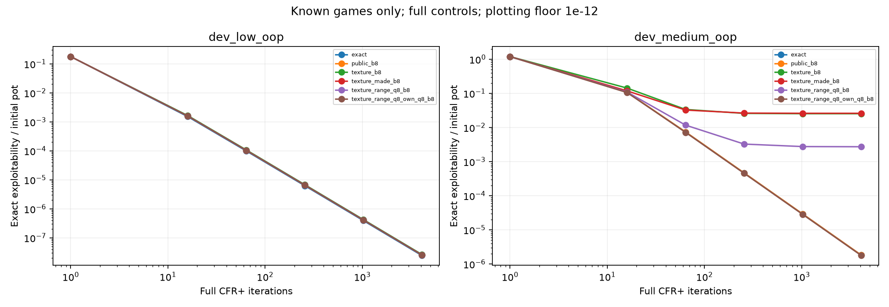
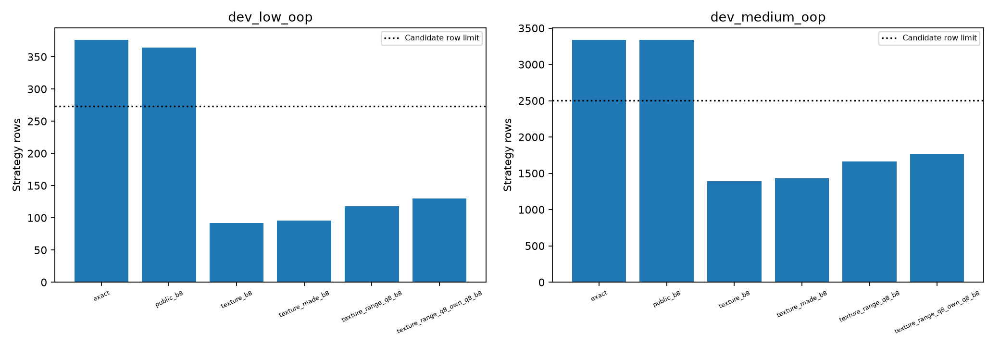

# Compact public-range full-control admission

## Prospective question and stopping point

Issue #4: does the ONE frozen `texture_range_q8_own_q8_b8` candidate preserve
near-exact full-tree play while using at most 75% of raw-public strategy rows?
The user authorized this admission milestone on November 11, 2026. Preserve
`configs/compact-public-range.json` byte for byte. All six controls, both pinned
spots, six checkpoints (1,16,64,256,1024,4096), 72 profiles, 12 layouts and all
original scalar gates/caps remain mandatory. No sampled training, default
replacement, fresh-game admission or superiority claim belongs to this step.

First publish this protocol, then implement and test the complete runner,
capture/archive/replay, native schema/failure paths and whole-command clocks.
Publish checked source before proof. Complete full local base checks and the
relevant optional tests on both supported interpreters, and both hosted jobs
bound to that source. Only then rehearse the SAME pipeline on tiny software
fixtures. Publish its own archive before constructing the comparison reference.
Next publish a checked conservative forecast/admission before ANY real new
Hold'em trajectory. Finish at a verified full-control result, or an honestly
retained blocking/failed admission with a concrete next decision. A software
foundation can be a separate bounded milestone when its gates need further work;
it must not be described as completed scientific admission.

## Artifact and failure contract

Use new modules and output paths; preserve historical source/data. Each profile
binds its game/context, representation, iteration, exact/abstract tree digest,
mapping, action menus, policy, cumulative regret and linear strategy-sum arrays,
and charged work `2 * iteration * tree_nodes`. Replay checks shape, finiteness,
legal actions, normalization, CFR+ nonnegative regrets/averages, normalized
average identity, partition expansion, work and recomputed own metrics. Record
uniform and deployed-own-reach coverage separately for all streets and river.
Whole and post-warm quantities are identical here: full CFR+ has no separate
sampled warm start. Do not describe initialized/fallback rows as learned.

Snapshots are immutable individual files with hashes, published in an ordered
manifest. Persist after every completed checkpoint; partial manifests and the
last unfinished write survive exceptions, interruption and hard timeout. A
partial result never supplies admission. An output destination is never reused.
The independent comparison checks value and BOTH best-response roots for every
saved profile, not just aggregated exploitability. Reject omitted/duplicate/
nonfinite/wrong-context/changed-source/native-own mismatch rows and fabricated
error fields. Native failure retains all completed comparisons and remains false.

Own/native caps remain 900/900 seconds, measured from before numerical imports
through child startup, prerequisites, context/JIT setup, all checkpoint work,
own-policy replay and final writes. A stdlib parent terminates the whole child
process group on cap/interrupt, retaining prior checkpoint files. Administrative
clock-receipt copying is identified separately and cannot turn an overrun into a
pass. Native includes rechecking the published own archive and reference setup.
Own and native evidence must have the same source fingerprint and exact runtime;
real studies require Python3.11.17/NumPy2.4.6. No native strategy is requested or
loaded into learning. Read/record installed OpenSpiel2.0.2 Apache-2.0 license.

## Software proof and fixed forecast

Tiny proof: two explicitly artificial Kuhn contexts (ordinary and negated
payoffs), six logical control labels, six checkpoints = 72 fixture policies.
Alternate identity and reversed row-number mappings, without changing legal
information. These are dependent software fixtures, not 12 poker treatments.
Use the same full runner, snapshot/replay and OpenSpiel EFG scalar adapter as the
real pipeline. Each own/native command has a fixed 180-second cap. Verify all
72 values and both BR roots to 1e-9 chips; do not apply poker accuracy/compression
gates to these duplicate fixtures or inherit the previous 144-policy proof.

Forecast uses NO new training prefix. Three fixed repetitions build/inspect all
12 real layouts, score uniform policies, round-trip archives and replay their
metrics. Charge all measured work and record process high-water RSS explicitly
as cumulative, not isolated per-layout RAM. Pin/replay the prior five-control
full admission and independent audit as historical timing evidence. Let H be its
complete historical own seconds, A its native seconds, S the maximum of the
three current no-training setup/replay command seconds, and T/N the complete
current tiny own/native command seconds. Fixed bounds:

`own_forecast = 4 * (1.2*H + S + T)`;
`native_forecast = 4 * (1.2*A + S + N)`.

The 1.2 factor is 72/60 profiles; factor4 is a prospective engineering safety
margin, not a statistical confidence bound. Both must fit 900 seconds, otherwise
deny admission without adjusting factors/caps or running a trajectory. Historical
timings alone cannot admit the study. Require source-bound checks, own/native
tiny proof, all three structural repetitions, input/runtime binding, and checked
published forecast/admission. Revalidate immediately before real training.

## Reporting limits

Publish own evidence (including a complete accuracy failure) before native
comparison, then audit/report all controls/checkpoints. Show exact exploitability
curves and row/key/table costs; retain signed differences from every control.
Only authenticated complete own/native artifacts may wrap the frozen pure
metric assessor into an actual full-control decision. Even a pass is known-game
full-training evidence, not sampled, general or deployable playing strength.
Codex implementation/execution is AI assistance; human time remains unrecorded.

## Source gate: retained architecture failure

Initial source1a9bb4a fails the unchanged reference-free postflop package test in
both complete base environments: 2,989 passed,60 skipped,149 deselected and one
failure (533.09/516.60s). Both optional suites passed278, which did not suffice.
No compact study, measured tiny proof or cost forecast started. The correction
moves native dispatch into evaluation and extracts pure scalar-receipt checks
into postflop. The own package imports no reference implementation. The original
guard remains unchanged and now passes in the focused279-test suite (32.24s);
strict typing641 files and lint/format pass. Complete corrected source checks
remain required. The [rejected cohort](../results/compact-full-control/failed-source-1a9bb4a/README.md)
retains actual failures; it cannot supply admission.

## Corrected source publication gate — November 12

Source02234c7 (fingerprint9db8dab585b2533be8ed109377e73b4314dcac963b2d45fb8686c87db157d490)
passes both immutable complete local bases:2,990passed/60skipped/149deselected,
551.59s on3.11.17/NumPy2.4.6 and532.46s on3.12.15/NumPy2.5.4. Lint/format/
mypy641/hooks and before/after clean HEAD/runtime/module/source guards pass.
Relevant ALL-EXTRAS suites both279pass37.58/35.98s, not every optional historical
test. Both hosted source jobs43179157842 pass:2,990/60/149/one historical warning,
1019.59/976.81s. Exact [six-role check receipts](../results/compact-full-control/checks.json),
logs and launcher are retained with their original raw timestamp whitespace.
The rejected hosted attempt is311failure/312canceled when corrected source
superseded it; separate final metadata preserves that distinction. These checks
permit the tiny software rehearsal only. No measured proof or real compact
scientific training has run at this publication checkpoint.

## Full-control outcome — November 12

**PASS on both known turn games.** The [authenticated result](../results/compact-full-control/result.json)
passes all11 checks: complete72-profile/12-layout inventories, source/context/work
binding, zero recall violations, compatible menus, accuracy, compression,
coverage, independent numeric agreement and both complete clocks.
[All controls/checkpoints](../results/compact-full-control/report/all-checkpoints.csv),
[layout/key/table costs](../results/compact-full-control/report/layouts.csv),
[signed differences from every baseline](../results/compact-full-control/report/signed-differences.csv)
and [the final table](../results/compact-full-control/report/tables.md) are retained.

| Game | Exact final exploitability (% initial pot) | Candidate (% pot) | Candidate/raw-public rows |
|---|---:|---:|---:|
| dev_low_oop |0.0000024545131|0.0000025771334|130/364 =35.7143%|
| dev_medium_oop |0.00018228985|0.00017718449|1770/3336 =53.0576%|

Allsix final controls have1.0 uniform-reach average coverage; whole=post-warm,
with no separate warm stage. Both exact-game node inventories2999/21303 are below
200k. Work at each checkpoint is2*iteration*nodes. The candidate's earlier parent
uses118/1662 rows; its medium final exploitability is0.27164015%pot. More detail
adds rows relative to that parent while remaining below75% of raw-public rows.

Publish permit5483c42 before real own training; publish ALL own evidencebb73102
before constructing the real comparison reference. Original3.11.17/NumPy2.4.6/
Numba0.68.1, unchanged model/ranges/actions/caps/checkpoints. Complete own command
50.698962332999145s (forecast94.0795, cap900); zero-change replay72. Complete
OpenSpiel audit25.00606195799992s (forecast68.0505, cap900);72 values and BOTH-BR
roots agree, maximum1.3500311979441904e-13chips against1e-9 tolerance. Reference
outputs remain scalar/comparison-only. Report authentication/plots command45.7460s,
including a temporary Matplotlib font-cache build. Both plots were visually checked.

### Costs and limits

Candidate key UTF8bytes150986/1985885 exceed raw-public125226/1079292. Dense
regret+average table bytes91520/1246080 are below256256/2348544. Keys are serialized
labels, not Python object RAM; dense tables include padding. Own process-lifetime
high-water RSS394985472bytes includes all treatments/setup/replay and cannot be
attributed to one representation. Do not claim whole-memory savings.

This is full-tree self-play in two previously diagnosed known turn games, with
fixed narrow ranges/actions and deterministic training. Checkpoints are dependent;
72 profiles are not72 independent playing-strength observations. The EFG reference
checks own exported game's arithmetic, not independently implemented mechanics.
The tiny proof/cost setup, seed-free full controls and measured learned policies
are distinct artifacts. No sampled training, held-out/fresh/global admission,
strict superiority inference or default-agent replacement follows. The earlier
sampled failures remain. Next decision: separately implement/admit the frozen
fixed-work sampled comparison, including all324 readouts and audits; do not start
it in this milestone.

Final source/artifact publication CI must pass before history-preserving merge;
[PR #55](https://github.com/jimmy-sim/poker-ai/pull/55) records its conclusions.

### Reproduce and inspect

Use the source revision recorded in the own archive, Python3.11.17/NumPy2.4.6 and
locked extras. The committed prospective protocol and CLI operation names define
the ordered reproduction: checked source; software-own; publish; software-native;
three layout repetitions; publish; forecast; publish; admit; publish; own; publish;
native; report. Preserve every complete/partial output and required publication
boundary. A rerun needs fresh destinations; proof/admission inputs use the fixed
folder named in the protocol. No reference policy may enter the learner.

For read-only local replay, the journal gives a fresh-output command. Open the two
plots or read report/tables.md for the complete final comparison. Replay verifies
all72 raw policies/weights/context/work and metrics; it does not retrain them.

Three interview questions:

1. **Why not count72 independent samples?** Six representations and repeated
   checkpoints share only two known games, and full training is deterministic.
   This tests a specified mechanism, not a population win-rate estimate.
2. **Why can fewer rows still use more memory?** The full key strings grow and
   have Python overhead. We measured their UTF8size and the actual dense table
   arrays separately; process peak RSS cannot isolate a treatment.
3. **What did OpenSpiel verify?** Value and both best-response roots of every
   saved own policy on the exported own game. It supplied no training strategy
   and does not independently validate the engine or general playing strength.

A verified claim draft, with assistance disclosed: "With Codex assistance, built
and audited72 full-CFR+ policy checkpoints on two fixed Hold'em turn games; a
public blocker-aware representation passed the preset near-exact accuracy gate
using35.7%/53.1% of raw-public strategy rows." This is not a general Hold'em
strength, sampled-efficiency or whole-memory claim. Human hands-on time is unknown.
