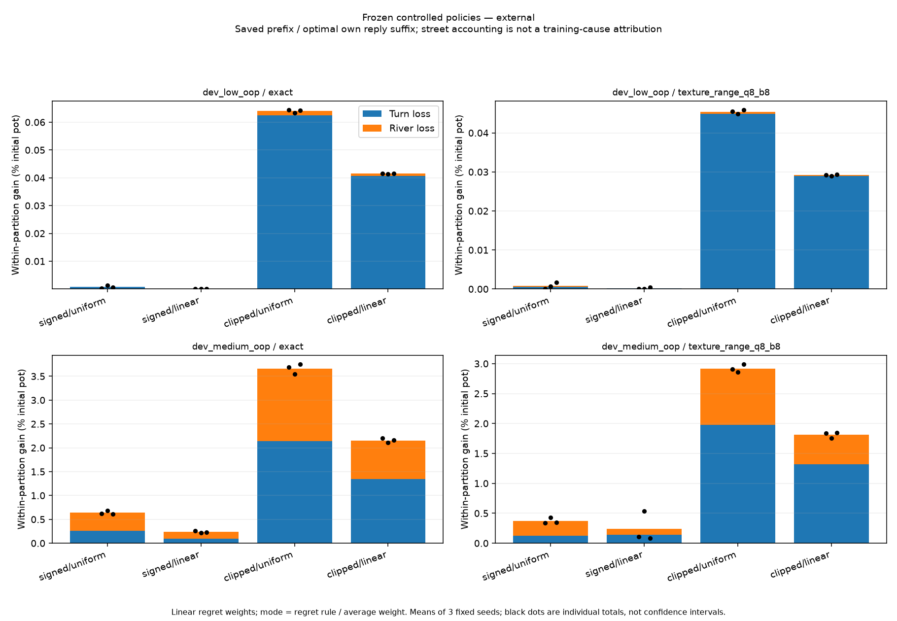
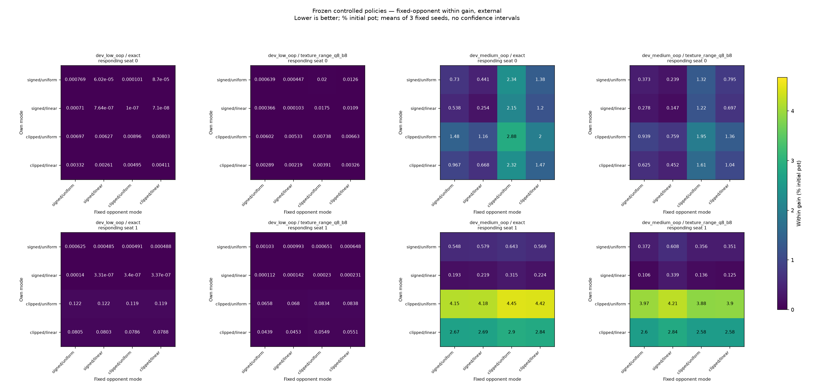

# Explain the clipping/averaging tradeoff with saved policies

Issue [#4](https://github.com/jimmy-sim/poker-ai/issues/4), November 8, 2026.
Depends on the completed original comparison in PR #28. Codex-assisted; personal
hands-on time not recorded. This document fixes selection and tests before new
diagnostic outcomes. It selects no strongest recipe and runs no new Hold'em training.

## Question, complete selection and units

The previously failing medium range-mass game motivates this follow-up. Changing
clipping under linear regret weights lowered total exploitability with linear
strategy averaging, while raising it with uniform averaging. Extra-information
value fell but within-partition response gain could rise. Diagnose that tradeoff
before changing the agent. All source policies were already independently audited.

Fix the original 10m work label and linear regret weights, matching the motivating
old sampled baseline. Keep signed/clipped regrets × uniform/linear averages, both
original games × exact/range-mass representations × full once/external all three
fixed seeds. This is **64 saved policies**, not newly trained agents. Select every
identity in this grid; do not select by metric, rank, seed or current strength.
Inputs include the entire immutable own archive and native receipt by SHA-256.
Game values are player-zero chips; responder values and gains use the target's
sign (+ for seat 0, - for seat 1). Display pot-normalized scores separately.

## Part 1: trace the within-partition gain

For each source profile and both seats (128 traces), compute an own best response
inside the same information partition. Keep the opponent fixed at that saved
profile. Use the checked `trace_losses`: saved full prefix reach multiplied by
local deviation with optimal own reply continuation. Aggregate hidden histories
within an information group before maximizing; retain every owned row, including
zero-support/zero-loss rows. Pure ties choose the first legal maximizer, no epsilon
substitution. Store own reply fingerprints, root values, row losses, saved reach,
counterfactual support and legal conditional action values in a compact streamed
archive with schema/menus/source bindings. No reference strategy is stored.

Require additive rows = unilateral response gain, and half-sum over both seats =
the source's within-partition metric, all at 1e-9 chips. Sum by turn and river only
when street is publicly constant inside each group. These are fixed-profile loss
accounting numbers; they are not a retraining intervention or unique attribution
of cause to one street or feature. An unmerged turn row can depend on future reply
choices. Never add these restricted response losses to exact response losses as
if they were disjoint. No action-conditioned beliefs are newly trained.

## Part 2: hold the opponent fixed

Within each game/encoding/traversal/seed group, cross every ordered pair of the
four modes: player 0 uses A, player 1 uses B. This yields **256 crossed profiles**
and **512 target conditions**. For each target, report baseline target EV, own
within-partition BR root, achieved own reply EV, and unilateral gain. Rows label
which mode belongs to the responding agent and which to its opponent. Retain all
opponents, both seats and all seeds. Do not assume the matrix is antisymmetric:
position, ranges and stacks can make the fixed game asymmetric. Each profile is
zero-sum, with target signs explicit.

The BR root depends on the fixed opponent, not on the responding agent's original
probabilities. Verify that root is constant across own modes for each opponent
and target, and that a difference in unilateral gains equals the negative target
EV difference. These identities distinguish changed opponent behavior from own
policy EV changes; they do not establish globally stronger play. Diagonal crossed
profiles must match the audited source values and within gains. Reuse source own
reply profiles where appropriate, but independently re-evaluate them and verify
hashes. New crossed EVs/roots/achieved own replies require native comparison too.

## Software tests, measurement and reporting gates

Before measuring: publish this config, then implementation with meaningful tests,
complete relevant base/optional local checks and both code CI jobs. Tests cover
selection/pins, compact trace loader, hidden-information aggregation, seat signs,
row/street/root accounting, all crossed identities, deliberate partial/altered
inputs and an asymmetric hand-computed toy game. A separate toy regression checks
that changing only average time weights leaves regrets, current policies, RNG,
visits and sampled keys unchanged. It formalizes an updater property; it is not
new postflop learning or a claim of cross-runtime bit equality for the whole agent.

Own and native stages each have a separate **900s hard cap**, including their
input checks and IO; retain partial outcomes on failure, no silent budget reset.
Publish complete own results before native comparison for the recorded study.
Fresh one-command reproduction may keep immutable own outputs in ignored staging
between stages; clean source and hash bindings still apply. This execution-only
clarification precedes all new diagnosis outcomes and changes no selections,
seeds, metrics, limits or validation gates. OpenSpiel 2.0.2 uses the
previously read Apache-2.0 license; recheck installed bytes/version. Native results
are scalar comparisons only; reference training and strategy export are forbidden.
Every target/row/profile must pass fixed 1e-9 chip accounting/comparison, with
unitless support reductions checked at 1e-12. Both stages require clean published
source, fixed source/archive hashes, environment and actual CPU/wall receipts.

Done means complete own/native receipts, source-bound replay, all raw rows and
crossed conditions, two street-contribution figures and two fixed-opponent gain
heatmaps, methodology/limitations, three interview Q&As, journal/work log, checked
CLI and green final CI. Sampled figures show arithmetic means and raw seed points
where applicable, without confidence intervals. The inspector defaults to the
motivating clipped/linear-average first-seed medium range-mass case, but can show
any retained source row. It labels merged-row Q values and illustrative own-card /
board examples clearly. It does not read hidden opponent cards to choose actions,
run a live client, train an agent, or present universal poker advice.

The original comparison's code and receipts stay frozen. Fresh reproduction of
that earlier study belongs at its recorded revision; later read-only modules do
not silently extend its learning admission. No new representation, seed, budget
or accuracy gate is chosen in this follow-up.

Fresh fixed-source reproduction uses `make diagnose-controlled-replies` after the
checked implementation is published. It produces new ignored outputs, retains
existing/partial files, and runs no new postflop training. Use
`CONTROLLED_REPLY_DIR=results/runs/another-name` for a distinct rerun. Read-only
review uses `.venv/bin/python scripts/report_controlled_replies.py --no-plots`.
The terminal inspector is `.venv/bin/python scripts/inspect_controlled_reply.py`;
its rank includes every owned row, not only positive losses. It states whether
the corresponding crossed-profile native receipt is present and verified.

## Recorded outcome

Both code CI jobs [42531469249](https://github.com/jimmy-sim/poker-ai/actions/runs/42531469249)
pass on clean `4f34289` before measurement. The
[own receipt](../results/controlled-replies/own.json) completes every 64 source
profile / 128 trace / 256 crossed profile / 512 target condition in **19.920551s**,
below 900s. Parent/reaped-child CPU: 10.704774/9.16s. Its 3,065,110-byte archive
retains **87,872 owned decision rows**, including zero-support/loss rows; maximum
row/street/root accounting discrepancy is **2.260818e-13 chips**. Own outputs are
published as `53d4fe9` before any new native comparison. The compressed archive's
SHA-256 is `840dc20aa50a2933f85d60388f5e88a46f9ac340d9e1213b59e7810287ec0373`.

The [native receipt](../results/controlled-replies/native.json) verifies every
crossed EV, both within-partition roots and both achieved OWN replies. Maximum
discrepancy is **2.415845e-13 chips**, below 1e-9; wall **17.525516s**, below 900s.
This includes all-own-row replay with zero error (8.868434s). Parent/reaped-child
CPU: 17.475461/0.03s. Installed OpenSpiel 2.0.2 license bytes match the pinned
Apache-2.0 record. No native strategy is exported, trained, or loaded into an
agent. Separate base Python 3.12 / NumPy 2.5.4 audited replay also has zero error
(8.795223s), and all four numerical report files regenerate byte-identically.
Report reproduction does not reproduce CPU/wall time or PNG bytes.

See [all street means](../results/controlled-replies/report/tables.md),
[every source/seat](../results/controlled-replies/report/self-targets.csv), and
[all crossed targets](../results/controlled-replies/report/crossed-targets.csv).
All four actual figures were visually inspected. Standard CSV CRLF is preserved
from the frozen writer; diff validation uses `core.whitespace=cr-at-eol`.

### Where the within gain appears

For the motivating medium range-mass game, sampled arithmetic means over the
three declared seeds, units **percent initial pot, half-summed over seats**:

| Regret / average | Within gain | Turn loss | River loss |
|---|---:|---:|---:|
| signed / uniform | 0.372605 | 0.126476 | 0.246128 |
| signed / linear | 0.243207 | 0.141330 | 0.101878 |
| clipped / uniform | 2.918434 | 1.975778 | 0.942656 |
| clipped / linear | 1.811454 | 1.315782 | 0.495672 |

Turn rows account for 72.64% of clipped/linear within gain under this saved-prefix,
optimal-own-suffix decomposition. This does **not** contradict the earlier
river-policy result: that measured changes in extra exact-information value under
street policy substitutions. Here the quantity, continuation and decomposition
differ. Neither calculation identifies the causal training mechanism.

### The increase persists with opponents fixed

Keep linear own average weights, compare signed versus clipped own policies, and
hold each opponent column fixed. The following are **unilateral** within gains in
percent initial pot, three-seed arithmetic means, for the same medium candidate.
They are not the half-summed self-profile metric above. A higher gain means more
room to improve against this fixed opponent, inside the same information groups.

| Responding seat | Fixed opponent regret / average | Signed own | Clipped own | Difference (points) |
|---|---|---:|---:|---:|
| 0 | signed / uniform | 0.278165 | 0.624549 | +0.346384 |
| 0 | signed / linear | 0.146973 | 0.451940 | +0.304967 |
| 0 | clipped / uniform | 1.215299 | 1.613857 | +0.398558 |
| 0 | clipped / linear | 0.697162 | 1.040039 | +0.342878 |
| 1 | signed / uniform | 0.106353 | 2.597033 | +2.490680 |
| 1 | signed / linear | 0.339442 | 2.835582 | +2.496141 |
| 1 | clipped / uniform | 0.135931 | 2.582107 | +2.446176 |
| 1 | clipped / linear | 0.124639 | 2.582869 | +2.458230 |

Thus changed opponent behavior alone cannot explain this within-gain increase.
It is especially large for seat 1. It also appears with exact own/public
information: seat-1 increases are 2.473964–2.617986 points across the same four
fixed opponent modes. Information compression is not necessary for this observed
within-game weakness. This does not rule out its separate extra-information cost.
Every other game, encoding, traversal, mode, target and seed remains in the raw
report; the motivated example is not a selected new winner or population claim.

Within a heatmap, moving down keeps the opponent fixed and changes our mode.
Moving across changes the opponent. Seat panels share a figure scale, but full
and sampled figures have separate color limits; compare numbers, not colors
across figures. All raw seeds are in the CSV; three runs are not confidence bounds.

## Interpretation, checks and next decision

- **Changed opponent alone:** Insufficient for the focal increase; it persists
  in every fixed-opponent mean comparison above. Own EV is lower by exactly the
  unilateral gain increase when the opponent is fixed, up to the chip tolerance.
- **Information grouping alone:** Insufficient; exact-information training also
  has a large clipped seat-1 within weakness. This is a local finding, not proof
  that compression never matters or that the global agent is sound.
- **Average weights change the raw learning path:** The separate 16 toy regression
  cases keep regrets/current policy/RNG/work/keys identical. Average weights change
  the stored average, which can score differently. The tests do not measure the
  current policies or averaging history of every poker trajectory.
- **Street localization or unique training cause:** Not established. Row losses
  use future own replies, and sampling, clipping and finite-time policy movement
  remain possible contributors. Numerical agreement does not establish convergence.

Full local base checks pass 1246 tests with 24 optional skips on both Python
versions; optional suites pass 1279 each. Four slow old-policy/render checks and
the final 90 focused checks pass on both versions; clean strict typing covers
310 source files. Existing training/reference separation is preserved by placing
this read-only diagnosis in evaluation. The default inspector succeeds in base
installs for both seats with the archived native audit verified; its examples
show only own cards and the public board. Shared-row conditional values average
compatible histories and use an optimal own reply suffix, not a universal action
recommendation for the illustrative cards.

Next, prospectively compare current policies and different time portions of the
average along checked, reproducible trajectories. This can test whether the
stored average retains weak earlier play or whether the current policies remain
weak too. It requires a separate protocol, correctness/prefix tests and compute
gate before new learning. No remedy, default, fresh-game or global admission is
granted here; the earlier sampled performance failure remains.

The experiment uses two already-known, tiny-range games, limited actions and the
original seeds. The reference independently checks value/BR arithmetic on the
exported own game; the two implementations still share our poker mechanics and
information definition. These numbers establish neither broad Hold'em strength,
global exploitability, nor real-world win rate. Human hands-on time is not recorded.

## Three interview questions

1. **Why cross strategies instead of comparing only trained pairs?** Both players
   change in a trained-pair comparison. Holding the opponent fixed makes the BR
   root constant; differences in remaining improvement then equal negative own
   EV differences. All ordered pairs and both asymmetric seats are required.
2. **Does the turn bar prove that turn training is the bug?** No. It is additive
   fixed-profile accounting with a best-reply suffix. A turn loss can depend on
   future decisions. The earlier river substitution examined another quantity.
3. **What does the independent solver check prove?** Every crossed EV, root and
   achieved own reply agrees within 1e-9 chips (max 2.42e-13). It checks these
   exported games and strategies, not convergence, global strength or all engine
   rules. The reference supplied no training strategy or targets.
