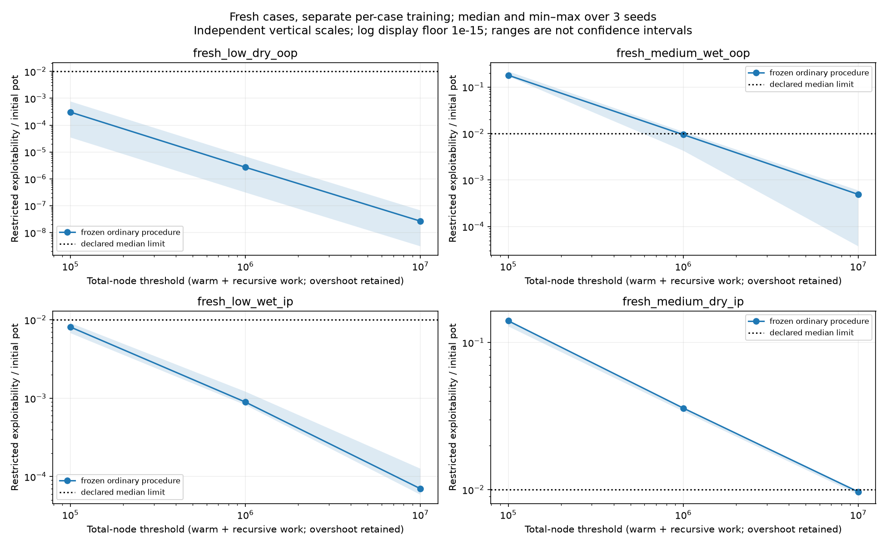

# Issue #3: fresh small-game validation

## Acceptance before outcomes — November 5

The four earlier games are development data. Issue #2 found mixed benefit from
river integration, so the ordinary external sampler remains the selected
procedure. This choice is frozen before generating or training the new games.

This block will publish the selection procedure, fully specified fresh inputs,
source/input freeze and checked development gate before collecting fresh results.
Only after that gate passes may the fixed-work run start. Stop after a complete
audited report, or at a retained numerical/budget failure; do not tune on the new
games. No global training or abstraction work belongs to this block.

Definition of done:

1. Publish `configs/fresh-validation.json` before generating fresh game inputs.
2. Deterministically select four cases by texture/position constraints, not
   strategy scores. Publish exact boards, ranges/weights, actions, pot/stacks,
   seeds and source/input hashes before training. No replacing difficult cases.
3. Validate a receipt tied to the archived development report, frozen own
   strategies, native audit and unchanged learning implementation. Require all
   selected development seeds and unchanged final limits before unblinding.
4. Train each fresh game independently at the same total-node thresholds and
   retain every seed/checkpoint, work overshoot, initialization cost and coverage.
5. Independently audit every frozen own policy, render tables/plots, retain all
   failed gates, pass applicable software checks and hosted CI, and update the
   learning journal and work log.

## Fixed procedure

Exact cards; ordinary external sampling; linear regret/average weighting; one
exact initial expectation; three new seeds; 100k/1m/10m work thresholds. Charge
initialization as 2*N node equivalents and all later recursive visits, including
terminals. Finish complete iterations and retain overshoot. Own fused-Numba CFR+
controls run at 256 and 4096 iterations. Full controls are diagnostics at their
recorded work, not matched-iteration sampled controls.

The previous limits remain: full final exploitability <=0.001 pots; sampled
three-seed median <=0.01 and worst <=0.025; positive-average-row coverage >=95%;
native value/BR error <=1e-9 chips. Subsequent sampling coverage and initial-only
rows are reported separately. A positive average row can come from initialization.
All four fresh cases must satisfy their final limits for the procedure gate.

The study has a two-hour total own-study cap and a 200k-node tree cap. A cap or
numerical failure retains partial evidence and stops. A performance miss does not
stop collection of the other predeclared cases. Do not add iterations or seeds to
turn a miss into a pass. Native audit/report time is recorded separately.

## Case selection and freshness

The config defines four strata: low/dry/OOP, medium/wet/OOP, low/wet/IP and
medium/dry/IP. They reuse known legal public betting prefixes and action menus;
the new inputs are the cards and weighted ranges. For the low-IP root, append a
legal turn check to the low-OOP prefix so the button acts next. Positions are
relative to postflop betting order, and the existing pot/stacks are preserved.

One explicit PCG64 stream selects ordered boards by the published structural
rules, rejecting known/duplicate rank signatures. Dry/wet labels describe the
flop part of the turn board. Aces are high for these selection predicates; the
predicates are not a general poker-texture classifier. Eight distinct remaining
cards give two physical combinations per seat, with integer weights 1..3.
This deliberately tiny design has no overlapping cards across listed combos;
it is not a realistic or representative full range.

Board/legality/novelty checks are allowed before training. Solver values,
exploitability, learning curves or strategically favorable cards are not selection
criteria. The inputs are public once committed; "fresh" means their outcomes
have not been used to choose/tune the procedure, not that input files are secret.
The new seeds also differ from the recorded development training/panel seeds.

## Interpretation

This tests a frozen training procedure on new small games, with separate training
for each game. It does not test one trained policy on unseen boards. Reusing
public betting templates and four structural strata limits novelty. Three seeds
give descriptive ranges, not a confidence guarantee about all games. Even a pass
does not establish competitive global Hold'em strength. The older failed hold-out
experiment stays failed in its own record.

The completed outcome below is separate from the prospective rules and
pre-training admission record.

## Reproduction and admission

The selection program imports no reference solver and calls no game-tree builder
or strategy evaluator while selecting cases. Its structural tests use a separate
test seed. Once the actual cases/freeze are published, the generator refuses to
replace them. Admission requires the freeze bytes to match Git HEAD, every source
and input hash to match that freeze, and the relevant learner dependencies to
match the accepted development implementation. It also replays all 16 final
ordinary/control development policies against their recorded metrics, after
checking the linked native audit and complete seed grid. This is a read-only
gate; development/reference policies are never supplied to the new learners.

```sh
make fresh-admission       # Verify the published freeze and known evidence only
make validate-fresh-games  # Full admitted own training, native audit, then report
make report-fresh-games    # Replay the reviewed fresh policies/audit; no training
```

Full reproduction writes under ignored `results/runs/fresh-validation-reproduction/`
and refuses to overwrite an existing report. Choose another retained directory
with `FRESH_OUTPUT=results/runs/fresh-reproduction-2`. A complete failed performance
gate returns nonzero only after all cells and the report are retained. Budget or
numerical failures stop and retain partial evidence. Large resumable own
checkpoints stay under the selected run's `runs/study/`; raw rows include their
hash receipts. Small frozen policy exports suffice to replay published metrics.

Initial cohort publication uses `scripts/prepare_fresh_validation.py` once,
then commits/publishes the generated configs and freeze before `--gate-only` or
training. The generator is not part of ordinary reproduction; cases are already
fixed in the repository. A later software change that invalidates source hashes
needs an explicit versioned protocol decision, not silent resealing.
Use a checkout of the recorded study revision for historical reproduction if
later source changes invalidate this freeze; preserve the original manifest.

## Cohort fixed before outcomes

Selection source `1fbc9c8`; PCG64 seed 20261224. The accepted structural attempt counts are 20, 4, 8 and 15; no strategy scores were computed during selection.

| Case | Board | Seat 0 combos (weight) | Seat 1 combos (weight) | Pot | Remaining stacks | Actor |
| --- | --- | --- | --- | ---: | --- | ---: |
| [fresh_low_dry_oop](../configs/fresh-spots/fresh_low_dry_oop.json) | 8d 4h Js 9h | Qc Qs (1); 6d 9s (3) | 7c 7d (3); 8c 3h (3) | 324 | [38, 38] | 0 |
| [fresh_medium_wet_oop](../configs/fresh-spots/fresh_medium_wet_oop.json) | 4h 2s 3s 7s | 2c 4s (1); 4d 9h (1) | 8c Qs (3); Kc 3d (2) | 36 | [182, 182] | 0 |
| [fresh_low_wet_ip](../configs/fresh-spots/fresh_low_wet_ip.json) | 8h 7d Jh Ts | As Ah (3); 2c 3d (2) | Kd 8d (3); 7s 2h (1) | 324 | [38, 38] | 1 |
| [fresh_medium_dry_ip](../configs/fresh-spots/fresh_medium_dry_ip.json) | Jh 8d 2c 3s | 6s 7c (2); 6d 2d (3) | Js Qc (1); Ks 5s (1) | 108 | [146, 146] | 1 |

The exact prefixes, actions and card-removal convention are in the linked configs. [The freeze](../configs/fresh-validation-freeze.json) binds all source/entrypoint/lock, protocol, known-game, development-evidence and selected-game hashes. Both low cases have SPR 38/324; the medium-OOP case has 182/36, and medium-IP 146/108. These are structural strata, not a causal test of position alone.

At this cohort publication no fresh strategy has been trained or evaluated. Admission follows after this freeze is committed and published.

## Development admission before fresh training

The published cohort/source freeze is in `1a86d28`, following code `1fbc9c8` and
protocol `25e85cc`. The real admission check passed before any fresh learning:
all 16 final ordinary/full-control development policies replay with zero own
metric discrepancy, all selected development cases pass the unchanged limits,
the linked complete native audit is valid, and source/input hashes match.
The [admission receipt](../results/fresh-validation/admission.json) binds this
decision to the exact config, freeze and source fingerprint.

The [cohort hosted CI](https://github.com/jimmy-sim/poker-ai/actions/runs/42083487841)
passed Python 3.11/3.12. Local Python 3.11 full checks passed 620 tests plus
lint/format/strict typing/hooks. This receipt is an admission to run the predeclared
study, not a fresh performance result. No reference strategy is supplied to the
ordinary learner.

## Observed results — November 5

The admitted study completed from **clean `9442bca`** in **499.560 seconds**,
including the repeated development admission, setup, own controls, training and
checkpoint/metric work. All **36 sampled snapshots and 8 own full-CFR+ controls**
were retained; there were no missing cases, replacements, cap failures, extra
seeds or outcome-dependent iteration extensions. Complete raw evidence was
published in `6e4d3d5` before native audit. Every source/input hash still matches
the published freeze.

The independent audit took **2.450 seconds** and passed **all 44 frozen policies**.
Maximum absolute native value/exploitability error was **8.53e-14 chips**, within
the unchanged **1e-9-chip** tolerance. Own-policy metric replay error was zero.
All 36 local checkpoint/core-visit receipts and their work counters were checked.
OpenSpiel 2.0.2 (Apache-2.0, [license previously read/recorded](solver_validation.md#solvers-versions-and-licenses))
provides native value and best response only; its strategy never enters training.
The export/mechanics are our own, so this checks arithmetic and information-set
alignment rather than independently proving the entire engine.

The recorded environment is Python 3.11.17, NumPy 2.4.6 and Numba 0.68.1 on macOS
arm64. The sandboxed CPU query was unavailable; a separate
[post-run hardware observation](../results/fresh-validation/hardware.json)
records Apple M4/10 logical CPUs without rewriting original provenance. These
are local wall times, not controlled cross-machine speed measurements or personal
hands-on time.

At the final **10 million node-work threshold**, exploitability is NashConv/2
in net chips per hand, divided by the initial pot. Lower is better. All values
below are **pot fractions**, so 0.01 means 1% of the pot.

| Fresh case | Full final epsilon/pot | Sampled median | Sampled worst | Passed |
| --- | ---: | ---: | ---: | --- |
| low dry OOP | 1.52403e-8 | 2.66788e-8 | 6.73091e-8 | Yes |
| medium wet OOP | 6.98912e-7 | 0.000489874 | 0.000597768 | Yes |
| low wet IP | 3.75631e-8 | 0.0000702137 | 0.000126404 | Yes |
| medium dry IP | 0.0000416776 | 0.00966995 | 0.00984460 | Yes |

**The fresh procedure gate passes 4/4 cases.** The tightest case is medium dry IP:
median **0.9670%** versus the preset **1%** limit, and worst **0.9845%** versus
**2.5%**. That small median margin remains explicit. Full controls pass 0.001-pot
accuracy; positive-average-row coverage is effectively 100% in every final case.
Earlier lower-budget errors remain in the complete tables and curves.



The [time plot](../results/fresh-validation/report/learning-time.png) uses observed
cumulative run times, including preceding checkpoint overhead. Work includes
initialization and terminal visits; actual counts/overshoot are retained in each
row. Min–max bands span three fixed seeds, not confidence intervals. Vertical
scales vary by panel, with a declared display floor for log plotting only.

Coverage needs a separate reading. Medium wet OOP retains **1,545 initial-only
rows** in the least-explored final seed. Its minimum subsequent uniform-reach
coverage is **94.6657%**, while initialized positive-average-row coverage passes
the original 95% criterion. We preserve both instead of tightening or changing the
criterion after outcomes. Tiny floating roundoff can put a raw reach ratio a few
ulps above one; it does not represent more than 100% of decisions.

The supported claim is limited: the frozen ordinary procedure met its declared
accuracy/average-coverage limits on these four structurally selected games, each
with separate training. It does not measure a global-agent upgrade, zero-shot
play, full-range robustness or a win rate. Reused public templates, artificial
non-overlapping two-combo ranges, four strata and three seeds limit inference.
The earlier failed hold-out experiment remains failed in its original record.
These four cases are now known evidence; future tuning needs fresh validation.

Evidence: [raw study](../results/fresh-validation/study.json),
[frozen own policies](../results/fresh-validation/study-own-policies.json.gz),
[native audit](../results/fresh-validation/independent.json),
[complete tables/CSV](../results/fresh-validation/report/tables.md), and
[replay summary](../results/fresh-validation/report/summary.json).

## Verification and stopping point

Local all-extras full checks passed **620 tests on each of Python 3.11.17 and
3.12.15**, with lint/format/strict typing and hooks passing. The 26 new checks use
old known games and a separate structural test seed; they cover selection
reproduction, no-solver selection, input/code tampering, committed manifest bytes,
missing evidence, seed/limit mismatches, gate ordering, complete-grid retention,
policy hashes and native-audit corruption. Hosted cohort CI passed before fresh
training; final evidence-head CI is attached to [PR #11](https://github.com/jimmy-sim/poker-ai/pull/11).
The generated figures were visually inspected. No new dependencies were added.

This completes issue #3's bounded validation milestone. The ordinary default
remains; no new global policy, global comparison or abstraction experiment was
launched. The next representation work is issue #4. Passing a small procedure
check supports that next investigation rather than establishing competitive play.

## Three review questions

1. **Why were the old games insufficient as fresh tests?** Their results already
   influenced the choice to retain ordinary sampling. New cards/ranges are selected
   by published structural rules before their learning outcomes are measured.
   The shared public betting templates still limit novelty, so this is a small
   procedure check rather than a representative sample of poker situations.
2. **What does the development admission actually verify?** It binds the
   committed freeze, current code/config/inputs and complete archived evidence;
   requires unchanged limits and disjoint new seeds; and replays the selected
   final development policies after checking their native audit. It does not
   certify a future outcome or provide a reference strategy to training.
3. **Would a pass mean one agent generalizes to new boards?** No. Every case
   receives separate training. A pass supports this frozen procedure at these
   budgets on the selected cases. A miss must stay a miss; neither outcome
   supplies a full-game win rate or justifies tuning on these cases while
   continuing to call them fresh hold-outs.
