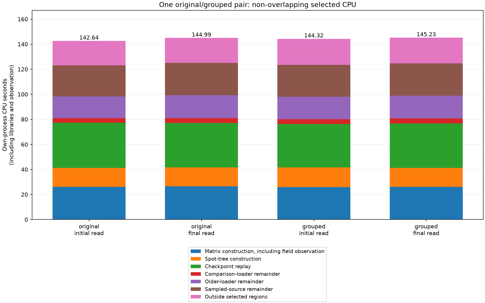

# Check matrix depths without repeated whole-tree scans

Registered November 15, 2026 in [issue #4](https://github.com/jimmy-sim/poker-ai/issues/4#issuecomment-6899625741)
before implementation or outcomes. This follows [PR #74](https://github.com/jimmy-sim/poker-ai/pull/74)
and its [loader CPU measurement](reader-load-cpu.md#recorded-result--november-15-2026).

## Question and completion criteria

Matrix construction accounts for 51.360752 of 277.177134 real-read process-CPU
seconds (18.5299%) in the preceding capture. Its final validation masks the
whole node array separately for every information group. Can a grouped integer
check preserve the result and avoid that repeated work? The individual loop has
not been timed; its possible savings are a hypothesis.

Done means a checked, private equivalent constructor, complete source-bound
software proof, one fixed complete-audit comparison, retained raw outcomes,
verified saved-data report, actual tests/CI and journal/work-log entries. A
negative or inconclusive cost result remains visible. This is an optimization
investigation, not a stronger strategy or a replacement training permit.

## Narrow implementation

Preserve all prior 406 source files. Add a private support module and comparison
entry under scripts, plus the new config: expected effective source count 409,
to be verified after implementation. Keep the original constructor available.
The candidate copies its construction body, replacing only the final depth
check with grouped integer minimum/maximum work linear in nodes plus groups.
A group must appear and have exactly one depth. Ignore negative/out-of-range
information IDs as the original per-group masks do. Keep the same ValueError
message and leave the arrays unchanged. No float tolerance or poker math changes.
An AST comparison must prove every other construction statement is identical;
only the private function's explicit cls annotation/decorator adaptation differs.

The scoped wrapper preserves class/subclass binding, arguments, return objects,
primary exceptions, earlier owned aliases and later imports. Reject a changed
baseline, nested installation, unsupported thread/process or exhausted capacity;
restore initial descriptor/alias objects and equivalent late aliases on failure.
Owned aliases include poker_ai modules and the private compact_cached package.
Arbitrary hidden/native references are outside this declared coverage.

Both original and grouped arms use the same successful-construction observer.
Record every dataclass field: array dtype, shape, strides, flags and C-order
bytes; nested tuples and scalar fields; and that source is the exact input
object. Compare ordered whole-child field fingerprints between arms, not
in-process object IDs. Source is an existing input, not a copied output array.
Keep complete/failed/partial constructor records and at most 512 calls per child.
The recorder adds work in both arms; its cost is included, not subtracted later.
Large tuple fields retain full typed content hashes and lengths rather than
repeating every action/key in each event. No elements are sampled or omitted
from those hashes. Array shape, strides, flags and full bytes remain included.

## Software evidence before collection

Independent direct-set predicates and property fixtures cover missing/empty
and mixed-depth groups, ignored IDs, extreme signed integers, input immutability
and malformed schemas. Constructed-field identity, subclass/descriptor/alias
restoration, exceptions, AST tampering, source/qualification/config rejection,
partial output and caps need tests before real measurement.

The source-bound proof uses 256 fixed generated integer cases with PCG64 seed
20261501, explicit edge cases and all five declared encodings on the pinned small
software construction fixture/model. This new fixture seed changes no historical
poker seed. Record inputs, decisions and complete field fingerprints, source,
config/runtime and timing; cap the complete proof at 180 seconds. It constructs
no learner or reference solver. Both full local bases, relevant optional suites
and both exact-source hosted jobs must pass and be published BEFORE this formal
proof or the comparison. Publish the proof and exact launch/save operators before
the one comparison; repeat required source/prerequisite checks inside its clocks.

The [config](../configs/grouped-depth-check.json) SHA-256 is
`8e627b4c8b9dc4a4a2346374a240dc3ed57836ed59c9190c0031cc1be70d03f8`.
It pins 47 inputs, including the previous source/capture/report and the small
software spot/model. Real archive execution remains Python 3.11.17 / NumPy 2.4.6
with the original locked extras and CPU-query/sleep-prevention utilities. Newer
Python qualifies software/data only, never original trajectory replay.

## One complete original/grouped pair

One ordered pair, original then grouped. Both arms install the same six sparse
CPU boundaries and preload the same modules. Retain the original tiny pre-read,
shared recall-proof cache, disabled-reuse card wrappers, initial/final own
mathematical reads, all three independent workers and source/publication/scalar
checks. Native worker processes remain unchanged and uninstrumented. OpenSpiel
2.0.2 and its recorded pinned Apache-2.0 license remain comparison-only;
reference strategies never enter the agent.

Keep 900 seconds per complete child, 1,800 shared, 120 seconds of operator saving
reserve and one attempt. All startup, preconditions, capture, field hashing,
original audit, final verification and required writes stay in their declared
clocks. Preserve the unchanged supervisor's self-measurement convention;
administrative exact canonical copying is outside the child clocks. No favorable
retry, subset, altered cap, seed or acceptance rule. Retain partial/failing
outcomes and original ignored bytes. Publish raw evidence before analysis.

The prepublished launch operator supplies a monotonic origin immediately before
starting Python through `POKER_GROUPED_COMMAND_STARTED`. The parent proof/pair
clock includes that interpreter's imports and orchestration. The unchanged
supervisor separately supplies each complete-child origin. A formal launch
without the operator origin is rejected. Final cap checks occur after the last
self-recording write; the saved elapsed value is taken just before that write.

Each arm must preserve all 432 profiles, 1,152 conditions, three computed reads,
worker/card/scalar and base-admission rejection witnesses. Each six-category
capture must contain 1,538 calls: tiny 432 checkpoints only; each real read 92
matrix, 26 spot-tree, 432 checkpoints and one call to each added loader. Both arms
together must remain below the 4,096 selected-call ceiling. All nesting, clocks,
process/thread identities and restoration checks remain required. Every successful
whole-child constructor fingerprint must match between arms, including calls
outside the selected read windows; missing or failed work is never zero.

The prospective diagnostic cost pass requires complete correctness/coverage,
strictly lower grouped complete-command wall time AND strictly lower grouped
selected-exclusive matrix CPU. Otherwise report fail/inconclusive honestly.
Report full clocks, nested inclusive/exclusive time and observer scope. One order
cannot establish uncertainty or pure causal savings. Inspect plots and require
portable numeric exports to match across actual supported runtimes with poker
execution blocked. Final applicable local and exact-head hosted checks precede
history-preserving merge.

Even a pass does not replace three fresh complete own costs, three fresh complete
native costs, the original conservative forecast or checked published admission.
The 933.889393168007/900 forecast stays failed; no new trajectories, default,
fresh/global admission or competitive-strength claim follows here.

Keep one coherent PR with required publication boundaries, actual dates,
Codex-assisted implementation and plain-English journal explanations. Do not
infer human hours or mastery. Continue until the user stops; no future schedule,
subagents or C++/Rust core. PR #74's pending final CI/merge remains a separate
prerequisite to its closure, not an assumed completed result.

## Source stage — November 15, 2026

[PR #75](https://github.com/jimmy-sim/poker-ai/pull/75) source
`7311ab4d3c84a2df032f56cdd744e7572de425dd` binds a verified 409 files, fingerprint
`01dfb1da8ac702c585744b997c77b19e0da1035e6b50c290d955d39766d05ef7`.
All prior 406 files and 47 input pins remain unchanged. Both complete immutable
local bases pass 4,135 tests / 64 skipped / 150 deselected, in 825.92 / 805.02
test seconds. Both relevant optional suites pass 647, in 56.19 / 54.67 seconds.
Actual runtimes, physical imports, source/head/cleanliness, lint, formatting,
strict typing and hooks are checked before/after as applicable. The source was
pushed only after all four local roles passed. Hosted source checks, published
qualification/operators and formal software proof remain prerequisites to the
single comparison. No formal software proof or candidate timing has run here.

All six source roles now pass. Both hosted jobs in
[CI 43759887855](https://github.com/jimmy-sim/poker-ai/actions/runs/43759887855)
pass 4,135 tests with the historical skips/warning, in 871.60 / 760.88 seconds.
Actual Python/NumPy/uv and the complete temporary checkout tree match the
qualified source. The [six-role receipt](../results/grouped-depth-check/checks.json)
retains untrimmed logs, metadata, the actual runner/assembler and exact generic
launch/retention operators for both stages. Qualification publication precedes
the formal software proof; no formal proof or candidate timing exists yet.

## Software proof — November 15, 2026

After qualification `e40d5e4`, the single formal proof completes in
**4.258358540973859 seconds** for the outer command, with
**4.2042644579778425 seconds** registered shared and
**2.367665457975818 seconds** supervised child time, all below 180 seconds.
All **256 generated cases plus eight edges** match the independent direct-set
predicate without mutating inputs. All five original/grouped encoding
fingerprint vectors match, including complete constructed array metadata/bits
and the exact input-source identity check. Descriptors and owned aliases restore.

The [proof](../results/grouped-depth-check/software/proof.json),
[child record](../results/grouped-depth-check/software/child/child.json) and
[18-file raw/admin manifest](../results/grouped-depth-check/raw-software-manifest.json)
retain the exact executed operators, inputs, cases, witnesses, original ignored
bytes and clock records. The manifest is the 19th retained file. No learner,
reference constructor or new poker trajectory is involved. These are software
construction facts, not a measured speedup or the complete end-to-end proof
required for a future training family. This proof is published before the
single original/grouped audit pair; that comparison has not yet run.

## Raw comparison checkpoint — November 15, 2026

After software-proof publication `4915c76`, the single pair completes:
original **430.3515602090047 seconds**, grouped **431.91335204200004 seconds**,
registered shared **866.5069792499999 seconds**, outer command
**866.5707877919776 seconds**, all within the unchanged limits. Both children
return zero and the original audit, ordered construction-fingerprint and
capture/restoration checks pass. The grouped wall time is longer; a diagnostic
cost pass requires strictly lower wall time as well as lower selected matrix CPU.

The [51-file raw/admin manifest](../results/grouped-depth-check/raw-pair-manifest.json)
retains exact copies and original ignored bytes before posthoc analysis. The
manifest is the 52nd retained file. The full CPU breakdown and interpretation
follow this raw publication. No retry, optimizer admission or new training.

## Recorded cost decision — November 15, 2026

**The diagnostic cost check fails.** Correctness and coverage pass, and selected
matrix CPU is lower in this one pair. The complete grouped command is longer,
so the two required cost conditions do not both pass. The implementation remains
a research candidate; it is not admitted into a new training family or default.

| Predeclared check | Original | Grouped | Result |
|---|---:|---:|---|
| Complete-command wall seconds | 430.3515602090047 | 431.91335204200004 | **Fail**: grouped is longer |
| Selected-exclusive matrix CPU seconds | 52.72510800000012 | 51.98051599999994 | Pass: grouped is lower |
| Complete original audit and constructor fields | Preserved | Equal | Pass |
| Combined diagnostic condition | Both cost conditions required | One misses | **Fail** |

The wall difference is **+1.5617918329953682 seconds (+0.3629106938%)**; selected
matrix CPU differs by **−0.744592000000182 seconds (−1.4122152201%)**. These are
paired point differences, not estimates of pure algorithm savings or uncertainty.
The selected matrix region includes the same field observer and timer machinery
in both arms. It does not isolate the final depth-check loop.

All **184 whole-child constructor fingerprints per arm** match in order. They
cover the 92 constructions in each real read; the tiny read has none. Each arm
retains 1,538 selected calls (3,076 combined), the original 432-profile /
1,152-condition / three-computed-read identities, worker/card/source/scalar
checks, zero hook errors and full restoration. No tolerance was relaxed.

Across the two real reads, the non-overlapping CPU totals are:

| Region, including observation where applicable | Original CPU seconds | Grouped CPU seconds |
|---|---:|---:|
| Matrix construction | 52.725108 | 51.980516 |
| Spot-tree construction | 30.217175 | 30.762100 |
| Checkpoint replay | 71.417259 | 70.365332 |
| Comparison-loader remainder | 7.431874 | 7.578065 |
| Older-loader remainder | 35.715616 | 36.281101 |
| Sampled-source remainder | 50.578009 | 51.236032 |
| Outside selected regions | 39.544938 | 41.340236 |
| Total real-read process CPU | 287.629979 | 289.543382 |



The bars show validation of the same saved strategies. A smaller matrix segment
does not imply that the complete command is faster. Other measured regions vary
too, and the three parallel workers take about 128.67 seconds each in original
versus 128.42–128.44 in grouped. Worker/body/nearby-child/command clocks are
different boundaries and cannot be added into a wall-time explanation.
One fixed order does not identify causality or support a general speedup claim.

[Full-precision result](../results/grouped-depth-check/report/summary.json),
[reader clocks](../results/grouped-depth-check/report/readers.csv),
[regions](../results/grouped-depth-check/report/regions.csv),
[workers](../results/grouped-depth-check/report/workers.csv) and
[body clocks](../results/grouped-depth-check/report/bodies.csv) retain the
underlying quantities. Raw publication `31bd40a` precedes all this analysis.

### Portable exports and next question

The first Python 3.12 export check fails on one old-parser CPU sum: the grouped
initial comparison-loader remainder is 3.736865999999978 seconds on 3.11 versus
3.7368659999999636 on 3.12. The difference is about 1.42e-14 seconds. The exact
failed renderer, outputs and [difference record](../results/grouped-depth-check/report/initial-export-failure/failure.json)
are retained. No capture is repeated.

The posthoc renderer now uses explicit sequential binary64 additions from the
raw selected-call rows to preserve the original 3.11 association on both
versions. It checks the frozen parser's results against its existing 1e-9
CPU-second arithmetic allowance. All five original 3.11 numeric exports and
the inspected figure remain byte-identical. The final five exports also match
actual 3.12.15 / NumPy 2.5.4 exactly, with poker construction/execution blocked.
Neither the source instrument, raw records, poker tolerance nor cost decision
changes. [Renderer](../results/grouped-depth-check/report/render.py.txt) and
[portable check](../results/grouped-depth-check/report/replay312.json) retain
this saved-data correction; it is not a new mathematical poker replay.

The next question is where matrix construction spends time: observation/key
creation, array setup, the depth check or field witnessing. This result does
not measure those pieces individually. Locate their cost before another
optimization rather than assuming the repeated depth masks dominate. Preserve
this negative result; no favorable retiming, shortened workload or changed gate.

The old 933.889393168007/900 forecast remains failed. A new production adapter,
complete source-bound end-to-end proof, all prescribed own/native costs and
checked published admission still precede any new trajectory study. Existing
known-game quality and competitive full-game limitations remain unchanged.

Final local checks pass 647 relevant tests per version (29.02 / 28.97 seconds),
Ruff lint/format for 911 files, strict typing for 764 source files, hooks and
focused Markdown links/images/anchors/fences. The saved-data CLI equals the
report; both raw manifests and all original ignored bytes remain exact.
[Local verification](../results/grouped-depth-check/report/local-verification.json)
records the checks. Both exact-report-head GitHub jobs must pass before merge.

After updating the checkout, inspect the saved result without a new run:

```sh
.venv/bin/python scripts/compare_grouped_depth.py --show --output results/grouped-depth-check/pair
open results/grouped-depth-check/report/selected-cpu.png
```

## Three questions

**Why compare constructor fields?** A faster check is useful only if the same
inputs produce the same game representation, including arrays and metadata.

**Why observe both arms?** Matching observation scope avoids attributing the
presence of selected timers to the candidate alone. Observation still costs time.

**Does a faster diagnostic admit training?** No. The full source-bound proof,
all fixed cost repetitions, original conservative forecast and published permit
still decide whether training may begin.
