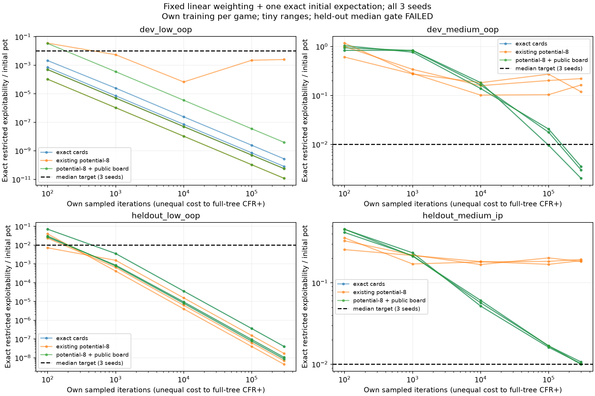
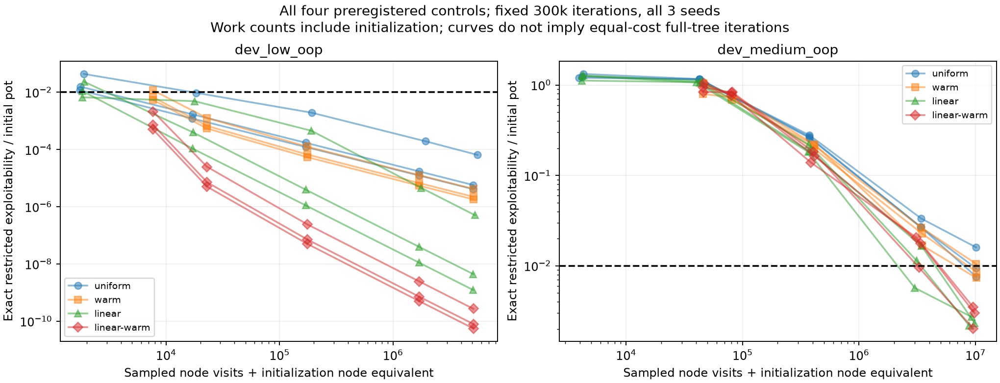

# Hold'em strength iteration 2 — own postflop learning diagnostic

The user authorized continued work while away, following the proposed learning /
representation / coverage diagnosis. Existing evaluation and Phase 5 reports are
historical evidence; user-terminal reproduction changes remain untouched.

## Definition of done, before implementation or results

1. Own finite turn–river mechanics and materialized trees are reusable without
   importing reference solvers or comparison policies into training. Preserve the
   old validation API and verify mechanics/export results remain unchanged.
2. Own full-tree CFR+ and own external-sampling MCCFR learn on two predeclared
   development games with limited physical ranges. Exact-card information is the
   first control. All policy outputs use own formats; OpenSpiel only checks values,
   best responses and matched full-tree iterations in a separate validation stage.
3. Diagnose exact versus existing potential-8 keys versus potential-8 with explicit
   public-board recall. Keep range/action/game parameters identical. Every key
   uses acting-player observations only. Test private/future-card invariance,
   legal menus, perfect recall, nonuniform chance and sampled regret expectations.
4. Gate the exact representation before representation comparisons: final own
   full-tree CFR+ exploitability <=0.001 initial pots; external-sampling median
   across three fixed seeds <=0.01 pots, every seed <=0.025 pots. Trained average
   rows cover >=95% of uniform-policy decision reach. These are initial acceptance
   targets, not promises. If a gate fails, retain the failure and diagnose it;
   do not loosen tolerances or silently run held-out cases anyway.
5. Profile short runs first. Fixed checkpoints and node/time budgets; initial
   total experiment cap under two hours. Stop at declared checkpoints, never
   publish favorable partial prefixes. A failed budget/gate remains explicit.
6. After development acceptance, freeze code/config choices and apply the same
   training/evaluation procedure to two held-out games. These games receive their
   own self-play training: this tests a training procedure, not zero-shot board
   generalization. No reference strategy trains any agent. Existing five solver
   spots remain known regression cases, not newly unseen tests.
7. Report exact restricted-game exploitability, independent checks, cross-play EV,
   chance-weighted fallback coverage, key collisions and runtime/node counts. Plot
   learning curves across all fixed seeds. Distinguish local game solutions from
   a usable global Hold'em agent. Implement a global change only if evidence
   supports it; do not claim improved full-game strength from spot learning alone.
8. Quality gates on 3.11/3.12, replayable commands, reviewed evidence, limitations
   and three interview Q&As. Preserve user changes and old benchmark provenance.

## Scope

All games use the existing full-pot/all-in grid and own engine/evaluator. The two
physical combos per seat deliberately keep the exact control affordable; these
are learning diagnostics, not realistic full ranges. Own self-play may use game
configs/rules, never reference actions, values, distributions or checkpoints.

The original MCCFR methodology is described in
[Lanctot et al. (2009)](https://www.cs.cmu.edu/~kwaugh/publications/nips09b.pdf).
The experiment tests our implementation under these specific mechanics; no new
algorithmic convergence theorem or competitive poker claim is intended.

## Retained initial failure and follow-up hypotheses

The initial exact-card run completed from clean `3be994c` in 121.50 seconds.
Both development gates failed, so no held-out game was run. Full-tree CFR+ passes
its accuracy threshold in both games. Sampled low-SPR accuracy is already below
its threshold, but uniform-decision-reach average-row coverage stalls below 95%;
on-policy coverage is nearly complete. Medium-SPR sampled exploitability improves
substantially but remains above the unchanged threshold at 100,000 iterations.
The reviewed initial report and all frozen policies are retained in
`results/holdem-learning/initial/`. Independent checking follows separately.

Before collecting any follow-up results, declare a 2×2 diagnostic of:

- Uniform versus linear iteration weighting of BOTH sampled regrets and averaging.
  Linear weighting uses raw cumulative sum(t*delta); regret matching is invariant
  to the common positive normalization in the existing full-tree Linear CFR.
  Conditional sampled updates retain their original expectations after multiplying
  by deterministic iteration weights. No claim of exact sampled trajectory matching.
- No initialization versus ONE full-tree expectation of the frozen uniform policy's
  counterfactual-regret and chance-weighted averaging updates. Both players use
  that same frozen policy for this initial simultaneous update; later sampled
  iterations alternate normally. Every initialized row receives an actual own-game
  regret/average calculation. Initial-only rows must be identified separately from
  subsequently sampled rows: coverage must not be presented as evidence of extra
  sampled experience. This is affordable only for the small finite games.

The original no-initialization/uniform cell already exists. Run the three new
versioned configs at the SAME seeds/checkpoints/accuracy/coverage thresholds.
Preselect **linear + one exact initial expectation** as the follow-up candidate;
retain every other cell regardless of outcome. This is an explicit new experiment
after a failed gate, not a retroactive rewrite of that gate. Do not run held-out
games until the selected candidate passes the unchanged development thresholds
and independent checks. Additional full-tree initialization cost is reported.

This experiment tests whether initial sampling noise and averaging/regret weighting
explain the failure. It cannot establish that a full-tree initialization scales to
global Hold'em, nor that public-board refinement improves a global sparse table.

## Independent-check failure traced to fused arithmetic

For all 36 frozen initial policies, native versus own value/BR/exploitability
checks agree within 1e-9 chips. The initial *training trajectory* comparison fails
on the medium game: policies first differ at iteration 3 after roughly 1e-16
regrets at mathematical ties are normalized into pure actions. The initial failed
comparison is retained alongside the failed learning gate.

An independent own scalar control evaluates all eight combinations of fused
value/regret/average arithmetic for three iterations. On this recorded ARM64
wheel, fused value and average expressions with separately rounded regret
increments reproduce the native trajectory. The compiler's fused multiply/add
rounds once; this is not an engine payoff error or an invented regret-zero cutoff.
No tolerance or original result is changed. A sequential NumPy summation alone
did not resolve it and was discarded.

The follow-up full-tree control uses an OPTIONAL Python/Numba kernel with explicit
LLVM fma and fast-math disabled. It implements the same own CFR+ equations, imports
no poker reference solver and requires no C++/Rust core. Original NumPy controls
remain reproducible under their original config; follow-up configs record the
arithmetic backend explicitly. Native trajectory matching depends on the pinned
build/hardware's contraction behavior; fixed-policy value/BR checking is a
separate criterion. The scalar control and all eight arithmetic modes test the
kernel independently, including a known single-rounding fma example.

Numba is introduced after traversal/scalar profiling, as allowed by the stack.
Versions are pinned in the optional `jit` extra and lockfile (Numba 0.68.1,
llvmlite 0.50.0); existing numerical dependency versions remain unchanged.
References: [Numba extension API](https://numba.readthedocs.io/en/stable/extending/high-level.html),
[llvmlite IR builder](https://llvmlite.readthedocs.io/en/latest/user-guide/ir/ir-builder.html),
and [single-rounding fma definition](https://docs.python.org/3/library/math.html#math.fma).
Performance comparisons use identical own scalar/JIT arithmetic and seeds, and
report compilation/cache-load time separately from steady-state training.

## Fixed budget extension after the 100k factorial

All four original/follow-up cells completed at 100,000 iterations. The preselected
linear+expectation candidate passes the low-SPR gate but misses the medium-SPR
median threshold (0.01770 pots versus <=0.01); its worst seed is within 0.025.
No candidate is retrospectively selected by the best observed score. Every cell
and the candidate's successful independent recheck is retained in
`results/holdem-learning/factorial-100k/`.

Explicit arithmetic resolves the original independent trajectory discrepancy:
all candidate full-tree checkpoints through 4,096 match native exploitability and
mean row L1 exactly on the recorded build. The original failure remains visible.
The compiled/scalar profile compares identical own policies; compilation/cache
loading is separate. This is numerical/compute validation, not strength evidence.

Before further outcomes, extend ALL FOUR cells to the same fixed 300,000 final
iterations, using new `holdem-learning-extended-*.json` configs. Existing seeds,
accuracy/coverage thresholds and preselected linear+expectation candidate stay
unchanged. The observed medium-game learning curves support testing this larger
budget. Runs finish their declared budgets, not the first favorable checkpoint.
No held-out game runs until the preselected development candidate passes both
learning and independent gates. The extension does not rewrite the failed 100k
acceptance or establish that iteration increases always improve global play.

## Global follow-up specified before any new global outcomes

After the local learning and held-out procedure gates pass, test the reusable
linear-regret/average update in GLOBAL own self-play. Do not apply the finite
full-tree initialization or exact public-board keys globally: their cost/sparsity
would make that extrapolation unjustified. Keep the existing potential-8 model
and full-pot/all-in action grid fixed.

Two versioned training configs compare uniform versus linear external sampling
at matched 1,000/10,000 iterations, all three original training seeds, two workers,
20,000 nodes/pass and 600 seconds/run. Six runs imply at most about 30 minutes
of worker training wall time at these caps. Actual short checkpoints profile cost;
no experiment expected to exceed a few hours is launched without flagging it.
The generic own trainer gains a checked optional weighting field; old configs
retain their original behavior. Weighted resumes restore visit audit/weighting,
and inference reads only frozen own average-strategy tables.

`configs/global-strength-study.json` fixes five own opponents and 1,000 FRESH
shared deck tapes. Both algorithms are frozen before play. Primary inference is
linear-minus-uniform paired improvement, with maximum loss bound 400 chips and
Bonferroni–Hoeffding control over five tests. Both seats and all three fixed
policies are averaged within each deck; 60,000 played hands still provide N=1,000
independent deck clusters per comparison. Same initial training seeds do not mean
identical training trajectories. Evaluation deal tapes are explicitly shared.

Absolute match means and approximate paired-deal CLT intervals are secondary.
No favorable-opponent/seed/checkpoint selection, no training from results and no
claim that a local solver improvement guarantees a stronger global policy. Keep
negative results. OpenSpiel/Slumbot outcomes are excluded from this own-baseline
study; independent spot comparison remains a separate measurement.

## Observed outcome: diagnostic complete, held-out performance gate failed

The 300k extension completed every declared cell, including controls that failed.
The preselected linear+expectation candidate passes both development games. It
passes the low-SPR held-out game but misses the medium-IP median threshold:
**0.01015285879237701 pots > 0.01**. The worst seed is 0.010664524586617995,
inside its separate 0.025 limit. No rounding, threshold change or candidate switch
turns that result into a pass. The preregistered global training/match comparison
has **not run**. Generic linear-weighting support is implemented and tested, but
the existing global checkpoint remains the earlier bounded prototype.

All values below are final exact restricted-game exploitability (NashConv/2),
normalized by the initial pot. Each median covers the same three configured
seeds. The two held-out games each receive their own self-play training.

| Game | Exact cards | Existing potential-8 | Potential-8 + observed public board |
|---|---:|---:|---:|
| Development low OOP | 7.98508e-11 | 5.58173e-11 | 5.58173e-11 |
| Development medium OOP | 0.00300824 | 0.164301 | 0.00300824 |
| Held-out low OOP | 1.05192e-8 | 6.93479e-9 | 1.05192e-8 |
| Held-out medium IP | **0.0101528588 (fail)** | 0.187193 | **0.0101528588 (fail)** |

The board-preserving encoding removes all public-board collisions here. It has
exactly as many information sets as exact cards in both medium games (3,336 and
1,112), so matching exact trajectories there is expected. This does not show
that eight private buckets plus exact raw boards scales or generalizes globally.
In the development low game, some private information still merges (364 versus
376 exact rows). Existing buckets are not uniformly worse: two low-game seeds
also approach an exact equilibrium. Neither a universal abstraction floor nor
monotone improvement with iterations follows.

The full 300k factorial is retained rather than selecting its best observed cell:

| Weighting / initialization | Low median ε/pot | Low minimum coverage | Medium median ε/pot | Development gate |
|---|---:|---:|---:|---|
| Uniform / none | 5.75111e-6 | 76.88% | 0.00943260 | Fail: coverage |
| Uniform / one expectation | 2.24058e-6 | 100% | 0.00852746 | Pass |
| Linear / none | 4.43152e-9 | 82.44% | 0.00232078 | Fail: coverage |
| Linear / one expectation (preselected) | 7.98508e-11 | 100% | 0.00300824 | Pass |

Initialization supplies a real own-game update and positive average mass to every
row. It is not evidence that sampling explored every row: up to **827** exact
development-medium rows have only the initial update at the final checkpoint.
The report separates these rows, subsequent sampled visits, and initialization
work. Initializing all rows is an affordable finite-game control, not a solution
to global Hold'em table coverage.



Blue is exact private/public information; orange is the existing potential-8
encoding; green adds the observed public board. Each color has three seed lines;
identical green/blue curves overlap. Lower is better. Both axes are logarithmic.
These lines show separate self-play learners, not the global agent playing three
opponents. The dashed 1% line is a median acceptance target; two of three final
exact held-out medium values lie just above it. The initial and 100k failures
remain in their original directories.



Node counts include one initialization node equivalent where applicable. They
measure traversal work rather than equal wall time; full-tree and sampled
iterations are not equal-cost. Training run times include setup/checkpoint work
and sometimes co-running checks, so they are not controlled throughput benchmarks.
The separate paired menu-cache and scalar/JIT profiles preserve policies exactly.

## Numerical checks and cross-play

For **378 frozen policy records**, independent native value and exploitability
errors are at most **1.14e-13** and **8.18e-14 chips**, below the declared 1e-9.
All **60** matched exact/full-tree checkpoints have zero exploitability error and
zero mean row L1 on the recorded pinned build. These counts include deterministic
controls repeated across experiments; they are not 378 independent statistical
samples. Offline own replay also agrees exactly with all stored own metrics.

Cross-play uses the frozen **own** full-tree CFR+ control, never a reference
strategy as training input. For tested policy C and own control B, the mean
two-seat EV is [u(C0,B1)-u(B0,C1)]/2. Positive favors C. The weighted action gap
is row L1 (range 0-2), averaged with uniform-policy decision reach. Full tables,
per-seed EVs and collision counts are in the generated report.

A fixed opponent need not expose every weakness. In development medium, the
existing-bucket policies have substantially larger best-response exploitability,
yet lose less against the particular own full-tree control than the exact sampled
policies do. Cross-play and exploitability measure different things; neither
equilibrium action distance nor one opponent's EV alone ranks general strength.
The reference shares our mechanics/EFG export, so its numerical agreement is not
an independent validation of every game rule. Earlier engine/evaluator checks
remain the separate mechanics evidence.

## Commands, retention and next experiment

```sh
make report-holdem-learning     # Offline replay of frozen policies, tables, plots
make validate-holdem-learning   # Retrain every 300k control; native checks; held-out
```

The full command installs the optional jit/solver-validation/research extras from
the lockfile. It takes tens of minutes on the recorded Mac, retains a timestamped
directory under `results/holdem-learning/runs/`, and returns **nonzero** when a
learning gate fails. That is the expected recorded outcome here; a completed run
is not a successful performance gate. It never launches global training or live
game requests. The faster report command returns success when its evidence audit
passes, while prominently reporting the failed learning gate.

Reviewed evidence is under `results/holdem-learning/extended/`, with input paths
in `configs/holdem-learning-evidence.json`. Small frozen own policies are committed;
large resumable checkpoints and interrupted/duplicate runs remain ignored under
`runs/`. No favorable prefix or interrupted run enters the manifest. Config,
source/dirty status, model/game/policy hashes, lockfile, environment and raw seeds
are retained. Historical input metadata is not rewritten when files are reviewed.

The next strength experiment should address sampling variance at a fixed node
budget, for example integrating the small river chance distribution while sampling
private worlds. Validate its expected regret/averaging updates first. All four
games above are now known development evidence; preregister fresh hold-outs before
testing any revised procedure. Keep the same accuracy limits, report every seed,
and only then revisit global training. More global iterations alone are not yet
an evidence-supported fix for the observed public-card aliasing.

## Three interview questions

1. **Why can board refinement help but still fail acceptance?** It removes a
   representation error, while finite sampling and averaging still leave regret.
   In the medium-IP hold-out the median is 1.0153% of the pot, above the fixed 1%
   limit. I retain that miss and do not claim the procedure passed.
2. **Did 100% coverage mean complete exploration?** No. A single exact uniform
   expectation initialized all average rows. I track initial-only rows and sampled
   visits separately; this finite full-tree operation does not scale globally.
3. **Why did exact algorithms initially disagree?** Near-zero tied regrets changed
   sign under fused versus separately rounded arithmetic. Scalar controls tested
   all eight contraction modes; explicit FMA reproduced the pinned native build.
   Fixed-policy value/BR checks already agreed. This is different from changing a
   tolerance to hide a mechanics error, and does not guarantee cross-hardware
   bit identity.
