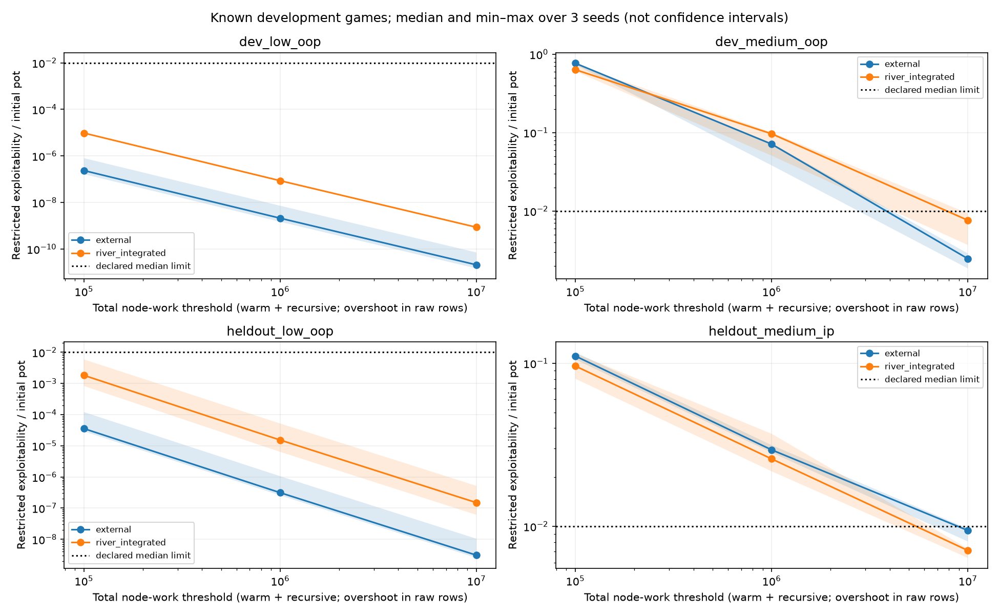
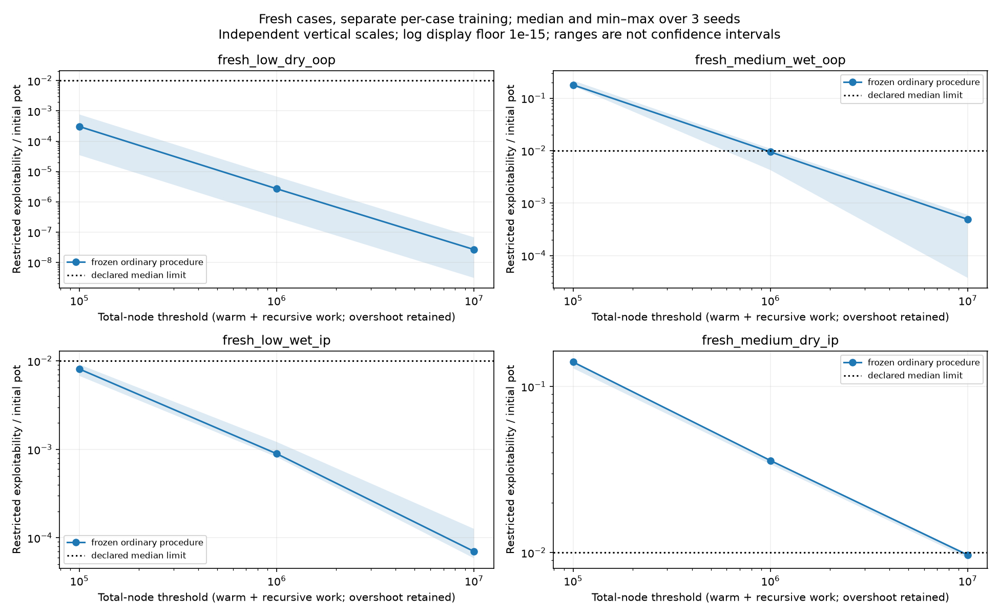
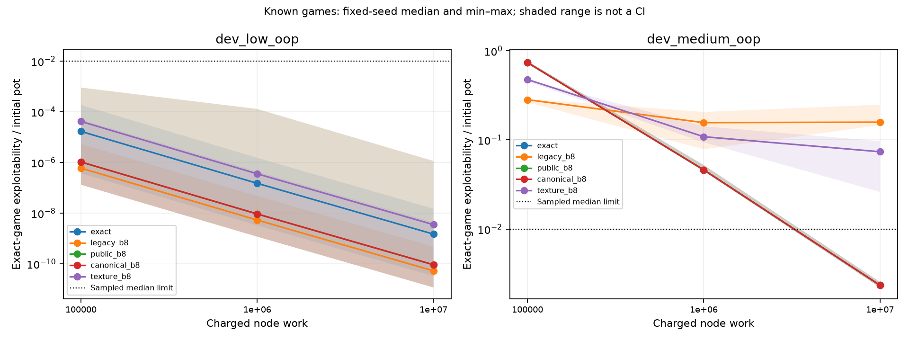

# Learning journal: building the poker project

Start here if the other project documents feel too technical. This guide follows
the order in which the project was built and explains why each part exists.
Examples marked **Example** are made up to explain an idea. Recorded results link
to the reports that support them.

The first version was compiled on November 4, 2026, looking back over the work
already completed. Codex assisted with implementation and drafting. The personal
notes section is for your own questions and explanations as you work through it.

## Quick navigation

- [Measure the full independent check](#108-find-the-remaining-cost-in-the-complete-independent-check)

- [Why the complete cached comparison still waits](#107-put-the-faster-check-into-a-fully-recorded-experiment-pipeline)

- [Reuse a structural proof without skipping changed inputs](#106-reuse-a-proof-only-while-the-checked-structure-stays-the-same)

- [Measure complete replay overhead before optimizing it](#105-measure-why-verification-is-expensive-before-optimizing-it)

- [Why the compact training remedy waits for a faster audit](#104-test-whether-a-finer-own-training-opponent-helps-the-compact-learner)

- [Inspect the actual decisions behind the information benefit](#103-find-the-concrete-decisions-behind-the-information-benefit)

- [Why the opponent must stay fixed](#102-keep-the-opponent-fixed-when-explaining-the-remaining-weakness)

- [Test whether the smaller description learns under sampling](#101-test-the-smaller-description-at-the-same-learning-work)

- [Rehearse and check the full-control test](#100-check-the-test-before-trusting-the-new-description)

- [Which strong hands could each player represent?](#98-ask-which-hands-each-player-can-still-represent)
- [Try the four-column saved-hand terminal exercise](terminal-river-lab.md)
- [Separate range beliefs from later action values](#97-separate-range-beliefs-from-later-action-values)
- [Why a turn call needs finer river information](#96-ask-what-makes-the-turn-call-valuable)
- [Why the unfavorable seed is still vulnerable](#95-separate-a-changed-policy-from-a-changed-opponent)
- [Latest measured learning result](#94-finer-own-opponents-help-the-harder-spot-the-overall-gate-still-fails)
- [Latest saved-hand browser and result](#step-79--move-from-totals-to-individual-hands-november-10)
- [Why river choices change a turn call](#step-81--see-the-river-weakness-affect-a-turn-call-november-10)
- [Testing what the river summary forgets](#step-82--separate-probability-precision-from-combination-identity-november-10)
- [Why these two static refinements do not help here](#step-83--rule-out-two-static-river-refinements-november-10)
- [Comparing opponents without giving away compute](#step-85--separate-opponent-information-from-extra-training-work-november-11)
- [Giving the own training opponent finer legal information](#step-84--build-the-own-opponent-information-controls-november-11)
- [What the batch experiment found](#38-compare-batch-sizes-at-fixed-work)
- [Why latest and average strategies differ](#39-compare-latest-strategies-with-averages-and-fixed-opponents)
- [Browse saved decisions in Terminal](#40-comparing-saved-action-tables-in-terminal--november-9)
- [How the matched-update test was planned on November 9](#41-separating-training-work-from-policy-updates--november-9)
- [How the new time gate works](#46-keep-the-time-budget-separate-from-playing-strength--november-10)
- [Your own reported terminal practice](#your-own-learning-notes)

## Where the project stands

A [November13 verification correction](ci-runtime-correction.md) found nine
GitHub receipt rows with the wrong Python patch label: they ran3.12.3, not
3.12.15. The original logs/results remain, but those labels cannot qualify the
exact-version gate. CI now pins and checks the actual runtime; fresh same-head
checks precede further profiling. Numerical producer results are a separate
question, and no new agent is promoted.

Step 107 completes the integrated cache checks and all six cost runs. Results
agree, but its full audit-budget forecast still fails: 933.89 seconds against
900. The own-work estimate passes at 4,046.17 against 7,200. The proposed new
learning treatment remains unrun. Next measure the complete audit path before
choosing another software improvement. These are verification results, not a
new stronger agent.

The compact river description passes full-control admission on both known turn
games in [PR #55](https://github.com/jimmy-sim/poker-ai/pull/55). Step100 explains
its saved strategies, independent check, smaller strategy tables and larger key
strings. The default agent and previous sampled results below remain unchanged.
The new fixed-work comparison
in [PR #56](https://github.com/jimmy-sim/poker-ai/pull/56) now fails the harder
game's median accuracy gate: 2.390% pot versus the fixed 1% limit. Step101 explains
all controls, the independent checks and what the failure means. Step 102
now diagnoses the saved failure while holding each opponent fixed. Step 103
traces that benefit to inspectable turn and river decisions.
Step 104 now completes the proposed compact training remedy's software proof and
cost checks, but compute admission fails. The actual new training comparison
has not run. Step 105 completes the full replay profile: computed results match
exactly, and repeated recall validation is the largest exclusive Python cost.
The outer OS recorder remains partially failed. Step 106 tests reuse of a proof
for unchanged structure. The full archive now replays identically in 188.28
seconds without reuse and 138.15 with reuse; this is a software result from one
ordered pair, not stronger poker play.

November 11 update: issue #4 has a measured improvement in the harder known spot.
Training against finer own opponents reduces mean exploitability from 2.173%
for ordinary coarse training to 0.597% of the initial pot. Lower is better.
Both spots meet the absolute accuracy limits, and the independent audit passes.
The overall preset superiority gate still fails: the already-near-zero low spot
has zero median improvement against its paired control. The default stays
unchanged. Step94 explains the complete result, including the seed that worsens.
The earlier sampling candidate's 3.35% versus 2.17% failure remains in the record.

Steps 69–75 explain that study. Steps 77–79 trace the saved strategies down to
individual hands and add a terminal browser. Steps 80–81 show how changing later
river choices can change the value of calling on the turn. The next question is
which river distinctions or training gaps produce those later choices. Steps
82–83 find that finer static range probabilities and ordered combo outcomes add
no new groups in this known game. The next question is whether training against
an own opponent with more detailed own-card/public-board information helps.
Step 84 builds and tests the mixed-information game software. Step 85 fixes the
learning comparison and implements its capture and replay checks. Step86 connects
the complete command, worker, archive, report and admission checks. Its wider
source checks and published proof/forecasts are pending; real learning is not
admitted. Step87 catches and corrects a coverage-tolerance mismatch before that
proof or any new real trajectory. Step88 makes interrupted-run records distinguish
confirmed work from unknown progress. Step89 completes the full fictional
rehearsal and independent audit; fixed cost forecasts are next. None of these
results establishes competitive general Hold'em strength. Step90 completes the
fixed forecast; step91 records the first actual command's rejected permit before
training and fixes its persistence bug. The corrected source needs fresh required
validation before real learning can proceed. Steps92–93 complete those checks,
the repeated proof/costs/forecast and corrected published permit. Step94 completes
the actual learning run and independent audit while retaining the failed overall
superiority condition.

Step 95 completes the saved-policy diagnosis without training again. Two turn
decisions account for most of the unfavorable seed's responding-seat 1 gap,
but their values include later river replies. Comparing against the same saved
opponents shows why better matchup results can coexist with worse vulnerability
to an optimal reply. The new terminal browser lets you inspect every seed,
method and seat.

Step 96 tests those continuations while keeping the turn and opponent fixed.
For the two important calls in the unfavorable saved matchup, even the best
river play within the current groups still favors folding. Finer legal river
information flips both to calling. This explains a concrete weakness; it does
not train a remedy or establish general Hold'em strength.

Step 97 completes the range-weight check after both GitHub jobs pass. Changing
the opponent's hand weights explains some river conflicts, but others persist
because the saved opponent's later responses differ. This narrows the problem;
it does not train a remedy. The [terminal exercise](terminal-river-lab.md) uses
the completed step 96 report, and step 97 adds a range-weight browser and plots.

Step 98 finds a useful missing distinction: which alternative hands public
cards remove from our own range. In the previously weak case it reduces local
conflicting groups from 23 to four. This is checked saved-data diagnosis; it
has not trained a stronger feature or changed the agent.

Step 99 defines and tests a compact candidate from that finding: summarize which
kinds of hands our public range can still contain, then store the binned summary
in one 30-bit word. Both full local suites pass 2,914 tests. No compression or
learning result is claimed for the new candidate.

We have a working poker simulator, learning algorithms, and tools for checking
their results. The project has found useful bugs and measured weaknesses. It has
not established a competitive Hold'em agent.

Here, “AI” mainly refers to algorithms that learn probabilities for poker actions
and store them in strategy tables. The chapters below explain how that works.

The earlier study, issue #3, tested the retained ordinary learning procedure on
four newly selected small games. All four met the rules fixed before their
outcomes were measured. This is progress in validating the method; each game
received its own training. The earlier river-integration result remains mixed,
and the ordinary default stays in place.

On November 6, issue #4 adds tested, optional ways to describe the public board.
One removes arbitrary suit names; another groups boards by coarse features.
The completed fixed-work comparison found that texture saves many strategy rows
but loses too much accuracy on the deeper game. Its preset gate fails, so no
global-agent default changes. You can inspect features with the terminal command
in step 15 and read the result in step 16.

The follow-up finds concrete decisions the old representation merges and tests
one category-based replacement. It also fails the deeper-game accuracy limit.
Step 17 explains the example, result and why the larger run stops there.
Step 18 completes a best-response diagnosis: the saved candidate is nearly
stable within its compressed game but remains vulnerable to exact information.
Step 19 finds missing relative-strength, blocker and action-conditioned range
distinctions. It completes a diagnosis, without training a replacement.
Step 20 defines the next candidate and its tests. Step 21 finds a measured
improvement: range masses pass the full-control gate on both known games.
Step 22 completes the sampled comparison: the new description improves on
category but fails the deeper-game accuracy limits. Step 23 diagnoses the saved
failure: most of its exploitable value appears when an opponent can use finer
information. That value depends on the saved strategies; it is not a fixed floor.
Step 24 swaps fixed turn/river policies and finds that the saved river continuation
accounts for most of the deeper-game gap change, with interaction between streets.
Step 25 separates the training rules and checks a shared updater before the next
learning comparison. It does not yet identify the cause of the river weakness.
Step 26 checks the compute cost before the larger controlled learning study.
Step 27 tests an opt-in policy-row cache against the frozen trainer and profiles
it again without changing the learning rules.
Step 28 tests an immutable game-node cache against every original node/edge,
then checks exact training trajectories before profiling again.
Step 29 measures independent cells across CPU processes, including startup and
resource costs, without changing a cell's learning rules.
Step 30 verifies checkpoint/scoring behavior and measures the still-missing
pipeline costs on old saved policies.
Step 31 completes the original controlled learning comparison: 140 runs and 840
checkpoints, with zero own replay error and independent native checks. Clipping
and averaging interact; improving one gap can worsen another. This diagnoses
training differences without selecting a replacement or passing a fresh-game gate.
No remedy, default change or fresh/global admission follows automatically.
Step 32 builds the saved-policy follow-up: account for decisions inside the
compressed game, then compare all four training modes against the same opponents.
Its complete own calculation and independent audit pass. The larger within-game
weakness persists against fixed opponents, especially for seat 1, and appears with
exact information too. It is not explained by compression or changed opponents alone.
Step 33 completes the averaging-history investigation. Original learning paths
match exactly, but the sampled current policies remain vulnerable. Late averages
do not supply a general repair; improving against old opponents and resisting a
best response are different outcomes. All own and independent checks pass.
Step 34 completes the zero-weight fallback test while keeping learned rows fixed.
All full controls are unchanged. The sampled whole-average fill has a small
effect in the motivating case and leaves the main weakness unresolved. Both
own and independent checks pass; no filled strategy is deployed.

Step 35 validates frozen-pass batch training but retains its failed compute
forecast; no long batch comparison was admitted. Step 36 profiles 48 short
copies with exact saved-state matches. It identifies measurable check overhead
without changing the learner or claiming stronger play.

Step37 completes the optional array-check dispatch change: checked training
paths stay exact and a new complete forecast fits; the original failure stays.
Step38 completes72 fixed-work batch paths and480 independently checked profiles.
The main signed configuration improves on average in one known game, but a seed
worsens and clipped river behavior remains unresolved. No default is changed.

You can read this in three sittings:

- **Steps 1–5:** How the program represents cards and runs a legal hand.
- **Steps 6–9:** How it learns decisions and how we judge those decisions.
- **Steps 10–34:** What the extensions and recent experiments taught us.

The [work log](work-log.md) has dates and commits. This journal explains the
ideas. Some older reports say hosted CI had not run: that describes their original
checkpoint. The repository now has [hosted checks](https://github.com/jimmy-sim/poker-ai/actions).

## 1. Make the work repeatable

Before teaching an agent poker, we needed a way to tell whether a code change
broke something. The project has automated tests, checks for common coding
mistakes, and a file called `uv.lock` that records dependency versions.

A **test** runs a particular check. **CI**, short for continuous integration,
runs the project checks on GitHub when we submit changes. A **commit** saves a
version of the files. A **pull request**, or PR, groups changes so their purpose
and checks can be inspected before they enter the main branch.

**Example:** A change accidentally allows the same ace to appear twice in a
deck. A test should fail immediately, before we spend time training on impossible
hands.

A green test run means the checks passed. Whether the agent plays well needs a
different kind of evidence. We keep those two questions separate throughout the
project.

Read more: [setup verification](phase0-verification.md).

## 2. Give every card an unambiguous identity

The first poker component represents the 52 cards with numbers. It also keeps
track of which cards are present, which have been dealt, and which remain.

A **bitmask** is a compact set of yes/no flags. Here, each flag corresponds to a
card. It makes questions such as “Are these two hands sharing an impossible
duplicate card?” easy to check. A deck also needs an order: a set of cards alone
does not say which card comes next.

**Example:** If a player holds the ace of spades, that card must be removed
before choosing an opponent's cards or dealing the board.

The deck is **immutable**: dealing creates a new remaining deck instead of
silently changing the old one. Keeping the original state makes replaying a hand
and finding a bug easier. Tests check card identities, duplicates, dealing, and
repeatable shuffles.

The lesson is basic but important: every later calculation assumes the cards
describe a possible deal.

Read more: [cards and decks](phase1-cards.md).

## 3. Decide which hand wins

The **hand evaluator** takes cards and ranks the resulting poker hand. It must
recognize categories, break ties using the right remaining cards, and handle
special cases such as an ace-low straight.

**Example:** Two players can both have a pair of kings. The evaluator must then
compare their other cards, called **kickers**, in order. Calling both hands “one
pair” is not enough to settle the pot.

Hold'em makes seven cards available at showdown: two private cards and five
board cards. We kept a simple approach that checks every five-card selection;
there are 21 selections from seven cards. It gives us a readable reference when
checking a faster implementation.

The recorded validation checked all **2,598,960 five-card hands** against Treys,
an independent poker library. A further **2,000,000 sampled six/seven-card hands**
also had no disagreements. The sampled checks are extensive, but do not cover
every possible seven-card hand.

This gives confidence in hand ranking. It does not teach the agent when to bet.

Read more: [five-card ranking](phase1-five-card.md),
[best five from six/seven](phase1-best-five.md), and
[verification evidence](phase1-verification.md).

## 4. Estimate a hand's share of the pot

**Equity** is the expected share of the pot at showdown under the specified card
assumptions. A win counts as one share, a two-way tie as half, and a loss as zero.

**Example:** In 100 equally likely outcomes, suppose a hand wins 50, ties 20,
and loses 30. Its equity is `(50 + 20/2) / 100 = 60%`.

We can calculate equity by checking every legal outcome when the remaining
problem is small. For larger problems, **Monte Carlo** estimates it from random
legal deals. A **seed** lets us repeat the same random sequence while debugging.
Repeating a seeded run does not make the estimate exact.

The equity code was checked against independent card calculations and cases
where the answer can be calculated exactly. Sampled estimates also report
uncertainty: another sample could give a somewhat different answer.

Equity alone does not tell us whether a bet is profitable. That also depends on
the price, folds, future decisions, and what hands the opponent may hold.

Read more: [equity methods and checks](phase1-equity.md).

## 5. Run a legal poker hand

The **engine** manages the rules: whose turn it is, legal bets, stacks, betting
rounds, folds, all-ins, and payouts. The evaluator settles hand strength; the
engine decides who is entitled to which chips.
The engine supports two to six seats; the research agents initially play heads-up,
meaning one player against one opponent.

**Example:** Three players contribute 20, 50, and 50 chips and all reach showdown.
The main pot contains 60 chips, which all three can win. The remaining 60 chips
form a side pot for the two players who contributed 50. The short-stack player
cannot win that side pot.

We check rules with ordinary examples and **property tests**. A property test
tries many generated cases against a rule that should always hold, such as “chips
are conserved.” Independent PokerKit comparisons also checked recorded action
traces and payouts, with differences in rule conventions documented.

An engine mistake can make a poor strategy look strong. That is why the project
checked mechanics before interpreting training results.

Read more: [engine contract](phase1-engine.md) and
[fundamentals verification](phase1-verification.md).

## 6. Learn decisions in tiny poker games first

Full Hold'em is too large to be a convenient first test of a learning algorithm.
We started with **Kuhn** and **Leduc**, small poker games with hidden cards and
betting decisions. Their size lets us inspect the complete game.

A **strategy**, also called a policy, assigns probabilities to legal actions.
It can mix actions rather than always taking the same one. An **information set**
groups situations that look identical to the player making the decision. The
player knows their own cards and the public action history, but not the opponent's
private card.

The learning method is **counterfactual regret minimization**, or **CFR**. It
compares the value of possible actions with the value of the current strategy,
then gives more weight to actions with positive accumulated regret.

**Example:** In an illustrative calculation, betting has value +3 chips while
the current mix has value +1. The advantage of betting is +2. The actual algorithm
weights such comparisons by how chance and the opponent can reach the decision;
it does not simply count how many times a bet happened to win.

We implemented several CFR variants and compared them with OpenSpiel on the same
small games. We report the **average strategy** built during training because
the latest strategy can fluctuate.

We also calculate **exploitability**: a measure of the strategy's remaining
weakness against opponents specifically chosen to punish it. The reported
two-player convention averages the two players' best-response gains. Lower is
better; zero means equilibrium in the specified game. Those opponents must still
respect hidden information.

The lesson: agreement in a tiny game checks the algorithm. It does not establish
full Hold'em skill.

Read more: [toy games and solvers](phase2-solvers.md).

## 7. Make learning affordable in Hold'em

A **game tree** describes possible cards, actions, and later outcomes. Traversing
every branch of a full Hold'em game is too expensive for this project.

We use **sampling** to examine part of the tree at a time. In external-sampling
Monte Carlo CFR, chance and opponent actions are sampled while the updating
player's actions are examined. The probability weighting matters: a shortcut
must still estimate the intended update correctly.

We also use **abstraction**, which groups situations to reduce the number of
decisions the program must store. Card **buckets** group hands with similar
features. An action abstraction limits the available bet sizes.

**Example:** A training game might offer check, a pot-sized bet, and all-in.
A real opponent's half-pot bet then creates a situation outside that menu.
Mapping it back to the training game is an approximation, and an unseen strategy
entry may require a fallback action distribution.

The project added saved **checkpoints**, including the random generator's state,
so a training run can continue from where it stopped. Tests check that resumed
updates match an uninterrupted run. The initial Hold'em runs were bounded and
had sparse strategy coverage: a working training system still needed strength
testing.

Read more: [sampled training and its limits](phase3-verification.md).

## 8. Compare with an independent solver

We needed a check beyond our own code reporting a good score. An independent
**solver** computes a strategy for a fully specified game. OpenSpiel supplies
the project's open-source reference calculations.

A **spot** is a particular poker situation. To compare fairly, we specify the
board, pot, stacks, positions, possible private hands, and allowed actions.
A player's **range** lists the private hands considered possible, with weights.

**Example:** Comparing a learner allowed only pot-sized bets with a solver
allowed many bet sizes would mix two questions: how well each learned and how
much the extra actions helped.

The project compared five restricted turn spots. The trained prototype had
higher exploitability than the reference in all five. Strategy action gaps and
values against common opponents exposed weaknesses that toy-game checks could
not reveal.

The reference is used for comparison only. Its strategies do not teach or
initialize our agent. The native solver is independent, but it reads our exported
game rules; an error in those shared rules could affect both sides. Earlier
engine and evaluator checks therefore still matter.

Read more: [external validation results](phase3.5-verification.md).

## 9. Play matches without mistaking luck for skill

Actual matches ask a different question from exploitability: how does the agent
perform against these particular opponents? We tested simple opponents that
choose randomly, call, raise, play a tight/aggressive style, or use equity rules.

Poker outcomes are noisy because the cards matter. In **duplicate matches**, we
reuse a deal with the seats exchanged to reduce the influence of which player
received the better cards. Those reused deals are related observations.

**Example:** Replaying one lucky deck in several matchups does not create several
independent pieces of evidence. That is why the local study's 36,000 hands were
analyzed using 1,000 independent deck groups for each comparison.

A **point estimate** is the measured average. A **confidence interval** expresses
sampling uncertainty under stated assumptions. We also declared a rule for
judging positive advantages across several opponents before looking at results.
No positive advantage passed that rule. Unfavorable results against the
tight/aggressive and equity opponents stayed in the report.

A separate, small public Slumbot pilot also ran. Its loss and wide uncertainty
remain recorded. The server's hidden deal seeds mean we can replay the records,
but cannot recreate identical live deals.

The lesson: beating an easy opponent in a sample, or getting a positive average,
is insufficient evidence of a winning agent.

Read more: [match evaluation](phase4-verification.md).

## 10. Learn something about an opponent

You selected **Bayesian opponent modeling** as one extension. It starts with
possible opponent types and updates their probabilities as actions are observed.
The starting beliefs are the **prior**; the updated beliefs are the **posterior**.

**Example:** Suppose the model considers both a frequent caller and a selective
caller possible. Repeated calls may shift belief toward the frequent-caller type,
depending on how likely those calls are under each model. One call does not prove
which type is present.

Our experiments use simulated opponents in the small games. The learner uses
permitted observations and accounts for cards it cannot see. Prediction improves
for some fixed opponent types included in the model, but can worsen when the
model misses the opponent's behavior or the opponent changes strategy.

The prediction plots use **negative log-likelihood**, abbreviated **NLL**. It
penalizes a model for assigning a low probability to an action that actually
occurred. Lower NLL means better prediction; when the graph plots NLL
*improvement*, a positive value means the model improved over the comparison.

The project also tests a **guarded response**: exploiting a modeled weakness while
limiting how much worst-case value can be lost relative to a starting strategy,
called the **blueprint**. That bound was checked in the exact small games.
The security-degradation plots show how much this worst-case value changes;
the budget line marks the permitted loss. Their units are small-game ante chips,
not a measured Hold'em win rate.

Better prediction does not automatically mean a stronger Hold'em player. Some
measured gains already come from prior beliefs, so they cannot all be credited to
learning from new observations.

Read more: [opponent-model methods](phase5-extensions.md) and
[extension checks](phase5-verification.md).

## 11. Study risk separately from strategy strength

The other extension was **bankroll and risk analysis**. Even a favorable average
return can come with deep losses along the way. A **drawdown** measures a fall
from a previous peak; it is different from going broke.

The **Kelly criterion** chooses a stake fraction to maximize expected long-run
logarithmic growth under a specified probability and payoff model.

**Example:** In a hypothetical independent, even-money binary bet with a known
55% win probability, the full-Kelly fraction is 10% of current wealth. That
calculation is specific to those assumptions. It is not a poker staking rule or
a recommendation to risk that amount.

We varied assumed edges, stake sizes, and dependence between outcomes. When bad
outcomes cluster together, paths can look much worse than an independent model
suggests. The plots show results conditional on each model, not a forecast of
what our agent will earn.

The follow-up used the agent's measured match returns. All five conservative
sizing calculations that accounted for uncertainty selected a zero fraction
before fees. The data did not establish a positive edge to size confidently.
Resampling those same returns creates more simulated paths, not new independent
evidence of skill.

This explains why a fitted-return model can show a positive preferred stake while
the more conservative calculation shows zero: the first treats the fitted model
as given, while the second also accounts for uncertainty in the estimated edge.

Read more: [risk experiments and assumptions](phase5-extensions.md).

## 12. Find out what prevents better Hold'em learning

The earlier results suggested looking inside the learner instead of just running
it longer. We compared small turn-to-river games using exact card information
and different ways of grouping cards.

One problem was **public-board aliasing**: the representation could merge
different public boards into the same stored decision. That can discard
information the player is actually allowed to use.

**Example:** A board showing three spades can change decisions compared with a
board showing three different suits. A representation needs to preserve relevant
public information while continuing to hide the opponent's cards and cards that
have not yet been revealed.

Keeping the public board helped the medium-stack diagnostic games. But in those
games it also made the stored representation as detailed as exact cards. That
small-game improvement does not solve the memory problem for full Hold'em.

We also varied how training iterations were weighted and whether every decision
row received one exact initial update. A **row** is one stored decision and its
action values or probabilities. Initialization gave every row average-strategy
data, including rows that were never visited again. Positive data in a row
therefore cannot be treated as proof of later exploration.

The selected procedure passed development tests but missed an accuracy limit in
one reserved game: **1.0153% of the pot against a 1% limit**. A **hold-out** is a
test reserved until the procedure has been chosen. Once we inspect and use its
result to guide further work, it becomes known evidence. We kept the miss and
did not relabel it as a pass.

Each small game received its own training. These results do not mean that one
global agent learned to handle unseen boards.

We then packaged the methods, results, and failed gate in a technical brief and
interview notes. The existing Git history was published to GitHub, followed by
issues, PRs, and hosted checks for new work. The goal is to make the evidence
inspectable and repeatable. The [packaging snapshot](phase6-verification.md)
records what existed at that earlier checkpoint; the work log covers later work.

Read more: [the learning diagnostic and retained failures](holdem-strength-v2.md).

## 13. Test river integration at the same work budget

**Completed November 4, 2026 — issue #2, PRs #7 and #8.**

The next question was whether learning would improve if a pass averaged over all
legal river cards instead of randomly picking one. In these turn games, fixing
the board and both private hands leaves 44 possible river cards.

This is **integration**: combining outcomes using their probabilities. The
strategy still cannot observe the future river when making a turn decision.
Only the training calculation considers all those possible futures.

**Example:** An estimate from one river can be noisy. Averaging all rivers might
make it steadier, but takes more work. Comparing the methods after the same
number of passes would give the more expensive method extra computation.

We first tested the mathematics and saved-state continuation. Then we compared
both methods at 100,000, 1 million, and 10 million units of node work, with three
fixed training seeds in each of four known games. A **node** is one state visited
in the game tree. Work includes initialization and terminal states. A final full
iteration can go slightly over a threshold; that extra work is recorded.

The complete run saved 80 learned/control strategies. Every saved strategy passed
an independent value and best-response check. A separate experiment froze the
strategies while measuring update error, so changes during learning would not
confuse that measurement.

At 10 million node-work, the two medium-stack games gave these recorded medians:

| Position/game | Ordinary sampling | River integration |
| --- | ---: | ---: |
| Out of position, medium OOP | 0.2463% of the pot | 0.7612% of the pot |
| In position, medium IP | 0.9433% of the pot | 0.7109% of the pot |

These numbers are **restricted exploitability**, not win rates. Lower is better.
In position means acting later in the betting order; out of position means acting
earlier. The complete four-game table is in the linked report.

Integration's final median was lower in one game and higher in three. Both
methods passed the declared final development limits. The frozen experiment
found lower error per pass, but extra traversal work usually outweighed that
advantage in its error-times-work measure. Some estimates were unstable, so the
report keeps the per-seed variability and qualifications.

The decision was to keep the ordinary default. The experiment answered its
question without showing a general upgrade. All four games are now known
development evidence, including the ones with `heldout` in their filenames.



Read this figure one panel at a time. **Blue** is ordinary sampling; **orange**
is river integration. Moving right means more work; moving down means lower
exploitability. The shaded bands span the three seeds, not confidence intervals.
Both axes use logarithmic scales: equal spacing represents multiplicative changes.
Each panel has its own vertical scale. The dotted line is the declared median
limit. Colors in other project figures can mean different things; check the legend.

Read more: [complete fixed-work study](river-fixed-work.md),
[PR #7](https://github.com/jimmy-sim/poker-ai/pull/7), and
[PR #8](https://github.com/jimmy-sim/poker-ai/pull/8).

## 14. Try the frozen procedure on fresh games

**Completed November 5, 2026 — issue #3, PR #11.**

We wanted to know whether the retained ordinary learning procedure could meet
its accuracy limits on new small games without changing the method to suit
those results. The rules, selection seed, exact case files and code/input hashes
were published before training. The admission check first replayed the accepted
development evidence and refused changes to the frozen procedure.

**Example:** A practice exam helps choose how to study. Once you use its answers
to improve the method, retaking it is less convincing evidence than trying a
reserved exam. The earlier poker games had become the practice set. The new
cases tested the method after that choice was fixed.

The run used three new seeds for each of four cases and the same 100,000,
1 million and 10 million work thresholds. It finished in about 8.3 minutes and
saved all 44 learned/control strategies. Every saved strategy passed independent
value and best-response checks. The final procedure gate passed in all four cases.

The closest case was medium dry IP: median exploitability was **0.9670% of the
initial pot**, just under the declared **1%** median limit. Its worst seed was
**0.9845%**, under the separate **2.5%** worst-seed limit. The tight result stayed
in the report; we did not add iterations or select a nicer seed.

Coverage still needs care. In medium wet OOP, 1,545 rows remained initial-only.
Later visits covered about **94.67%** by the uniform-reach weighting, even though
positive average-row coverage was effectively 100%. The original average-row
criterion passed, but it does not mean every decision was explored after setup.

The useful conclusion is that this fixed procedure met its chosen limits on
four cases reserved before testing. Each case received separate training; these
are not results from one global agent playing unseen boards. The ranges are
still tiny and artificial. These cases are now known evidence, so later tuning
needs another fresh test rather than relabeling them as unseen.



Here the blue curve is the retained ordinary method. The panels show different
cases, not different opponents. Lower is better; the dotted line is the median
limit. The shaded range spans three seeds and is not a confidence interval.

Read more: [method, exact case inputs and results](fresh-validation.md),
[complete table](../results/fresh-validation/report/tables.md), and
[PR #11](https://github.com/jimmy-sim/poker-ai/pull/11).

## 15. Describe the board without storing every physical board

**November 6, 2026 — protocol and correctness milestone.** The question is whether
we can share strategy rows across boards without losing too much useful
information. A **strategy row** stores the probabilities of the available moves
at one kind of decision. More distinct rows mean more memory and more decisions
that training needs to visit.

Issue #4 adds two optional descriptions. The first removes suit names while
preserving public ranks and suit relationships: changing every heart to a spade
and every spade to a heart should not change the game's meaning. The second,
called **texture**, groups boards by features such as pairs, suit counts, high
cards and straight connectivity. It remembers a separate description of each
street already seen.

**Illustrative example:** `2c 3d 7h` and `3c 4d 8h` share a coarse texture. Both
have three different ranks, three different suits, no ten-or-higher card, no ace,
and at most two ranks in a five-rank straight window. Their exact ranks differ.
Grouping them may save rows, but may also force different situations to share a
bad compromise. The tests do not tell us whether that tradeoff helps learning.

The software tests check that equivalent suit names/flop orders behave alike,
actual hidden cards cannot enter the key, earlier streets stay remembered, and
the small game's legal actions and abstract memory remain consistent. The
existing three representations are retained. No default agent behavior changes.

A full check also exposed the old study's source guard: it correctly rejects the
new code as different from its frozen revision. The archived manifest remains
unchanged; historical reproduction needs its recorded checkout. Unit-test
fixtures are explicitly separate from archived admission evidence.

**Actual checks:** 29 new board/inspection tests, plus the historical source-guard
regression. Full-suite and hosted checks are recorded in the
[protocol's verification](public-board-abstraction.md#verification-and-remaining-work)
and linked PR. There is no new training or measured strength improvement here.

To explore the new description from the ordinary Terminal prompt, run:

```sh
.venv/bin/python scripts/inspect_public_board.py Ac Kc 2d 7c 7d
```

It prints the original board, a suit-renamed equivalent, and features for the
flop, turn and river. The board's suit counts go from `[2,1,0,0]` to `[3,1,0,0]`
to `[3,2,0,0]`; its river rank counts begin with `2` because the sevens pair.
The renamed board is an encoding, not a new deal. This command inspects features;
it does not play a bot or recommend a move.

**Next decision:** Run the preregistered comparisons at equal work, retaining
every result. The candidate must meet both accuracy and compression limits before
any new fresh-case stage. Read the [protocol and limits](public-board-abstraction.md)
and [issue #4](https://github.com/jimmy-sim/poker-ai/issues/4). The code and checks
are published in [PR #12](https://github.com/jimmy-sim/poker-ai/pull/12).

## 16. Compare the board descriptions at the same work budget

**Completed November 6, 2026 — issue #4, PR #13.** We tested whether the new board
description helps learning and whether it actually saves space.
Correctness tests answered whether it follows its rules, not whether it is useful.

**Illustrative example:** Two learners both run 1,000 iterations, but one visits
twice as many game states each time. Those iteration counts do not represent the
same work. Here we count visited states plus the cost assigned to initialization,
and compare at the same declared work checkpoints. Both learners finish their
current update before stopping; we keep any small overshoot in the report.

The runner keeps every configured strategy, including bad ones. It separately
records rows that received an initial calculation and rows later visited by
sampling. It also checks **collisions**: different boards or private hands that
share a strategy row. A collision saves rows, but it may force a harmful compromise.

After training, the independent checker evaluates the saved strategies. **Cross-play**
means having two frozen strategies face each other; we exchange their seats to
account for position. All final pairings are kept, including self-play. A
strategy's seat-balanced advantage against itself is zero by definition; that
alone says nothing about how strong it is.

The runner and tests were published before the full study. It then ran for about
20 minutes, keeping all 150 strategy snapshots. The native audit checked all of
them, all 800 ordered final strategy pairings and 90 saved checkpoint pairs.
The largest native comparison error was below 1.64e-13 chips; our own replay
matched exactly. That gives us confidence that the reported calculations agree,
not that the resulting strategy is strong.

**The result is a failed candidate gate.** Here is the comparison with the
raw-public-board control at the same final work budget:

| Game | Raw-board rows | Texture rows | Raw-board median weakness (% pot) | Texture median weakness (% pot) |
|---|---:|---:|---:|---:|
| Small stacks relative to pot | 364 | 92 | <0.000001 | <0.000001 |
| Deeper stacks | 3,336 | 1,392 | 0.234 | 7.37 |

“Weakness” here is the exact-game exploitability measure: lower is better. It is
not a measured win rate against people. The texture description uses about 75%
fewer rows on the first game and 58% fewer on the second. But on the second game
it misses the preset 1% median limit and 2.5% worst-seed limit. Its full-tree
control also stays around 2.52% pot, missing its separate accuracy requirement.
We did not add training or choose a nicer seed to rescue the result.

This points toward a public representation that loses useful distinctions, under
this learner and budget. The medium game has no extra private-hand collisions,
and checks for remembering past decisions, legal actions and native values pass.
The full-tree result argues against
blaming only sampling noise. It still does not prove that every possible strategy
using texture must be bad, or that every engine detail is independently verified.



These lines are five descriptions of the same game, not five opponents. On the
right, purple is texture and ends above the dotted 1% limit. Exact, raw-public
and suit-canonical lines overlap below it. The panels use different logarithmic
vertical scales. Shading spans three seeds, not a confidence interval.

Coverage also needs careful reading. The deeper texture learner has about 98.29%
subsequently visited-row coverage versus raw-public's 97.60%, yet plays worse by
the best-response measure. Visiting one shared row counts all situations mapped
to that row; it does not prove the action fits every one of them. Initialized
average-row coverage is 100%, and initial-only rows are reported separately.

The saved own policies look much closer in cross-play: the largest seat-balanced
advantage in that final pool is only about 0.103% pot. A small set of our own
opponents can miss weaknesses that an exact best response finds.

The key/float storage components shrink, but shared game trees and Python objects
remain. We have not measured a comparable reduction in total process memory.
No agent default changes, no new fresh cases and no global training follow this
failed gate. Issue #4 remains open for a more informative representation.

Software checks pass with 676 local tests on Python 3.11/3.12, including 26 new
runner/audit tests. Initial GitHub CI caught an optional-dependency mistake in a
timeout test; selecting NumPy in that fixture fixed it without changing the study
source, config or outcomes. Hosted checks are linked on
[PR #13](https://github.com/jimmy-sim/poker-ai/pull/13).

From Terminal, open the graph or run the small software fixtures:

```sh
open results/public-board/report/learning-work.png
.venv/bin/python -m pytest -q tests/test_public_study.py
```

Those tests use tiny fixtures; they do not repeat the 20-minute study. Native and
plot checks require their optional extras. Read the
[methods and diagnosis](public-board-comparison.md) and
[complete tables](../results/public-board/report/tables.md).

## 17. Find which shared decisions need different treatment

**November 6, 2026 — completed diagnosis and admission check.** The last test
showed that the smaller description was too weak on one game. Before adding features, we need concrete
examples of what the sharing loses.

The diagnostic looks at a row containing several exact situations. It asks which
action looks best in each situation under a frozen strategy from our own solver,
then compares that with being forced to choose one action for the whole row.
The values average possible hidden opponent hands first; the program cannot
choose a different action after secretly looking at those cards.

**Illustrative example:** One situation values check/call at 3/1 chips, another at
0/4 chips. Separately they prefer different moves. If we force them into one
row, at least one situation may receive the wrong compromise. These numbers
explain the diagnostic and are not measured poker results.

The ranking score is a local comparison under a frozen continuation. It is not
the agent's total expected loss or exploitability. Tied local actions can also
hide a need for different mixing probabilities when an opponent adapts.

At first publication, diagnosis examples and the replacement candidate were
pending. Code, tests and input hashes were published before that run.
The local checks pass with 686 tests on both Python versions, including ten new
tests for this diagnostic and viewer.
Read the [definition and limits](board-collision-diagnosis.md).

The retained diagnosis now gives a concrete example. With pocket nines, one
river makes a full house and another makes four of a kind, yet the old texture
key shares their decision row. In the frozen-control example, the full house
prefers folding to an all-in, while quads prefers calling. Another shared row
combines a straight with one pair. These are different visible hand categories.

The one proposed fix is to keep that category at every observed street. It
still groups many situations, and does not store exact tiebreakers. Its code
passes the unit/recall checks; the full local suite now has 712 tests on both
Python versions. The small full-tree admission test is now complete.

**The candidate fails.** Here all strategies receive 4,096 full-tree training
iterations. Lower exploitability means less weakness against a best response.

| On the deeper known game | Exploitability (% of initial pot) | Strategy rows |
| --- | ---: | ---: |
| Keep the exact public board | 0.000182 | 3,336 |
| Old coarse texture | 2.522516 | 1,392 |
| Texture plus made-hand categories | 2.593658 | 1,428 |

The new candidate keeps 57% fewer rows than the raw-public control, but its
excess weakness exceeds the rule set in advance. The low game passes. All
48 saved strategies pass the separate OpenSpiel value/best-response check;
that check confirms these measurements on our exported game mechanics.

There is another revealing example already in the diagnosis: pocket nines on
`Ts 9s 4d 2h` makes a full house with either `Th` or `Td` on the river. The
category history is identical, yet the frozen control prefers different moves.
The fixed opponent range includes `Tc Td`: that hand can make quads when the
river is `Th`, but cannot exist when `Td` is on the board. This is called a
**blocker** or card-removal effect. Knowing “full house” alone loses this detail.
The example does not tell us how much of the final exploitability it causes.

The lesson is that fixing an obvious local example does not automatically
improve the whole learned strategy. The larger sampled-learning comparison
stops here; fresh/global testing and agent defaults stay unchanged. The earlier
7.37% result used sampled learning, so it cannot be compared directly with this
2.59% full-tree result. The matching old full-tree number is 2.52%.

To inspect the two examples and open the measured learning curves:

```sh
.venv/bin/python scripts/inspect_board_collision.py --rank 2
.venv/bin/python scripts/inspect_board_collision.py --rank 7
open results/made-category-admission/report/full-controls.png
```

On the right-hand graph, the old and new compressed versions flatten around
2.5% of pot while the exact/raw-public controls keep falling. The vertical axis uses a
logarithmic scale: each numbered step is a factor of ten. Read the
[complete tables](../results/made-category-admission/report/tables.md) and
[method, limits and stopping decision](board-collision-diagnosis.md), published
with [PR #14](https://github.com/jimmy-sim/poker-ai/pull/14).

## 18. Ask how a counterstrategy exploits the saved agent

**November 7, 2026 — completed diagnosis.** The category experiment failed. Before
changing features again, this step will inspect the actual saved strategy.
A **best response** is the strongest counterstrategy to a fixed opponent, using
only the information its player is allowed to see.

We will compare a response that sees exact cards with one restricted to the
agent's compressed descriptions. Their difference measures extra response value
from the discarded information against that fixed opponent. We will also trace
losses to decisions and check that they add up to the measured total. This is a
stronger accounting check than the earlier local ranking, but does not tell us
what would happen after retraining with a new feature.

The [protocol](candidate-best-response.md) and input-bound config are declared
before outcomes. No new training or feature selection starts in this block.
The implementation now passes 733 local tests on Python 3.11/3.12, including
21 new checks for the math, hidden information and saved evidence. A small test
caught a native-wrapper crash: the Python policy object had to stay alive while
the C++ response calculator used it. That wrapper is fixed before any new
research results are measured. The known Kuhn equilibrium gives zero loss, and
brute-force Kuhn replies agree with the new response algorithm. Actual retained
results were still pending at that code publication.

The completed diagnosis checks all eight saved cases. For the deeper game's
category candidate:

| What the response can use | Contribution to exploitability (% pot) |
| --- | ---: |
| Only the candidate's compressed descriptions | 0.000169 |
| Additional value from seeing exact information | 2.593490 |
| Total | 2.593658 |

This means the saved strategy is close to an **equilibrium inside the compressed
game**: if both players are forced to use those descriptions, neither can gain
much by changing strategy. A player who can distinguish exact cards has much
more opportunity. That points toward the information being discarded, instead
of treating this as an obvious shortage of training iterations. It does not
prove every strategy using this abstraction must have the same weakness.

There is a useful surprise in the decision trace. Holding `Tc Td` on
`Ts 9s 4d 2h`, the saved strategy almost always bets. The exact best response
checks, because its later decisions can take advantage of the fixed opponent.
This turn row has only one exact member: no turn situations were merged there.
So “the loss appears on the turn” does not mean “add more turn features.”
Earlier choices can gain value from better decisions later in the hand.

All **32 response values and 32 own reply-profile values** pass the separate
OpenSpiel checks, with disagreement below 0.0000000000001 chips; own replay
error is zero. Each player's decision losses add up to its total gain, and
half the two gains gives exploitability. The native comparison shares our game
export and partition definitions; it does not independently prove those are
correct or establish competitive Hold'em strength.

GitHub then caught an optional Matplotlib typing issue in the new report module
that the environments with all extras had missed. Lazy optional imports fixed
it; a separate base install passes 709 tests with 15 optional skips. The first
receipts are preserved. A clean rerun reproduces all eight cases exactly and
produces a byte-identical reply-data file. This software correction did not
change the experiment's conclusion.

Try the new inspector and graph:

```sh
.venv/bin/python scripts/inspect_saved_reply.py
open results/saved-replies/report/response-values.png
.venv/bin/python -m pytest -q tests/test_reply_diagnosis.py
```

The inspector is a saved research example, not an interactive match. “Responding
seat 0” means it is exploiting the fixed seat 1 strategy. Its action values use
best-response decisions later, so copying just its first action is not the whole
counterstrategy. In the graph, blue is gain available within the descriptions;
orange is extra value from exact information. Each panel uses its own scale.

The previous failed gate stays failed; no new feature or training run follows
this diagnosis. Read the [method and limits](candidate-best-response.md),
[complete table and figures](../results/saved-replies/report/tables.md), and
[PR #15](https://github.com/jimmy-sim/poker-ai/pull/15).

## 19. Find the river details the compressed strategy misses

**November 7, 2026 — completed river diagnosis.** The last diagnosis showed that exact
information gives the counterstrategy much more opportunity. Now we will look
at the river decisions themselves. We will hold earlier choices fixed, replace
only river decisions, and check both the compressed and exact earlier choices.

A **blocker** is a card you can see that prevents an opponent from holding a
particular hand. We will investigate card removal, full hand rank and relative
strength against the declared range. These are diagnostic probes, not new agent
features or promises of stronger play. The [protocol](river-distinction-diagnosis.md)
is published before outcomes. The implementation passes 753 tests on each of
Python 3.11/3.12, including 20 new checks. A separate base install passes 728 with
16 optional checks skipped. Lint, formatting, strict typing and hooks pass.
These checks establish software behavior; retained research results were pending
at that code publication.

The results identify three useful distinctions:

1. **Strength relative to the opponent's range.** Pocket tens makes three of a
   kind on either a king or jack river here. But the possible `Kh Qh` opponent
   hand makes a straight on the jack. The saved exact reply calls one and folds
   the other against the fixed opponent.
2. **Card removal even with the same full house.** With `Tc Td` on
   `Ts 9s 4d 2h`, either `9h` or `9d` makes tens full of nines. On `9h`, the
   opponent can have `9c 9d` for quads. On `9d`, that hand is impossible because
   the diamond nine is already on the board. The saved exact reply folds on
   `9h` and calls on `9d`; the compressed reply calls both.
3. **The range after observing betting.** Some rows still have different best
   actions even when full own rank, possible opponent hands and their showdown
   outcomes match. The opponent's betting gives those hands different weights.
   Future betting behavior can matter too; this experiment does not isolate
   those effects or explain why the saved opponent uses those frequencies.

On the deeper game, after the exact earlier choices, there are **24 merged rows
with strict reachable action conflicts** across both responding seats. Grouping
by full own rank leaves 11 unresolved; compatibility alone leaves 14; the static
range-outcome probe leaves 4. These are separate diagnostic probes, not trained
agent upgrades. Removing a displayed conflict does not establish an EV gain.
The simpler game's category candidate has zero such reachable conflicts.

The earlier choices matter. Replacing only river decisions after the compressed
response's earlier choices gains about **0.000014% of pot**. Replacing them after
the exact response's earlier choices gains about **3.774592%**. These hold
different paths fixed, so do not add them together. The second comparison also
keeps the saved compressed river actions fixed, rather than fitting new ones.
This explains why the previous trace could assign a large opportunity to a turn
decision even though the exploitable distinction appears later.

All eight cases, both seats and both prefixes are retained. All **64 own hybrid
profile values** pass the native OpenSpiel check; maximum disagreement is below
0.0000000000001 chips and own replay error is zero. That checks the calculations
on our exported game mechanics. It does not prove an independently correct whole
engine or competitive Hold'em strength.

Inspect the same-full-house blocker example and the probe-count graph:

```sh
.venv/bin/python scripts/inspect_river_distinction.py --rank 2
open results/river-distinctions/report/probe-conflicts.png
.venv/bin/python -m pytest -q tests/test_river_distinctions.py
```

The graph's blue and orange bars hold the compressed and exact earlier choices
fixed, respectively. Each probe is tried separately on the same saved data. The
left panel is blank because all its conflict counts are zero. These colors have
a different meaning from the previous chapter's exploitability decomposition.

Read the [method, examples and limits](river-distinction-diagnosis.md),
[complete tables](../results/river-distinctions/report/tables.md), and
[PR #16](https://github.com/jimmy-sim/poker-ai/pull/16). We stop here: no feature
has been selected, trained or deployed, and the earlier failed gate is preserved.

## 20. Define a small range-aware description

**November 7, 2026 — completed definition and correctness tests.** The next candidate will add a river summary
of how much of the declared opponent range is blocked, beats your hand, ties it,
or loses to it. It keeps the existing buckets, board texture and hand categories.
The four amounts are grouped into fixed intervals; no exact opponent deal or
saved strategy is supplied to the feature.

The range is a fixed assumption from the spot config. It does not change after
bets, so this candidate does not solve the remaining conditional-range problem.
The [definition and acceptance protocol](range-mass-representation.md) are
published before implementation or performance outcomes. This milestone will
build correctness tests and an inspector, then stop before training. That
implementation is now complete.

A **prior** is the range and weights assumed before conditioning on the betting
we observe. A **histogram** groups that weight into a few categories. Here the
categories are blocked / opponent beats us / tie / we beat opponent. Each amount
is placed into one of eight fixed intervals, represented by numbers 0–7. The
new name is `texture_range_q8_b8`: `q8` describes these mass intervals, while
`b8` is the existing private-hand bucket count.

With equal prior weights on `Kh Qh` and `9c 9d`, holding `Tc Td`:

| River on `Ts 9s 4d 2h` | Blocked | Opponent beats us | Tie | We beat opponent |
| --- | ---: | ---: | ---: | ---: |
| `9h` | 0 | 1/2 | 0 | 1/2 |
| `9d` | 1/2 | 0 | 0 | 1/2 |

The new description separates these situations. It knows the whole declared
range, not which hand was actually dealt. The weights here are the equal
starting weights; the earlier 83.9% figure came after the opponent's betting.
Handling those changing beliefs remains future work.

The acceptance rules are fixed before training. On both known games, the future
full-tree candidate must have at most 0.5 percentage points more exploitability
than the exact control, use at most 75% of the raw-public strategy rows, and meet
coverage/recall/independent-audit checks. Only then may it enter the later sampled
comparison, whose final median/worst limits remain 1%/2.5% of pot. A good result
on one game cannot hide a failure on the other.

There are **67 new correctness and contract tests**. They check examples, hidden
information, memory of earlier observations, exact bin boundaries, context
binding and failure cases in the acceptance rules. Their hypothetical metrics
are explicitly synthetic. They also reject a record claiming initialization
while counting zero initialization work. The full local suite passes **820 tests on each of
Python 3.11/3.12**, plus lint, formatting, strict typing and hooks. A base install
passes 795 with 16 optional skips. Duplicate test-environment path files first
pointed at older worktrees; repairing those paths and rerunning resolved the
collection failures without changing the feature or its limits.

Try these from the normal Terminal prompt (leave Python with `exit()` first if
you still see `>>>`):

```sh
.venv/bin/python scripts/inspect_range_feature.py 9h
.venv/bin/python scripts/inspect_range_feature.py 9d
.venv/bin/python -m pytest -q tests/test_range_mass.py tests/test_range_protocol.py
```

Look at `prior_mass` and `feature_bins`. In blocked/loss/tie/win order, the bins
change from `(0,4,0,4)` to `(4,0,0,4)`. These numbers label intervals; they are
not betting probabilities. The context hash stays fixed because both examples
use the same range assumptions.

The prototype intentionally still merges one published example where betting
changes the opponent weights but static masses stay the same. It also pools
combo identities and small differences within each interval. We have not
measured whether the candidate learns a stronger strategy or retains enough
compression. Read the [definition and limits](range-mass-representation.md) and
[PR #17](https://github.com/jimmy-sim/poker-ai/pull/17). We stop at this protocol
and correctness milestone; no new training or default change has occurred.

## What comes next

[Issue #4](https://github.com/jimmy-sim/poker-ai/issues/4) remains open. The next
step is to implement and run the declared full-control admission for this one
candidate, preserving every control/checkpoint and the independent audit. If it
fails, stop before the larger sampled comparison. Dependence on the tiny known
ranges remains a limitation; fresh/global work waits for accepted development
results and a separately frozen fresh-case design.

## A small glossary

| Term | Meaning in this project |
| --- | --- |
| Board / street | Public cards / a betting stage: preflop, flop, turn, or river. |
| Range | Possible private hands, often with probability weights. |
| Policy / strategy | Probabilities assigned to legal actions at each decision. |
| Information set | Histories the acting player cannot distinguish from their allowed observations. |
| Expected value, or EV | Average net payoff under specified strategies and chance probabilities. |
| Best response | A strategy chosen to exploit a fixed opponent, while respecting hidden information. |
| Exploitability | A best-response-based measure of remaining weakness; its units and game scope matter. |
| Self-play | Learning through interactions between the program's own strategies. |
| Abstraction | A smaller representation that groups cards, decisions, or available actions. |
| Variance / MSE | Variation in an estimate / average squared distance from the target answer. |
| NLL | A prediction penalty; lower is better. An improvement in NLL is plotted with the opposite direction. |
| Seed | A starting value that makes a random sequence repeatable in the recorded setup. |
| Frozen policy | A saved strategy that is not learning during the measurement. |
| Checkpoint | Saved training state, including what is needed to resume it. |
| Development / hold-out | Cases used to choose a procedure / cases reserved to test the chosen procedure. |
| Gate | A pass/fail rule written before inspecting the relevant results. |
| Fallback | The behavior used when the intended learned strategy entry is unavailable. |

## Things you can try on this Mac

Use the existing project environment. For a fresh installation, follow the
[README setup](../README.md#development) first. Each command below starts from:

```sh
cd /Users/jimmysim/Projects/poker-ai
```

Read this file in Terminal:

```sh
less docs/learning-journal.md
```

Press Space to move forward and `q` to leave. GitHub displays the headings, links,
and image more comfortably than the raw Terminal view.

Run the card tests without starting a training experiment:

```sh
.venv/bin/python -m pytest -q tests/test_cards.py
```

Run the fixed-work runner and artifact checks on their small test fixtures:

```sh
.venv/bin/python -m pytest -q tests/test_river_study.py
```

That second command tests the software, including a tiny fixture run. It does not
repeat the full four-game study. See the full-study document for its separate
reproduction command and budget.

Open the recorded learning graph and inspect recent commits:

```sh
open results/river-integration/report/learning-work.png
git log -8 --oneline
```

## 21. Test whether the range-aware description is accurate enough

**November 7, 2026.** Does adding river range masses actually improve the
small-game strategies? We trained all five fixed descriptions on the same two
games, visiting the whole tree each iteration. That helps separate representation
limits from the extra noise of sampling branches during learning.

The earlier example explains the intended distinction: a river 9d blocks the
opponent's pair of nines; 9h does not. The new description can tell those cases
apart. This time we measured whether the resulting strategy improved as well.

On the deeper game at 4,096 iterations, old category exploitability was
**2.594% of the initial pot**. The new range-mass description gives **0.272%**.
Lower means a best-response opponent has less room to exploit the strategy
inside that exact small game. It does not say how often the agent wins hands.
The exact control is still much closer to zero, at **0.000182%**.

The candidate uses **1,662 strategy rows versus 3,336** for raw-public. Both games
pass the accuracy and row limits fixed before the run. All 60 checkpoints were
saved and independently checked with OpenSpiel; the largest numerical difference
was about **0.000000000000128 chips**. Own-policy replay matches exactly. Training
and setup took about 13 seconds; the separate audit took about 7 seconds.

There is a useful catch: fewer strategy rows did **not** mean less total storage.
The new keys are longer. On the deeper game, key bytes rise even though the
regret/average arrays shrink. We report both instead of claiming memory was halved.

The curves show all descriptions nearly overlap on the easy game. On the deeper
game, the new purple line falls below the old category/texture lines, then levels
off above the exact/raw-public controls. The vertical axis is a **fraction** of
the pot: about 0.00272 means 0.272%. It uses a logarithmic scale, so equal vertical
gaps represent multiplication, not equal chip differences.

Open the recorded plots from the project folder:

```sh
open results/range-mass-admission/report/full-controls.png
open results/range-mass-admission/report/row-counts.png
```

For software checks, run `.venv/bin/python -m pytest -q tests/test_range_admission.py`.
These are small fixtures, not a repeat of the research run. Local full checks
pass 845 tests on each Python version; base-only checks pass 818 with 18 optional
skips. [PR #18](https://github.com/jimmy-sim/poker-ai/pull/18), the
[method](range-mass-admission.md) and [tables](../results/range-mass-admission/report/tables.md)
contain the evidence and limits. Codex assisted with implementation and reporting;
no new personal learning or hands-on hours are inferred.

We stop here before sampled learning. The next step is to test whether this
improvement survives the fixed branch-visit budget and three training seeds.
Passing this first gate does not yet make it the global Hold'em agent.

## 22. Check whether the improvement survives sampled learning

**November 7, 2026.** The previous result used every branch of the small game
tree. Would the same description stay accurate when learning explores only
selected branches? We compared all five descriptions at the same branch-visit
budgets, counting exact initialization and the last whole iteration's overshoot.

There was a useful engineering failure first. The old replay compared calculated
collision probabilities exactly; that passed locally and failed on Linux. A new
adapter allows only a tiny rounding difference in those three probability sums,
while keeping counts, hashes, contexts and work exact. Poker performance limits
stay unchanged. Both Linux jobs passed the repair. The interrupted 20-checkpoint
run is retained separately; the complete run starts again from checked source.

The complete run saved **all 90 checkpoints** in about **21 minutes**. Here is the
important deeper-game result at 10 million node work, in percent of the pot:

| Description | Median exploitability | Worst seed |
|---|---:|---:|
| Exact/raw-public | 0.234% | 0.255% |
| Texture | 7.370% | 9.688% |
| Category | 6.723% | 7.189% |
| Range mass | 4.480% | 5.507% |
| Required exact/candidate limits | 1.000% | 2.500% |

Lower is better: it leaves a best-response opponent less room to exploit the
strategy inside this fixed game. The new description improves on category, but
**fails both deeper-game limits**. It passes the easier game. The full-tree
success from step 21 remains valid; it did not guarantee sampled learning would
meet its separate budget and targets. These numbers are not human-match win rates.

The software and numerical checks pass: **886 tests** on each Python version,
**all 90 checkpoint/visit pairs** replay exactly on this Mac, and all 90 independent
OpenSpiel value/BR comparisons agree within about **0.0000000000000853 chips**.
This is why a failed strength result can still be useful progress: we checked
that the measurement is reliable, then kept the unfavorable result.

A row can be populated yet still make poor decisions. Exact initialization gives
100% average-row coverage here; the report separately records later sampled
visits. Likewise, fewer table rows do not imply less total memory. The run's
process peak includes trees and the growing saved-receipt bundle.

In the learning plot, faint lines are individual seeds and bold lines are their
medians. Colors are blue exact, orange raw-public, green texture, red category,
purple range mass. The vertical axis is already **percent of the initial pot**
(unlike step 21's fraction axis). The dotted line marks the final 1% median target.
The second plot retains every final seed and both final limits. Small low-game
points look like zero on its linear axis; their recorded values are not all zero.

```sh
open results/range-mass-sampled/report/learning-work.png
open results/range-mass-sampled/report/final-seeds.png
.venv/bin/python -m pytest -q tests/test_range_sampled.py
```

The test command runs small fixtures, not another 21-minute research experiment.
Read the [method and limits](range-mass-sampled.md),
[tables](../results/range-mass-sampled/report/tables.md) and
[PR #19](https://github.com/jimmy-sim/poker-ai/pull/19). Codex assisted with the work;
no personal learning or hands-on hours are inferred.

We stop here. Next, inspect whether the saved candidate is still learning within
its own compressed game or mainly suffers from missing distinctions. We have not
measured that diagnosis yet, so we will not assume extra compute is the answer.
No fresh-game or global training follows this failed gate.

## 23. Separate unfinished learning from missing distinctions

**November 7, 2026.** The sampled strategy missed its limits. We kept it fixed
and asked two questions: what could an opponent gain using the same information
groups, and what extra gain could it get by distinguishing the exact poker states?
A best reply is an optimized response to this one saved opponent, not a new trained
agent or universal poker advice.

All five descriptions, both games, all three final sampled seeds and the full
controls are included: **40 saved profiles**. On the deeper game, the range-mass
candidate's sampled mean splits like this, in percent of the initial pot:

| Component | Mean across the three seeds |
|---|---:|
| Gain available within existing information groups | 0.243% |
| Additional gain using exact information | 4.111% |
| Total exploitability | 4.354% |

The earlier **median is still 4.480%**. We use the mean here because the pieces
must add. A different summary statistic is not an improvement in the agent.
Every individual seed is kept in the report; all three have a much larger
extra-information component than their within-group component.

This points to a weakness that a compressed opponent mostly cannot see. But there
is a catch: the full-tree control uses the **same description** and has only
**0.272% total exploitability**. Its opponent's saved strategy also differs.
Therefore 4.111% is not a permanent information-loss floor, and this result does
not prove that adding a feature or simply training longer will fix it.

There is a concrete example to explore. In the first sampled seed, seat 1 holds
**9c 9d** on **Ts 9s 4d 2h**. The saved policy folds about **99.24%** of the time.
The exact best reply calls against that saved opponent. Calling has a better
net-chip value than folding **when followed by the exact reply's later play**.
The reply restricted to the saved information groups still folds here. The turn
row itself is not merged: later river distinctions can make the difference.
We should not reduce that to “always call a set” or assume one turn-action edit
recovers the whole gain.

All **160 independent best-response roots** and **160 achieved own reply values**
pass OpenSpiel checks, with maximum difference about **0.000000000000121 chips**.
The complete summaries and row details replay with zero difference on this Mac;
Python 3.12 also passes replay. Local checks pass 914 tests on each Python version;
base-only passes 883 with 22 optional skips. Own diagnosis took about 26 seconds,
and the separate audit took about 49 seconds. No agent training occurred.

In the plots, **blue** is the response gain within the saved information groups;
**orange** is the extra value of exact distinctions. Each bar's total is the
saved strategy's exploitability. The candidate plot shows every seed plus the
separate full control. The all-controls plot uses means of the three sampled seeds.
The low and medium panels have different scales; compare their axis labels.

```sh
open results/range-mass-replies/report/candidate-profiles.png
open results/range-mass-replies/report/sampled-means.png
.venv/bin/python scripts/inspect_range_reply.py --seat 1
```

Try another saved seed with `--seed 20261302`, or the full control with
`--training full`. These inspect saved counterstrategy examples and do not retrain.
Read the [method and limits](range-mass-reply-diagnosis.md),
[tables](../results/range-mass-replies/report/tables.md) and
[PR #20](https://github.com/jimmy-sim/poker-ai/pull/20). Codex assisted with the work;
no personal learning or hands-on hours are inferred.

We stop at this verified diagnosis. A useful next question is why the same
information groups produce very different exact-opponent vulnerability across
the saved full and sampled strategies. We have not isolated that cause or chosen
a remedy. The failed learning gate remains in force, with no fresh/global run.

## 24. Hold the opponent fixed and swap saved decisions

**November 8, 2026.** Full and sampled training use the same card-information
groups, yet their saved policies have different weaknesses. We kept training
stopped and swapped saved decisions to find where the difference lives.

First, we crossed the four saved policies between seats. Then, for every seed,
we combined full or sampled turn decisions with full or sampled river decisions.
All five descriptions and both games stay in the study: 160 crossed profiles
and 120 street hybrids. A hybrid here is a diagnostic combination, not a new agent.

For the deeper game's range-mass candidate, the mean extra value available to an
exact-information responder is:

| Turn decisions | River decisions | Extra-information gap (% initial pot) |
|---|---|---:|
| Full | Full | 0.271% |
| Sampled | Full | 0.255% |
| Full | Sampled | 3.362% |
| Sampled | Sampled | 4.111% |

The big jump follows the **sampled river decisions**, rather than a change to
card groups. Turn and river interact: changing the earlier play can alter which
later situations are reached and the opponent's likely hand distribution there.
We averaged both swap orders so that one arbitrary order does not get all the
credit. The 3.839-percentage-point gap change splits into **0.366 points turn**
and **3.473 points river**; the interaction is already shared between them.

These figures measure the extra-information gap, not total exploitability of a
new hybrid. The earlier **4.480% median total** and failed learning gate remain.
No retraining or playing-strength improvement occurred in this step.

There is another useful finding: full has only a small seat-balanced advantage
against these sampled policies in this spot, about **0.034–0.064% of the pot**.
Two policies using the same compressed groups can look close when playing each
other while differing greatly against a responder with finer legal information.
Exact does not mean seeing hidden opponent cards; those stay hidden.

This locates a difference in saved behavior. It does not prove whether sampling,
the regret-update rule, averaging or training work caused that difference.
The full and sampled procedures differ in several ways. We need a controlled
comparison before choosing a remedy, rather than assuming a new feature or more
iterations solves it.

All fixed inputs, seeds, negative effects and interactions are retained. Complete
replay matches with zero difference on this Mac. The independent audit passes
160 crossed EVs, 120 hybrid baseline values, **480 response roots and 480 achieved
own reply values**, with largest disagreement about **0.000000000000128 chips**.
Own computation took about 60 seconds; the separate audit took about 71 seconds.
Local checks pass 944 tests on each Python version; base-only 911 with 24 optional
skips. Codex assisted; personal learning and hands-on hours are not inferred.

```sh
open results/policy-swaps/report/street-gaps.png
open results/policy-swaps/report/crossed-payoffs.png
.venv/bin/python scripts/inspect_policy_swap.py
```

In the bar chart, each bar is one turn/river combination. Check the low panel's
scientific-notation scale; its gaps are tiny. In the heatmap, a positive blue cell
favors the row policy over the column policy after balancing seats. The diagonal
is zero by construction. These are fixed-spot EVs, not full-game win rates.

The inspector defaults to the first declared seed. Try `--seed 20261302` to see
another saved seed. F means full, S sampled, and the first letter is the turn.
The [method](frozen-policy-swaps.md),
[tables](../results/policy-swaps/report/tables.md) and
[PR #21](https://github.com/jimmy-sim/poker-ai/pull/21) contain the complete evidence.
We stop here before choosing a training or feature change. Issue #4 stays open.

## 25. Change one training rule at a time

**November 8, 2026.** The last step pointed to river decisions. The next question
is what in training produced those decisions. We first checked whether the two
training procedures were doing the same calculations.

They were not. Full training deletes negative accumulated regret; sampled
training keeps it and gives later regret updates more weight. Both give later
strategy averages more weight, but collect those averages at different moments.
They also start differently and use different amounts of work. Calling the
whole difference “sampling” would combine all those changes.

**Example, not a poker result:** Suppose two equally likely sample updates are
+1 and -1. Their mean is zero. If we delete each negative result before averaging,
the mean becomes 0.5. Averaging first and then deleting negatives gives zero.
This explains why a correct sampling estimate can still lead to different
learning after clipping. It does not prove which rule hurt our river strategy.

We built an experimental trainer with separate switches for full versus sampled
traversal, clipping, regret time weights and strategy-average time weights. The
common version uses the same averaging convention and initialization. The old
trainers and saved strategies stay available for comparison.

Before any long comparison, a small software game checks every possible random
selection. Its chance probabilities are deliberately uneven. Both players and
policies with zero-probability actions are included. Tests also check shared
rows are combined before clipping, match the old trainers' specified modes,
check all 16 switch combinations, and count initialization as real work.

The short regression trace on the actual Hold'em adapter checks code compatibility
in both known games. It is not a new strength experiment. Twenty focused tests
pass. Full local checks pass **964 tests on each Python version**; base-only
931 pass with 24 optional skips. Both hosted Python jobs pass. The recorded
checks cover **54 possible selector tapes across four cases**, and replay on
both Python versions. Their largest raw-update disagreement is below
0.000000000000001 fixture chips; this is a software check, not a poker score.

The [protocol](training-isolation.md) fixes the later learning grid and separates
equal-work comparisons from equal-iteration comparisons. An **iteration** is one
update pass for each player. A **node visit** is one situation examined, including
chance and terminal situations. Sampling can complete many short iterations in
the time/work of a much smaller number of full traversals.

The [work receipt](../results/training-isolation/correctness.json) checks all
30 old control/seed endpoints. For the medium range-mass candidate, the full
control examined **174,514,176 situations**, compared with about **10 million**
for each sampled seed: roughly **17.45 times as much work** by the declared visit
count. Sampling completed roughly 298,000–316,000 short iterations, versus 4096
full ones. This tells us the old endpoints were not matched on either axis; it
does not tell us how much of the weakness the work difference caused.

You can replay these checks without training or overwriting anything:

```sh
.venv/bin/python scripts/check_training_isolation.py --replay results/training-isolation/correctness.json
.venv/bin/python -m pytest -q tests/test_controlled_training.py
```

We stop at the verified correctness gate before running the controlled learning
study or choosing a remedy. There is no new stronger agent or established training cause in this step.
Codex assisted; personal hands-on time is not inferred.

## 26. Check the cost before a large comparison

**November 8, 2026.** The trainer can change one rule at a time. Before asking it
to run a large experiment, we need to know whether the planned work fits the
two-hour computation cap. This step measures cost, not poker strength.

**Profiling** means timing the program and finding where it spends that time.
We fix the cases before looking at the measurements: both games, both card
descriptions, every rule combination and all three sampled seeds. We also include
the full-only bridge controls. That makes 140 different cases, each repeated
three times, for 420 timing rows.

Each repeat starts fresh. Full training gets 16 additional iterations; sampled
training gets 1000. We separately count and time the initial exact calculation.
We check the final training state and random-generator state are identical across
repeats. Otherwise we might mistake changed work for a speed difference.

The timing forecast uses the slowest of three estimates for each case, then
adds a fixed 2× planning margin. This is a rough projection, not a guarantee.
Later strategies can visit different situations, and scoring/checkpoint costs
need separate measurement. A result below two hours would still leave those
costs unresolved. A result above two hours would block the large study on
training cost alone. We do not change the poker-learning targets to make it fit.

The profiling tools and 13 new tests are implemented. The 33 focused checks
(including the previous 20) pass at this checkpoint. Full local checks pass **977 tests on each Python version**; base-only
944 pass with 24 optional skips. Lint/format, strict typing and hooks pass.
The full timing run has now completed; hosted CI is tracked separately. The existing correctness command still works through a
tested adapter; its old numerical receipt and mathematical code are unchanged.

The profile completed all 420 rows in **about three minutes**. Its forecast
puts the large comparison at **4.23 hours for training alone**, or **8.46 hours
with the fixed planning margin**, against a two-hour cap. Those are projected
hours, not time already spent. The large comparison stays off; no cases or seeds
were removed to make the estimate smaller.

The profiler gives us a concrete target. In its fixed medium-spot sampled case,
roughly **half the instrumented update time** goes through the routine that
rebuilds the whole current-policy table. It runs twice per iteration. The sampled
traversal only needs some of those rows, so there may be repeated work to remove.
That requires a tested alternative, not a change to the strategy rules. Other
costs remain, so one change is not guaranteed to meet the budget.

The next milestone is to preserve exactly the same updates, random choices and
work counts while reducing measured overhead, then profile again. This is a
compute barrier; it still does not explain which training rule caused the river
weakness. The [tables](../results/controlled-training-profile/report/tables.md)
come from the recorded timings, and regenerate identically on both Python
versions. Rerunning a timer would produce different times.

```sh
.venv/bin/python scripts/profile_controlled_training.py --report results/controlled-training-profile/profile.json
.venv/bin/python -m pytest -q tests/test_controlled_profile.py
```

Read the [fixed profiling plan](controlled-training-profile.md). No poker score,
new stronger agent or established cause of the river weakness follows from this
step. Codex assisted; personal hands-on time is not inferred.

## 27. Reuse policy rows within one update pass

**November 8, 2026.** The profile identified repeated work: the sampled trainer
rebuilds the full table of action probabilities before each player's pass, even
though that pass visits only some rows. This step adds an optional backend that
constructs a row when it is first needed and reuses it during that pass.

A **cache** stores a result for reuse. Its lifetime matters. Regrets stay fixed
while one pass is running, so its policy rows stay fixed too. After a player
updates regrets, we discard the cache before starting the next pass. Keeping old
rows across that boundary could silently train a different strategy.

We also keep the same padded row width. Removing extra zero entries before a
floating-point sum can change its last bits. A tiny probability change can later
change a random action choice. The new backend keeps that sum/division behavior,
checks visited rows, and computes the uniform fallback only when needed.

Before timing, both implementations must match exactly on all 96 external cells,
including both games/descriptions, all eight rules and all three seeds. Checks
cover six fixed iterations through 1001, including the exact initialization.
Regrets, average tables, policies, random-generator state and work counts must
match; a small numerical tolerance is not a substitute for this gate.

The 32 new tests and previous focused checks pass: 65 total at this checkpoint.
They cover padded rounding, stale caches, per-iteration state equality, real-game
prefixes, balanced paired timing order and incomplete/changed receipts. Full local checks pass **1009 tests on each Python version**; base-only
976 pass with 24 optional skips. Lint/format, strict typing and hooks pass.
Both code-head CI jobs passed. The complete parity/profile is now recorded below.

The complete gate passed: **96 cases matched at all 576 checkpoints**, then
all 708 timing rows and six profiler cases matched their expected states. The
measurement took about **5.4 minutes**. The median paired loop-time ratio is
**1.695× in favor of on-demand rows** across all 288 observations.

The forecast fell from **4.23 hours to 2.28 hours for training alone**. With the
same planning margin it is **4.57 hours**, still above the two-hour cap. These
are projections, not hours already spent. There is still no full learning run
or stronger-agent result. The low candidate gains little on average and some
cached repeats were slower; all those timings are retained.

The new profile points to remaining work in the unchanged state adapter: building
actions/menus repeatedly and constructing child wrappers. I will investigate
that as a separate measured change while you are away, preserving exact behavior
and profiling again. The current optimization does not change card groups,
clipping, averaging, random draws or which situations are examined.

You can inspect the [recorded table](../results/row-policy-profile/report/tables.md):

```sh
.venv/bin/python scripts/profile_policy_rows.py --report results/row-policy-profile/profile.json
.venv/bin/python -m pytest -q tests/test_row_policy.py tests/test_row_profile.py
```

The old trainer stays frozen and remains the default. The paired timing study
compares both backends on the same machine, alternating which runs first.
It retains all cases and the same two-hour forecast rule. A speed improvement
would make the larger experiment cheaper; it would not establish stronger poker
play or explain the river weakness. Read the [fixed plan](row-policy-cache.md).
Codex assisted; personal hands-on time is not inferred.

## 28. Reuse the static game-node interface

**November 8, 2026.** The row-cache profile still spends time repeatedly reading
menu metadata and creating child-state wrappers. In a fixed finite game tree,
those menus, chance probabilities and child links do not change as learning runs.
This step adds an optional immutable cache for that interface.

The two caches have different lifetimes. Policy rows change when regrets change,
so their cache lasts one target pass. Game-node metadata stays fixed for the
whole trainer. No policies, regrets, reach values or random-generator state are
stored in cached game nodes. Reusing an object changes its Python identity;
the mathematical state and its legal outgoing moves must stay identical.

We first compare every node and edge with the original adapter, including values,
types and errors for invalid accesses. The four matrices contain **48,604 nodes
and 48,600 edges**. Tests also permute node IDs, check immutability, and compare
each training iteration with the parent across cold/warm starts and all rules.
All 30 new tests and 65 previous focused checks pass at this checkpoint.

Building the cache creates more static objects up front. Its time is charged to
initialization, and its prepared-node count is recorded separately from the
unchanged CFR visit count. This is a memory/setup tradeoff, not a memory-saving
or global Hold'em scalability claim. Full local checks pass: 1039 all-extras
tests on each of Python 3.11 and 3.12, and 1006 base-only tests with 24 optional
skips. Lint, typing and hooks pass; hosted CI and the fixed complete
interface/parity/paired timing run remain pending.

Read the [fixed plan](cached-node-graph.md). The next measurement uses the same
cases, seeds, planning margin and compute cap. It will retain slow outcomes too.
No learning rule or playing-strength result changes in this step. Codex assisted;
personal hands-on time is not inferred.

The complete fixed run now passes: all four interface matrices, all 96 training
trajectories at six checkpoints (576 comparisons), 708 timing rows and six profiler
cases. It took 213.257 seconds from clean published source `1991026`. The median
parent/cache loop ratio is **1.356×**. The smallest observed ratio is 1.040×;
every repeat is retained, including setup costs in the forecast. Report files
regenerate exactly on Python 3.12; historical timings themselves will vary.

The guarded training forecast falls from 16,337.788 to **12,432.056 seconds**.
That is still above the unchanged 7,200-second limit, before other pipeline costs.
This improves engineering speed; it does not make the agent stronger or establish
why its river policy is weak. The large learning comparison remains off.

Next we will measure independent cells running in separate CPU processes. Each
cell keeps its own fixed seed and trainer; parallel execution must match serial
results. Startup and contention will be measured, not assumed away. See the
[recorded table](../results/cached-node-profile/report/tables.md) and
[PR #25](https://github.com/jimmy-sim/poker-ai/pull/25). Hosted CI remains pending
at this evidence checkpoint.

## 29. Measure several independent training cells at once

**November 8, 2026.** The cached-node result is faster, but serial training still
exceeds the two-hour planning gate. The next question is whether independent runs
can use more of this Mac's CPU cores without changing their answers.

A **process** is a separate running Python interpreter. Each receives a fixed
list of cells, builds its own game trees, and creates a separate trainer and
fixed random generator for each cell. No strategy table or random state is shared.
This does not speed up the steps within one training trajectory; it lets unrelated
trajectories proceed at the same time.

**Example:** With two workers, cells 0, 2, 4 go to one and cells 1, 3, 5 go to the
other. If the first worker has harder cells, the entire batch waits for it. We must
measure that imbalance, startup and competition for CPU time; dividing serial time
by two would hide them. More processes also replicate trees in memory and consume
simultaneous resources.

The plan fixes one, two and three processes, three balanced-order repeats, and all
140 cells each time. All **1,260 endpoints** must exactly match the saved serial
arrays/RNG/work fingerprints before we compute any forecast. Timing is a short
calibration; it does not run the large learning comparison or measure poker skill.

The first spawn tests exposed a test-module import path problem. Giving child
interpreters the test source path fixed that fixture; no training equation changed.
All 37 new tests now pass, including actual spawned toy runs, deliberately failing
workers, early exits, timeouts and child cleanup. Strict typing passes (261 files).
All 132 focused checks pass. Full local suites pass 1076 all-extras tests on
each Python 3.11 / 3.12, and 1043 base tests with 24 optional skips. Lint,
typing and hooks pass. Spawned tests confirm child CPU accounting in all three
environments. Hosted CI and the fixed calibration remain pending at this
checked-code checkpoint. Read the [fixed plan](parallel-cell-calibration.md) and
[PR #26](https://github.com/jimmy-sim/poker-ai/pull/26). Codex assisted; personal
hands-on time is not inferred.

The fixed calibration completed all nine batches in **197.722 seconds**, from
clean published source `0dd5af6`. All **1,260 endpoints** exactly match serial
results, including work and cache counters. All repeats are retained. Report files
regenerate exactly on Python 3.12; timing itself varies with machine conditions.

One / two / three processes took median **33.163 / 18.691 / 13.827 seconds** per
short batch. Three processes give a measured median 2.400× elapsed-time speedup.
Median total CPU time rises from 33.175 to 40.795 seconds, because extra processes
replicate setup and use simultaneous resources. Faster elapsed time is not less
resource consumption.

The guarded known-cost forecasts are **12,250.546 / 6,299.036 / 4,257.374
seconds**. Two and three processes are below 7,200, but scoring and checkpoint
costs are still missing. The large learning comparison remains off. Next we will
verify those functions and measure the remaining pipeline costs with a fixed
three-process candidate. This is progress toward an affordable experiment, not
proof of stronger poker play. See the [table](../results/parallel-cell-profile/report/tables.md).
Hosted CI remains separately pending at this evidence checkpoint.

## 30. Check what a training checkpoint means

**November 8, 2026.** Three processes make the known training cost affordable on
paper. We still need to check the work of saving, scoring and reporting policies.
This step tests that machinery and calibrates OLD own policies; it does not launch
the larger learning comparison.

A **checkpoint** records a policy at a declared point. A work checkpoint saves the
first complete iteration that crosses its node-visit threshold, including any
overshoot. An iteration checkpoint saves that exact iteration. They answer
different questions, so the report keeps them separate. Reading or saving a
checkpoint must not change the next training update or random sequence.

The scorer divides exploitability into improvement available within the saved
information groups and extra improvement from exact information. Those pieces
must add back to the total. A separate river-switch number keeps the saved
opponent fixed; it does not predict improvement after retraining.

One subtle diagnostic: exact warm initialization can give every row positive
average mass immediately. That makes average coverage one while later sampled
river visits are still zero. Full coverage does not mean a good strategy.

A large reporting unit test also revealed unnecessary file padding. The internal
arrays have width 44 for wider chance menus, while a betting row uses two or three
actions. Files now save legal weights only and restore exactly the same matrix
bytes. The synthetic 840-record IO fixture streams one record at a time. The first
unit was interrupted during a run that also waited for macOS font discovery;
we did not measure RAM usage or establish a sole cause for its delay.

All 56 new fast checks and seven slower integration checks pass. The latter check
all 16 old published profiles, native values/replies and all eight labeled fixture
figures (60.58 seconds on Python 3.11, 59.17 on Python 3.12). Full local suites
pass 1132 fast tests on each Python version; base 1099 pass / 24 optional skips.
Typing/lint/format/hooks pass; hosted CI and formal timing runs remain pending. Fixture figures say **SYNTHETIC IO CALIBRATION — NOT LEARNING
RESULTS** and stay in scratch space. No new playing-strength result is claimed.

Read the [fixed plan](controlled-pipeline-check.md) and
[PR #27](https://github.com/jimmy-sim/poker-ai/pull/27). Codex assisted; personal
hands-on time is not inferred.

The first own-only cost run completed all 48 cases and three reporting fixtures
in 107.725 seconds from published source `f6ca5cb`. Its receipt is retained. CI also
caught a base-environment typing problem: an optional plotting dependency was
imported directly. The poker tests had not started in that CI job. Local base
pytest had passed, but base-only typing had been missed. We will fix that import
boundary, check base typing and repeat the same calibration under the corrected
source. No scientific gate or training rule changes; native timing and the large
learning run remain off.

The import fix now passes complete base `make check` on Python 3.11 and 3.12:
1099 tests passed, with 24 optional skips each. Clean typing passes in both minimal
environments, and the rendering integration passes again. No dependency, strategy
formula or scientific tolerance changed. The same fixed cost run will be repeated
from the corrected published source.

The corrected own-only cost run now passes full replay: 48 cases and all three
reporting fixtures in **107.174 seconds**, from clean published source `8843db1`.
The guarded own-stage forecast is **4674.496 seconds**, below 7200. It includes
checkpoint scoring twice, byte/hash round trips, setup and the slowest reporting
fixture. Every repeat is kept, including font discovery. These are timing
estimates, not a guarantee. Native comparison/cost is next; the large learning
run remains off.

The native comparison has now checked all 48 cases in **31.319 seconds**. Its
largest value/root/reply discrepancy is **1.21×10⁻¹³ chips**, below the 1e-9 limit.
These are comparisons of old own policies; no reference strategy enters training.

The combined report puts the guarded own-stage estimate at **4674.496 seconds**
and native stage at **543.838 seconds**, under their separate 7200 / 3600 limits.
That makes the planned experiment feasible on paper. It does not establish a
stronger agent. The next milestone is a checked runner for the original 140 cells,
with the original seeds and budgets. Only that experiment can provide new learning
outcomes. Read the [final cost table](../results/controlled-pipeline-check/report/tables.md).

Both report files regenerate exactly in the base Python 3.12 environment. That
checks the saved evidence and forecast arithmetic; it does not reproduce timing.
Hosted CI and main-checkout verification are the remaining checks for this
milestone.

## 31. Run a fair comparison of the training choices

*November 8, 2026 — issue #4; [PR #28](https://github.com/jimmy-sim/poker-ai/pull/28).
Codex-assisted implementation and drafting; personal hands-on time not recorded.*

**Question:** With the computer cost now manageable, which training differences
change the river weakness when the agent sees the same information groups?

The comparison keeps four switches separate: full versus sampled traversal,
signed versus clipped regrets, uniform versus increasing regret weights, and
uniform versus increasing strategy-average weights. A **regret** is a stored
score for how much a different action would have helped. **Clipping** replaces
negative stored regret with zero after the declared update. The two time weights
control different things: learning updates and the final averaged strategy.

Four on/off switches make sixteen combinations. We keep all combinations in
both known games and both representations. Sampled learning uses three fixed
random seeds; deterministic full runs are performed once. The extra full-only
bridge compares the original initialization/averaging conventions. Its final
point already exists in the common comparison, so it is referenced rather than
trained twice. This makes 140 actual runs.

**Example — invented numbers:** Suppose clipping reduces a gap by two chips with
uniform averaging but increases it by one chip with increasing average weights.
Saying “clipping helps” would hide that dependence. An **interaction** measures
how one switch's effect changes when another switch changes. The report keeps
these paired differences and interactions, along with every individual seed.
A three-seed average does not establish a precise population uncertainty interval.

The runner saves each work checkpoint at the first complete learning iteration
that crosses it. It also saves the exact iteration checkpoints, kept on a
separate axis. Together these produce 840 logical checkpoints. The observer
checks that scoring and saving do not change the learner's arrays, random state,
or work counters. Each worker then reloads its own strategies and recomputes the
scores. Strategies are stored one at a time; own reply fingerprints let us check
reconstructed replies without saving six redundant reply tables per checkpoint.

**Checks at this implementation checkpoint:** 58 new fast checks pass. The real
three-process runner completes all 140 cell identities on explicitly toy worlds,
with all 840 labels and archive replay. Hand-computed factor examples check first,
second, third and fourth-order differences. Tests reject missing or duplicate
cells, false work crossings, altered policies, nonfinite metrics, failed CI
receipts and changed source. Two slower native/render integrations pass in
34.35s / 37.24s on Python 3.11 / 3.12; they use old own policies and synthetic plot fixtures,
with new poker training and reference strategy export blocked. The synthetic
figure layout was inspected; it is not a learning result. Full base checks pass
both versions with 1157 tests and 24 optional skips each. Strict typing checks
293 files. The full optional suites also pass 1190 tests each, and the clean-source
correctness receipt checks 32 toy trajectories / 136 physical snapshots in
0.539277s. Final-source slower checks pass 39.74 / 38.26s. Hosted CI passes both Python jobs on `87fb4bc`; source-bound admission is
recorded before starting. No new Hold'em learning result exists yet.

One test caught an orchestration mistake: the old cached-node timing table has
sampled cells, while its parent table holds the full controls. The new runner
now uses the already checked combined lookup, preserving all 140 prefix targets.
No learning formula, seed, work limit or acceptance rule changed.

**Execution:** Checked code, the clean-source toy receipt, both CI jobs and the
admission receipt were published before the actual known-game comparison.
Every own outcome was then published before the native comparison. No strongest
recipe, default change, fresh-game or global-agent admission follows this
investigation automatically. The earlier failed sampled gate remains recorded.

Read the [execution protocol](controlled-learning-comparison.md). The own stage now completes all 140 runs and all 840 checkpoints in **36.02
minutes**, within the two-hour cap. Reloading every saved strategy reproduces its
own score with zero error, and all serial-prefix checks pass. The small archive
holds all owned strategies; the tables and eight figures keep every combination.
The independent native audit now passes every checkpoint too: its largest
value/response discrepancy is **1.71e-13 chips**, below the fixed 1e-9 limit. It
takes 92.19s, including its own-policy input replay. A base Python 3.12 environment
also replays all strategies with zero error and rebuilds all five numerical
report files byte-for-byte. The numbers come from the scripts and saved outputs,
not from the earlier toy checks or the cost forecast.

**What we learned:** Focus on the same deeper range-mass game that failed before.
At the 10-million-work label, hold regret time weights linear. With later
iterations weighted more heavily in the final strategy average, clipping lowers
mean exploitability from **4.354032% to 2.501852% of the initial pot**. But the
components move in opposite directions:

| Stored regret rule, linear average | Total | Within compressed information | Extra exact-information value |
|---|---:|---:|---:|
| signed | 4.354032% | 0.243207% | 4.110824% |
| clipped | 2.501852% | 1.811454% | 0.690398% |

Clipping makes the strategy less vulnerable to the opponent's finer legal
observations, while making it easier to improve on inside the compressed game.
“Exact” still respects hidden opponent cards; it uses exact own cards and the
public board. Percent of initial pot is a unit for these gains, not a win rate.

With equal weights in the final average, clipping instead makes total
exploitability **worse: 2.664089% to 3.525759%**. Both directions occur in all
three declared seed pairs in their respective comparisons. This is why “just
turn on clipping” is not a justified conclusion. All combinations, including
unfavorable ones, remain in the report; three seeds are not a confidence interval.

The gap between sampled and full traversal also remains after matching the work
label in this case. Matching iteration numbers is different: at iteration 128,
full traversal has about 5.45 million visits while the original sampled seeds
have about 47 thousand. Warm initialization gives every row average mass, so
100% average coverage does not mean all those rows were sampled. The report
keeps these work, coverage and averaging distinctions explicit.

**Next useful question:** Where does the larger within-partition gain occur, and
why does the averaging choice reverse the clipping effect? Inspect fixed saved
policies and own response traces before proposing a repair. The experiment
narrows the question; it does not yet make a globally stronger agent or erase
the earlier failed gate. Read the technical protocol's three interview answers
for the exact numbers, ordered bridge and remaining limits.

## 32. Separate our decisions from the opponent's behavior

**November 8, 2026 — issue #4, saved-policy diagnosis.** Codex-assisted
implementation; personal hands-on time not recorded. Follow
[PR #29](https://github.com/jimmy-sim/poker-ai/pull/29) and the
[fixed plan](controlled-reply-diagnosis.md).

**Question:** Clipping can reduce one measured weakness while increasing another.
Where does the extra room for improvement occur? Does it remain when we compare
strategies against the same opponent?

The previous comparison scored each learned pair together. Both players changed
when we changed a training rule. A different score could therefore reflect our
decisions, the opponent's decisions, or their combination. This follow-up freezes
the saved strategies and crosses all four modes: signed or clipped regrets, each
with equal or increasing weights in the final average. It keeps both seats,
both games, both information descriptions, full controls and all three sampled
seeds. There is no new Hold'em training or chosen winner.

**Example, made up:** Against one fixed opponent, our best possible response in
the compressed game earns 8 chips. Strategy A earns 3 and strategy B earns 6.
Their remaining improvement is 5 and 2 chips respectively. The best-response
value stays 8 because the opponent stayed fixed. This lets us compare our own
decisions fairly within that game. A new opponent can change that 8-chip value.

The code also records where a saved strategy gives up value along its decisions.
These local losses add to its total improvement opportunity. Grouping them by
turn and river is useful accounting, but does not prove which street caused a
training problem: a turn decision can depend on what happens later.

**Checks before measuring:** Hand-computed hidden-information examples check that
the response cannot peek at the opponent's private choice. Tests cover both seats,
all crossed combinations, missing or altered archive rows, and the terminal
inspector. A separate toy learning check changes only the final averaging rule
and confirms that the raw regrets, current strategy, random state and work stay
unchanged. It helps distinguish the path of learning from how that path is
summarized. Plot fixtures are explicitly synthetic, not poker research results.

**Current result:** All 89 focused fast checks pass. Full base checks pass 1246
tests with 24 optional skips on each Python version; the optional suites pass
1279 each. Four slow adapter/render checks pass on both versions too. Both hosted
code CI jobs then pass before measurement. The own calculation reads all 64 old
strategy pairs, retains 128 decision traces and evaluates every one of 256 ordered
crossed pairs in **19.92 seconds**. A base Python 3.12 environment replays the
traces with zero error and regenerates every numerical report file byte-for-byte.
The independent scalar audit then checks all 256 crossed pairs and 512 targets
in **17.53 seconds**, with maximum disagreement **2.42e-13 chips**, below the
1e-9 limit. No stronger agent or repair has been demonstrated.

The full suite also caught a packaging mistake: the read-only diagnosis imported
an archived solver-check helper from inside the training package. Moving this
new work into evaluation preserves the existing separation test. We fixed the
location rather than weakening that test; this is a software correction, not a
new poker finding.

**What the saved strategies show:** On the deeper range-mass game with linear
averaging, clipped regrets have 1.811454% of initial pot in remaining improvement
inside the compressed game. The turn rows account for 1.315782 percentage points
and river rows for 0.495672. This describes where the saved-policy accounting puts
the losses, not which street caused the training problem. The old finding about
river policy concerned a different quantity: vulnerability to finer information.

Holding opponents fixed makes the new result clearer. For seat 1, the clipped
policy leaves roughly **2.45–2.50 percentage points more** improvement than the
signed policy against each of the four fixed opponent modes, averaged across the
three seeds. The pattern also appears with exact information. Changing opponents
or merging boards cannot explain it alone. Percent of initial pot is a score
unit, not a win rate or a percentage of hands won.

Read [the full table and heatmap](controlled-reply-diagnosis.md#the-increase-persists-with-opponents-fixed).
In the heatmap, moving down keeps the opponent fixed and changes our strategy.
Both seats and all unfavorable results are kept. The 512 target conditions reuse
strategies; they are not 512 independent experiments.

**Try it:** Run `.venv/bin/python scripts/inspect_controlled_reply.py --seat 1`
to inspect the first seed's largest saved decision loss. The output confirms the
archived audit, lists the saved action probabilities, and shows their conditional
values under an own best-reply continuation. It shows only our cards and the
public board. A merged row can average several legal situations, so its card
example does not turn the output into general poker advice.

**Next question:** Are the policies currently being learned also weak, or does the
stored average keep too much weak earlier play? The averaging-only toy check
shows why this is a useful distinction: the raw learning path can stay the same
while its final average changes. A new learning experiment needs its own fixed
plan and correctness/compute gates first. The previous failed performance limit
and global default remain unchanged.

## 33. Look at current play and older averages

**November 8, 2026 — issue #4, averaging history.** Codex-assisted implementation;
personal hands-on time not recorded. [PR #30](https://github.com/jimmy-sim/poker-ai/pull/30)
and its [fixed plan](averaging-history.md) precede the new measurements.

**Question:** The agent changes its action probabilities during learning. We
usually evaluate a weighted average of those probabilities. Does a measured
weakness remain in its current play, or is weaker earlier play still in the
average? A current snapshot is only one point on a possibly changing path; it
does not automatically make a better agent.

The follow-up keeps the original cases, rules, random seeds and work limit. It
will observe current play at five fixed checkpoints, plus averages from two
fixed late windows. Each replay must recover the old strategy and state
fingerprints at three original checkpoints. A mismatch stops the study.

**Example, made up:** Suppose the cumulative weights for check and bet are
initially `[8, 2]` and later `[9, 8]`. The new period contributes `[1, 6]`, so its
average is check `1/7`, bet `6/7`. We subtract raw weights and then normalize.
Subtracting the already-normalized old and new probabilities would not give
that average. These weights are learning contributions, not a bankroll or a
count of real hands played.

The archive will retain the raw cumulative weights at the window boundaries.
That lets the report reconstruct each late average without retraining. Rows
with no new weight use the existing uniform legal fallback, and the report must
show their coverage. Warm initialization giving every row some old mass does
not tell us whether a late window learned about every row.

**Software progress:** 119 focused checks pass on both Python versions. They
cover hand-calculated window arithmetic, bit-exact toy trajectory preservation,
all eight toy traversal/clipping/averaging combinations, corrupted artifacts and
complete worker grids. Fictional ledger fixtures check missing/altered entries;
their invented values are not poker results. The real archived loader also
passes with new training and native solver construction explicitly blocked.

Full foundation checks also pass: 1365 base
tests with 24 optional skips and 1398 optional-suite tests on each Python version.
These are software checks. The previous failed performance gate remains.

**November 9 software follow-up:** The runner now saves and reconstructs the
whole average and both late windows, checks every saved strategy, and compares
each one against the same frozen opponents. It also refuses to start learning
until the checked-source and compute permissions are recorded. An interruption
leaves a failed receipt and partial files instead of erasing the attempt.

There are 193 passing focused fast checks. A three-process toy test exercises the
entire archive, with all planned profiles and opponent conditions. Further tests
deliberately change a score, a window boundary, coverage or raw learning weights
and recompute the file hashes. Replay still rejects the altered meaning. A hash
checks whether bytes changed; reconstructing and rescoring checks what they mean.
The independent adapter also checks old audited Hold'em policies with both player
signs, while reference training and strategy export are blocked.

These are software results, not stronger play. Full local checks, GitHub CI,
source-bound correctness/forecast and published admission still precede the new
Hold'em replay. The plan and all old failed limits remain unchanged.

The complete local code checks now pass too: 1439 base tests with 24 optional
skips and 1472 optional-suite tests on both Python versions. All ten longer checks
pass on both. GitHub CI and the source-bound correctness/compute receipt remain
separate gates before the study.

Both GitHub code jobs have now passed. The recorded toy proof checks all planned
archive paths with zero replay error. A fixed calculation using the original
64 run durations forecasts about 89 minutes, below the two-hour own-stage cap.
That is a cautious planning estimate, not time already spent or a guarantee.
The next step is to publish the checked admission and replay the known Hold'em
trajectories. [Correctness receipt](../results/averaging-history/correctness.json).

**Completed November 9:** Admission was published first. All 64 known
trajectories recovered their 192 original checkpoint fingerprints exactly.
Every late average reconstructs from its stored raw weights. All 512 self
profiles and 2048 fixed-opponent conditions pass the independent audit, with
maximum difference about 0.00000000000024 chips. That checks the calculations;
it does not mean the strategies are that close to unbeatable play.

For the medium range-mass sampled game, using clipped regrets and linear time
weights, the three-seed mean exploitability is:

| Strategy being measured | Percent of initial pot; lower is better |
|---|---:|
| Whole average | 2.501852 |
| Current play at 10m work | 9.519793 |
| Average over 5m–10m work | 2.531900 |
| Average over 9m–10m work | 4.888556 |

The current weakness remains. The whole average is not simply hiding a good
endpoint under bad old play. Removing the first half of learning does not improve
the mean total here, and the shorter late window is worse in every seed. All four
clipping/averaging modes, both games, both information descriptions and every
seed remain in the [full result](averaging-history.md#completed-diagnosis--november-9).

There is a useful surprise: these late variants can earn more against the old
saved opponents while being more vulnerable to a best response. Doing better
against one set of opponents is different from making fewer exploitable mistakes.
That is why we keep both measurements and do not select a new agent from this table.

Some river rows received no averaging weight in a late window and use the
existing uniform fallback. That might matter, but coverage alone does not prove
it: the full control has many such rows and zero measured late exploitability.
Some rows may be unreachable under its own play. A sensible next saved-policy
test is to change only that fallback while leaving every learned row fixed.
It needs a separate plan before measurement. No new training rule or failed
performance limit changes here.

The own stage took 1136.77 seconds; the independent audit took 237.65 seconds,
including input replay. Both stay below their fixed caps. Base Python 3.12
also replays everything with zero error and regenerates all six numerical files
byte-for-byte. These process times are not personal work hours.

**Try it:** Open `results/averaging-history/report/final-averages-external.png`
from the terminal, or run `.venv/bin/python scripts/report_averaging_history.py
--no-plots` as one line to check the saved result without training again.
The [method page](averaging-history.md#reproduce-and-inspect) lists the exact
commands and explains how to read all six plots.

## 34. Ask what happens at late rows with no weight

**November 9, 2026 — issue #4, prospective.** Codex-assisted; personal hands-on
time not recorded. [Plan](window-fallback.md), published before implementation
or intervention outcomes.

**Question:** Some late-window rows received no new averaging weight. The
existing rule uses uniform probabilities there. Does that fallback matter to
the saved strategy, or are the rows unreachable under its own play?

**Example, made up:** If an earlier decision always folds, a later decision on
that path cannot happen. Changing the later action probabilities would not
change the strategy's result. But a reachable decision might be absent from a
finite sample, so its fallback could matter. Missing mass alone cannot tell us
which situation applies.

The new test will keep every learned row fixed and fill only exact-zero rows
from the same agent's saved whole average. It keeps raw, seat-0-only,
seat-1-only and both-seat fills for all original windows, then checks every
variant and all fixed opponents. Full controls must preserve realized behavior;
any failure is investigated before interpreting a result.

This is an offline diagnostic, with no new training or agent deployment.
Correctness, complete local and GitHub code checks, own results and independent
comparison remain required in that order. All outcomes are pending.

**Software checkpoint:** 107 focused fast checks pass. Hand-calculated examples
distinguish an unreachable decision from a reachable one missed in a sample.
A complete tiny-game archive tests every planned fill/opponent condition;
corrupting probabilities, masks, scores or support fails replay even after the
file hashes are recomputed. Interrupted attempts remain saved. The real archived
window loader also works without starting a learner or native solver. These
checks verify the tools; the Hold'em intervention still awaits full local and
hosted code checks. The four draft figures are explicitly labeled toy fixtures.

The complete local suites pass too: 1546 base tests with 24 optional skips and
1579 optional-suite tests on both Python versions. All 27 relevant longer checks
pass. GitHub must still check this complete code before the Hold'em intervention.

Both complete-code GitHub jobs have now passed. The next calculation uses only
the original saved policies and masses. It keeps both seats and every declared
case; the independent comparison follows publication of the own results.
The [plot-reading guide](window-fallback.md#how-to-read-the-four-figures) explains
what the colors, diamonds, small points and signs mean before any new outcome.

**Completed November 9:** All 128 saved windows and 512 fill profiles pass own
replay. The independent audit checks all 512 profiles, 2048 fixed-opponent
conditions and 128 accounting panels. The largest discrepancy is about
0.00000000000016 chips, below the fixed limit. All 32 full-control windows
preserve realized behavior and the required values exactly.

For the motivating medium range-mass sampled case, with clipped regrets and
linear time weights, the three-seed mean total is:

| Late window | Original uniform fallback | Whole-average fill |
|---|---:|---:|
| 5m–10m work | 2.531900% pot | 2.531738% pot |
| 9m–10m work | 4.888556% pot | 4.869954% pot |

This particular fill changes little. Two of the three half-window seeds worsen
slightly despite its small mean improvement. The short window improves in each
seed but still has a large gap. Every mode, seed, one-seat fill and unfavorable
result remains in [the full explanation and tables](window-fallback.md#completed-saved-policy-intervention--november-9).

Missing coverage can describe a decision that the strategy itself cannot reach.
That is what the unchanged full controls help distinguish. In the sampled first
seed's short window, 544 rows actually change, yet the overall effect is small.
This does not prove every possible fallback is harmless: some whole-average
rows use the same uniform probabilities too, and only one fixed alternative
was tested. We do not turn the result into a new agent or erase the failed gate.

The own stage takes 285.48 seconds and the independent audit 332.71 seconds,
within their separate 900-second caps. Base Python 3.12 replays everything with
zero error and recreates all seven numerical files byte-for-byte. Four final
figures and three interview answers are linked from the method page.

**Next question:** Would averaging several independent traversals before each
learning update reduce sampling noise, or would fewer updates at the same work
limit outweigh the benefit? That needs its own fixed plan, mathematical tests
and compute gate before any new Hold'em learning.

## 35. Test steadier updates: the first compute gate fails

The last experiment tried filling missing late-window decisions with our own
whole-average probabilities. It changed little. The next question is whether
training itself benefits from averaging several random samples before updating.

**Example:** One noisy measurement can jump up or down. Taking four independent
measurements and averaging them steadies the estimate, but costs four samples.
In our learner that leaves fewer opportunities to change the strategy at the
same total work. We need to measure both sides of that tradeoff.

The [fixed plan](frozen-pass-batches.md) compares batches of 1, 4 and 16 on the
same two known games and seeds. First we prove the arithmetic on a tiny game,
check that batch 1 reproduces the original learner, and measure whether the
complete comparison fits the existing work/time limits. If that gate fails,
we keep the failure and investigate cost; we do not shrink the test to get a pass.

The implementation now passes 101 focused fast checks and 23 relevant slow
checks on each Python version. On the tiny test game, all 480 planned profiles
and their raw observations replay with zero error. A deliberately broken
baseline stops larger batches, and altered saved numbers are rejected. The
batch arithmetic also matches a separate implementation. These checks establish
that the experiment works as specified; they do not show stronger poker play.

Full checks now pass: 1647 base tests and 1680 optional tests on each Python
version, plus both GitHub CI jobs. The recorded correctness proof takes 6.34s
and replays the complete tiny-game exercise with zero error. Next comes the
fixed Hold'em timing test; at that checkpoint no new Hold'em timing had run.
Codex assists with implementation and
documentation; your hands-on time is not recorded. Any later result stays
diagnostic and does not automatically become a new default agent.

### The first timing gate fails narrowly

The fixed test completes all 216 timing rows in 55.26 seconds. Its guarded
forecast is 7201.49 seconds, just above the 7200-second limit fixed before running.
That forecast includes extra allowances; it is not time actually spent training.
The full learning comparison stays unrun, and no agent is changed.

Being close does not let us add two seconds to the rule or keep retrying until
a faster timing passes. We retain all raw measurements and the failed decision.
Next we will profile where time goes before considering a verified execution
optimization. This result says nothing yet about whether larger batches make
the poker strategy stronger. [Exact counts and limits](frozen-pass-batches.md#retained-compute-gate-failure--november-9).

## 36. Find the cost before changing code

The batch experiment's planning gate fails narrowly. We keep that result. Next
we will profile which functions take time before considering an optimization.
A profiler is a tool that records function calls and durations. It can add
overhead, so these timings will not replace the failed planning measurements.

**Example:** If function A calls function B, A's total time includes B. Adding
both totals double-counts some work. Our batch combiner also runs the sampled
traversal through a generator, so its total time is not just the cost of checking
and combining arrays. We must inspect its own time and the functions it calls.

The [fixed plan](batch-overhead.md) uses all 24 first-seed combinations and checks
that profiling changes no saved strategy, RNG state or work count. That gives a
measured reason for a later change. No optimizer or new stronger agent exists at
this prospective checkpoint. Codex assists; your hands-on time is not recorded.

The implementation now passes 49 focused fast checks and five integration
checks on each Python version. All 48 tiny-game copies preserve their expected
states, and the profiler's visit counts match charged work. Saved reports replay
without training and reproduce their numerical files. These are software checks;
full project checks and GitHub CI still precede the actual Hold'em cost profile.

A review caught a reporting issue before the real run: two different functions
can have the same printed name and source line, especially generated constructors.
The ordinary summary can hide one behind the other. Our collector now keeps
all raw entries and distinguishes their code. Regression checks cover that case.
The learner is unchanged, and the corrected collector needs its own complete
checks before measuring Hold'em costs.

The corrected measurement tool now passes the full local checks and both
GitHub Python jobs. Each local base suite passes 1,700 tests; the optional suites
pass 1,733 each, plus five dedicated process checks on each version. The saved
permission record binds those checks to the exact code. The next action is the
fixed short Hold'em cost experiment; it still cannot start a long study or
establish better play.

The real cost experiment is complete: all 48 copies match their saved training
states exactly. It takes 21.73 seconds, and another Python version recreates all
four numerical reports from the saved data. The graphs in
[the report](batch-overhead.md#measured-outcome--november-9) show where instrumented
time goes. Random action selection is the largest individual function cost.
Repeated array checks are also measurable, so the next candidate is a cheaper
way of doing the same checks. We have not removed checks, measured an optimizer,
or shown stronger play. The earlier failed compute gate still stands.

**Example:** A kitchen timer around making coffee also counts waiting for the
kettle. Blaming the whole interval on stirring would be misleading. Likewise,
our batch function calls the game traversal while gathering samples; its total
time is not all validation work. The saved caller breakdown separates them.

## 37. Keep the checks while using cheaper dispatch

The cost report suggests a small implementation question: can an array perform
its own “are all values finite?” check more cheaply than the general NumPy
wrapper? The test must keep the check and the same arithmetic, rather than
assuming good inputs. The [plan](batch-reduction.md) fixes exact behavior tests
and the complete cost grid before implementation. A failed cost result stays
visible; this step has no outcome or new agent yet.

The optional implementation now passes 84 focused checks. These include invalid
input rejection, exact sparse means, random-state preservation and both average
books. Full project, process and GitHub checks still precede any real Hold'em
prefixes. These are software results, not a measured speed improvement.

The optional code passes both GitHub jobs and all full local checks:1,784 base
tests and1,817 with extras on each version, plus the three process checks. The
saved source record is published before the72 real state comparisons. A speed
or strength improvement has not been measured yet.

All72 real short training paths now exactly match the originals, including
both strategy averages, random state and work counts. This tells us the checked
prefixes behave the same. The complete timing experiment is next; exact behavior
alone does not show that the new implementation is faster or stronger.

The complete216-row forecast fits the unchanged budget:6,953.92 seconds against
7,200. Every checked state stays exact, and another Python version recreates the
saved report. The old7,201.49-second failure remains visible. Different timing
sessions are noisy, so this is not a measured percentage speedup or stronger
agent. The separate long-study pipeline still needs its own checks/admission.

## 38. Compare batch sizes at fixed work

The cheaper checks still need their real cost gate. Meanwhile, the next step's
[plan](reduced-batch-study.md) explains how to connect the optional implementation
to the full saved-study pipeline. It must keep every game, seed, work limit and
accuracy rule. Missing or failed cost evidence blocks the experiment. A complete
software rehearsal and GitHub checks must also pass before real long training.
No result, new default or strength claim exists at this checkpoint.

The conditional connection passes62 focused checks, including a complete tiny-
game rehearsal of all480 saved profiles. Those are software examples, not new
Hold’em results. Missing or failed real cost evidence still blocks long training,
and full project/GitHub checks remain required.

All full study checks now pass:1,822 base tests and1,855 with extras on each
Python version,62 focused checks each, and both GitHub source jobs. The saved
tiny-game proof replays all480 profiles with zero error. These checked files
and the fitting forecast must be bound by a published admission before the real
long study. The original failed experiment remains unchanged.

The separate admission is now checked: it ties the exact study code to the
software proof, both GitHub jobs and the complete fitting forecast. This permits
the fixed known-game experiment. It still does not select a stronger agent or
change the default. The next action is to run all declared cases, keeping every
result and publishing our own calculation before the independent comparison.

The full own calculation finished in25minutes3seconds. Every saved profile and
raw observation replays with zero error. In the main B4 experiment, the deeper
compressed game improves on average: total vulnerability falls from4.35% to2.17%
of the initial pot. One seed gets worse, and the clipped mode does not receive a
general fix. This is a mixed known-game result, not a stronger default. All cases
are kept in [the report](reduced-batch-study.md#complete-own-outcome--independent-audit-pending).
The independent check is still pending; our full result is published first.

The independent check also passes: all480 profiles agree with OpenSpiel’s
separate calculations, with maximum difference about0.000000000000156chips.
Another Python version reproduces all four numerical files exactly. This checks
the numbers on our exported small games; it does not establish general poker
strength. The next preregistered question asks whether the latest policies also
improve when held against the same original opponents.

## 39. Compare latest strategies with averages and fixed opponents

The full batch experiment is running; no new result has been inspected yet.
The [next plan](batch-current-diagnosis.md) asks whether a change helps the latest
strategy as well as its average. It fixes every saved checkpoint and opponent
before looking at outcomes. A fixed opponent means we swap our responding player
while keeping the other player's probabilities unchanged. This can clarify a
change that a self-play comparison mixes together. No extra training is planned,
and incomplete or failed source evidence blocks the diagnosis.

The saved-policy evaluator now passes47 focused checks. Independent tiny-game
path sums and exhaustive replies verify the signs and best-response values;
comparing the same strategy to itself gives zero difference. A complete analytic
software example checks216 profiles and1,728 fixed targets without training.
These are software checks, not the real diagnosis. Full source checks and a
published admission remain required.

Both GitHub jobs and all full local checks now pass for the saved-policy
diagnosis:1,871 base tests and1,904 with extras on each version, plus65focused
checks each. The source record verifies every code byte against the tested
commit. Admission must still tie it to the complete saved study and audit before
we score real currents. No training or changed strategy is part of this step.

The saved-data admission is now checked. It ties the exact evaluator to the
complete saved study, its independent audit and all archive bytes. The next
step scores existing latest policies and tests them against unchanged original
opponents. There is no retraining and no strategy is edited.

The saved-data calculation is complete, before its independent comparison. It
checks216 latest policies and1,728 fixed-opponent targets in156.78seconds, with
zero replay error. In the harder known game, averaging greatly reduces self
vulnerability: for example signed B4 range encoding is28.01% of the initial pot
for the latest policy versus2.17% for the linear average. Against unchanged
original opponents, latest policies can nevertheless do better. That tells us
“good against these opponents” and “hard to exploit” are different questions.
The latest policy is not automatically the best policy to deploy. Independent
checks are still pending; no default or broader strength claim changes.

The independent check now passes all216 strategies and1,728 fixed-opponent
targets. Its largest disagreement is about0.000000000000206chips, comfortably
inside the preset tolerance. This checks the calculations, not full-game playing
strength. You can rerun the saved analysis without learning or a solver install:

```sh
.venv/bin/python scripts/report_batch_currents.py --no-plots
open results/batch-current-diagnosis/report/current-self-texture_range_q8_b8.png
open results/batch-current-diagnosis/report/fixed-current-average.png
```

In the first plot, colors are batch sizes and line styles are latest, uniform
average and linear average strategies. Lower is harder to exploit. In the
second, each labeled line measures value left against unchanged original
opponents. Its y-axis is a different measurement. The [writeup](batch-current-diagnosis.md)
explains the distinction; every seed and case remains available. The next useful
learning aid is to inspect actual saved action probabilities side by side.

## 40. Comparing saved action tables in Terminal — November 9

The graphs summarize whole strategies. This tool lets you look at the action
probabilities behind them. A “strategy row” is a situation, or a group of
situations, where the saved agent uses the same probability table.

From the project folder, run:

```sh
.venv/bin/python scripts/inspect_batch_strategy.py --interactive
```

The first load checks the complete saved evidence and can take a minute or more.
Then type `n` for the next row, `p` for the previous row, or `q` to finish. The
default compares the latest strategy with its linear average from the same B4
training path. Both are already saved; this command does not train or play.

Read “left” and “right” as two probability tables. In the first checked example,
both see our Tc Td and the public Ts 9s 4d 2h Js river. The latest strategy folds
almost always, while the average calls almost always. This shows a disagreement,
not which action is best. The row's probability-distance score is nearly2:
0would mean identical tables;2means choosing completely different actions.

Rows are sorted by this unweighted probability difference. A large score does
not mean a big money loss: a row may be rare or unreachable, and two actions
might have similar values. The tool labels that limitation. It also shows the
number of exact situations sharing a row; the displayed cards are one example.

To compare linear averages from B1 and B4 instead:

```sh
.venv/bin/python scripts/inspect_batch_strategy.py --left linear_average --right linear_average --left-batch 1 --right-batch 4
```

The work label is matched, but actual node counts and update counts can differ.
This tool reports them. It verifies saved hashes, keeps opponent private cards
out of the display, and cannot change a strategy. Twenty-four fast checks and
three actual-archive checks pass on the first runtime; complete project checks
and the second runtime remain in progress. [Method and checks](batch-strategy-viewer.md),
[PR37](https://github.com/jimmy-sim/poker-ai/pull/37). Codex assisted; your own
hands-on time or understanding is not inferred from these tests.

The viewer now passes the full project checks on both Python versions:
1,897base tests each,1,930with optional tools, plus three actual saved-data
checks each. The real3.12terminal browser accepts n/p/q successfully, and its
startup loads the saved chain once. These are software checks; no strategy was
trained or made stronger by displaying it. Final GitHub checks remain required
before merge.

## 41. Separating training work from policy updates — November 9

A policy update is when the learner changes its action-probability table. Node
work counts the game-tree nodes it visits to collect information for updates.
These are different measurements. A larger batch gathers more samples before
changing the table.

**Teaching example:** Ignoring the shared warm start, B1 uses one sampled
traversal per seat for an update; B4 uses four. Comparing both after100updates
lets B4 do more sampling work. Comparing both after the same work lets B1 update
more often. Either comparison is useful if we label what was held equal.

The completed study held node work fixed. The next planned study also compares
strategies after the same update count. It uses both larger batches' recorded
endpoint counts in every existing game, encoding, rule and seed. It does not
choose a favorable seed or score. There are48planned targets, with latest and
two average readouts at each. No new Holdem strategy has been trained for this
follow-up yet.

Tonight's foundation checks that recording those moments cannot alter training.
Twenty-eight tiny-game tests check the observer;22more check the complete
planned grid and source records. All50pass on both Python versions. A capture
that changes probabilities, accumulated averages, random state or work counters
fails. Captures happen after both seats finish their update, and a deadline
also covers the last capture.

Try the quick saved-metadata check after merge:

```sh
.venv/bin/python scripts/check_matched_update_grid.py
```

Expected:24contexts,48targets,144pairs, and an explicit statement that no
training, strength scores or long-run admission occurred. [PR38](https://github.com/jimmy-sim/poker-ai/pull/38)
and the [prospective method](matched-update-batches.md) describe the remaining
runner, archive, independent audit and compute gates. The full future caps
cannot fit tonight's remaining window, so they stay intact and no run is started.
This is preparation for a controlled test, not a stronger-agent result.


The prospective target list is now published from clean source after both
GitHub source checks pass. It includes every48planned target, from18,727to
146,972recorded updates, all within the old B1 endpoints. This only checks
which saved comparisons the future experiment must make. It does not train
those prefixes or report how good they are. A regression check recomputes
every target and preserves that no-training/no-admission boundary.

## 42. Save what the learner knew at an exact update — November 9

The next experiment will compare strategies at the same update count. Before
using poker runs, we need to trust the files saved at those moments. This step
tests that storage with a tiny teaching game. It is not another Holdem result.

The archive stores the latest action probabilities and both averages. It also
stores the raw weights used to make each average. Keeping those weights lets
us check that dividing by the total recreates the saved probabilities exactly.
We also compare the observed learner with a separate uninterrupted run, so
saving a file cannot quietly change the learning path.

The fixture covers144policy readouts,96raw weight tables and384update-boundary
checks. Its24logical cases share one tiny game and repeat six seed/rule paths.
That tests the storage inventory; it does not create24independent poker results.
A separate terminal-path calculation and exhaustive replies check the arithmetic.

All22focused checks pass on both Python versions. Deliberately broken archives,
missing records, invalid numbers, interrupted work and expired time limits must
fail visibly and keep incomplete output. A new source-bound proof also requires
clean committed code. Tests use a temporary clean copy, so they preserve the
results you already modified in your main checkout.

The last replay check uses the preset rounding tolerance for its error summary,
while retaining exact counts, flags, hashes and raw weights. This avoids making
a cross-machine rounding difference look like a changed strategy. Final full
checks and publication are still pending. [PR39](https://github.com/jimmy-sim/poker-ai/pull/39)
and the [software-only method](matched-prefix-capture.md) record the remaining
gates. No matched-update Holdem run is admitted and the agent default is unchanged.

The clean software-only proof is now published after both source GitHub checks
pass. It takes0.71seconds and retains all144readouts and96raw weight
tables. The independent arithmetic differs by about0.00000000000000033fixture
chips. A separate Python version replays every artifact without learning or a
solver. This is storage/math correctness, not a new poker-strength result.

From your current project folder, try:

```sh
.venv/bin/python scripts/check_prefix_capture.py --replay results/matched-prefix-capture/own.json
```

Expected:144policies,96ledgers,384step checks,72work checks, and explicit false
flags for poker training, reference construction and long-run admission. The
replay preserves your existing modified results. A fresh proof needs a clean
branch; the integration tests create their own temporary clean copy. Final
artifact GitHub checks remain required before merge. The next scientific work
still needs the actual runner, comparison adapter, forecast and admission.

## 43. Build the complete equal-update experiment — November 10

The next question is whether a bigger batch helps when both learners make the
same number of updates. The earlier experiment instead gave them the same
amount of game-tree work. We will report both comparisons and their different
costs. This is a planned test, not a new stronger-agent result.

The target list already fixes all24 contexts and both larger batches, giving
48 targets and three saved readouts at each. First we must replay every old B1
path and match its old checkpoints exactly. New target snapshots stay unscored
until every original path passes. Then we can score and independently check
the144 captured policies against the same original opponents.

Timing must cover more than learning. The new gate also measures loading,
scoring, writing/replaying files and independent comparisons. It keeps the old
budgets and worst-repeat forecast formula. A failed compute or correctness gate
stops the large run; it does not change the rules until they pass.

The project is an ongoing research pursuit. For each milestone we will record
the question, change, real evidence, limitations and next decision. Your own
practice and reported time stay separate from AI work and experiment runtime.
The [continuing roadmap](roadmap.md#continuing-research-program--user-direction-november-910-2026)
records this direction without changing the original phase contracts.
[Prospective pipeline](matched-update-pipeline.md).

## 44. Check the old path before measuring the new one — November 10

Question: could observing extra checkpoints accidentally change the learner?
The new capture worker saves policies without scoring them, while checking the
original saved checkpoints. For example, two comparisons may request update4:
we observe update4 once, but keep both comparison names. Those are dependent
readouts, not two learners.

Separate tiny uninterrupted paths agree with the saved policies and raw weights.
Tests deliberately alter an old ledger, RNG/state fingerprint, current policy or
work counter: the check fails, earlier captures remain available, and scoring
stays blocked. The real factory also loaded the complete published24-context
grid with both training and reference constructors blocked. No new Hold’em
trajectory, performance score or admission follows from this software milestone.
Next: complete scoring/replay and independent-audit integration. AI-assisted
implementation/checks; no additional human practice or minutes reported.

## 45. Follow one saved policy through the whole pipeline — November 10

Question: do our files and comparisons still describe the same policy? A raw
capture is now saved first. Scoring creates a second file linked to the capture's
exact bytes; it adds measurements without changing action probabilities. Raw
averaging weights must reproduce the saved averages exactly. An offline replay
recalculates the scores, fixed-opponent values and paired differences.

The small test control compares a strategy with an independently generated copy
of itself: all gaps are zero. Review then found that the production collector
and reader expected different row orders. A new test reproduced the error; the
collector was corrected and the full small exercise now uses that same collector.
This happened before any real timing or new poker trajectory. Other tests remove a row, alter a hash or value,
or interrupt a file write; acceptance fails while partial evidence survives.
The independent OpenSpiel adapter checks scalar values and best-response roots,
and never provides a strategy for training. Its tests caught an information-set
numbering mistake before any new poker experiment.

This is AI-assisted software progress. The144 logical profiles share one tiny
nonuniform Kuhn tree and six seed/rule paths; they are not144 independent
Hold’em observations. Next: finish source checks, compute profiling and checked
admission before a real comparison. No new human practice/minutes reported.

## 46. Keep the time budget separate from playing strength — November 10

Question: can the next experiment fit the budget without changing its rules?
We now have tests for the forecast, which estimates the large run's time from
short runs. It keeps the slowest of three measurements for every context and
uses the same fixed worker assignments. For example, exactly 7,200 projected
seconds fails a rule that requires less than 7,200. All17 forecast tests passed.
Those times are synthetic test examples, not measured experiment runtimes.

The separate overhead exercise will load old saved policies and repeat the
same number of file writes, scores and comparisons as the planned experiment.
Each record keeps the old policy's real update count and labels itself as a
timing alias. It cannot claim that a new prefix was trained. Two metadata tests
checked all144 aliases and their1,152 original fixed targets without training.

The native adapter also passed correctness checks on both actual poker spots
and both representations using a fixed uniform policy. This checks the game
exporter, values and replies; it trains no new poker strategy. The four checks
passed in3.32seconds. Full source checks and published proof/forecast evidence
are still needed before the large study. AI-assisted implementation and tests;
no additional human practice or minutes have been reported.

## 47. Keep old evidence readable as the project grows — November 10

Question: should adding a new module make an old result unreadable? Review found
that one check was applying the fresh-experiment rule to an offline archive
reader. A regression reproduced the problem. The corrected reader still checks
every original file and the original tested commit, but allows additional files.
A new experiment must match the complete newly tested source before it starts.

For example, adding a new plotting helper should not erase access to yesterday's
saved experiment. Editing yesterday's calculation code should still break its
old source check. Seven source-gate tests cover those boundaries and incomplete
check records; another test ensures old checks cannot start a fresh tiny proof.
These are software corrections, not a new strength measurement. Complete checks
are being repeated on the corrected source before any real timing run. Work and
verification remain AI-assisted; no new personal practice/time was reported.

## 48. Check the complete corrected source — November 10

Both Python versions now pass the final checks:2,044 base tests,2,097 optional
tests and59 relevant slow integrations each. Lint, formatting and strict typing
also pass, and both hosted GitHub jobs are green. The source receipt links the
actual logs to the tested commit; earlier checks stay in the log as earlier
checks, not substitutes for this corrected version.

Next we can run the full small archive proof, publish our own evidence first,
and ask the independent native calculator to check it within the same time
budget. A software pass still cannot claim a stronger Hold’em agent. Real
prefix timing and the larger comparison remain gated. AI-assisted checks;
no new human hands-on time or practice was reported.

## 49. Publish our own answer before the independent check — November 10

The complete small proof passed. It saved144 captures and144 scored versions of
those same policies, plus96 sets of averaging weights. Replay reproduced all
1,152 fixed-opponent conditions with zero own error. These are dependent tiny
test cases, not a poker-strength sample.

The own files were committed and pushed before OpenSpiel checked them. Its
largest scalar difference was about0.000000000000000222 chips. The shared
34.52second run included publishing the own evidence and a final own replay;
the cap was180seconds. A separate Python3.12 read also worked with learner and
reference construction blocked.

This shows the pipeline can preserve and independently check its evidence. It
does not show the Hold’em agent improved. Next we measure the real short-prefix
and reporting costs before deciding whether the full comparison may start.
[Proof files](matched-update-pipeline.md). AI-assisted execution; no new human
practice or minutes reported.

## 50. Check the interpreter, not the folder name — November 10

Correction to steps48–49: the assistant mislabeled a local check. The folder was called
base312, but `uv` used the project's defaultPython3.11 and recreated it. The
archive read labelled312 also actually ranPython3.11.17/NumPy2.4.6. Optional
and hostedPython3.12 checks did pass; the local base312 check was still missing.

The original files and exact bytes are retained with a correction notice. The
first small arithmetic proof passed, but it cannot admit a real study with
that prerequisite record. The gate is closed while an explicitly selected
Python3.12 check runs, with runtime printed before and after. No real prefix
timing or new poker trajectory started. Next: correct the evidence chain and
repeat the eligible small proof. This records an assistant execution/reporting
error, not a claim about your actions or understanding.

## 51. Rebuild the evidence chain using actual runtimes — November 10

Both base runs passed again, with the interpreter selected explicitly and its
runtime asserted before and after:Python3.11.17/NumPy2.4.6 andPython3.12.15/
NumPy2.5.4. Each passed2,044 tests plus lint, formatting and typing. The genuine
optional and slow results remain2,097 and59 tests per version.

The corrected receipt uses machine output rather than a folder name. All original
mislabeled files remain in a separate, hashed retention folder. The first small
arithmetic proof is not being reused as admission: a fresh proof will run after
this corrected prerequisite record is published, with own evidence published
before native comparison. Real timing and the larger study still follow their
separate gates. This correction and execution were assistant work; no new human
practice or minutes are inferred.

## 52. Complete the eligible small proof — November 10

The new small proof ran after the corrected runtime checks. Its own archive
replayed144 policies and1,152 fixed conditions with zero error; the own files
were pushed before independent comparison. The whole shared run finished in
30.47seconds, including publication and final replay. The independent
calculator's largest scalar difference was2.22×10^-16fixture chips.

The separate archive reader now actually ranPython3.12.15/NumPy2.5.4, with its
version asserted before and after and learner/reference constructors blocked.
The earlier mislabeled attempt remains retained as ineligible evidence.

Next is the first real timing attempt: all24 contexts, three short runs each,
and the full reporting overhead on old saved policies. The forecast and overhead
must pass before the larger comparison starts. This is software correctness,
not a stronger-agent result. AI-assisted execution; no new human practice/time
was reported.

## 53. Measure the work around training too — November 10

The first real timing attempt passed its own checks. Three short runs in each
of24 contexts reproduced the original saved checkpoints. Keeping each context's
slowest repeat and the fixed worker assignments gave a guarded forecast of
3,343.35seconds, below the7,200second own cap.

The reporting exercise then used old saved policies to measure loading,
writing, scoring, fixed opponents, replay and tables/plots. It covered the same
144policy/96ledger/1,152target shape and took151.01seconds, below its600second
allowance. The entire own profile took238.37seconds, below900.

These numbers estimate whether the next comparison fits its budget. They do
not show the agent improved: the overhead policies are old timing aliases.
The complete own evidence is published before the independent native overhead
check. That check and a published checked admission are still needed before
long training. AI-assisted execution; no human minutes or new practice inferred.

## 54. Publishing evidence changed the wrong comparison field — November 10

The native overhead step stopped before it built a reference or scored a target.
The saved policies and all stable corpus identities matched. The mismatch came
from comparing the Git commit and working-tree status inside the manifest.
Publishing the own files changes those fields, even when the code and data are
unchanged. The pipeline had treated that expected publication step as an input
change.

This is a software reader bug, not evidence that the poker agent lost. The failed
receipt and successful own timing data are retained. A versioned IO adapter will
check the original code/config bytes and every stable target separately from
volatile publication metadata. The repaired source still needs its checks and
compute admission before a long study. No cap, seed or tolerance is relaxed.
AI-assisted diagnosis; no new human practice or time inferred.

## 55. Separate identity from publication history — November 10

The repair keeps the old reader and numerical code unchanged. A new parent IO
adapter checks every stable target and original code/config byte, then lets the
reader keep its saved publication view. That view's Git commit/status can differ
after a push; the policy, grid and input identities cannot.

The original real old-policy corpus now replays all144profiles,96ledgers and
1,152fixed targets with learner and reference construction blocked. Tests also
change a target, input hash or original source byte: the repaired boundary still
rejects those changes. The adapter restores the original service after failure
or CLI exit. The first cohort and failed native attempt are retained unchanged.

Next: verify the expanded source and repeat the full prescribed proof/compute
gates for that cohort. The old favorable forecast is not being silently reused
for changed source. This is a reader repair, not a stronger-agent finding.
AI-assisted work; no new human practice or time is inferred.

### Step56 — keep the first attempt while checking the repair (November10)

The first own forecast passed, but its independent comparison stopped at a
publication-reader bug. That complete attempt now has a named retained folder:
[source cohort06](../results/matched-update-pipeline/source-cohort-06a3402/retention.json).
Every saved file was checked before clearing the latest-result aliases. This
means a later result cannot quietly erase the failure or borrow an earlier
favorable timing. The repair adds one parent reader service; every earlier
scientific source byte stays frozen. Its own complete checks, tiny proof and
72-row real compute forecast must pass before a long run is allowed.

AI-assisted implementation/checking; no additional human practice or time has
been reported. Next: finish the current source checks and its proof chain.

### Step 57 — verify the publishing repair (November 10)

Both supported Python versions now pass the full current check set: 2,054 base
tests, 2,107 optional tests and 60 slower integrations each. The two GitHub CI
jobs passed too. These counts overlap; they are not independent experiments.
The actual saved-policy reader was tested with training and reference
construction blocked. It accepts publication metadata changes but rejects
changed targets, input hashes and original source bytes.

The receipt records the actual interpreter versions, rather than trusting a
folder name. Next comes a fresh tiny end-to-end proof tied to this exact source.
Passing these checks does not yet admit new Hold'em training or show a stronger
agent. AI-assisted implementation and verification; no human time was reported.

### Step 58 — prove the whole repaired pipeline on a tiny game (November 10)

The full software proof passed: it saved and replayed 144 policies and 96 raw
averaging ledgers, then checked 144 self-play and 1,152 fixed-opponent scalar
targets independently. The largest discrepancy was about 0.000000000000000222
fixture chips. Own publication, independent comparison and final replay all
fit one 34.34-second clock. The independent solver's strategies never enter
training.

A separate Python 3.12 reader replayed the saved archive with training and
reference construction blocked. That checks we can inspect evidence without
quietly rerunning a learner. These tiny cases prove software behavior, not
Hold'em strength. Next: repeat the entire prescribed real compute forecast
for the repaired source, keeping the earlier attempt visible.
AI-assisted work; no new personal practice or human time was reported.

### Step 59 — a destination check was missing (November 10)

The next attempt completed all 72 timings and replayed the entire old-policy
corpus. Its last step failed: the assistant had removed old report files but
left an empty report folder behind. The report writer refuses to reuse any
existing folder, even an empty one. That protects old evidence, but we should
have checked the destination before spending compute.

The complete failed attempt is retained in
[source cohort 7bd650d](../results/matched-update-pipeline/source-cohort-7bd650d/retention.json).
Its favorable partial timings do not turn it into a passing gate. No new native
comparison or long study ran. Next: check all output destinations before a child
starts, record the complete command clock, and verify the changed IO source.
The scientific trainer and budgets stay frozen. AI-assisted work; no additional
human practice or time was reported.

### Step 60 — reject bad destinations before spending compute (November 10)

A new launcher checks destinations before starting the unchanged child command.
An empty report folder is now an immediate, saved rejection. The launcher never
deletes anything automatically. It also keeps the child's exact receipt beside
a measured copy, so a failed child cannot quietly become a successful result.

The complete child clock includes setup checks, startup and final child writes.
The tiny proof includes the publication interval too. Existing scientific limits
stay fixed; the complete clock is checked alongside the original inner clock.
The lifecycle and parent-reader checks passed 39 tests, including corrupted
receipts, partial failures and strict clock boundaries. Next: verify this entire
source cohort before repeating the prescribed proof and compute gate.
AI-assisted work; no additional personal practice or time was reported.

### Step 61 — check the complete lifecycle launcher (November 10)

The whole current source passed both GitHub jobs and all six local checks. Each
Python version passed 2,083 base tests,
2,136 optional tests and
60 relevant slower integrations. These
overlapping suites are software checks, not independent poker experiments.
The recorded runtime assertions prevent the earlier interpreter-label mistake.

Next: a fresh tiny proof with the complete launcher clock, then the entire
prospectively fixed compute gate. Earlier partial timings and successful old
proofs are not admission for changed source. AI-assisted checking; no additional
personal practice, time or mastery was reported.

### Step 62 — the complete-clock tiny proof passes (November 10)

The new launcher passed the full tiny proof: all144 policies,96 raw ledgers and
1,152 fixed targets replayed. The independent discrepancy was about
2.22×10⁻¹⁶ fixture chips. Publication and final replay fit one
52.01-second outer clock, below180 seconds.
The exact child receipts remain beside the measured receipts. A separate
Python3.12 reader also passed with training/reference construction blocked.

This proves the repaired lifecycle on tiny software fixtures, not poker
strength. Next: the entire72-row real compute forecast and complete old-policy
overhead for this source, then independent overhead and published admission.
No earlier partial timing is substituted. AI-assisted checking; no additional
human practice or time was reported.

### Step 63 — the whole own compute gate passes (November 10)

This attempt finished all72 short timings and the complete old-policy
copy/score/archive/replay/report cycle. Its guarded estimate is3,342.35 seconds
against a7,200-second cap. Complete overhead took148.71 seconds
against600. The complete launcher/child command took234.75 seconds
against900, and the own replay had zero discrepancy.

The old corpus is used to measure overhead; these are not new learned prefix
strategies. The earlier failed attempts remain visible and are not rewritten.
Next: publish these own results, independently check the complete overhead,
and publish checked admission before starting any long real trajectory.
AI-assisted work; no additional human practice or time was reported.

### Step 64 — independent overhead and scalar checks pass (November 10)

The independent program checked all144 profiles and1,152 fixed targets. Its
largest scalar discrepancy was about1.35×10⁻¹³ chips. The complete command took
111.67 seconds; twice that stays below the fixed 900-second guard.
Own evidence was published first, and reference strategies never entered
training. The exact child receipt is retained.

This establishes that the two calculators agree on these bounded inputs. It
does not mean our agent plays as well as an equilibrium solver. Next: publish
and check the admission receipt, then start the full24-context matched-update
study only if its complete caps and verification fit the remaining window.
AI-assisted checking; no additional human practice or time was reported.

### Step 65 — admission means permission to run, not a strong agent (November 10)

The complete software proof and fixed own/native compute gates passed, so the
project recorded an admission receipt. It binds the actual source and evidence
files for all 24 contexts and 48 update-count targets. Its exact pushed bytes
will be checked before training. There is enough time left in this authorized
window for the full unchanged budgets and verification.

This gate answers “is the planned experiment implemented and affordable?”
It does not answer “is the strategy good?” The actual matched-update study
still has to run and be independently audited. Every seed/readout and any
failure remains in scope. AI-assisted work; no additional human practice or
time was reported.

### Step 66 — the real matched-update run completes (November 10)

The complete planned run finished: all24 B1 paths reproduced their original
checkpoints before any newly captured policy was scored. It saved144 policies
and96 raw ledgers, then all144 self comparisons and1,152 fixed-opponent targets.
The scored archive contains those same144 policies with measurements added;
it is not another144 independent learners. Full own replay had zero discrepancy.
The complete command took756.89 seconds, within7,200.

The comparison keeps policy-update counts equal and reports the actual, unequal
node work. It complements the earlier equal-work view. All games, encodings,
regret rules, seeds and readouts remain in the tables. The independent audit is
next, after these own files are published. No default or general-strength claim
is being made. AI-assisted execution; no new human practice or time was reported.

### Step 67 — the real independent comparison passes (November 10)

The independent calculator checked every144 new-policy profile and1,152 fixed
targets after own publication. Maximum scalar discrepancy was about
1.99×10⁻¹³ chips. The complete command took219.22 seconds, within900.
This finishes the planned matched-update experiment, including every seed and
readout; exact child receipts and both earlier failed cohorts remain visible.

In the original motivating medium-game/q8/signed/linear context, B4 has mixed
seed directions at equal updates. B16 has lower self exploitability than the
earlier B1 prefix in all three declared seeds there, while spending much more
node work. That is a limited comparison on this known game. Equal work and
equal updates answer different questions; neither proves a pure variance cause
or a stronger global agent. The default stays unchanged.

Next: make the complete two-axis results and saved decisions easier to inspect,
then use them to define the next method before measuring it. AI-assisted
implementation/execution; no additional human practice or time was reported.

The final publication check exposed a hosting limit: GitHub's Python3.11 job
was still progressing at91% when its15-minute allowance expired. Python3.12
passed. The canceled log is retained, and the software-check hosting allowance
is now25 minutes. The scientific7200/900-second limits are unchanged. Both
new hosted jobs must pass before merge. Separate constructor-blocked replay on
both Python versions reproduces all values; the original CSV renderer can
reorder columns after JSON replay. The new presentation work will fix column
order without changing the historical scientific files.

### Step 68 — make the two-axis result inspectable (November 10)

The complete study is merged in[PR40](https://github.com/jimmy-sim/poker-ai/pull/40).
Your local project was updated after all ten existing modified result files
were backed up; their bytes are unchanged. The next work is a separate
[data-only report and browser](matched-update-viewer.md).

The report compares both the B1 final policy at the same work label and the
earlier B1 prefix at the same update count. It keeps every seed and readout.
The browser shows one matched pair's saved action probabilities, actual work
and update counts, then lets you move through rows with n/p/q. A large action
difference is not automatically an important decision or a good poker action.

The first real-data integration check caught a tuple-index assumption in the
new reader. Joining explicit saved IDs fixed it; a regression test covers that
case. All29 focused tests and the actual constructor-blocked reader checks on
both Python versions pass. The actual tests replay the whole saved study and
exercise both average/current archive paths. Complete source checks still come
before publication of the new heatmaps and tables. This reports existing
evidence; it does not change the agent. AI-assisted work, with no additional
personal practice or time reported.

The full source checks then caught an optional plotting boundary: the research
environments passed, while base typing could not resolve Matplotlib. Plotting
modules now load only when a plot is requested, using a headless backend. A
fictional rendering test covers that boundary. The failed logs remain visible;
complete source checks rerun before the new report is published. The archived
strategies, numbers and scientific gates are unchanged.

The corrected full checks now pass:2112 base tests and2166 optional tests on
**each** supported runtime, plus the actual saved-data integration and both
hosted CI jobs. The published report contains all288 self/2304 fixed contrasts,
96/768 complete three-seed groups and three heatmaps. All six numeric/text
exports reproduce byte-for-byte across Python3.11/3.12. The assistant also
checked n/p/q through ranks1→2→1 after one load; this does not imply new user
practice. [Commands and reading guide](matched-update-viewer.md).

For the motivating medium/q8/signed/linear comparison, the same-work means are
4.354032% for B1,2.172684% for B4 and3.553971% for B16, in percent initial pot.
At equal updates, B1 stops earlier and spends less work; B4 still has mixed
seed directions. A lower mean on these tiny known ranges does not establish a
competitive agent. Next: test a newly preregistered sampling candidate, starting
with correctness rather than selecting the nicest chart. No default changed.

### Step 69 — test spreading private deals across a batch (November 10)

A **stratum** is a probability bin. Instead of drawing four private deals
independently, the proposed B4 sampler draws once from each quarter of the joint
private-deal distribution. The engine deals one player's hand and then a
compatible opponent hand, so the plan must combine two chance levels. It still
samples the river and later opponent actions normally.

**Illustration, not a result:** four equally likely private deals and B4 give
one deal of each kind per frozen pass. This can reduce one source of raw update
noise. It changes random-number use and sampling cost too; it does not prove
better play or a faster learner. The existing B1/default is unchanged.

The [exact protocol](private-prefix-stratification.md) was published before the
implementation in[PR42](https://github.com/jimmy-sim/poker-ai/pull/42). Independent
rational-bin calculations check means and covariance, including unequal/zero
probabilities and boundaries. A separate dense implementation uses its own
warm calculation, sampled recursion, CDF and updater. All120 toy endpoints match
with zero array error, including40 original B1 bit checks. All71 focused tests
pass, including final-callback mutations of the plan/state and retained partial
receipts. These are toy software results, not new Hold'em strength measurements.

Next: complete both runtime suites and hosted checks, then the full
archive/runner/native/schema/failure pipeline. The432-profile tiny proof,
conservative time forecast and checked published admission remain required
before any new real study. The kernel replay command explicitly says those
stages are incomplete. AI-assisted implementation/testing; no new user practice
or human minutes are reported.

The complete kernel checks now pass on both actual runtime pairs:2183 base tests
(45 skips,145 deselections) and2237 optional tests(145 deselections), plus both
hosted jobs in[run42828991764](https://github.com/jimmy-sim/poker-ai/actions/runs/42828991764).
The published kernel receipt replays identically on both Python versions:
12 raw-moment cases,120 trajectory endpoints,40 B1 bit checks,zero array error.
The output explicitly says the full pipeline, forecast and admission are
incomplete. [Replay command and limits](private-prefix-stratification.md).
This is a completed correctness foundation, not a new Hold'em performance result.

### Step 70 — save complete comparisons without changing training (November 10)

The next pipeline keeps each saved strategy connected to its exact work count,
update count, random-state guard and raw average weights. A **replay** reads those
files and checks the numbers again without running the learner. It must also
handle several work labels crossing in the same large batch update.

The assistant initially made a reading mistake: the old216 current-policy
records were assumed to describe only the final checkpoint. The actual saved
records contain72 at each of three checkpoints, including24 B1 records at each.
All72 B1 currents already have independent scalar checks. The erroneous draft
stays visible, with a[version2 correction](private-prefix-pipeline.md) published
before any real new profiling, training or native comparison. The original
432-policy/288-ledger/1152-fixed core task, all seeds and all limits stay fixed.
This correction avoids pretending a saved score is missing or silently changing
a scientific workload.

The new components capture all432 candidate readouts and288 average books,
then score the same policies after the capture barrier. The explicit toy
fixture also keeps all648 unchanged IID baseline readouts and1728 baseline
fixed conditions, giving864 self comparisons and2304 fixed comparisons. This
is one nonuniform Kuhn game repeated under logical labels, not many poker games.
The full integration test replays both sets with learner/reference constructors
blocked, gets zero discrepancy, and reproduces the four numeric report files
byte-for-byte. Native schema tests use fictional data and do not claim a solver
ran.

The focused base checks pass133 tests with one optional plotting skip; the
complete archive integration passes in11.50 seconds. The actual source-loader
test passes in31.32 seconds with constructors blocked, checking all original
72 B1 crossings and the existing scalar-score inventory. Source/compiler checks
pass. The remaining work is the command-level runner, whole time limits,
published own-before-native proof, conservative forecast and checked admission.
No real new Hold'em trajectory or stronger/default claim follows from these
component checks. AI-assisted work; no new user practice or human minutes
reported.

### Step 71 — a failed run must leave an honest record (November 10)

A long experiment can stop during setup, training, saving or independent
checking. The new command writes each worker message to disk immediately and
keeps both the child result and the whole-command time. A **gate** is a check
that must pass before the next stage starts. Passing code tests is one gate;
proving the full job fits its fixed time budget is another. Neither means the
agent plays better.

**Example:** a worker finishes two saved strategies and then fails. Those two
strategies and the error remain available. The run is marked incomplete, and
it cannot become evidence for starting the full learning study. An existing
report directory is rejected before profiling starts, so it cannot waste a
training run and then quietly replace an earlier report.

The execution/source tests pass23 checks in55.99 seconds. They include complete
and interrupted spawned workers, journal tampering, independent forecast
arithmetic, the full toy runner/replay, and copying the real old archive without
constructing a learner. A separate failure test confirms that an unpublished
own result is rejected before a reference solver is constructed. These are
software checks, not measurements of a stronger Hold'em agent.

Next: finish full local and hosted checks, publish the complete tiny proof
before its independent comparison, and measure the unchanged compute gate.
Only a checked published admission can permit the real new study. See
[the command boundaries and limits](private-prefix-pipeline.md). Codex assisted
with implementation and tests; no new hands-on time or learning is inferred.

The full base suites then found a test-launch issue: both had two failures
because the console test command could not import a synthetic worker fixture.
The same tests passed under the Python module command. A console reproduction
confirmed the missing import path; the test now supplies it explicitly. The
corrected console run passes20 checks in0.85 seconds. The original failed full
logs remain visible, and the full checks are being repeated before any admission.
This fixed test setup, not poker strategy.

Review then caught a different interruption gap: worker messages were saved
immediately, but the parent could still lose later scoring messages if killed
before its final JSON. Both hosted jobs and all local checks had passed for the
earlier code, so passing tests did not excuse this gap. Parent scoring and old
archive calibration now write durable journals too. New tests inspect those
records before cleanup runs. Complete source checks are repeated before proof;
no real new trajectory has started and no time limit changes.

Hosted checking then found a dependency that the full local checkout hid: a
synthetic failure test tried to verify a historical Git commit absent from the
shallow hosted checkout. That unit test now uses a clearly marked stand-in for
its unrelated input evidence. The separate slow test still verifies the real
archive and history. The failed hosted log is retained, and hosted checking must
pass before proof. The sampling code, seeds and limits are unchanged.

The final source now passes every local check and both hosted jobs. Each runtime
has2,267 base passes,2,322 optional passes and three slow integration passes.
GitHub did not schedule the latest pull-request run while its mergeability state
was unknown, so the existing workflow was run directly on the exact commit;
both jobs passed. The complete check packet is saved. Next comes the full tiny
rehearsal and its independent comparison, then the real compute forecast.

### Step 72 — the complete rehearsal agrees with an independent calculator (November 10)

The new pipeline has now completed its small-game rehearsal. It saved432
candidate strategies and288 raw average books, checked1,152 fixed conditions,
and retained all648 baseline strategies and1,728 baseline conditions. Own
archive replay finds zero difference. The files were published before the
independent calculator was constructed.

OpenSpiel then checked1,080 profiles and2,880 fixed conditions. Its largest
difference is about0.00000000000000056chips. The complete own command, GitHub
publication, independent check and final replay took116.91seconds together,
inside the fixed180-second allowance. The three new heatmaps are labeled toy
fixtures: their repeated rows represent one small Kuhn game under logical
context names, not results on multiple Hold'em spots.

This completes the software rehearsal. Next comes a real cost measurement of
all144 short prefixes and the full old-policy workload. Only a fitting forecast
and a checked published admission can permit the long new study. Codex assisted
with implementation, verification and publication; no new human practice or
minutes are inferred.

### Step 73 — the complete own cost forecast fits (November 10)

A cost forecast asks whether the proposed experiment can finish within its
fixed budget. It does not ask whether its strategy plays better. The new test
uses all48 changed paths, each repeated three times for timing, and keeps the
slowest measured cost for each path. Repeated timings use the same seeds; they
are not144 independent strength tests.

The full profiling command takes288.37seconds. This includes loading and checking
the sources, warm setup, all short prefixes, and copying/scoring/replaying the
complete old-policy workload. All remaining non-training work totals260.74
seconds, below its600-second allowance. The fixed conservative formula predicts
4,649.90seconds against the7,200-second own-study cap. All limits and cases stay
unchanged. The old-policy heatmaps describe already saved strategies, and their
IID-self comparisons are zero; they do not show new candidate learning results.

The own forecast fits. Next, publish it before independently timing the old
policies. A checked published admission is still needed before the long study.

The independent cost check now passes too. It checks all432 old-policy profiles
and1,152 fixed conditions, with maximum disagreement about0.000000000000206
chips. Its whole command takes341.49seconds; twice that is682.99seconds, below
the900-second limit. Own results were published first. The remaining step before
long training is to publish and recheck the complete admission record.

### Step 74 — bind permission to the exact evidence (November 10)

An **admission record** connects the exact code and settings to the checks that
allow an experiment to start. Here it includes both hosted jobs, all local logs,
the complete small-game rehearsal, every short timing prefix, the old-policy
independent check, and hashes of the input files. A changed or missing input
blocks the next stage.

The admission command now recomputes these checks successfully. Its permission
is for the fixed known-game experiment only. The record still says that candidate
strength is unmeasured and that no default or fresh/global policy is admitted.
It is published before a read-only recheck with learner/reference constructors
blocked, and before long training. The full prescribed budgets and final
verification must also fit the remaining authorized window.

### Step 75 — the new sampling method misses the main target (November 10)

All48 planned training paths finished. The run saved432 strategies and288 raw
average books, scored1,152 fixed conditions, and kept every planned comparison.
It took20minutes1second, and archive replay finds zero difference. These are
complete own results; the independent check is next.

The main compressed deeper-game result is unfavorable. Average vulnerability
is3.35% of the initial pot with the new sampler, compared with2.17% for the
existing same-batch sampler. Lower is better. Two seeds improve a little, but
one gets substantially worse. All three remain in the report. The new median
is3.25% against a1% limit; the worst seed is4.49% against a2.5% limit. The main
accuracy target fails, so this does not justify changing the default.

The small game and the deeper exact-information control pass their accuracy
limits. That helps locate the question, but it does not rescue the compressed
primary result. Also,100% coverage including the exact warm start does not mean
all those decisions were visited again during learning; both coverage views
remain visible.

The useful next step is to independently verify all numbers, then examine the
saved policies to understand the larger loss in one seed. We will not repeat
unchanged training until it happens to look favorable. The result covers two
known small games and three seeds, and does not establish general Hold'em
strength. Codex assisted with implementation, experiments and documentation.

The independent audit now checks all432 profiles and1,152 fixed conditions
within about0.000000000000206chips. Its whole command takes639.71seconds,
inside the900-second cap, including setup and final replay. This verifies the
reported calculations. The main performance target still fails, so the default
remains unchanged. The next question is where the saved strategies lose value,
using every prescribed seed and control rather than retraining until a result
looks favorable.

### Step 76 — locate the failed result using saved policies (November10)

The next diagnostic is fixed before its tables are generated. It keeps every
seed, readout and checkpoint for B4/signed in both known games and encodings.
We compare the new strategies with both original controls. No further training
is needed to inspect those saved calculations.

**Example:** suppose a saved strategy has3units of vulnerability:1unit can be
exploited using the same information groups, and2more become available with
exact information. Those parts add to3. A separate river-row switch may change
a different reply continuation; it must not be added to this stack or called
the agent's actual EV loss. These are made-up teaching numbers, not a result.

The implementation replays the complete bound evidence with constructors
blocked, then writes the declared tables and figure. Fictional software tests
pass11 base checks plus one optional plotting skip, or12 checks with plotting.
They also confirm that a self comparison gives zero and an incomplete panel is
rejected. The actual diagnosis is next. A component can locate a weakness
without proving its cause or an unavoidable abstraction floor.

### Step 77 — find where the failed strategy loses value (November 10)

The saved-policy diagnosis is complete. In the main compressed-game comparison,
the new strategy's average vulnerability is 3.350775% of the initial pot.
About 0.150998% comes from improvements an opponent can make while respecting
the same information groups; another 3.199777% becomes available when that
opponent can distinguish exact situations. Those two parts add to the total.

The ordinary batched control totals 2.172684%: 0.094215% within the groups and
2.078469% from extra information. Most of the new strategy's disadvantage
therefore appears when finer distinctions are allowed. This tells us where to
look. It does not prove that the groups alone caused the difference, because
both methods used the same groups but learned different strategies.

One seed accounts for a large unfavorable difference; we kept it and the other
two seeds. The exact-information control is much stronger on these small games.
Changing to the latest strategy also does not solve the problem: latest
strategies are far more vulnerable than their averages.

The program replayed the complete saved evidence with learning and reference
constructors blocked, then wrote every prescribed row. It did no new training.
Both base environments passed 2,278 tests; both optional environments passed
2,334. The [report](private-prefix-diagnosis.md) explains the complete tables,
support counts, separate river diagnostic and limitations.

Next, inspect the particular merged decisions behind the loss before choosing
a new representation or training experiment. Codex assisted with the analysis
and documentation; this entry does not record personal practice or hours.

### Step 78 — plan to inspect the decisions behind the totals (November 10)

A single number cannot show which card situations cause trouble. The next
saved-data exercise keeps every seed and both ordinary controls, then lists
the decisions that contribute most to a best response against each saved
strategy. Turn and river contributions must add to the original total.

**Example:** a saved action can lose value because an opponent can choose a
better continuation. A row trace says where that fixed-strategy loss appears;
it does not tell us how much retraining with a different representation would
help. This is a teaching example, not a measured result.

The [fixed panel and checks](private-prefix-decisions.md) are published before
the local tables. No new training, solver strategy input or default change is
authorized by this diagnostic. The implementation now has 16 passing fictional checks and a cached browser.
Actual saved-game results and full verification follow.

### Step 79 — move from totals to individual hands (November 10)

The decision report now keeps every exact row behind nine saved strategies:
30,024 row records, covering all three seeds, all ordinary controls and both
responding seats. A terminal browser lets you switch groups, seeds, methods
and seats without running another training job.

A recurring example is pocket nines on the turn. The saved strategy usually
folds; the exact best response prefers calling when it can choose its later
river actions freely. The turn information group contains just one exact
situation, so we should not immediately blame a missing turn feature. Later
choices can change the value of an earlier decision.

The [report](private-prefix-decisions.md) gives the actual chip values, every
seed/control, and commands for inspecting them. The full detail archive and
summary are unchanged byte for byte after adding stricter accounting and
interruption safeguards. Both base environments pass 2,304 tests; both optional
environments pass 2,360. No new poker training ran and the failed strength gate
still fails.

Next, hold the opponent fixed and change only our future river continuation
to test that explanation. This is a saved-strategy question, not a claim that
retraining with a new feature will improve the agent. Codex assisted with the
implementation and analysis; personal practice or hours were not recorded.

### Step 80 — hold the opponent fixed and change later choices (November 10)

The next check asks why a turn call can become better when later river choices
improve. It compares an exact reply, a constrained reply, and a hybrid that
uses the exact earlier reply but the constrained river choices. The opponent's
action probabilities stay fixed in all three cases.

**Example:** imagine stopping pays 1. Continuing pays 4 if the later decision
is good, but 0 if it is bad. The preferred earlier action changes even though
nothing about the current observation changes. These are made-up payoff values
used in arithmetic tests, not poker results.

The [fixed saved-data panel](private-prefix-continuations.md) includes every
previously selected group and every exact member, with all seeds and controls.
An added two-player regression catches and fixes a support-checking mistake;
14 focused checks now pass. The original failure is retained. Actual saved-poker values and
full verification follow. This measures a continuation effect against a fixed
opponent; it does not measure improvement from retraining the agent.

### Step 81 — see the river weakness affect a turn call (November 10)

The continuation check is complete. It keeps the opponent fixed within each
saved snapshot and changes only the responding player's later river choices.
All 90 selected groups and 415 exact situations remain in the report.

In the pocket-nines example, the unfavorable new seed values folding at
-18 chips. Calling with constrained river play is worse, about -19.85.
Calling with the exact reply's later choices is better, about -12.72.
The current turn cards did not change. The later continuation changed what
calling was worth.

Across the nine pocket-nines examples, seven switch from favoring fold to
favoring call. Two already favor calling, and remain in the table. Across
all selected turn records, 10 of 31 preferred actions change. These are
dependent saved records, not a win rate or a fraction of all poker hands.

The first diagnostic had a support-checking bug. Its original log and source
are retained; a small two-player example reproduced and fixed it. The corrected
program matches every checked source root and responding support exactly.
Both base environments pass 2,318 tests; both optional environments pass 2,374.
No new poker training or reference strategy input occurred.

The [figure and report](private-prefix-continuations.md) explain the colors,
all nine cases and reproduction commands. Next, investigate which river
distinctions or training gaps cause the constrained choices before selecting
another training change. This does not establish a stronger agent; the main
sampling experiment's strength gate still fails. Codex assisted with the work;
no personal practice, hours or mastery are inferred.

### Step 82 — separate probability precision from combination identity (November 10)

The next question is whether the river description loses important differences
by rounding probabilities or by pooling different opponent hands together.
These are different problems, so the next diagnostic tests them separately.

**Example, made up for the arithmetic:** suppose two situations favor different
actions. In one, fold/call values are 3/0; in the other they are 0/2. Give them
weights 1/4 and 3/4. Choosing separately earns a weighted 2.25, while sharing one
action earns at most 1.5. The local sharing cost is 0.75 chips per weighted
decision. It is not a poker win rate or the amount lost over a whole hand.

The fixed saved-data plan keeps all nine original snapshots and both seats,
including every river information row. It compares the current summary, exact
static probabilities, ordered outcomes against each declared opponent combo,
and separate exact situations. It repeats this under both existing reply
continuations. No new agent is trained and no opponent's actual hidden cards
enter the feature. A declared range is an assumption fixed in the game config.

Thirty focused checks pass, including the hand arithmetic, hidden/future-card
invariance, malformed data and retained interruptions. The complete local and
GitHub checks, followed by actual saved-data measurements, are still pending.
The [protocol](river-refinement-diagnosis.md) explains the score and safeguards.
The failed strength result remains. This tests a way to diagnose a weakness;
it does not yet establish a stronger representation or agent. Codex assisted
with implementation and explanation; no personal practice or hours are inferred.

### Step 83 — rule out two static river refinements (November 10)

The full diagnostic is complete. It keeps all nine snapshots and both seats,
including 29,808 river-row records. These repeat the same known game across
saved strategies; they are not independent poker hands.

Neither finer static range probabilities nor an ordered list of outcomes against
each opponent combo separates any additional situations. Seat 0 still has 864
groups; seat 1 still has 774. Each seat has 1,656 exact river situations. Every
local conflict count and sharing score stays unchanged under both saved reply
continuations.

There is a simple reason for the probability result. With two equally weighted
combos, a mass can only be 0, 1/2 or 1. The existing eight bins already distinguish
those three values. An ordered combo list could add information in principle,
but it adds none inside the current groups in this specific game. The tests
include a fictional case where ordering does matter, so the negative result is
not caused by accidentally implementing the same probe twice.

The original calculation takes about 295 seconds. The second runtime reproduces
all twelve numeric files byte for byte in about 266 seconds. Every checked root
and responding support matches its source exactly. Both the full tables and
figure remain in the [report](river-refinement-diagnosis.md). The chart's zero
singleton control means there is no second row to disagree with; it does not
represent a newly trained perfect agent. The local chart also cannot rank the
saved learners' playing strength.

This helps choose the next experiment: increasing these static features would
leave the known-game agent's groups unchanged. A more useful question is whether
its own training opponent needs finer information to punish weaknesses that a
coarse opponent misses. “Exact” here would still mean that opponent's own cards
and public board, never the other player's hidden cards. A new prospective
protocol and correctness tests must come first. No reference strategy would be
used for learning. The current strength failure and agent default stay unchanged.
Codex assisted with the work; no personal practice, time or mastery is inferred.

The first Linux check catches a report-reader mistake: it requires exact
floating-point equality when recalculating the summary. An independent exact-
fraction check matches every saved local score within about 9e-16. The correction
allows at most 1e-12 roundoff in those recomputed scores while keeping file hashes,
support, row counts and zero controls exact. It does not change the saved data,
training results or strength limits. Seven regression cases test that boundary;
the corrected source passes 2,369 base and 2,426 optional tests on each runtime.
Both Linux jobs pass too, measuring the same tiny rounding difference. PR #48
is merged; your local checkout passes all 52 focused checks and reproduces the
tables. Your ten existing local result changes remain intact.

### Step 84 — build the own opponent information controls (November 11)

The new question is whether a coarse learner misses weaknesses because its own
training opponent is also coarse. We need to change the opponent's information
without changing the game or quietly giving the learner extra information.

The new software builds two views. In one, seat 0 stays coarse while seat 1 uses
its fine legal own-card/public-board information. The other reverses those roles.
A future final coarse strategy would take seat 0's own rows from the first game
and seat 1's own rows from the second. The finer opponents' rows are discarded.
Both training games must count toward the compute budget.

**Fictional example:** a player can stop for zero or risk a response. In state 0,
the opponent's A/B choices pay the player +1/-1; in state 1, -1/+1. A coarse
opponent must respond the same way in both states, so risk averages to zero.
A fine opponent can choose the harmful response in each state, making risk
worth -1. Stopping still guarantees zero. Thus a coarse strategy can be safe,
even when another coarse equilibrium is vulnerable to finer deviations.

This example has a known answer, so tests independently add terminal payoffs and
enumerate possible replies. Thirty-two focused checks pass. They cover both
seats, source/role bindings, changed data, immutable copies and remembering past
own information. Structural tests on both known poker games cover every decision
node, including different hidden opponent hands and unrevealed future cards
that share the same acting-player observation. The acting agent's groups stay
coarse; the legal game, actions and payoffs stay the same.

The [protocol](exact-opponent-views.md) explains the controls. Broader checks and
source publication follow before software acceptance. No new Hold'em training
has run, and no reference strategies enter the learner. A real comparison still
needs its fixed design, source/compute checks and published admission. The earlier
strength failure and agent default stay unchanged. Codex assisted with the code
and explanation; no personal practice, hours or mastery are inferred.

The published foundation passes all broader checks: 2,401 base tests and 2,458
optional tests on each runtime, with both GitHub jobs passing. The two software
proofs agree exactly on their mathematical and structural fields. Their
[receipt and raw logs](../results/opponent-information/software-views/checks.json)
are retained. This validates the software construction; no new poker learning
or playing-strength gain follows from it.

### Step 85 — separate opponent information from extra training work (November 11)

The finer-opponent idea needs two training games: one for our coarse seat 0 and
another for our coarse seat 1. Simply comparing those two games with one ordinary
self-play game could hide a compute advantage. The new design adds a paired
coarse control too. Both paired arms split the same total work between two games
and charge every warm start and both players' updates.

**Example:** at a 100,000-node budget, the paired control takes seat 0 after
50,000 nodes of coarse self-play and seat 1 after 50,000 nodes of a separate
coarse self-play run. The treatment replaces each opponent with its own finer
legal-information opponent at those same budgets. Each component can cross its
label by one complete iteration, and both overshoots are reported. Ordinary
coarse self-play through 100,000 nodes remains a separate practical comparison.

The first control's earlier checkpoint already exists along the ordinary coarse
path, so we reuse it. This saves duplicate execution. It stays fully charged in
each logical comparison and is explicitly dependent data, not an independent
repeat. Tests confirm that recording these extra checkpoints leaves every final
training-state bit unchanged in the fictional fixtures.

The [prospective protocol](own-opponent-learning.md) retains both known games,
all three seeds, all three policy readouts and all eight frozen own opponents
per game. The capture and replay tests exercise 30 fictional paths, 324 raw
policies, 216 raw average ledgers and 108 seat compositions. They check that an
average really matches its raw book and a composition really uses the correct
seat's own rows. Consistently repacked wrong values must still fail; a matching
file hash alone is insufficient. Interrupted work keeps its partial files.

Sixty-six focused checks pass in 3.62 seconds, including the earlier construction
checks. The complete scoring, fixed-opponent, archive, independent audit and
compute/admission pipeline is still pending. Fictional signal games check
software, not Hold'em strength. No new real trajectory or agent default change.
Codex assisted with the implementation and explanation; personal hours, practice
and mastery are not inferred.

## 86. Check the whole experiment before spending its training budget

**November 11, 2026 — issue #4, [PR #49](https://github.com/jimmy-sim/poker-ai/pull/49).**

The question is still whether our compressed agent learns better against an own
opponent that can distinguish more legal card situations. Before running that
test, we need to know that the complete experiment saves, checks and reports
everything it promised. Checking the learner alone would miss bugs in how we
combine seats, save averages or compare the final strategies.

The command now starts three worker processes and collects all 30 learning paths
in the fictional test games. It saves 324 policies, 216 books of averaging weights
and 30 starting books. It then constructs 108 paired policies, scores 432 unique
policies and checks 1,152 fixed-opponent conditions. A replay rebuilds the paired
policies and verifies the stored numbers from the archives. Independent solver
comparisons have their own publication gate and worker path.

**Example:** a paired policy takes seat 0 from one training game and seat 1 from
another. We must copy each seat's own decisions, charge both training games and
keep their starting weights. Accidentally copying the finer opponent's decisions
would give us a different agent. The tests reject altered seats, incomplete
worker results and averages that no longer agree with their raw books.

We also need a conservative time estimate before starting real training. The
new cost mode sends old saved own strategies through the reporting/checking
pipeline. It labels them as old data and records zero new training. For example,
the nominal 50,000-node cost slot uses an explicitly identified old 100,000-node
checkpoint. That helps measure file and scoring work; it is not a newly trained
50,000-node strategy. Mixed cost tables were never trained together. They cannot
pass as the actual experiment or improve the agent's reported strength.

One archive test caught that an old averaging book did not contain its own work
counter. The fix links it to the original checkpoint's saved work record. This
preserves what the old files actually say. A separate test checks the full 180
old policy/book members without constructing a new learner or external solver.

At this checkpoint 175 focused checks pass in 18.04s; 10 optional checks are skipped
in that base environment. With optional dependencies, 185 pass in 18.24s.
The slow archive check passes separately in 34.42s.
The complete fictional command uses actual worker processes. Schema tests with
copied numbers check failure handling only; they are never presented as agreement
with an independent solver. All three draft report figures were inspected, with
numeric files unchanged by the layout corrections.

Next are the wider local/optional and GitHub checks on this exact source, the
published fictional proof and actual cost forecasts. Real Hold'em training stays
blocked until those gates pass and its compute permit is published. The current
agent default and known failed strength result remain unchanged. Codex assisted
with this implementation and explanation; no personal practice, hours or mastery
are inferred. See the [technical method](own-opponent-learning.md).

## 87. Keep the promised tolerance for each kind of number

**November 11, 2026 — issue #4, [PR #49](https://github.com/jimmy-sim/poker-ai/pull/49).**

The complete suites passed on the first pipeline source: 2,576 base tests and
2,643 with optional dependencies on each Python version, plus the archive check
on both. Both GitHub jobs passed too. A final comparison with the written
protocol still found a mistake: the replay allowed the chip-value rounding
tolerance when checking coverage fractions. The protocol had promised a tighter
tolerance for those fractions. Passing existing tests did not establish that
this separate requirement was implemented correctly.

**Example:** chip values and a fraction such as 95% measure different things.
The protocol allows an absolute discrepancy of 1e-9 chips, but only 1e-12 for a
coverage fraction. A new test changes a saved fraction by 5e-10 and rebuilds its
file and archive checksums consistently. The file is readable and its checksums
match, but its coverage no longer agrees with the averaging book. The old replay
accepted that error. This demonstrates why we recompute the mathematics as well
as checking files.

The correction enforces the original 1e-12 coverage tolerance and records chip
and unitless error maxima separately. Both whole-average and post-warm altered
fractions now fail. A change of 5e-13, inside the allowed rounding tolerance, still
passes. The regression first reports two failures and one pass, then all three
pass after the fix. The before/after logs and earlier complete check logs are
[retained](../results/opponent-information/source-627427b-checks/receipt.json).

The earlier checked source is preserved. The correction needs its own complete
source checks before advancing. Its focused checks pass: 178 base in 23.51s and
188 with optional dependencies in 23.45s. Lint, formatting and typing pass.
No actual new poker trajectory, cost forecast or
formal new proof ran on the too-permissive source. Training rules, seeds, caps
and acceptance thresholds are unchanged; this repair follows the threshold
already written down. Codex assisted with the review, test and fix. No personal
learning time or mastery is inferred.

## 88. An interrupted worker may have done more than it reported

**November 11, 2026 — issue #4, [PR #49](https://github.com/jimmy-sim/poker-ai/pull/49).**

The coverage correction passes the full suites: 2,579 base tests and 2,646 with
optional dependencies on both Python versions, plus both archive checks and
both GitHub jobs. Before starting the formal proof, an interruption review finds
another reporting bug. The initial receipt said no poker training had happened.
If workers started and the run failed, that initial flag could survive even
though some work had happened. It would misdescribe an unfinished run.

The command now saves an explicit unknown state before workers can start. If a
worker reports completed initialization or a checkpoint, the failure record can
confirm that work happened. Without such a message, it stays unknown. It does
not turn a missing message into proof that nothing ran. Reference-solver attempts
use the same distinction. A receipt saved before worker startup also protects
the case where a hard timeout prevents the normal error handler from running.

**Illustrative test:** a simulated worker reports 12 initialization visits and
later a checkpoint at 45 total visits. If interrupted, we can record at least
45 visits, rather than adding those two counters. More could have happened after
the last message. The completed total remains unknown. This test mocks the
permit, source and worker; it performs no real poker training or solver run.

Two simulated training-interruption cases fail before the repair. Afterward,
four training/reference interruption cases pass. The hard-timeout test also
preserves unknown progress. The prior coverage-source logs and before/after
regression are [retained](../results/opponent-information/source-7f191d4-checks/receipt.json).
Focused checks pass: 182 base in 21.54s and 192 with optional dependencies in
20.85s. Repository lint, formatting and typing pass.

The new flags distinguish a checked compute permit from successful completion.
They do not accept a failed study, change learning or promote an agent. The
complete corrected source still needs its own wider checks, then the published
fictional proof and fixed cost forecasts. No new real trajectory, forecast or
formal new proof has run yet. Codex assisted with the review and repair; no
personal practice time or understanding is inferred.

**Verification update:** source4878eb9 passes the complete suites on both Python
versions: 2,583 base tests and 2,650 with optional dependencies, plus the archive
check on each. Both GitHub jobs pass too. The raw logs and hashes are
[saved](../results/opponent-information/source-4878eb9-pipeline/software-checks/local.json). The next
step is the formal fictional rehearsal; these checks alone admit no real run.

## 89. The complete rehearsal passes before poker training

**November 11, 2026 — issue #4, [PR #49](https://github.com/jimmy-sim/poker-ai/pull/49).**

The full pipeline now passes its formal rehearsal on fictional games. It trains
all 30 planned toy paths, retains every required policy and averaging book, saves
the five archives, rebuilds the paired policies and checks every reported value.
Its own evidence was committed and pushed before the independent solver started.

The own stage took 14.94 seconds. Publication, independent evaluation and final
replay fit inside one shared 25.26-second clock, below the fixed 180-second limit.
All 432 profiles and 1,152 fixed-opponent conditions pass. Own chip and coverage
replay errors are zero; policy and book bits match exactly. The independent
OpenSpiel calculation differs by at most 1.11e-16, below the 1e-9 tolerance. A
base Python 3.12 replay of the published archives passes too.

**What this means:** saving, reading, combining seats, evaluating strategies and
checking them independently work together on these small test games. It does
not establish a stronger poker agent or admit real training. The explicit
fictional labels on the figures matter. See the [own receipt](../results/opponent-information/source-4878eb9-pipeline/software/own.json)
and [independent receipt](../results/opponent-information/source-4878eb9-pipeline/software/native.json).

Next we measure all three complete cost repetitions using old saved own poker
strategies. Those old files help estimate the cost of loading, scoring, saving,
reporting and checking the full-sized experiment. They record zero new training.
We will publish all own cost evidence before constructing its native comparison,
then evaluate the fixed conservative time-budget rules. Real learning stays
blocked until a passing forecast and compute permit are checked and published.
Codex assisted with execution and reporting; no personal practice time or mastery
is inferred.

**Cost update, November 11:** all three complete old-own repetitions pass in
230.23s, 232.65s and 233.22s. Every one keeps the full inventory and has zero
replay error. The forecast will use the maximum, 233.22s. Byte-identical copies
and their [publication manifest](../results/opponent-information/source-4878eb9-pipeline/cost/own-publication.json)
are saved before any native cost comparison. These are old-data cost tests with
zero new training; the independent costs and final budget decision are pending.

**Independent cost update:** all three comparisons pass in 368.53s, 371.20s and
371.65s. Each checks all 432 profiles and 1,152 conditions; its largest discrepancy
is 1.85e-13 chips, below 1e-9. Original outputs and byte-identical publication
copies are retained in the [native manifest](../results/opponent-information/source-4878eb9-pipeline/cost/native-publication.json).
The final forecast will use 371.65s, the maximum. The complete budget check and
published compute permit are still required before real training.

## 90. The complete comparison fits its declared compute budget

**November 11, 2026 — issue #4, [PR #49](https://github.com/jimmy-sim/poker-ai/pull/49).**

All three own cost tests and all three independent cost comparisons have passed.
Each used the complete old-data inventory. The forecast command then replayed
the own archives, verified the independent calculations and publication records,
checked all 24 historical training timings, and sealed 87 input files. That full
verification took 408.80 seconds, below its separate 900-second cap.

The fixed rules use the slowest measured repetition, not the fastest:

| Input or estimate | Seconds |
| --- | ---: |
| T: conservative assigned-worker training estimate | 610.94 |
| D: maximum complete own data-pipeline cost | 233.22 |
| N: maximum complete independent comparison cost | 371.65 |
| Guarded own estimate: 2 × (2T + D + 600) | 4,110.21 |
| Guarded comparison estimate: 2 × (N + 60) | 863.30 |

Both estimates fit the original 7,200/900-second limits. Every shorter training
component was still charged a full historical path estimate; no half-budget
discount was taken. The seeds, budgets, formulas and acceptance limits were not
adjusted after seeing the measurements. The [forecast receipt](../results/opponent-information/source-4878eb9-pipeline/forecast.json)
retains the exact inputs and calculations.

**What this means:** the bounded real experiment may proceed after its checked
compute permit is published. A forecast is not a guarantee of runtime and says
nothing about the agent's strength. The experiment still has to match the
original 36 B4 boundaries, finish every required path, replay its saved results
and pass independent numerical checks. Its performance targets remain separate.

The next action is to publish the compute permit, then run the unchanged
fixed-work learning comparison. Complete, partial and failing own evidence must
be published before its native comparison. Codex assisted with execution and
reporting; no personal learning time or mastery is inferred.

**Permit update:** the checked [compute permit](../results/opponent-information/source-4878eb9-pipeline/admission.json)
has passed verification and is published before real worker initialization.
Its limits remain 7,200 seconds for own work and 900 seconds for comparison.
It grants this bounded known-game experiment, while leaving the agent default
and fresh/global admission unchanged. The actual study's results are still ahead.

## 91. A saved permit must survive being written and read

**November 11, 2026 — issue #4, [PR #49](https://github.com/jimmy-sim/poker-ai/pull/49).**

The first real-study command stopped after 8.85 seconds, before any training
worker started. Its safety check rejected the saved compute permit. The permit
builder had listed89 required files, but the command's later save step replaced
that list with a smaller19-file list used for ordinary input checks. The reader
correctly refused the incomplete permit. Passing the earlier forecast did not
make this saved file valid.

**Example:** checking a packing list in memory is insufficient if saving it
accidentally replaces it with a grocery list. The test must save the packing
list and read it back. Our earlier tests missed that complete route.

The fix gives the permit's full sealed inventory its own field. A new test
reproduced the failure before the fix;39 related tests pass afterward. They also
reject missing or changed seals, altered caps, the wrong source, and changed
historical inputs. All prerequisites in this test are synthetic: it performs
no poker training and constructs no solver.

The [failed attempt](../results/opponent-information/failed-admission-4878eb9/own.json)
and [earlier source evidence](../results/opponent-information/source-4878eb9-pipeline/README.md)
are preserved. The corrected source must pass its complete software checks,
proof, cost measurements, forecast and published permit before another real
attempt. Seeds, training rules, budgets and strength targets remain unchanged.
This is a pipeline correctness fix, not evidence of a stronger model. Codex
assisted with diagnosis, implementation and tests; personal time is unrecorded.

**Complete-check update:** the corrected source passes2,590 base tests and2,657
optional tests on each supported Python version, plus the required archive check
on both. Both GitHub jobs pass2,590 tests as well. Formatting, lint, typing,
hooks and exact source/runtime checks pass. The [new check receipts](../results/opponent-information/software-checks/local.json)
retain the evidence. These results repair our confidence in the software path;
they do not grant training admission or demonstrate poker strength.

## 92. Repeat the full rehearsal after the permit fix

**November 11, 2026 — issue #4, [PR #49](https://github.com/jimmy-sim/poker-ai/pull/49).**

The corrected source passed its complete checks, then repeated the full
fictional learning-and-comparison rehearsal. Our stage took6.45seconds and was
published before the independent solver was constructed. Its comparison took
7.62seconds. The complete shared sequence, including publication and final
replay, took16.98seconds, within the180-second limit.

All432policies and1,152fixed-opponent comparisons pass. Own replay has zero
measured error and exact saved probability/book bits; the independent scalar
calculations differ by at most1.11×10⁻¹⁶chips. A read-only replay on Python3.12
also passes. All three figures were visually checked and clearly identify their
fictional data. See the [own result](../results/opponent-information/software/own.json)
and [independent result](../results/opponent-information/software/native.json).

The first launch accidentally reused an old scratch-folder name. It refused to
overwrite that folder before any learning; the [failed attempt](../results/opponent-information/failed-software-scratch-5cbb87e/own.json)
remains published. The successful launch uses a fresh folder and reruns the
complete procedure. It does not resume a favorable fragment.

This checks the machinery, not poker strength. The next stages repeat all three
own and three independent timing tests using explicitly old saved strategies,
then rebuild the forecast and published permit. Only afterward may the real
fixed-work learning comparison start. The learner, seeds, budgets and strength
targets remain unchanged. Codex assisted; no personal hours are inferred.

**Own timing update:** all three complete old-data runs pass: 231.49, 233.83
and 233.75 seconds. The forecast uses 233.83 seconds, the slowest. Every run
replays all 432 policies and 1,152 fixed comparisons with zero measured error
and exact saved bits. New poker training work is zero. The first run's tables
and all three plots match the earlier old-data reports byte-for-byte.
The [publication manifest](../results/opponent-information/cost/own-publication.json)
records exact copies of every run before any independent timing comparison.
All three independent costs and the complete forecast/permit are still required.

**Independent timing update:** the three complete comparisons pass in 356.13,
357.76 and 358.88 seconds. The forecast uses 358.88 seconds. Each checks all
432 policies and 1,152 fixed comparisons; the largest discrepancy is
1.85 × 10⁻¹³ chips, below the fixed 10⁻⁹ tolerance. They export no reference
actions and perform no training. The [native publication manifest](../results/opponent-information/cost/native-publication.json)
records exact copies and original run locations. The full forecast must still
verify every source-bound input and apply the unchanged formulas; these timings
alone grant no training permit or strength claim.

## 93. Rebuild the forecast on the corrected source

**November 11, 2026 — issue #4, [PR #49](https://github.com/jimmy-sim/poker-ai/pull/49).**

All six new timing runs are complete and published. The full forecast command
then replays the own archives, checks the independent calculations and source
records, seals 87 inputs, and verifies all 24 historical training timings.
That complete verification passes in 407.79 seconds, within its 900-second cap.

| Conservative input or estimate | Seconds |
| --- | ---: |
| T: assigned-worker training estimate, without half-budget discount | 610.94 |
| D: slowest of three full own data-pipeline runs | 233.83 |
| N: slowest of three full independent comparison runs | 358.88 |
| Guarded own estimate: 2 × (2T + D + 600) | 4,111.43 |
| Guarded comparison estimate: 2 × (N + 60) | 837.76 |

Both guarded estimates fit the original 7,200/900-second limits. No seed, cap,
inventory, formula or accuracy target was adjusted. The [forecast](../results/opponent-information/forecast.json)
is a checked estimate of whether the complete run fits, not a measured poker
improvement or a guarantee of runtime.

One outer shell launch stopped before Python because its variable name was
reserved. The launcher was corrected and the error retained; it did not create
a scientific run. The next step is a checked, published compute permit and an
actual read-back of its saved input seals. Only afterward may real training
start. Earlier failures stay recorded. Codex assisted; personal time is unknown.

**Saved-permit update:** the actual admit command passes in 8.95 seconds. Its
saved file now keeps all 89 permit seals separately from the 19 routine input
pins. The earlier overwrite is repaired. The [permit](../results/opponent-information/admission.json)
is published before its independent read-back and before any real worker
initializes. It permits the bounded known-game computation; it does not prove
successful completion, improved strength, or a new default agent. The study
still repeats its prerequisites inside the original full time cap.

## 94. Finer own opponents help the harder spot; the overall gate still fails

**November 11, 2026 — issue #4, [PR #49](https://github.com/jimmy-sim/poker-ai/pull/49).**

The real fixed-work comparison finished in 635.31 seconds. All 30 paths completed,
using 210,001,434 charged visits to game nodes. These are computational visits,
not poker hands. The 36 original B4 checkpoints match exactly. All 432 policies
and 1,152 fixed-opponent evaluations replay with zero measured error and exact
saved policy/book bits. All seeds, readouts and the three figures are retained.

The table below uses the final linear averages, with three fixed seeds in each
known spot. Exploitability measures how much a best response can gain inside
this specified game. Lower is better. Values are percent of that spot's initial
pot; they are not win rates against human players.

| Known spot | Ordinary coarse mean | Paired coarse mean | Finer-opponent treatment mean | Treatment median / worst |
| --- | ---: | ---: | ---: | ---: |
| Low | 8.61 × 10⁻⁹% | 2.46 × 10⁻⁸% | 3.53 × 10⁻⁸% | 6.61 × 10⁻⁹% / 9.26 × 10⁻⁸% |
| Medium | 2.173% | 3.028% | 0.597% | 0.553% / 1.036% |

**The overall predeclared superiority test fails.** Both spots meet the absolute
accuracy limits, but we also required strictly positive median improvement over
the paired control in both spots. The low spot was already near zero and has
zero median improvement. We retain that failure and do not change the rule after
seeing it. The medium spot's paired improvement is 2.805 percentage points in
the median; two seeds improve and one worsens. The full per-seed results stay
in the [216-point table](../results/opponent-information/report/arm-points.csv).

Whole-average coverage is 100%. Later learned support is different: post-warm
reach coverage is about 71–81% in low and 97.2–97.6% in medium. Uniform warm
initialization must not be mistaken for later learning at every decision.

This is promising evidence in the harder known spot, pending independent
numerical comparison. It does not establish general Hold'em strength, an edge,
or a new default agent. The [own receipt](../results/opponent-information/own.json)
and [summary](../results/opponent-information/report/summary.json) are published
before the reference is constructed. Next: the full independent scalar audit,
then diagnosis of the failed superiority condition and the remaining weaknesses.
Codex assisted with execution and reporting; personal hours are not inferred.

**Independent-audit update:** the actual OpenSpiel comparison passes in 358.57
seconds, including its complete preflight and closing own replay. All 432
policies and 1,152 fixed comparisons agree within 1.85 × 10⁻¹³ chips, below the
fixed 10⁻⁹ tolerance. The [native receipt](../results/opponent-information/native.json)
records that our full own evidence was published first. No reference actions or
strategy entered learning. This validates the measurements, not a winning-agent
claim; the overall superiority gate remains failed.

**Why the low spot ties:** for seeds 20261302 and 20261303, the paired control
and treatment have identical saved probability hashes. Their exact tied scores
are not just rounded graph labels. Here “low” means low stack-to-pot ratio:
only 38 chips remain behind a 324-chip pot. The medium spot has 182 behind 36.
This is consistent with little improvement headroom in the already-solved low
spot, but we keep the original gate and its failed outcome. All three seeds,
including the one that worsens in medium, remain in the assessment.

**Portability update:** Python 3.12 archive replay passes in 140.02 seconds;
report rebuilding passes in 151.34 seconds. All three numeric files and all
three plots match the original bytes. This checks saved data and calculations,
not new training trajectories. The [portability record](../results/opponent-information/portability312/publication.json)
keeps exact copies and states the tolerance and receipt scope.

**What remains to understand:** the improvement is uneven. Against the paired
control, medium seeds 20261301 and 20261303 greatly reduce the part of the gap
available to a player with finer information. Seed 20261302 increases that gap
from about 0.419% to 0.868% of the initial pot, even though its within-group
learning gap decreases slightly. This points to a useful next question: which
saved river decisions account for that seed's remaining vulnerability? It is
a diagnosis to investigate, not a reason to drop the seed or change the gate.

## 95. Separate a changed policy from a changed opponent

**November 11, 2026 — issue #4; completed saved-policy diagnostic.**

The completed finer-opponent study improves the harder known spot on average,
but one seed still worsens. Before training again, the next investigation asks
which saved decisions explain that weakness. It will inspect every final primary
profile: both games, three seeds, four methods and both responding seats.

**Example:** if strategy A has less loss than strategy B while facing a different
opponent, that alone does not tell us that A's own choices improved. The new
cross table will compare A and B against the same saved opponent. It will retain
all 192 candidate/opponent/seat conditions. Separate traces will show how each
profile's own fixed-opponent loss is distributed across decisions.

The [frozen plan](own-opponent-decisions.md) requires complete row accounting,
matching audited source roots, constructor blocks, tamper tests and a cached
terminal browser. It changes no training strategy, seed, original acceptance
rule or agent default. Implementation and results are still pending; no personal
learning or time is inferred. Codex assists with the investigation.

**Implementation update:** the new reader and browser have 35 focused passing
tests. They check complete row accounting, common-opponent EV signs, saved reply
fingerprints, partial-result retention, tampered caches and keyboard navigation.
That was the implementation checkpoint; the completed checks and result follow.
The earlier measured study is merged as [PR #49](https://github.com/jimmy-sim/poker-ai/pull/49),
including its failed overall superiority condition. Your main checkout is updated
and all ten unrelated local result changes are preserved byte-for-byte. No new
personal learning exercise or time is inferred from these automated checks.

**Measured result:** the complete read-only command passes in 139.80 seconds.
All24profiles,48seat traces and192common-opponent conditions are retained.
The largest accounting difference is about 0.000000000000123 chips, below the
declared tolerance. Both full local Python suites pass 2,625 tests; both relevant
optional checks pass 35 tests. Both hosted source jobs pass, with the earlier
numerical-roundoff warning retained. Final artifact CI is checked before merge.
No model is trained or made the default by this diagnostic.

**A real saved example:** in the harder spot with seed 20261302, the responding
seat has `9c 9d` on `Ts 9s 4d 2h`, facing a 36-chip turn bet. The saved strategy
folds about 99% of the time. Its best legal reply calls and then changes later
river decisions. With that later continuation, calling is worth about -16.99 net
chips versus -18 for folding. This is a result inside this specific saved game,
not a general recommendation to call with a particular hand.

That decision and the corresponding `Qh Kh` decision account for 91.50% of that
seat's 0.67821-chip total reply gain. A turn loss can therefore point to a river
continuation problem. We still need to hold the continuation fixed to understand
which part creates the opportunity; a large bar alone does not answer that.

**What the common-opponent table adds:** keep the paired opponent fixed, and
changing this seat's saved candidate to mixed slightly reduces its reply gap,
from 0.33099 to 0.32794 chips. Then keep that mixed candidate fixed but change the
opposite seat to mixed, and the gap rises to 0.67821 chips. The self-play result
therefore changes substantially with the other seat. Better results against
saved opponents can coexist with a bigger weakness against an optimal reply.
These new cross values are our own calculations; the original diagonal roots
match the independently audited source, but the new crosses have no new native
audit.

**Try it:** from the project folder, run
`.venv/bin/python scripts/inspect_own_opponent_decisions.py --seat 1`.
Add `--rank 2` for the other large group, or use `--interactive` and press
`n`/`p` for groups, `s` for seeds, `o` for methods, `g` for games, `t` for seats
and `q` to quit. The agent smoke-tested all 48 selections with the actual cache;
this does not record you personally trying them.

The [method and complete result](own-opponent-decisions.md) link every profile,
the full cross table and check logs. The next question is whether the same turn
call is valuable with the saved river continuation, the best coarse continuation,
or only the fine-information continuation. The original failed superiority gate,
seeds and default remain unchanged. Codex assists; human hours are not inferred.

## 96. Ask what makes the turn call valuable

**November 11, 2026 — issue #4; completed continuation diagnostic.**

The saved-decision trace found two important turn calls. Its action values assume
an optimal later reply. The next diagnostic keeps the turn probabilities and
opponent fixed, then compares saved river play, the best river play using the
current information groups, and the best play using finer legal river information.
It also retains the complete best reply as a separate control.

**Example:** a call may look bad if we continue with our saved river mistakes,
better if we learn those same river groups properly, and better still if we can
distinguish rivers that the groups currently merge. Those possibilities require
different improvements. We will measure all 24 saved profiles and both seats,
not only the unfavorable example, before choosing another training change.

The [frozen plan](turn-continuations.md) defines the checks and unchanged scope.
The question and complete panel were fixed before the measurements. Codex assists;
the prior failed superiority condition remains in the record.

**Implementation update:** 62 focused tests pass. Small examples with answers
we can calculate directly check all four stages. One catches a tempting shortcut:
copying the turn action from a full best reply can be wrong when later choices
must stay saved. Another shows that a shared river improvement can help overall
while hurting one finer hand's action value, so the test checks the right total.
Archive, partial-failure and terminal controls also pass. Full runtime checks and
the complete saved-policy measurement were pending at that checkpoint. The
completed result follows; those software tests alone do not show a stronger agent
or record personal practice.

**Measured answer:** all 24 profiles, 48 responding-seat conditions, 192 root
values and 384 turn decisions pass the full calculation in 137.92 seconds.
Source comparisons have zero chip discrepancy on the recorded runtime. Both
full local Python suites pass 2,687 tests, both relevant optional checks pass
62, and both hosted source jobs pass. Final artifact checks are required before
merge. No model was trained or changed by this diagnostic.

**A real example:** take the saved `9c 9d` hand on `Ts 9s 4d 2h`, facing the
36-chip bet. Folding loses 18 net chips. Calling has different values depending
on what happens after the turn:

| River continuation after calling | Call's net chip value |
| --- | ---: |
| Saved play | -25.89 |
| Best play using current river groups | -18.81 |
| Best play using finer legal river information | -16.99 |

The first two favor folding. The last favors calling. In this fixed matchup,
learning the existing river groups better is not enough to flip the decision;
the finer river distinctions matter. The other large `Qh Kh` example has the
same fold-to-call switch. Different saved opponents can change this answer, so
it is not a rule for all hands or proof of a universal representation limit.

**Why the whole-game river gain looks small:** saved turn play mostly folds
before these opportunities. Better coarse river play adds about 0.03254 chips
at the root; finer river play adds only another 0.00743 while those folds stay
fixed. Allow the full reply to change turn play too, and another 0.63824 becomes
available. Together they recover the original 0.67821-chip reply gap. These are
controlled reply values, not measured improvements from retraining our agent.

**Try the four columns:** run
`.venv/bin/python scripts/inspect_turn_continuations.py` from the project folder.
Add `--rank 2` for the other large group or `--interactive` for n/p/s/o/g/t/q.
The agent checked all 48 game/seed/method/seat selections with the real cache and
training/reference construction blocked. This does not record you trying them.

The [complete method and all-seed tables](turn-continuations.md) retain the
unfavorable seed and both seats. Next, inspect the river groups themselves and
their action-conditioned opponent-range weights. That can help explain which
observable distinctions matter before selecting another feature or training
change. The original failed superiority gate and agent default remain unchanged.

## 97. Separate range beliefs from later action values

**November 11, 2026 — issue #4; prospective follow-up.**

The important calls need finer river information in the saved matchup. Next,
we will check what the shared river groups are missing. A range is a set of
possible opponent hands with weights. A posterior updates those weights using
the public bets and a fixed opponent model; it does not reveal the actual hand.

**Example:** two rivers might have the same made-hand category and the same
possible opponent hands, yet a bet could be much more likely with one hand on
one river. The updated weights could change our preferred response. Or the
opponent's later action probabilities could matter even if we replace those
updated weights with the original prior. The next diagnostic keeps later values
fixed and changes only the range weights to separate those possibilities.

The [frozen plan](river-range-reweighting.md) retains every saved profile and
both own reply continuations. Its local disagreement scores are not root EV
or improvements from training. No range result, new feature, new training or
personal practice is claimed. Codex assists; the original failure remains.

**Implementation checkpoint:** 40 focused math and integration checks pass.
Small examples with independently summed outcomes catch hidden-hand mistakes,
wrong range order and accidentally counting our own earlier action probabilities
as evidence about the opponent. Uniform-policy examples in both poker engines
reconstruct their conditional river values and keep every supported decision.
The full saved-policy study has not run; these are software checks, not a stronger
agent. The earlier four-column continuation browser is now merged and checked in
your main project folder, with all ten local result changes preserved.

**Command and browser checkpoint:** the focused suite now passes 72 tests.
The new command retains complete and interrupted evidence, and the cached
browser can compare both range weights and both later continuations. Missing
hands, changed action values or weights, corrupted caches and wrong group totals
are rejected. Full runtime checks and the actual saved-policy range comparison
are still pending; no feature is deployed. Your main project's earlier
continuation browser passes 62 focused checks, with local changes preserved.

**Full local checks, hosted block:** Both Python 3.11 and 3.12 pass 2,759 tests,
with 58 tests skipped and 149 slow tests excluded in each. Lint, formatting,
strict typing and hooks pass; the focused optional suite passes 72 tests on
each runtime. [Exact records](../results/river-range-checks/source-local/summary.json)
keep these software checks separate from the experiment. GitHub rejected both
hosted jobs before any steps ran, citing its billing/payment or spending-limit
restriction. This is an account block, not a failed poker result. Required
hosted checks still need to pass before the range comparison; no gate is waived.

**Something to try:** the [four-column terminal exercise](terminal-river-lab.md)
walks through the saved nines and QhKh calls, navigation keys and root totals.
Codex checked those commands against the actual cache. This records providing
and checking an exercise, not you completing it or spending any measured time.

**Completed comparison — November 11:** After you authorized making the repo
public, both retried GitHub jobs passed. Each passed 2,759 tests, with 58 skipped,
149 excluded and one retained historical rounding warning. The original local
runtime was restored from the unchanged lockfile and passed 72 focused tests.
The full comparison then finished in 168.79 seconds, inside its 900-second cap.
All 24 saved strategies, both seats, both river continuations and both range
weights are retained. This is a diagnosis of saved play, not new training.

**What the result means:** Consider pocket nines on `Ts 9s 4d 2h`, later facing
a river decision where folding costs 54 chips already invested. With river 5d,
the fixed opponent's updated range puts about 43% on As Js and 57% on Tc Td.
Calling is worth about −27.94 chips, better than folding for −54. With river 5h,
the updated range puts only about 20% on As Js; calling falls to −118.37, so
folding is better. Our made-hand rank and static showdown descriptions match.
The change in likely opponent hands can therefore matter to the decision.

If we replace both updated ranges with the same 50/50 prior, both call values
become zero. That removes this particular conflict. But it does not remove
every conflict: another matched pair with Qh Kh still prefers fold on 9d and
raise on 9h under the same prior. There, the saved opponent responds differently
to the raise. Those response differences remain when this diagnostic gives
both rows the same hand weights. We have not tested whether a particular
range-based feature could also act as a useful proxy for later responses.

For the previously unfavorable saved matchup, the local disagreement score in
the richer static groups falls from 0.38674 to 0.16420 chips per weighted
decision when we replace the weights; 11 of 1,386 groups still conflict under
the prior, versus 23 under the actual weights. These scores describe a fixed
diagnostic weighting, not a measured gain from retraining or a game win rate.
Other cases retain increases too: prior replacement creates one small conflict
where the actual range had none. We keep all these directions in the
[complete tables and plots](river-range-reweighting.md#complete-measured-panel).

Both runtimes checked every cached condition and reproduced all report tables,
examples and both plots byte for byte. Codex checked the terminal navigation;
no personal practice or hours are inferred. New publication checks also validate
the actual committed cache and all 192 reported weight pairs. The next question
is which later opponent responses cause the remaining differences. This is
evidence against treating a range-only feature as a complete repair, not proof
that a new feature will improve learning. The original failed superiority gate
and agent default remain unchanged.

**Publication checks:** Both full local suites now pass 2,761 tests, with 58
skipped and 149 excluded. This includes the two checks of the actual saved
publication. Focused optional suites pass 74 tests on each runtime. These
checks protect the evidence and reporting; they are not another training gain.
The final GitHub checks are recorded separately before merging the milestone.

**Try the new browser after this milestone is merged:**
`.venv/bin/python scripts/inspect_river_range_weights.py --interactive`.
It shows the opponent's possible hands, prior and updated weights, and the
resulting action values. Use r to switch between the two own continuations;
the other navigation keys work as in the earlier browser. The figures show all
seeds and controls, including zero-cost singleton controls and unfavorable changes.

## 98. Ask which hands each player can still represent

**November 11, 2026 — issue #4; prospective investigation.**

A blocker is a visible or known card that makes a particular hand impossible.
Our previous report showed a new question: do we need to describe not just the
opponent's possible hands, but also the hands the opponent thinks WE could hold?

**Recorded example:** with Qh Kh on Ts 9s 4d 2h, a river 9d removes 9c9d from
our declared alternative range. A river 9h leaves that strong hand possible.
The opponent could respond differently to a raise because the strong hands we
can represent differ. That is a hypothesis to investigate, not a proved cause
of the saved strategy's decisions or a trained improvement.

The [fixed plan](two-sided-blockers.md) checks every earlier saved case. It adds
public availability of our range, then both ranges, to the old grouping. It
also checks the full compatibility table between possible hands. With fixed
ranges, that table is determined by the two availability masks and the cards
already in the declared hands; it must not magically add more information.

We will keep all action values and weights fixed. The question is whether these
extra descriptions separate decisions that previously conflicted. We must not
use our actual private hand to remove alternatives the opponent cannot know
are impossible. No results, new agent feature or personal practice are claimed.
The original failed learning gate remains. Codex assists with implementation.

**Implementation checkpoint, November 11:** The checker now constructs both
players' possible-hand lists from the board alone, then asks whether those lists
separate conflicting saved decisions. Our actual private hand must not erase
alternative hands that the opponent could still think we hold. Tests also check
that two different boards with identical feature values stay grouped together:
otherwise we would quietly be testing exact board identity instead of blockers.

All 53 focused tests pass (2.35s), plus lint, formatting and strict typing. Tests
use deliberately fictional tiny examples; these are software checks, not new
playing-strength results. Both full Python environments and GitHub checks are
next, before measuring every saved case. This work is Codex-assisted; no personal
practice time or mastery is inferred.

**Complete saved-data result, November 11:** Both full local suites and GitHub
source jobs passed before the 11.83-second comparison. In the same harder spot
and second seed, adding public blockers to our alternative range separates 19
of 23 previously conflicting groups. Four remain. Local disagreement cost falls
from 0.386739 to 0.046621 chips per weighted decision; with the compatible-prior
control it falls from 0.164205 to zero. These are fixed saved-decision costs,
not money won or a stronger trained model.

The QhKh example makes this concrete. A river 9d removes our possible 9c9d value
hand; 9h leaves it possible. The old description treated those river situations
alike. The public own-range description can separate them. This fits the earlier
bluff-credibility hypothesis, but does not prove why the opponent's saved policy
responds differently.

Every saved case remains in the report: 24 profiles, 192 range panels and 960 grouped
panels. Cost falls in 36 panels; 69 still have residual cost. Adding the other public
range adds no further split in these particular tiny ranges, because hands
across the two players' declared ranges share no private cards: the old opponent
compatibility feature already gives that mask. That may differ for overlapping
ranges; the software has a test demonstrating it. The joint table is separately
redundant whenever both public masks and fixed ranges are known.

Both Python versions check all 24 details and 96 browser selections. All five report
files, including both plots, reproduce byte for byte. [Method and all-case
tables](two-sided-blockers.md) retain the support weights, zero outcomes and
limits. The [new terminal exercise](terminal-two-sided-lab.md) walks through
the browser. Next, any compact feature needs its own declared learning test;
this milestone does not promote a default or erase the earlier failed gate.
Final publication checks and both GitHub jobs are required before merge; see
[PR #53](https://github.com/jimmy-sim/poker-ai/pull/53) for their conclusions.
Codex-assisted; personal practice or hours are not inferred.

**Publication checks:** Both complete final environments pass 2,816 tests, and
both focused optional suites pass all 55 tests. These include checking every
actual saved detail and every number in the report. The measured source and
data remain unchanged. The exact check records are linked from the method;
the PR records the final GitHub conclusions before merge.

## 99. Keep the distinction without listing every possible hand

**November 11, 2026 — issue #4; prospective definition.**

The previous diagnosis stored an availability flag for every possible hand.
That list grows with the range. This candidate asks a smaller question: how much
of our original range is blocked, and how much can still make each kind of hand,
such as a pair, full house or quads?

It keeps the old description and adds this public summary only on the river.
Ten values go into eight fixed intervals and pack into one 30-bit number. That
bounds the added description; it does not prove the whole model uses less memory
or plays better. Pooling can still merge important hands.

For example, 9h leaves our alternative 9c9d available as quads on the recorded
board; 9d removes it. The summary notices this without keeping every identity.
It must not remove alternatives just because they share a card with our actual
private hand: the opponent cannot see that hand.

The [fixed definition and acceptance plan](compact-public-range.md) precedes
implementation. Tests will check arithmetic, privacy, packing and legal groups.
Fictional metric tables test future pass/fail rules; they are not poker results
or permission to train. Stop at the tested definition. Actual compression and
learning need separate source-bound stages; the earlier failure remains.
Codex-assisted; no personal practice, hours or mastery are inferred.

**Implementation checkpoint:** All 98 focused tests pass (4.10s), along with
lint, formatting and strict typing. The public summary takes only a board and
fixed range. Tests change hidden opponent/future cards, check exact category
arithmetic independently and keep earlier-street information unchanged. The new
key separates the motivating 9d/9h observations; another board pair intentionally
collides, showing that the summary loses information.

The future-gate tests use fictional 72-profile full tables and 324 sampled readouts,
not trained policies. Even when those thresholds pass, the code returns
`actual_admission=False`. Full publication checks are next. The definition
milestone stops before counting compressed rows or running learning.

Try `.venv/bin/python scripts/inspect_public_range_feature.py 9h`, then replace
9h with 9d. “Word” is just the packed bin label. The [method](compact-public-range.md)
explains its coordinates; it is not an action or playing-strength score.

**Full local checks:** Both complete base suites pass 2,914 tests, including
the 98 new tests. Both focused all-extras suites pass 165 tests covering this
candidate and its unchanged parent. Lint, formatting, strict typing and hooks
also pass; the test environments check the exact source before and after.
[PR #54](https://github.com/jimmy-sim/poker-ai/pull/54) records the final hosted
checks required before merge. This completes the tested definition, without
claiming fewer strategy rows or a stronger trained agent. Those are later tests.

## Your own learning notes

**November 11, 2026 — your question:** You asked what “saved continuation” means
and why its values are negative. We compared net results from the start of the
hand with folding: −16.994 can be better than −18 even though both are negative.
The example distinguishes a call's price, total expected result and value
relative to folding. This records the question and explanation, not measured
hands-on time or a claim of mastery.

**November 9, 2026 — your report:** You replayed the published prefix archive,
then used the saved-strategy browser's n/p/q controls to inspect ranks1–9 and
quit. The replay reported all144 policies/96ledgers/384step/72work checks.
This records the exercise you reported; hands-on minutes and understanding
were not measured or inferred.


**November 8, 2026 — your report:** You ran the correctness replay and the
controlled-training tests on your Mac. The replay passed and all 20 tests passed
in 2.53 seconds. This records your reproduction of the checks, without inferring
additional review or conceptual mastery.

**November 5, 2026 — your report:** You completed the suggested terminal commands
and got the expected results. Those exercises covered project navigation, a
focused card test, card conversion, hand evaluation, exact equity and opening
the recorded graph. This records your reported completion; it does not infer
additional code changes or that every concept has been mastered.

These prompts are for you to answer in your own words. Leaving one unanswered is
fine; it tells us what to explain next.

- After steps 1–5: How is “this hand wins” different from “this bet is good”?
- After steps 6–9: Why can an agent beat a simple opponent and still be exploitable?
- After steps 10–13: Why did we keep the ordinary sampler even though integration
  helped one game?

- After step 14: Why does passing four fresh cases still leave work to do on
  the global agent?

Further answers or questions can be added here with the date and worked through
in your own words.

## How this journal stays current

For each substantive implementation or research milestone, update the current
status and append a dated explanation of the question, what changed, a small
example, the actual checks/result, and the next decision. Link the technical
report and issue/PR. Explain new terms before using them.

Keep earlier failed results and distinguish corrections from new experiments.
Label teaching examples and preserve actual assistance and authorship. Personal
notes should reflect what you actually said or did. Updating happens with the
project work; this instruction does not schedule background work or filler entries.


## 100. Check the test before trusting the new description

**November 11, 2026 — issue #4; full-control admission in progress.**

We have a compact way to describe what each range can still contain. Now we need
to find out whether it actually preserves good decisions while using fewer
strategy rows. The test keeps six descriptions on the same two small known games
and records each one after six fixed amounts of full-tree training. That makes
72 saved strategies; it is not yet a test of general heads-up Hold'em strength.

A saved strategy is more useful when we can check where it came from. The new
runner saves the action probabilities, the accumulated training weights that
produce their average, the legal action menus, and the exact information groups.
Replay reconstructs the same game and recomputes its numbers. If a run is
interrupted, completed checkpoints survive and the result stays incomplete.

The independent check asks OpenSpiel to calculate the saved policy's value and
each player's best response separately. Checking only their combined total could
hide two errors that cancel. No OpenSpiel strategy enters our agent. A clock
includes imports, setup, checks, training, replay and final writes.

So far 78 new focused tests pass, including changed files, invalid probabilities,
missing comparisons, interrupted own runs and failed reference audits. Lint and
strict typing also pass. This is software progress, not an improved trained model.
Complete checks on both Python versions and GitHub come before a tiny rehearsal;
then a fixed conservative forecast must admit the real run. All original pass
limits and budgets stay fixed. The [protocol](compact-full-control.md) records
that order. Codex-assisted; no personal practice, time or mastery is inferred.

**The wider checks caught a mistake:** both complete base runs rejected an import
from the reference-audit package into the own postflop package. Keeping those
packages separate is a project rule. The optional tests had passed, but that did
not cancel this failure. The fix puts native dispatch outside the learner package
and keeps receipt arithmetic in a pure checker. The original boundary test was
kept and now passes in the focused suite (279 tests). Complete corrected checks
still have to pass before the rehearsal. This is a software correction; it adds
no evidence that the poker agent plays better. The failed records stay published.

**Corrected publication checks, November 12:** both complete local suites pass
2,990 tests, and both relevant optional suites pass279. Both GitHub source jobs
also pass2,990 tests. The saved logs identify the exact code and environment.
This completes the source check; next comes the small software rehearsal and
its independent check, then the cost forecast. The compact poker study still
has not started. These execution times are automated check times, not personal
hands-on hours.

**Own rehearsal:** the same runner saved and replayed all72 planned checkpoint
slots on tiny artificial games, with no changed replay numbers. The complete
automated command took about1.84 seconds. The six labels deliberately repeat the
same tiny information structure; this checks plumbing, not six poker methods.
These own records are published before the independent reference is constructed.
The independent check and cost admission are next.

**Independent rehearsal and setup cost:** OpenSpiel agreed on the tiny archive's
value and both players' best-response values to within about1.53e-16 chips.
Three no-training repetitions built and checked every real layout and wrote/read
their tables; each complete command took about6.2 seconds. Their uniform policies
are setup fixtures. Next, the fixed safety-margin formula combines these costs
with the old checked run's timing. The forecast must fit the unchanged budget
before any compact candidate training starts.

**Forecast:** the unchanged formula projects about94.1 seconds for the own full
run and68.1 seconds for its audit. Both fit their900-second limits. The formula
uses a fixed factor-four safety margin; it is an engineering estimate, not a
probability guarantee. The admission check must still recompute it from the
published files before training is allowed.

**Permission to run:** the admission command recomputed the forecast and checked
the exact published prerequisites. It permits the fixed full-control study.
That is permission to measure the candidate, not a statement that it passed the
playing-quality test. The next saved records will be real own training, published
before their independent audit.

**The real own run finished:** all72 strategies were saved and replayed, in
about50.7 seconds including prerequisite checks and final writes. On the harder
known game, the new description uses1,770 strategy rows versus3,336 for raw
public information. Its own exploitability calculation is near the exact control.
Those numbers still need independent verification. The key strings themselves
are larger than raw-public keys, so fewer strategy rows do not prove lower total
memory. Publish the whole own grid before asking OpenSpiel to check it.

**Full-control result:** the complete report passes every predeclared gate on
both known turn games. The new description uses130 of364 raw-public rows in the
low game (35.7%) and1,770 of3,336 in the medium game (53.1%). On the medium game,
its final exploitability is0.000177% of the initial pot, near the exact control's
0.000182%. All72 saved policies agree with OpenSpiel's value and both best-response
calculations within1.35e-13 chips. The complete own/audit commands take50.7/25.0s.

Open [the learning curves](../results/compact-full-control/report/full-controls.png).
Each color is an information description, not a different opponent. Left and right
are the low and medium games. Moving right means more full-tree iterations; lower
means less vulnerability to a best response. Both axes use logarithmic scales.
Brown is the new candidate; it overlaps the exact/raw-public curves. Purple is
the earlier range-aware description. On the low game almost everything overlaps.
The vertical axis is a fraction of the pot; multiply by100 for the table's percent.

Open [the row counts](../results/compact-full-control/report/row-counts.png). The
last bar is the candidate. The dotted line is its fixed75%-of-raw-public limit.
Being below that line is useful only alongside the accuracy and audit checks.
It does not show total RAM: the candidate's serialized keys are larger.

This supports the next fixed-work sampled test. It does not establish that the
current default agent improved, that the feature generalizes, or that its extra
information can be learned efficiently under sampling. The games were already
used to diagnose the weakness. The older unfavorable sampled results remain.
Final publication CI is a merge gate recorded on PR55; stop at this milestone.

After updating the checkout, try these directly in Terminal (one command per line):

```sh
open results/compact-full-control/report/full-controls.png
open results/compact-full-control/report/row-counts.png
.venv/bin/python scripts/validate_compact_full.py replay --own results/compact-full-control/own.json --output results/runs/compact-full-local-replay.json
```

The replay should report72 checked profiles in its saved JSON and exit successfully.
It trains nothing. Use a fresh output name if that file already exists. The saved
archive is bound to its published source/runtime; later source changes may require
a checkout of the recorded revision. Codex assisted with code and execution;
personal practice, time and mastery are not inferred.

## 101. Test the smaller description at the same learning work

November 12, 2026. The compact river description passed the full-control test,
but its new sampled-learning test **fails the declared accuracy gate**. On the
harder game, median exploitability is 2.390% of the initial pot; the limit is 1%.
The default agent stays unchanged.

The question was whether the smaller description could learn a good strategy
with the same work as the five existing descriptions. The
[published protocol](compact-sampled.md) fixed three seeds and checkpoints at
100,000, 1 million and 10 million node visits. A node visit is one unit of tree
traversal work. Both players' work and the exact initialization count. There are
36 separate trainer instances, but repeated seeds deliberately pair the runs;
they are not 36 independent statistical observations.

Each checkpoint saves the current policy, an ordinary average and an average
that gives later iterations more weight. The last one, called the linear
average, was chosen as the accuracy test before results. A more favorable
readout cannot replace it afterward.

At 10 million visits, the harder game's final linear averages give:

| Description | Median exploitability (% pot) | Worst seed (% pot) |
|---|---:|---:|
| Exact / raw public board | 0.292 | 0.661 |
| Previous range-aware description | 2.793 | 3.349 |
| New compact description | 2.390 | 2.495 |

Lower is better. The compact description's three seeds are 2.495%, 1.225% and
2.390%. Two improve over their paired previous-description controls; one worsens.
Its worst seed is just below the separate 2.5% limit, but passing that limit does
not cancel the failed median limit. The low game is already near zero for all
six descriptions. Tiny numerical differences there do not show useful strength.
[Every control, seed and readout](../results/compact-sampled/real/tables.md)
remains available, including the unfavorable outcomes.

This does not prove the feature is useless. Full-control training found a much
less exploitable strategy with these same information groups. It also does not
prove that sampling alone caused the gap: the full and sampled procedures use
different work and update conventions, and their learned opponents differ.
The next useful question is whether the saved weakness comes from decisions
inside a group or from distinctions a finer responder can use. Holding the
opponent fixed will matter when answering it.

**Example:** initialization puts a little average mass in every row, so an average
can cover the whole table before sampling has learned much. Here whole-average
coverage is 100%, but some low-game seeds added no later river average mass.
That alone is not a bug: some decisions may be almost unreachable. The report
separates initial, sampled, post-warm, warm-only and fallback support so coverage
cannot be mistaken for accuracy. Reach under the saved whole profile includes
both players' actions; it is not the actor-only reach used in CFR averaging.

The implementation saves signed regrets, both average tables, RNG state and work
counters. Worker journals record completed writes as they happen; progress after
the last confirmed write stays unknown if a worker disappears. Archive replay
checks table arithmetic, normalization and receipts without retraining millions
of steps. It does not reconstruct every historical random draw. Tiny tests also
compare the capture path with the original B4 trainer bit for bit.

Before real training, both Python versions passed 3,082 base tests and 375
relevant optional tests, and both GitHub jobs passed. Initial checks caught an
optional plotting-library import mistake; self-review caught a replay-only
"no training" label being copied into collection metadata. Both were corrected
and tested before the experiment; failed logs remain. A complete tiny rehearsal,
three nontraining cost measurements, a fixed conservative forecast and a permit
bound to 909 published prerequisite files preceded the real run.

The real own command took 12.26 minutes. All 108 states and 324 readouts replayed
with zero metric change. After the own archive was published, OpenSpiel checked
all 324 values and both best-response roots in 41.16 seconds. Maximum disagreement
was 1.28e-13 chips, below the fixed 1e-9 tolerance. Numerical validation passes;
accuracy is the only failed check among the 13 sampled checks. Reference output
is comparison-only and never enters training. These are two known, restricted
games, not a general Hold'em win-rate result. Smaller tables also do not prove
lower total memory use; the compact key strings are larger.

Open the [clearer learning plot](../results/compact-sampled/real/learning-log.png).
Colors are descriptions, not opponents. Blue/orange exact and raw-public curves
overlap on the harder game. Brown is the compact candidate; its final median
stays above the dotted 1% limit. Lines show medians and bands show the three-seed
minimum/maximum, **not confidence intervals**. Both axes are logarithmic. The
original report figure is retained; the clearer figure changes only axis display
and records unchanged scientific-input hashes.

After updating the checkout, try one command per line:

```sh
open results/compact-sampled/real/learning-log.png
open results/compact-sampled/real/tables.md
.venv/bin/python -m pytest -q tests/test_compact_sampled_state.py tests/test_compact_sampled_pipeline.py tests/test_compact_sampled_clock.py
.venv/bin/python scripts/render_compact_sampled.py --output results/runs/compact-sampled-local-plot.png
```

The tests use tiny fixtures. The last command draws a fresh figure from the saved
results without training or constructing a reference. Use a new output name if
it already exists. The [method and complete receipts](compact-sampled.md) contain
the recorded-runtime replay command and its source requirements. Codex assisted
with implementation, execution and drafting; personal time and mastery are not
inferred.

## 102. Keep the opponent fixed when explaining the remaining weakness

November 12, 2026. The compact description passed the full-control test but
failed the fixed-work sampled test. Before changing the feature or training
again, we checked what the saved strategies were getting wrong.

**Result:** in the harder spot, most of the compact sampled strategy's weakness
comes from useful distinctions its groups hide. Across the three saved seeds,
mean exploitability is **2.037% of the initial pot**: 0.117 percentage points of
better choices within the groups, plus 1.920 points available to a responder with
finer legal information. The second part is 94.25% of this mean total. These are
means for diagnosis; the previous **2.390% median still fails the 1% gate**.

A **best response** is the best strategy against a fixed opponent. We calculated
one that must use the existing groups, and another that can distinguish its own
cards and public board more precisely. Neither sees hidden opponent cards.
Their value difference measures what those extra distinctions are worth against
that particular saved opponent.

We used all 36 saved sampled averages and 12 same-description full-control
averages, without training. For each pair, we mixed their rows in four ways:

| Label | Seat 0 | Seat 1 |
|---|---|---|
| SS | Sampled | Sampled |
| SF | Sampled | Full control |
| FS | Full control | Sampled |
| FF | Full control | Full control |

The first letter always means seat 0. Here is the harder compact case, averaged
across all three declared seeds. All values are percentages of the initial pot;
smaller response gains mean less vulnerability.

| Saved pair | Total vulnerability | Within groups | Extra information |
|---|---:|---:|---:|
| SS | 2.036646 | 0.117109 | 1.919537 |
| SF | 1.918312 | 0.004551 | 1.913760 |
| FS | 0.118512 | 0.112734 | 0.005779 |
| FF | 0.000177 | 0.000175 | 0.000002 |

This table does **not** say that replacing our own strategy makes the whole
problem disappear. Compare SS with SF for responding seat 1: its opponent,
seat 0, stays sampled. Swapping seat 1's own saved strategy changes its achieved
value, but the extra-information benefit stays exactly the same. Against that
sampled opponent, seat 1's information benefit is 1.689, 0.819 and 1.626 chips
in the three seeds. Against the full-control opponent it is zero in every seed.
The full-control opponent therefore hides a weakness that the sampled opponent
exposes. This is a property of these matchups, not a universal feature error or
a promise that more training fixes it.

**Example:** imagine two public river situations share one strategy row. A
responder with finer information may prefer calling in one and folding in the
other. A different opponent can make calling correct in both. The row is still
the same; the value of separating those situations depends on the opponent.
This is an illustration, not an extra measured hand.

Open the [decomposition plot](../results/compact-fixed-opponents/real/decomposition.png).
Blue is the possible gain within existing groups; orange is the extra benefit
of finer information. Each stacked bar adds to total exploitability. SS and FF
use different opponents, so comparing those bars alone does not isolate a cause.
The low-spot axis has a **1e-6 multiplier**: its differences are extremely small.

The [fixed-opponent plot](../results/compact-fixed-opponents/real/fixed-opponents.png)
asks a different question: how does our achieved value change when only our own
saved policy changes from sampled to full? In that figure, blue means a fixed
sampled opponent and orange a fixed full-control opponent. Negative values are
kept. The error bars span the three saved seeds; they are not confidence
intervals. All per-seed numbers remain in the [tables and CSVs](../results/compact-fixed-opponents/real/tables.md).

All 144 profile combinations and 288 player responses replayed. Both players'
fixed-opponent identities held with zero numerical error. After own evidence was
published, the independent scalar audit agreed within 1.07e-13 chips. Complete
own/audit/report commands took 123.74, 105.58 and 88.64 seconds. No reference
strategy entered training. Both complete local base suites passed 3,152 tests;
relevant optional suites passed 447 on Python 3.11 and 446 with one runtime skip
on 3.12; both exact-source GitHub jobs passed. Four deliberately failing tests
caught a player-ID type bug before outcomes; the fix and raw failure log remain.

These are two previously studied, narrow-range games. Repeated full profiles
and paired seeds are dependent. Training work and update conventions differ
between the sources, so this is not a pure causal sampling experiment. We have
not changed the default agent, admitted the failed candidate or established
competitive Hold'em strength. The next useful step is to inspect the concrete
merged decisions behind the large information benefit, keeping opponents fixed,
before choosing another representation or training change.

After updating the checkout, try one command per line:

```sh
open results/compact-fixed-opponents/real/decomposition.png
open results/compact-fixed-opponents/real/fixed-opponents.png
open results/compact-fixed-opponents/real/tables.md
.venv/bin/python -m pytest -q tests/test_compact_fixed.py tests/test_compact_fixed_archive.py tests/test_compact_fixed_clock.py
.venv/bin/python scripts/diagnose_compact_fixed.py replay --own results/compact-fixed-opponents/real/own.json --output results/runs/compact-fixed-local-replay.json
```

Use a new replay output name if it already exists. Replay uses the recorded
Python 3.11.17/NumPy 2.4.6/Numba 0.68.1 runtime and checked diagnostic source;
it loads saved policies, without training or constructing a reference solver.
The [method](compact-fixed-opponents.md) explains the source checks and limits.
Codex assisted with implementation, execution and drafting; no personal hours
or understanding are inferred.

## 103. Find the concrete decisions behind the information benefit

November 12, 2026. Step 102 found a large benefit from finer information against
the sampled opponent. We traced that benefit down to decisions, keeping the
opponent fixed and starting from our best response inside the existing groups.
This starts no new training.

**Result:** all three compact sampled seeds point to the same important turn
situation. The responding player holds **9c 9d** on **Ts 9s 4d 2h**. The best
constrained response folds; a response that can use finer legal information
later prefers calling. The turn row itself has only one member, so this is
**not a collision at that turn decision**. Its value includes later choices.

| Seed | Total information benefit (chips) | This turn's contribution | Call with finer future play | Fold |
|---|---:|---:|---:|---:|
| 20261301 | 1.689074 | 1.689008 | -12.975126 | -18 |
| 20261302 | 0.818624 | 0.818597 | -15.571622 | -18 |
| 20261303 | 1.626020 | 1.626009 | -13.375233 | -18 |

Negative call values do not make folding better. In the first seed, -12.98 is
better than -18: the values count net chips, including chips already committed.
The conditional improvement is about 5.025 chips. Multiplying by this decision's
0.336129 restricted-reply-prefix reach gives its 1.689008-chip contribution.
These are saved conditional values, not universal advice for playing a set.

The displayed call value assumes the **finer reply's future choices**. The
constrained responder cannot simply take that continuation as its own. Its fold
is not evidence that the constrained best-response code ignored a better legal
option under its own future information limits.

The raw trace still finds three, four and seven strictly conflicting reachable
groups in the three compact seat-1 panels against sampled opponents. Those
river contributions are much smaller under this prefix. Some future branches
have little or zero reach because the constrained response folds earlier.
We retain every row, including zero-reach rows. The location where value is
attributed does not prove which street's feature should change.

**Who is being attacked?** Here seat 1 is the responding player; it attacks the
fixed sampled seat 0 strategy. The information benefit is zero against the
full-control seat 0 opponent in every seed. This suggests testing whether our
compact learner can avoid leaving these attacks available when its own training
opponent has finer information. That needs a separate fixed-work comparison;
we have not trained that remedy or selected a new card feature in this trace.

The complete result retains 144 panels, both aliases per panel, 133,632 owned
decision rows and 84,600 group rows across all descriptions, games, seeds,
players and opponents. The trace sums back to the already-audited information
benefit within 1.07e-13 chips. New row values are our own calculations, not a new
independent solver audit of each row. Own and report commands took 117.18 and
98.94 seconds under their fixed 900-second caps. All own data were published
before report rendering. Learner factories and reference imports were blocked.

The implementation passed 67 focused checks, both full base suites with 3,217
tests each, relevant optional checks (513 on Python 3.11; 511 and two runtime
skips on 3.12), and both source-bound GitHub jobs before collection. The actual
tiny 144-panel rehearsal passed first; separate hand-calculated tests cover
positive information benefits, both players, zero support and overlapping ties.
Final publication checks passed on both local bases and both hosted jobs before
the history-preserving merge in PR #58. Main then passed 138 focused checks,
the complete 144-panel replay, and saved-decision browser checks. All ten
unrelated local result changes stayed byte-identical. The earlier sampled
accuracy failure and default agent remain unchanged.

After updating the checkout, try one command per line:

```sh
cd /Users/jimmysim/Projects/poker-ai
.venv/bin/python scripts/inspect_compact_information.py --interactive
```

Use **n/p** for groups, **j/k** for panels and **q** to quit. The initial display
shows the first seed's turn decision above. These are constrained-best-reply
probabilities, not the original sampled agent's action probabilities. The
browser checks published hashes and source files; full mathematical replay is
separate. Codex checked the actual n/p/j/k/q navigation; this is not a claim
that you have practiced it yet.

Try the other seeds or the full-control opponent separately:

```sh
.venv/bin/python scripts/inspect_compact_information.py --seed 20261302
.venv/bin/python scripts/inspect_compact_information.py --seed 20261303
.venv/bin/python scripts/inspect_compact_information.py --opponent F
open results/compact-information-trace/real/report/tables.md
```

The browser reports one player's information benefit in chips. Earlier
exploitability charts average both players' gains and divide by the initial
pot; those are different units and summaries. The [method and limits](compact-information-trace.md)
explain the proof and recorded-source replay. These are two known, narrow-range
games, not competitive Hold'em validation. Codex assisted with implementation,
execution and drafting; personal hours and understanding are not inferred.

## 104. Test whether a finer own training opponent helps the compact learner

November 12, 2026. The trace shows an attack a finer responder can use against
the sampled opponent. The next [prospective comparison](compact-own-opponent-learning.md)
keeps the compact learner's information groups and work budget fixed, while
letting its own training opponent distinguish its own cards/public board more
precisely. That opponent still cannot see the learner's hidden cards. No
reference solver strategy is used in learning.

We will compare four arms: ordinary compact self-play, two half-budget compact
controls, two half-budget compact/fine learning games, and ordinary fine
self-play. The paired compact control matters: otherwise an apparent improvement
could come from splitting training across two games instead of finer information.
Both players' updates and initialization count in each budget.

All original seeds and gates remain, including strict improvement in both known
games. A zero improvement in the already-near-zero low game can still fail that
rule. Implementation, software proof, conservative forecast and admission are
pending; no new model or strength result exists yet. The full capped study
must fit before the user's 10 a.m. stopping time, or we stop at a tested smaller
milestone. No automatic future window is created. Codex assists with the work;
personal hours and understanding are not inferred.

The first implementation now separates the training worker from every saved
opponent loader. A worker receives game/source/clock identifiers, not saved
probability tables. Its own finer opponent learns during that same game. Fresh
process checks reject reference imports. The read-only parent can authenticate
old comparison receipts, but its learner and native constructors are blocked.

We also need honest cost data before committing to a long experiment. Imagine
an old group split into two new groups: copying its whole book into both would
double that group's recorded mass. Instead, the adapter carries over its
post-initialization density in proportion to each new group's exact uniform
warm mass. Tests check the exact new warm origin, monotone later books and
unchanged normalized probabilities. These tables estimate pipeline cost; they
were never learned with the compact groups and cannot establish model strength.

The original compact/exact snapshots supply all 36 ordinary-path checkpoints.
Their probabilities, raw books, RNG/state hashes and visited-node work must
match exactly. A changed probability or a merely close score cannot replace
this check. A separate slow integration test loaded all 36 boundaries and 180
cost source tables with solver constructors blocked. The complete base/optional
and hosted source checks, formal shared-clock rehearsal and compute gates are
still pending. Unit fixtures, including direct terminal sums and exhaustive
pure responses for all 432 tiny profiles, are software tests rather than new
poker training or a published admission.

One optional test initially expected the original real archive to replay under
Python 3.12. It failed because the existing original-runtime guard correctly
refused it. The corrected test expects that refusal on an unsupported runtime;
the full 36-boundary/180-table source integration runs on the recorded Python
3.11.17/NumPy 2.4.6 environment. Python 3.12 still checks the structural factories,
software pipeline and raw data math. The original failure is retained. No
runtime tolerance, scientific cap or performance gate was relaxed.

Review then caught a cost-fixture consistency bug before any formal cost run.
A book is a table of accumulated action weights; dividing each row by its
total gives the average action probabilities. Lifting the old probabilities
separately from the book could change the final floating-point bit. We now
derive each cost average directly from its lifted book. The old exact replay
check remains unchanged, and proximity to the original probabilities still
meets the predeclared 1e-12 cost-only limit. The complete 180-table integration
passes with this exact relationship checked. This fixes test data preparation;
it changes no original policy, learned trajectory or quality gate.

The corrected source now passes both complete local base suites (3,319 tests,
64 optional skips and 150 slow deselections each), both relevant optional suites
(636 each), and both exact-head hosted jobs before formal collection. The
observed logs, source hashes and receipt are retained. The formal rehearsal,
fixed cost runs, forecast and checked admission still come before real learning.

The new formal rehearsal is now complete on the fictional signal games: all
30 learning paths, 324 captured policies, 216 raw books, 432 unique scored
profiles and 1,152 fixed conditions pass replay and independent scalar checks.
Own evidence was public before reference construction. The whole shared clock,
including that publication, was 47.28 seconds under the 180-second limit. The
largest comparison difference was about 1.1e-16 fictional payoff units. Those
counts test software coverage, not new Hold'em playing strength.

The first of the three fixed own cost runs also passes its complete archive and
replay checks in 308.32 seconds under 900. It reuses old own-policy tables as
cost stand-ins: zero new poker work, learning iterations or reference
construction. All three own runs must be public before any native cost run;
the maxima of all fixed repetitions will determine the conservative forecast.

All three own cost runs now pass: 308.32, 309.28 and 305.31 seconds, each under
900. Every run retains and replays all 432 profiles and 1,152 fixed conditions
with zero numerical change and exact policy/book bytes. Their two CSV tables,
summary and three plots reproduce byte for byte. The charts were visually
checked; their labels say zero new learning. The paired control and treatment
coincide here because they reuse old tables by construction, not because a new
training experiment found no difference. The independent cost runs are next.


The complete cost record now blocks the real comparison. All three independent
runs pass the same 432 strategy / 1,152 condition checks, but their slowest complete
command needs 545.11 seconds. The predefined safety formula doubles that time
plus 60 seconds, giving 1,210.21 seconds against a 900-second
limit. It fails. The own-work forecast passes at 4,262.32 seconds
against 7,200, but both must pass. The [full forecast and every timing](compact-own-opponent-learning.md#recorded-compute-decision--november-12-2026)
are retained; no seed, cap or rule changes to turn it into a pass.

This is not another measurement of the model's playing strength: the new compact
training remedy has not run. It is a refusal to start a long experiment whose
complete verification currently costs too much. The next profiling step keeps
all checks and compares normal versus instrumented full replay for identical
results. A profiler tells us where time goes before we change code. It does not
make a stronger agent by itself. No new permit or agent default was created.

Final same-source review passes102focused fast checks (one slow integration deselected),20.70s. All362named scientific dependencies match the original fully checked source. The earlier complete local bases (3,319passes/64skips/150deselections each), optional636each and both source-bound hosted checks remain valid; the new complete archive/cost/forecast evidence is retained. Final PR-head hosted CI is required before merge.

## 105. Measure why verification is expensive before optimizing it

November 12, 2026. The compact training remedy is ready as software, but its
verification estimate exceeds the preset budget. We need to find where the time
goes before changing the code. A **profiler** records how often functions run
and how much time they use. It adds overhead, so its timings are diagnostic.

The [prospective plan](compact-replay-profile.md) fixes the first cost archive
by index. One fresh process will replay the entire archive normally; another
will do the same with instrumentation. Both keep all 324 raw policies, 216 books,
432 scored profiles and 1,152 fixed conditions. No learner or reference solver
can be constructed. Each whole child has a 900-second cap; the pair has 1,800.

Two checks caught problems before collecting formal profile data. First,
GitHub downloaded only the latest commit, but the archived reports point to
older source commits. Those checks correctly refused missing history. CI now
fetches the full history, and a local shallow-clone test proves that refusal
stays in place. The original failed and cancelled jobs are retained.

Second, the old reader validates its newly computed values and then returns
the stored report. Comparing only that returned object would compare stored
summaries. The observer now records the actual replay calculation's return as
well. **Synthetic test:** a computed difference of 1e-16 is detected even when
the stored report stays identical. Missing or duplicate summaries are rejected.
The actual complete tiny-game rehearsal has matching computed and stored results.
The original reader's arithmetic and tolerances stay unchanged.

Before formal collection, both complete local base suites pass 3,356 tests,
with 64 optional skips and 150 slow deselections. Both relevant optional suites
pass 116 tests, and both exact-head GitHub jobs pass. All six raw check receipts
are [retained](../results/compact-replay-profile/checks.json). The instrumented
source has its own binding; the earlier scientific runner is unchanged.

The older timing receipts already show about 72% of an audit's wall time falls
outside its three-worker comparison batch. That remainder includes several
parent stages, so it does not prove which function is slow. The full replay
profile is next. It will retain every raw function and caller entry, actual
runtime/hardware and CPU use, and exact comparison of recomputed summaries.
This measures verification software, not a stronger poker strategy. Codex
assists with implementation and execution; personal hours or mastery are not inferred.


The full pair is now complete. The normal replay takes 188.01 seconds and the
instrumented replay 289.35, within the fixed 900-second caps. Both recomputed
summaries match exactly, with zero numerical change and exact policy/book bytes
across the full archive. The 2,017 functions and 4,722 caller relationships are all
retained, including entries outside the short terminal display.

The clearest next target is the perfect-recall check. It verifies that a player
has not forgotten earlier information or choices needed by the response method.
The same checker runs 2,832 times here. Its own Python work takes 44.09 seconds of
the instrumented run; including its called helpers takes 75.24. Those inclusive
times overlap other work, so they cannot be added to the source-loader total.
This suggests testing a reusable proof for unchanged tree structure. It does
not justify deleting the check or using an old proof after the structure changes.

One resource-recording failure remains visible: macOS denies the expanded
kernel query requested by the outer time tool. Both replay processes pass,
but that recorder returns 1. We keep its failure and the available wall/CPU
records; full memory/resource counters are unavailable. The trial is not rerun.
The [method and raw evidence](compact-replay-profile.md#recorded-full-replay-profile--november-12-2026)
explain the distinction. This profile changes no poker strategy and does not
admit the failed training experiment. A controlled cache test is the next question.

```sh
.venv/bin/python scripts/profile_compact_replay.py --show results/compact-replay-profile/profile
```


## 106. Reuse a proof only while the checked structure stays the same

November 12, 2026. The full profile shows the same recall checker running 2,832
times in one saved replay. Recall means that a player retains the earlier
information and choices required by our response calculation. We need that
check, but we may be able to reuse its result for an unchanged structure.

The [prospective plan](recall-proof-cache.md) fixes a narrow software experiment.
Before every request, the prototype hashes every structural input consumed by
the original checker, including all levels of the tree. A **hash** is a short
fingerprint of those exact contents. A successful proof may be reused only when
the fingerprint matches. If an information label or child changes, the original
checker runs again. Failed checks are never saved as successful proofs. Other
policy, payoff and scoring calculations still run as before.

This is a private experimental adapter. It restores its four temporary hooks
when finished and does not change the production checker or trained agent.
It assumes one thread owns stable tree data while a check runs; it does not
promise safety against concurrent mutation.

The prototype passes 31 focused tests, covering changed structural fields,
invalid recall, mutation during validation, unsupported-input fallback and hook
restoration. A complete tiny-game replay preserves both the actual recomputed
summary and the stored receipt for all 432 scored profiles. Both full local
base suites now pass 3,387 tests, with 64 optional skips and 150 slow deselections;
both relevant optional suites pass 147 tests. Both exact-source GitHub jobs also pass, with the same 3,387 passes, 64 skips
and 150 deselections (plus one historical warning) each. All six roles and
raw logs are [retained](../results/recall-proof-cache/checks.json). They were
published before collecting the full saved-cost timing.

The pair started at 8:41 a.m., before the unchanged 8:55 latest start: the full
saved archive without reuse, then the same archive with reuse. Policy/book bytes
and computed results must match. Each process keeps its 900-second cap and the
full pair keeps 1,800 seconds, with the required final-CI/save reserve before
the user's 10 a.m. stop. No cap or gate is changed to fit the clock.

A faster replay would help us verify future experiments efficiently. It would
not make today's poker policy stronger or reverse the failed training-budget
forecast. That still needs a separately checked integration and admission.
Codex assists with this work; personal hours and understanding are not inferred.


The fixed pair is complete: 188.28 seconds without reuse, then 138.15 with it.
All recomputed results and policy/book bytes match exactly across the full
432-score, 1,152-condition archive. Both runs make 2,832 checker requests. The
cached run validates 18 distinct structures and reuses 2,814 successful proofs.
It still hashes the current contents before every reuse. No request is dropped.

That is a 26.62% lower whole-replay wall time in this one ordered pair. It is a
useful software result: we can spend less time checking the same saved evidence.
It does not establish the same gain on other machines or the full independent
audit, and it does not train a better policy. The old 1,210.21-second forecast
still fails its 900-second gate. The [full method and raw records](recall-proof-cache.md#complete-saved-archive-result--november-12)
retain exact times, CPU records, limits and the next decision. Before any future
training, integrate and check the improvement separately, measure the complete
prescribed costs, and pass the original admission rules. Final GitHub checks
remain before merging this result; work stops by the user's 10 a.m. deadline.

## 107. Put the faster check into a fully recorded experiment pipeline

November13,2026. The cache trial speeds up one saved replay, but the full training
experiment still lacks a passing audit-budget forecast. The next step is a
separate [recorded pipeline](compact-cached-pipeline.md). Its source identity must
include the adapter that actually runs, and each process must report its cache
requests and reuses. We cannot call it the old implementation or reuse its old
admission receipt.

The scientific question stays the same: does training against our own
finer-informed opponent help the compact learner at fixed work? Before trying
that, the integrated software must pass correctness, both Python checks and
GitHub CI, a complete tiny-game rehearsal, and three complete own/audit cost
measurements. The original time and accuracy rules stay fixed. If the complete
forecast still fails, retain that failure and investigate the remaining cost.
The separate opt-in adapter is now implemented. Its focused checks include a
complete tiny-game run whose policy and book contents match the old uncached
proof exactly, and direct enumeration checks of values and best replies. Source,
worker execution records, failure retention, scope labels and missing permits
are checked too. Full source-bound local/optional/GitHub checks still precede
formal measurements. No new cost or playing-strength result exists yet. Work
stops by9a.m.Pacific. Codex assists; personal time and understanding are not inferred.


The final source checks now pass: 3,443 tests on each Python base environment,
784 relevant optional tests on each, and both exact-source GitHub jobs. The
formal toy proof also has a new safeguard: it must match every old policy,
book and warm-vector content, with the original published baseline identified
by its Git commit. Updating a changed archive's hash cannot bypass that check.
The earlier source version's checks remain separate; no formal experiment used
it. These checks are published before the next fresh proof or timing run.


The fresh tiny-game rehearsal is complete. It preserves every old policy/book
and warm-vector value, and all 432 scores plus 1,152 fixed conditions agree with
the independent checker within 1.11e-16 fictional payoff units. Our own evidence
was public before the reference ran. The full proof, including that publication
interval, takes 133.86 seconds under its 180-second cap. This validates software;
it says nothing new about poker strength. Next measure the complete real-game
verification workload using old own policies as timing stand-ins, without any
new poker training. All three own cost records must be public before reference
costs start.


All three own-side cost runs finished in 200.11, 200.82 and 201.20 seconds.
The forecast will use the slowest, 201.20. Each checks the whole fixed inventory
and reproduces every value exactly. These are old policies reused only to
measure software cost, so the identical report curves do not show a new agent
learning. The plots say this explicitly. All own evidence is published before
the next three independent-reference cost runs. Their slowest complete time
will decide whether the unchanged audit-budget forecast fits. No new training
permit has been issued.


All three complete reference-side cost runs also agree numerically: 432 scores
and 1,152 conditions differ by at most 1.85e-13 chips, a tiny rounding amount.
They take 402.32, 406.54 and 406.94 seconds. The slowest still exceeds the
390-second threshold required by our unchanged safety formula. The cache passed
correctness, but this implementation does not yet make the larger study fit its
audit budget. Next run the complete forecast, retaining all inputs and all three
runs. Then profile the whole reference-checking path before choosing another
optimization. No new Hold'em training or stronger-agent claim follows.


The [complete forecast](compact-cached-pipeline.md#recorded-compute-decision--november-13-2026)
is now finished. It takes 450.75 seconds to recheck every required run, archive
and training-cost input. The own-work estimate is 4,046.17 seconds against a
7,200-second limit; the independent-check estimate is 933.89 against 900. Both
must pass, so the planned learning experiment stays unrun. We retain the failed
result, even though it is close. The next measured question is which part of
the complete audit remains expensive; an earlier own-replay-only profile cannot
answer that alone. No time limit, seed, training work or accuracy gate changed.


## 108. Find the remaining cost in the complete independent check

November 13, 2026. Step 107 preserves every result, but its complete audit-budget
forecast still fails. We now ask where the complete audit spends its time. The
[fixed plan](compact-native-profile.md) selects old cost repetition 0 by index,
then runs one ordinary and one profiled copy of exactly that complete check.
This includes the initial own replay, all reference workers, and the final own
replay. Every scalar and computed replay summary must match exactly.

A **CPU profile** records which functions use processor time in the parent. The
three child workers have separate CPU and wall times; waiting for them is not
parent CPU. Full wall time still includes all startup, checks, waiting, profile
extraction and writing. We also time the complete own reads to see costs that
the CPU-only profile excludes. Inclusive function times overlap.

The instrumented outputs are explicitly excluded from experiment admission. One
ordered pair is a diagnosis, not evidence of improved poker strength or a new
budget permit. A private unmeasured scaffold was drafted during the preceding
forecast; this prospective protocol is public before formal data. Source checks,
tests, both Python environments and both GitHub jobs come first. No profile
outcome yet. Codex assists; personal time and understanding are not inferred.

The measurement tool now has 35 new tests. Together with existing profiler and
raw-statistics tests, all 96 pass. A small fixture confirms that the profiled
child retains its raw function records and cannot qualify as ordinary budget
evidence. Tests also reject missing final replay, changed scalar results and
worker identities, and preserve timed-out output. All original 380 pipeline
source files stay unchanged. Full source checks still precede formal profiling.


The profiler's complete source checks now pass: 3,478 base tests on each Python
version, 819 optional tests on each, and both exact-source GitHub jobs. Their
[logs and source record](../results/compact-native-profile/checks.json) are saved
before any formal profile data. The preceding cached-pipeline result also passed
its final GitHub checks. Next preserve the local changes while integrating that
finished milestone, then run the one fixed ordinary/profile pair without other
heavy local work. No bottleneck or optimization outcome is assumed in advance.


The first formal profiling attempt did not finish. Its ordinary copy completed
in407.51seconds, including about275seconds across the two real own-result
replays. The CPU-instrumented copy hit its900-second limit. Its reference workers
finished, but the final replay and wrapper checks did not. The full raw partial
is saved; no detailed function profile was produced, so we cannot name a
function bottleneck from it. The old budget forecast remains failed.

The next [separately registered instrument](compact-native-wall-profile.md) uses
the profiler's built-in elapsed clock, avoiding a Python CPU-clock callback on
every function call. This is a new measurement method, not a retry that makes
the CPU attempt pass. Its function values include waiting and must not be called
CPU time. We still sample whole-parent, read and worker CPU separately. The same
complete work, fixed case,900/1800-second caps and source checks remain. No agent
optimization is chosen before complete measurements, and no new training starts.

The separate elapsed-time instrument now passes131focused checks with the older
profiler tests included. A fixture verifies that it uses the built-in timer.
The original CPU-profiler code, failure and numerical pipeline stay unchanged.
Full checks on both Python versions and GitHub still precede the new measurement.


A second verification issue was caught before the elapsed pair ran: the GitHub
job labeled Python3.12 was actually using the runner's3.12.3 interpreter, while
our receipts said3.12.15. A read-only audit found nine such mislabeled rows;
the nine Python3.11 rows matched. The original records stay saved, with the
[correction](ci-runtime-correction.md) clearly attached. We cannot use later
tests to pretend an earlier precollection check happened. The local numerical
runs have their own recorded runtimes; this audit did not erase or rerun them.

The workflow now forces the exact interpreter and prints/asserts actual Python
and NumPy before testing. All six checks will run again at one corrected head
before more profiling data. Reading the actual tool output caught what a matrix
label alone missed. No new Hold'em training, limit change or stronger agent
claim follows. Codex assistance and this mistake are documented plainly.
