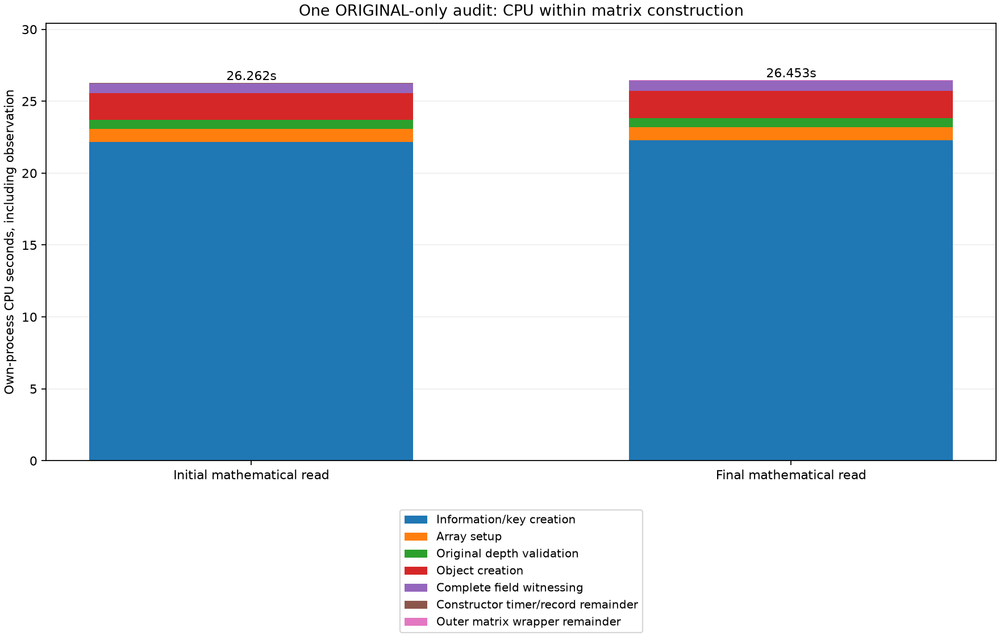

# Locate CPU inside original matrix construction

Registered November 15, 2026 in [issue #4](https://github.com/jimmy-sim/poker-ai/issues/4#issuecomment-6901801110)
before implementation or outcomes. This follows [PR #75](https://github.com/jimmy-sim/poker-ai/pull/75)
and its [failed cost condition](grouped-depth-check.md#recorded-cost-decision--november-15-2026).

## Question and completion criteria

The grouped depth check preserves all constructor fields but misses the combined
cost condition: wall time is longer, while selected matrix CPU is only slightly
lower. Preserve that outcome. The preceding region includes construction and
its field observer; it does not locate the cost of the depth loop itself.

Measure five coarse phases once per constructor: information/key creation,
array setup, original depth validation, object construction and field witnessing.
Done means a checked private instrument, complete source-bound software proof,
one original-only complete audit, retained raw outcomes, portable report and
plots, actual local/hosted checks and dated journal/work-log explanation. This
is localization, not another original/grouped cost trial or optimizer admission.

## Narrow instrument

Preserve all prior 409 source files. Add a private original-constructor copy,
entry and config: expected 412 effective files, verified after implementation.
The copy adds only explicit timing contexts around the existing blocks. Remove
only those declared contexts and the AST/signature/global dependencies must
match the original constructor. Keep its original per-group depth loop, not the
grouped predicate. Preserve arguments, subclass binding, objects, exceptions,
owned earlier/late aliases, descriptors and restoration. Reject changed/nested
hooks and unsupported processes/threads. Native spawned workers remain unchanged.

Use the same complete typed field observer and require all 184 whole-child
fingerprints to equal PR #75's pinned ORIGINAL vector in order. Tuple hashes
include every value/type; array witnesses include dtype/shape/strides/flags/full
C-order bytes. No sampling, observation-key cache, skipped proof or new policy.

The five phase contexts are mutually exclusive within one construction and its
witness. Keep before/after monotonic wall/process CPU, PID/thread, constructor
index, phase ordinal, complete/error/partial events and exact inventories. The
four constructor phases plus field witnessing must nest inside the observed
matrix/constructor boundary; disclose wrapper/timer/output remainder separately.
Never add nested parent and child CPU twice. These are process/library CPU
intervals including observation, not instruction samples or pure self-time.

## Source qualification and software proof

Before collection, tests cover literal-body equivalence, full array/metadata
identity on all five declared encodings, retained depth rejection, primary
exceptions, subclass/owned aliases/restoration, nesting/accounting, source/schema/
clock/PID/thread/cap refusal and partial retention. Complete both immutable full
local bases, relevant optional suites and both exact-source hosted roles with
actual runtime/uv/tested-tree proof before formal software evidence.

Under a complete 180-second software budget, compare original/phased construction
for the pinned small fixture/model and all five encodings. Also use an explicit
synthetic chance tree with two same-observation, same-owner/menu decision nodes
at depths one and two: both constructors must reject with the original depth
ValueError. This is a negative software fixture, not poker evidence. Preserve
its expected failure records distinctly from a failed real collection. Construct
no learner/reference or new trajectory. Publish exact qualified operators and
the complete proof before the single real archived-policy audit.

## One original-only audit

Use the unchanged original uncached context: tiny pre-read, shared recall cache,
disabled-reuse card wrappers, initial/final own mathematical reads, all three
comparison-only native workers and original source/publication/scalar checks.
Require all 432 profiles / 1,152 conditions / three computed reads and worker/
card/source/scalar/base-admission-refusal witnesses to match the original.
Retain the existing six sparse regions and exact 1,538-call inventory. The tiny
read contains no matrix construction; each real read has 92.

Require 184 whole-child constructor fingerprints matching the pinned original
and 184 complete calls to EACH of the five phases: 920 phase calls, combined
1,538+920=2,458 selected calls below the unchanged 4,096 ceiling. Missing phases
are unknown, never zero. All hook/counter/resource/clock/restoration checks must
pass for a usable profile. No global per-frame or per-node callback is installed.

Keep the complete supervised audit child capped at 900 seconds, shared controller
at 1,800, and 120 seconds of failure-saving reserve. Only one arm runs; unused
shared capacity cannot extend the child cap. Include all required startup,
source/proof/prerequisite checks, observers, original stages, final verification
and writes. An operator origin immediately before Python launch charges parent
imports/orchestration; the unchanged supervisor times the complete child.
Retain complete/partial/failing data, ignored originals and exact copies. One
attempt; no favorable retry, subset, changed cap/seed/tolerance/acceptance rule.
Publish raw before analysis. Administrative canonical copies remain outside.

Original archive execution remains Python 3.11.17 / NumPy 2.4.6 with locked
extras, declared CPU query and temporary sleep-prevention utility. Python 3.12
is software/saved-data only. OpenSpiel 2.0.2 and its recorded pinned Apache-2.0
license remain comparison-only; reference strategies never enter the agent.

## Reporting and next decision

Show per-read/global/phase counts, inclusive/exclusive CPU and non-overlapping
construction breakdown, matrix remainder, whole-body/nearby-child/worker/command
clocks and field fingerprints. Compare phases within this capture. Earlier
captures are context, not causal controls or evidence of pure observer overhead.
There is no cost-pass or training-admission claim in this profiling design.

Inspect figures and require all saved-data numeric exports to match on actual
supported runtimes with poker execution blocked. Retain export failures; make
legacy 3.11 sequential CPU association explicit if necessary, within its existing
1e-9 CPU-second arithmetic allowance, without changing raw/poker values or gates.
Final relevant local checks and both exact-report-head hosted jobs precede a
history-preserving merge. Keep one coherent PR and required publication stages,
work log and plain-English journal, with actual dates and truthful AI assistance.
Do not infer personal hours/mastery. No subagents, future automation or C++/Rust.
Continue under the active user request until stopped. PR #75's final CI/merge
remains separately required; this plan does not mark it complete.

The old 933.89/900 forecast and known-game quality failure remain. A separately
qualified production family, full original end-to-end source-bound software proof,
all three fresh own publications before any fresh native construction, all three
fresh native costs, original conservative forecast and checked published admission
still precede new trajectories. This diagnosis weakens none of those conditions.

## Three questions

**Why not repeat the comparison?** Its declared condition failed. The next
question concerns where time goes, with the original implementation held fixed.

**Why include field witnessing?** The measured matrix region contains its cost.
Separating it avoids assuming all CPU belongs to game construction.

**Does a complete profile admit a faster agent?** No. It provides a target for
another correctness/cost investigation, preserving prior failures and gates.


## Recorded source qualification — November 15, 2026

Initial source a459b06 passes all four local roles but fails both hosted jobs on
its two expiry fixtures. [Original complete records](../results/matrix-phases/qualification-history/initial-a459b06/manifest.json)
are retained. The test subtracts 2,000 seconds from uptime; this can create a
negative origin on a fresh VM, correctly refused by the production runner.
Correct only the fixture to model a positive 5,000/3,000 clock independently of
short/long host uptime. No scientific source/config/cap/seed/tolerance changes.

Corrected source f82ae1d passes both full local bases (4,230 each), both optional
suites (742 each) and both [hosted source jobs 43771918458](https://github.com/jimmy-sim/poker-ai/actions/runs/43771918458)
(4,230 each). Actual Python/NumPy, every uv selection and complete temporary
checkout trees match the checked source. [Six-role records and exact operators](../results/matrix-phases/checks.json)
precede the formal proof. Their software fixtures may exercise toy solvers; no
actual complete-audit target or new real trajectory study ran in qualification.

All 412 source files, prior 409 and 53 pinned inputs remain fixed. The formal
180-second own software proof and one original-only audit remain unrun at this
publication checkpoint. No cost/optimizer/training/default/fresh/global admission.


## Recorded software proof — November 15, 2026

After qualification1bffc0f was published, the one formal own software proof
returns zero: outer command 4.598493875004351 seconds, registered command
4.5392701660166495, supervised whole child 2.5236837080155965, all
below180. All five original/phased constructor field fingerprints match,
including all array bits/geometry/flags and every tuple value/type. Both
explicitly synthetic same-observation/depth1-and2 fixtures reject with the
original ValueError; their expected failure records remain separate. No learner,
reference constructor or new trajectory is created.

[Complete proof](../results/matrix-phases/software/proof.json),
[all25 raw/admin hashes](../results/matrix-phases/raw-software-manifest.json)
and exact launch/save operators retain original ignored outputs too; the
manifest is26th. Saved-data proof verification passes without construction.
Publish this proof before the single actual audit. It establishes this narrow
instrument check, not a speedup, production-family full end-to-end proof or
training/default/fresh/global admission. The actual audit remains unrun here.


## Recorded raw audit — November 15, 2026

After proofee4a639 publication, the single original-only audit completes:
whole child 432.06430320898653 seconds (cap900), registered shared
436.83444570799475 and complete outer command 436.86079670800245
(cap1800). Exit0, no interruption. All original432/1152/three-read/worker/card/
source/scalar checks pass, with restored hooks and all184 constructor fingerprints
equal to the pinned original. Five complete phases per constructor give920phase
calls, plus1538global calls=2458below4096.

[All32 exact raw/admin files](../results/matrix-phases/raw-pair-manifest.json)
and original ignored outputs remain retained; the manifest is33rd. This
publication precedes the detailed phase analysis. No favorable retry or new
trajectory occurs. This successful diagnostic capture does not replace the
failed production-family forecast or admit a faster/default/stronger agent.


## Recorded CPU result — November 15, 2026

Information/key creation uses **44.433599 CPU seconds**,
**84.29%** of the observed matrix
region's 52.715310 seconds. Original depth validation is only
2.45% of that region. This locates a
larger target inside key creation; it does not measure an optimizer's saving.



| Disjoint matrix component | CPU seconds | Matrix CPU share |
|---|---:|---:|
| Array setup | 1.818490 | 3.4496% |
| Original depth validation | 1.292698 | 2.4522% |
| Complete field witnessing | 1.403231 | 2.6619% |
| Information/key creation | 44.433599 | 84.2897% |
| Object creation | 3.727125 | 7.0703% |
| Constructor timer/record remainder | 0.028252 | 0.0536% |
| Outer matrix wrapper remainder | 0.011915 | 0.0226% |

The two archived-policy reads use 288.672415 process CPU seconds in total.
Observed matrix construction is 18.2613% of that total, and key
creation 15.3924%. These denominators
exclude the tiny fictional software pre-read. CPU includes observation/library
work; the five phase intervals and remainders are disjoint. Do not add the
matrix parent again. Timers do not isolate pure self-time or wall time.

| Read | Constructor calls | Calls per phase | Global selected calls | Inner read CPU seconds | Matrix CPU seconds |
|---|---:|---:|---:|---:|---:|
| Tiny software pre-read | 0 | 0 | 432 | 1.945540 | 0.000000 |
| Initial archived-policy read | 92 | 92 | 553 | 143.274095 | 26.261939 |
| Final archived-policy read | 92 | 92 | 553 | 145.398320 | 26.453371 |

The tiny pre-read's zero matrix count is verified observed coverage, not a
placeholder for missing data. Every one of the other 184 constructor calls has
five complete intervals; the published parser refuses missing/failed phases,
changed schema/clock/context, out-of-bound timing or mismatched field vectors.

### Exploratory encoding classification

This posthoc table groups **constructor encoding fields**, not final trained
representation names or strategy counts. Source field witnesses and phase
indices supply the mapping. Different groups contain different game trees and
call inventories: these aggregates are not a controlled encoding-speed test.

| Constructor encoding | Calls | Information/key CPU seconds | All constructor CPU seconds |
|---|---:|---:|---:|
| `exact` | 68 | 0.986307 | 4.272210 |
| `public_b8` | 16 | 4.966956 | 5.729262 |
| `texture_b8` | 100 | 38.480336 | 42.701923 |

Only these three encoding fields occur in this capture. The separate formal
software proof covers all five declared builder encodings. Classification is
exploratory; it adds no acceptance threshold and changes no earlier outcome.

### Complete and nested clocks

The complete supervised command is 432.06430320898653 seconds; registered parent
436.83444570799475; outer operator 436.86079670800245. All fit900/1800.
The following original-body/nearby-child intervals are nested and narrower than
the supervised clock; their resource fields are not extra elapsed segments.

| Interval | Wall seconds | Own-process CPU seconds |
|---|---:|---:|
| `body_observation` | 426.403917 | 294.189777 |
| `child_observation` | 428.256842 | 295.372888 |

| Original comparison worker | Wall seconds | Worker-process CPU seconds |
|---|---:|---:|
| 0 | 128.694521 | 126.514952 |
| 1 | 128.694510 | 126.472614 |
| 2 | 128.694523 | 126.559348 |

The three workers run in parallel. Their CPU/resource intervals are not added
into parent wall time. [Reader clocks](../results/matrix-phases/report/readers.csv),
[all six global regions, inclusive/exclusive CPU](../results/matrix-phases/report/regions.csv),
[all920 phase rows](../results/matrix-phases/report/phases.csv),
[worker resources](../results/matrix-phases/report/workers.csv),
[body clocks](../results/matrix-phases/report/bodies.csv) and
[posthoc encodings](../results/matrix-phases/report/encodings.csv)
retain the full numbers and zero/missing distinctions.

### Saved-data verification and limits

All six main numeric exports are byte-identical on actual3.12.15/NumPy2.5.4,
with actual builder/reader/child/supervisor/learner/native execution blocked.
The additional encoding CSV is byte-identical too. Explicit legacy3.11
sequential CPU association is checked against the frozen parser's existing1e-9
CPU-second arithmetic allowance; phase aggregation uses `math.fsum`. No raw
number, poker tolerance, scientific cap, seed or acceptance gate changes.
The figure was visually inspected. This is saved-data parsing, not a new bit-exact
3.12 mathematical replay or trajectory. See the
[render manifest](../results/matrix-phases/report/render-manifest.json) and
[portable receipt](../results/matrix-phases/report/replay312.json).

One original-only historical cost-context capture cannot estimate uncertainty,
population runtime, production throughput or a causal saving. Initial/final
reads share archives and recall state; they are not independent replications.
The tiny read is explicitly fictional software evidence. The other reads retain
`OLD_OWN_OPPONENT_COST_STANDINS_NO_NEW_TRAINING` scope. This does not turn them
into the prospective full24-context/48-target/144-new-profile study.

Key creation includes observations, model keys, board features, JSON and mapping
work. The phase timer does not distinguish those internals or prove that any
specific replacement is faster. The next candidate needs its own prospective
hypothesis, exact software/field checks and complete cost comparison. The failed
grouped-depth condition and older card-cache timing failure remain failures.
No optimizer/default/stronger agent is admitted here. The933.89/900 production
forecast and2.390%-versus-1% known-game accuracy failure remain. Fresh production
qualification, complete original end-to-end proof, all three own publications
before any fresh native run, all three native costs, conservative forecast and
checked admission still precede a real learning study.

```sh
.venv/bin/python scripts/profile_matrix_phases.py --show --output results/matrix-phases/pair
open results/matrix-phases/report/matrix-phases.png
.venv/bin/python -m pytest -q tests/test_matrix_phase_support.py tests/test_matrix_phase_collection.py
```
