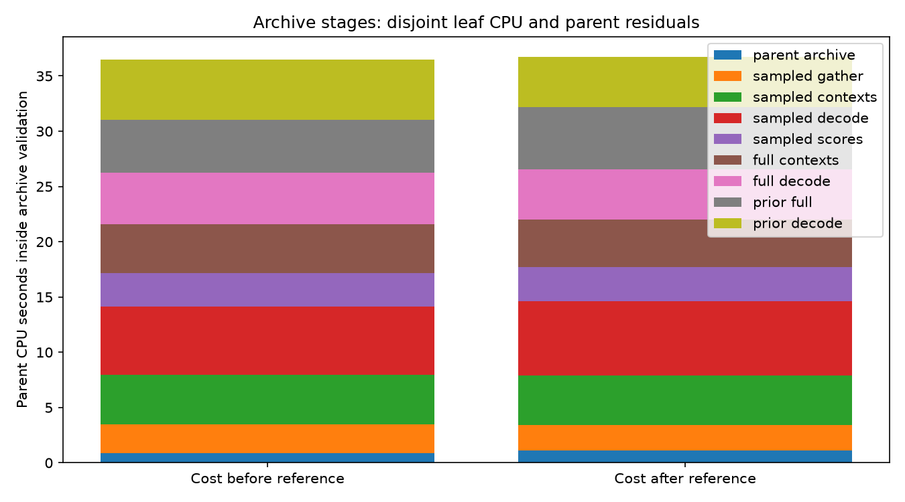
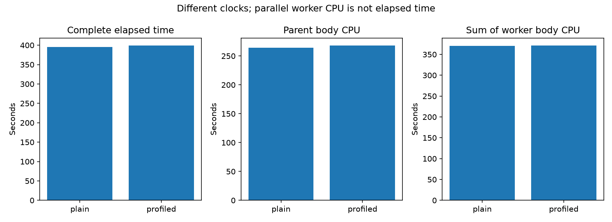

# Where archive validation spends CPU

[PR #84](https://github.com/jimmy-sim/poker-ai/pull/84) is history-merged at b852436 after all six final roles passed on 49cb951.
Actual main passes 419 focused tests and authenticates the complete saved pair;
all three numerical exports match and all ten unrelated local results remain
preserved. Its diagnostic locates 37–39 parent CPU seconds per cost read inside
sampled-parent archive validation. That boundary contains several different jobs.

Question: how much belongs to reconstructing sampled states, scoring them,
rebuilding contexts, decoding full-control checkpoints and verifying the prior
full-control record? Separate these stages together before choosing an exact
optimization. No cache, check removal, optimizer or new learning is proposed here.

## Fixed scope and call inventory

Keep the original complete ordinary/profiled cost-audit repetition 0: all three
reads, 432 profiles, 1152 fixed conditions,three comparison-only reference workers,
original ranges/actions/seeds/member order and current suit/recall implementations.
Observe selected caller-held aliases, leaving their reusable defining functions
and modules unchanged. Module proxies must forward every unrelated attribute.

| Boundary | Parent | Calls per cost read |
| --- | --- | ---: |
| compact_fixed_inputs.replay_sources | whole read | 1 |
| compact_sampled_own.gather | archive root | 1 |
| sampled gather's materialized game_contexts | gather | 1 |
| sampled-state decode, including warm states | gather | 144 |
| sampled-state scores | gather | 108 |
| direct full materialized game_contexts | archive root | 1 |
| direct full-checkpoint decode | archive root | 72 |
| prior full-control verify | archive root | 1 |
| prior full-checkpoint decode | prior verify | 72 |

These are 401 selected calls per original cost read, 802 overall. The first
fictional-software read has no selected root. The new observer's fixed event
budget is 1024 selected calls, chosen from this declared inventory. The preceding
observer's 32-call cap, all 444 preceding scientific source files and every old
result/config stay unchanged. This is a separate observation scope, not an
extension or favorable retry of the previous run. New support/entry/config would
bring the complete source binding to 447 files, preserving old fingerprint
5b966422276208f50fff1fc4ab4126271cb4405f39edbcc7a982329c86829ee9.

Caller holders: compact_opponent_sources.sampled_parent.replay_sources;
compact_fixed_inputs.old_own.gather, old_inputs.game_contexts, files.decode and
prior_full; compact_sampled_own.inputs.game_contexts, decode and scores;
compact_sampled_prior.old.decode. The decode/scores/prior_full function aliases
are imported callers, not their defining-module bindings. Time the materialized
game_contexts return, not creation of the contexts generator.

## Acceptance before formal collection

- Test forwarding, unchanged defining identities, nested three-level clock
  arithmetic, exact typed ordering/counts, ownership, late aliases, cleanup,
  exceptions and partial failures. Reject malformed/nonfinite/boolean metadata,
  missing/duplicate/reparented events and exhausted budgets.
- Retain the corrected startup rule: finite numeric 0<inner allowance<=180 and
  complete child time strictly below it; the actual CLI-startup/publication
  round-trip is covered. The unchanged complete outer 180-second limit remains.
- A source-bound own proof compares the actual archived fictional-software replay
  before/during observation, with zero selected roots. Two separately labeled
  synthetic forwarding reads exercise all 401 ordered calls each. These fixtures
  do not establish real cost-loader coverage or new independent poker mathematics.
- Complete all four immutable local base/relevant-optional roles and both exact-
  head hosted jobs. Verify actual 3.11.17/NumPy2.4.6 and 3.12.15/2.5.4, every uv
  selection and the whole tested checkout tree. Publish all six plus exact tested
  launch/retention/publication/report tools before the formal own proof.
- Use ordinary linked-index metadata access and normal Git status after worktree
  creation; retain independent source/input hashes. Never hide changed files or
  bypass checks to repair the earlier stat-cache problem.
- Read/record the pinned installed OpenSpiel 2.0.2 Apache-2.0 license before fresh
  use. Outputs remain scalar comparison-only, never agent/training inputs.
- Publish every own-proof raw byte and actually verify successful publication
  before fresh reference work. The launcher repeats this preflight inside its
  outer clock and refuses a child after exhaustion. Check actual exit status.

## One complete pair, then interpretation

Caps remain 180 seconds for the complete own proof, 900 per complete child and
1800 shared/outer, with 120 seconds only for failure retention. All startup,
source/license/publication checks, original work, restoration and writes count.
Retain every complete/partial/failing outcome; no shortened work, reseed,
unchanged-source favorable scientific retry or selected checkpoint.

Require complete scalar/computed-replay identity across arms and the previous
unchanged numerical identity ccd8e493a22a04dd0514c180d234b3ee4b62df68531eb1ddda516ea7175a7185.
Pin its published report summary (SHA256 af5bf0fd2dc172704338ed98028fc48b6b6c54b6caddc67afb6ae17691d3399c)
separately from the original 128 unchanged scientific input pins. No reference
strategy is used by this comparison. Original scalar tolerance 1e-9 chips and CPU
roundoff 1e-9 seconds stay fixed.

Require all 802 selected calls, complete PID/thread/event/command clocks, exact
ordered parent relationships and full alias/function restoration. Within each
parent, direct children plus residual must equal inclusive parent CPU. Archive
root plus outside CPU must equal complete-read parent CPU. Do not add a parent
to its children, or sum parallel worker CPU as elapsed time. Report every parent,
leaf, residual and both dependent cost reads; a residual is not a named pure job.

Publish all raw pair bytes and verify them before timing analysis. Reproduce all
numerical exports byte for byte on both actual runtimes with every identified
constructor/replay/scoring/solver path blocked, including new entrypoints and
captured aliases. Require zero forbidden calls, unchanged raw inputs and visual
review of every figure. Then complete all four final local roles and both
same-head hosted jobs before a history-preserving merge and protected-main checks.

Definition of done: the complete checked method, source/proof/raw receipts,
three-level tables/plots, report reproduction and final checks are public in one
coherent PR, with a plain-English journal/work-log account and the next decision.
One ordered diagnostic pair is not stable overhead, a causal speedup, production
costs or playing strength. No new Hold'em trajectory or stronger/default/fresh/
global admission. The 912.54/900-second forecast and 2.390%/1% accuracy failures
remain failed; this step cannot replace their required future gates.

Published prospectively on November 17, 2026, in [issue #4](https://github.com/jimmy-sim/poker-ai/issues/4#issuecomment-6945622230), before implementation or new timing outcomes.

## Implementation and current verification

The observer and runner are implemented in `scripts/parent_archive_support.py`
and `scripts/profile_parent_archive.py`, with the fixed
`configs/parent-archive-cpu.json`. Caller-held aliases are temporary; defining
functions remain untouched. The saved-data reader independently reconstructs the
three-level event tree and reconciles every parent's direct children and residual.
The runner requires the previous complete numerical identity as well as equality
between its new arms. Reports authenticate raw data without reconstructing games.

On November 17, the focused tests pass on actual Python 3.11.17 / NumPy 2.4.6 and
3.12.15 / NumPy 2.5.4: **139 passed, one optional plotting test skipped**, in
24.99 / 23.86 seconds. Ruff and formatting pass; full strict typing passes
816 files. Tests cover the actual archived software replay, synthetic 802-call
trees, exact clock arithmetic, corrupted events, publication and startup-budget
parsing, partial failures, aliases, cleanup and original exception identity.
The skipped plotting check remains required in the upcoming optional roles.

The initial new runner test still expected its predecessor's 14 calls; it caught
the new 802-call result. The assertion was corrected to the published inventory;
the diagnostic design and scientific work were unchanged. Complete source-bound
local/hosted qualification and tested operator publication remain before any
formal own proof or fresh reference comparison. No new measured result exists.


## Complete source qualification — November 17, 2026

[All six roles](../results/parent-archive-cpu/checks.json) pass on `a9c672a`, source fingerprint
`3c343e8f8963a4d73e0ea6a277db13d57f06918ba45cb1d5216be151e7089e5d` (447 files). All 444
previous scientific files and the original 128 scientific input pins remain
unchanged. Logs verify actual Python/NumPy, every hosted uv choice and the
entire tested checkout tree, rather than relying on a workflow's version label.

| Role | Actual pytest result |
| --- | --- |
| base 311 | 5220 passed, 69 skipped, 150 deselected in 724.62s (0:12:04) |
| base 312 | 5220 passed, 69 skipped, 150 deselected in 695.25s (0:11:35) |
| optional 311 | 2127 passed in 428.44s (0:07:08) |
| optional 312 | 2127 passed in 361.94s (0:06:01) |
| hosted 311 | 2026-11-17T11:41:24.3100421Z 5220 passed, 69 skipped, 150 deselected, 1 warning in 1213.39s (0:20:13) |
| hosted 312 | 2026-11-17T11:12:41.0651154Z 5220 passed, 69 skipped, 150 deselected, 1 warning in 1092.97s (0:18:12) |

Before collection, the saved-report guard was expanded from 68 to 73 targets
to cover directly imported state/context aliases and full-checkpoint capture and
metric helpers. Both final setups pass; the earlier successful setup and an
administrative filename/duplicate-output preparation failure remain archived.
The scientific source and measurement workload did not change.

The first hosted Python 3.11 job reached the unchanged 25-minute limit at
88% of the test log. Its full log, official cancellation annotation and metadata
remain in the check archive. Only that job was retried on unchanged source and
workflow. The Python 3.12 success is carried forward with its original execution
identity, not counted as a second execution. No formal scientific pair was run
or retried during qualification.

All ten tested administrative tools and complete fixture outputs are retained
with the checks: six process, five preflight, four retention and ten synthetic
publication cases pass. On both actual runtimes, all 73 saved-report guard targets
resolve, patch and restore without numerical execution. Their actual saved-report
reproduction check remains after raw pair publication.

OpenSpiel 2.0.2 remains the pinned comparison-only reference under Apache-2.0.
The full installed license was read before fresh use; both runtimes record its
11,358 bytes and SHA256
`cfc7749b96f63bd31c3c42b5c471bf756814053e847c10f3eb003417bc523d30`.
This diagnostic exports scalar comparisons, with no reference strategy input to
an agent or learner. Existing credits and license records remain intact.

This publication precedes the formal own-only proof. After that proof's raw
bytes are public and successful publication verification actually exits zero,
the exact tested launcher may start the one fixed complete pair. Source
qualification alone does not admit that comparison or any training.


## Own-only proof retained — November 17

The complete source-qualified command finishes in **6.639982541 seconds**
under the unchanged 180-second outer cap. Its inner allowance is
`179.9988875420022`, after startup; the complete child measurement takes
`6.538012999997591` seconds. The corrected remaining-allowance parser accepts this
finite remainder without extending the limit.

The actual archived software replay stays exactly identical, with zero selected
archive roots. Two separately labeled synthetic trees exercise all 802 selected
calls and restore every selected binding. No reference or learner is constructed;
this does not establish real cost-loader coverage or new independent poker math.
[All 13 raw members](../results/parent-archive-cpu/software-raw-manifest.json)
and the successful source-publication verifier are retained for publication
before reference work. Own-publication verification must actually exit zero
before the single complete comparison starts; the launcher repeats that preflight
inside its outer clock.


**November 17 — complete pair retained before analysis.** Both original full
arms finish with exact complete scalar/computed-replay identity, also matching
the previous published numerical identity. All 802 selected calls are present
and bindings restore. [All 27 raw files](../results/parent-archive-cpu/pair-raw-manifest.json)
are retained for publication before timing analysis. The successful public own-
proof verification preceded reference use; no training or new admission follows.
The next step is to verify the published raw pair, then interpret its stages.


## What the complete comparison found — November 17

The archived validation is several substantial jobs, rather than one dominant
sampled-state score calculation. Its observed root takes **36.48 / 36.74 parent
CPU seconds** in the two cost reads. Combined sampled/direct-full/prior-full
checkpoint decoding takes **16.29 / 15.88 seconds**, or **44.66% / 43.23% of archive
CPU**. The two explicitly materialized context calls take **8.88 / 8.75 seconds**,
about **24%**. Sampled scoring takes about **3.01 / 3.07 seconds**.

“Decode” includes validation and reconstruction; full-checkpoint decoding also
recomputes strategy metrics. These are not measurements of JSON parsing alone.
The remaining prior-full time includes context-generator iteration and other
checks; it is not a pure context-building or hashing timer.

[All 27 raw members](../results/parent-archive-cpu/pair-raw-manifest.json) were
public at `a9097f4` before publication verification exited zero and analysis began.
The complete scalar/calculated-replay identity is exactly the same in both arms
and the preceding published comparison:
`ccd8e493a22a04dd0514c180d234b3ee4b62df68531eb1ddda516ea7175a7185`.
All three original reads, 432 profiles, 1,152 conditions and three reference
workers remain. The 802 selected calls have the declared order, parents and full
restoration. Maximum independent scalar discrepancy is
**1.8474111129762605e-13 chips**, below the unchanged 1e-9 tolerance.

### Inclusive CPU and the work left inside each parent

All numbers below are parent-process CPU seconds. “Before” and “after” are the
two dependent cost reads in one instrumented command, on opposite sides of the
reference work. Inclusive CPU contains a region's children; residual CPU is what
remains after subtracting its direct children. Leaf regions have the same value
in both columns. Add the residuals across all rows to recover archive-root CPU;
never add inclusive parents to their children.

| Region | Inclusive before | Inclusive after | Residual before | Residual after |
| --- | ---: | ---: | ---: | ---: |
| Archive root | 36.482965 | 36.735498 | 0.877017 | 1.144968 |
| Sampled archive gather | 16.288997 | 16.574663 | 2.604198 | 2.272455 |
| Sampled materialized contexts | 4.469436 | 4.477370 | 4.469436 | 4.477370 |
| Sampled-state decode (warm + saved) | 6.201034 | 6.751928 | 6.201034 | 6.751928 |
| Sampled-state scoring | 3.014329 | 3.072910 | 3.014329 | 3.072910 |
| Direct full materialized contexts | 4.413790 | 4.271364 | 4.413790 | 4.271364 |
| Direct full-checkpoint decode | 4.668811 | 4.549105 | 4.668811 | 4.549105 |
| Prior full-control verification | 10.234350 | 10.195398 | 4.811778 | 5.615194 |
| Prior full-checkpoint decode | 5.422572 | 4.580204 | 5.422572 | 4.580204 |

Archive root plus outside-archive CPU equals each complete read:
**36.482965 + 93.753431 = 130.236396**,
and **36.735498 + 95.057322 = 131.792820**.
The outside portion is not divided by this diagnostic. The software read has
zero selected roots. Plain-arm selected zeros mean timers were disabled, not
that validation was free. [All six reads](../results/parent-archive-cpu/pair/report/reads.csv)
include these cases and every declared category.



### Complete commands and separate clocks

| Arm | Complete child wall | Parent body CPU | Sum of worker body CPU | Longest worker body wall |
| --- | ---: | ---: | ---: | ---: |
| plain | 394.975386 | 264.119136 | 370.422635 | 124.528668 |
| profiled | 398.778299 | 267.843327 | 371.006858 | 124.675314 |

The complete enclosing CLI takes **797.198346 seconds / 1,800**; both
complete children stay below 900 seconds. Source/publication preflight, startup,
all original work, restoration and writes remain inside their applicable clocks.
Parallel worker CPU is not elapsed time and must not be added to these wall
clocks. [Command export](../results/parent-archive-cpu/pair/report/commands.csv).



### Reproduction and next decision

All three [numerical exports](../results/parent-archive-cpu/pair/report/summary.json)
reproduce byte for byte on actual 3.11.17 / NumPy 2.4.6 and 3.12.15 / NumPy 2.5.4,
with all **73 numerical entry points blocked**, zero forbidden calls and every
raw input unchanged. Both PNGs were visually inspected. The
[3.11](../results/parent-archive-cpu/report-reproduction-311.json) and
[3.12](../results/parent-archive-cpu/report-reproduction-312.json) receipts retain
the exact guards and file hashes.

A concrete next question is whether repeated materialized context construction
has identical complete inputs/results and can be reused without permitting
mutation or skipping validation. This pair does not establish interchangeability
or test a cache. That needs a prospective design, independent correctness and
mutation tests, complete qualification and a new checked comparison before any
performance or admission claim. The measured source remains unchanged here.

One ordered pair does not estimate stable instrumentation overhead, establish a
causal speedup, replace the production forecast or measure playing strength.
Residuals include unseparated bookkeeping, file work and timer/capture costs.
The two cost reads share inputs and a process; they are not independent samples.
No training or stronger/default/fresh/global promotion follows. The old
912.54/900-second forecast and 2.390%/1% accuracy failures remain failed.
Final local/hosted software and report checks still precede merge.

To reproduce the report from committed raw data, choose a fresh destination:

```sh
.venv/bin/python scripts/profile_parent_archive.py report --output results/parent-archive-cpu/pair --report-output results/runs/parent-archive-local-report
```

### Questions to explain the result

- **Why subtract child timers?** A parent already contains its children. Direct
  children plus the parent's remaining work must equal its inclusive CPU.
- **Can the 36 seconds simply be removed?** No. They contain required checks and
  reconstruction. Reuse must prove identical inputs/results and reject mutation.
- **Does exact identity mean a stronger agent?** It means the measuring tool kept
  existing results unchanged. No new strategy was trained in this diagnostic.
