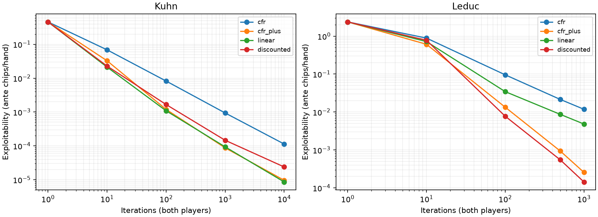

# Phase 2: exact toy games and counterfactual regret minimization

Acceptance criteria, declared before solver experiments: own Kuhn and Leduc rules
agree exhaustively with an independent implementation; implement CFR, CFR+,
Linear CFR and Discounted CFR; exact information-set best responses; verify the
Kuhn first-player value -1/18; convergence plots and raw iteration metrics; matched
OpenSpiel checks with conventions and tolerances fixed in versioned config;
quality checks and three interview Q&As. No playing-strength claim follows from
toy-game convergence. Phase 3.5 remains gated after Phase 3 training.

## Rules

Both games have two players, a one-chip ante, zero-sum net chip payoffs, and player
zero acting first each street. Kuhn has three ranks, one private card each, and
one permitted one-chip bet. Check/check closes; bet/call shows down; folding loses
one ante. Leduc has six physical cards (J/J/Q/Q/K/K), one private card per player,
a single public card after the first betting round, and up to two raises/bets per
round, sizes 2 then 4. A pair beats an unpaired hand; otherwise rank wins, with no
suit priority. Default information states distinguish physical copies, matching
OpenSpiel's default `suit_isomorphism=false`. Chance is uniform without replacement.
No free folds, rake, finite-stack all-ins, or no-limit bets appear in these games.

`ToyState` is own immutable game logic. The validation boundary maps Kuhn's
check/fold and bet/call action IDs to the project's fold, check/call, raise labels.
The information key contains own card, public board and complete action history;
never the opponent card. `scripts/validate_toy_games.py` checks every tree history,
legal action, chance probability, actor and payoff, plus a bijection between both
implementations' information sets.

## Independent reference license and boundary

OpenSpiel **2.0.2** is pinned in the optional `solver-validation` extra. The full
[versioned Apache 2.0 license](https://github.com/google-deepmind/open_spiel/blob/v2.0.2/LICENSE)
was read before use. It permits use, modification and distribution, subject to
license/notice preservation and applicable modification attribution; no warranty.
Its source headers attribute the implementation to DeepMind Technologies Limited.
The project uses its installed API for comparison only. No source is copied and
no reference strategy initializes, trains, or enters production strategy lookup.
The native reference wheel does not replace the project's own Python core.

This is the original Phase 2 rule/algorithm check approved in the roadmap. The
additional Phase 3.5 postflop spot and trained-agent comparison is not underway.
Its future license inventory and metrics will be recorded separately at its gate.

Rule sources: the pinned
[Kuhn implementation](https://github.com/google-deepmind/open_spiel/tree/v2.0.2/open_spiel/games/kuhn_poker)
and [Leduc implementation](https://github.com/google-deepmind/open_spiel/tree/v2.0.2/open_spiel/games/leduc_poker).

Implementation and experimental results follow in tested commits; no solver
convergence result is claimed at this initial rules checkpoint.

## Regret, averaging and exploitability conventions

One iteration updates player 0 then player 1. Each player traversal freezes the
joint current strategy, aggregates across hidden histories in each information
set, then updates regrets and refreshes policy. Regret matching normalizes the
positive cumulative regrets; if none are positive it uses uniform legal actions.

For player i, the information-set action regret increment is
`sum_h chance(h) * opponent_reach(h) * (v_i(h,a) - v_i(h))`.
The player's own reach is excluded from this counterfactual weight. Strategy
averaging instead weights by own realization reach. This retains decisions at
information sets the opponent might currently avoid. Average strategy, rather
than the last iterate, is the reported output.

| Variant | Regret update | Strategy averaging weight at iteration t |
| --- | --- | --- |
| CFR | Add counterfactual increments | 1 |
| CFR+ | Add then clip aggregated cumulative regrets at zero | t |
| Linear CFR | Add t times increments | t |
| Discounted CFR | Add increments, then discount positive regrets by t^1.5/(1+t^1.5), negative by 1/2 | t^2 |

There is no averaging delay or pruning. Linear uses the recurrence `(R+delta)*t/(t+1)` in code. Its weighted regret sum is equivalent
up to a positive scalar to discounting the cumulative sum by t/(t+1) after each
iteration, as in the reference. Discounted parameters are alpha=1.5, beta=0,
gamma=2; multiplication occurs after the target-player update. These conventions
matter when comparing identical iteration counts.

Sources: [original CFR](https://poker.cs.ualberta.ca/publications/NIPS07-cfr.pdf),
[CFR+](https://poker.cs.ualberta.ca/publications/2015-ijcai-cfrplus.pdf), and
[discounted/linear CFR](https://arxiv.org/abs/1809.04040).
The OpenSpiel Python discounted implementation includes a warning that its paper
results have not been verified by the OpenSpiel team; agreement is an independent
implementation check, not a replication of every claim in that paper.

Exact best response chooses one action per information set after summing
chance/opponent-reach-weighted continuation values across hidden histories.
The tree asserts equal information-set depth; these games have perfect recall.
No responder maximizes independently after observing its opponent's private card.

`NashConv = (BR_0-v_0)+(BR_1-v_1) = BR_0+BR_1` because the game is zero-sum.
Reported exploitability is `NashConv/2`, in ante chips per hand. The first-player
Kuhn value is -1/18; the profile's value alone does not establish equilibrium.
Unit tests check a known equilibrium and compare best response against all pure
strategies in Kuhn, independently of the optimized tree calculations.

## Predeclared experiment

`configs/cfr-validation.json` fixes checkpoints, algorithm order, comparison
thresholds, final convergence limits and independent best-response policy seeds.
Training has no sampling and records seed=null. Random BR sanity checks use
explicit independent PCG64 seeds; they do not turn deterministic convergence into
statistical estimates. The pilot estimated roughly 0.04–0.05 seconds per Leduc
iteration including the reference, comfortably below an hours-long budget.

`make validate-cfr` reproduces a JSON report, CSV table, and PNG/SVG convergence
plots. Checks include exhaustive rules, matched average-policy mean L1 distance
(unweighted mean across information sets of summed absolute action differences),
matched exploitability, independent BR evaluation of the mapped own strategy, and
final Kuhn value/convergence limits. It exits nonzero if any gate fails. Iteration
counts and wall times are both recorded; equal iterations do not mean equal time.
Source revision/dirty status, config, dependency hashes and environment are saved.

Plots have logarithmic iteration/exploitability axes. Small sampled checkpoints
cannot establish monotone convergence between them. These are exact full-tree
values up to floating-point error, with no Monte Carlo confidence intervals.

## Numerical diagnosis: Linear CFR accumulation

The first full comparison failed its original Leduc/Linear agreement gates at
100, 500 and 1,000 iterations, despite satisfying final convergence limits. The
complete failed report, plots and table are retained in
`results/diagnostics/cfr-weighted-sum/`, generated from clean `ea0e998`.

The initial implementation accumulated raw t-weighted regrets. In exact
arithmetic, dividing that sum by t+1 yields the reference's discounted recurrence.
Floating-point operation order differs; regret matching and later trajectories
can amplify the difference. Other variants matched, and independent best response
checks passed. The fix uses the equivalent recurrence, including operation order,
with the original comparison tolerances unchanged. No strategy output is imported
or used for training. A fresh committed-source rerun is required before advancing.

## Interview questions

**Why does CFR use counterfactual reach for regret but own reach for averaging?**
Regret asks how an action would change the player's outcome if it reached the
information set; multiplying by its own current reach would suppress learning in
parts of the game it currently avoids. Averaging combines that player's realization
plans, so its own reach determines how its successive local strategies combine.

**Why isn't a best response allowed to pick the best action in each full state?**
A full state includes hidden cards. The responder must choose the same action for
all states it cannot distinguish. We weight and sum their continuation values,
then maximize once for the information set. Exhaustive Kuhn pure-strategy search
and independent OpenSpiel BR on seeded policies check that constraint.

**Does a small strategy distance prove strong Hold'em play?**
No. It verifies agreement on the specified tiny games, conventions and iteration
budget. Different equilibria can also have different action probabilities. Exact
exploitability certifies a toy-game profile against its worst-case opponent;
full Hold'em abstractions and sampled training introduce additional error. This
phase does not measure a real Hold'em win rate or satisfy the later postflop
trained-agent validation milestone.

## Recorded acceptance results

The clean-source rerun at `e561a28` passed every predeclared gate.
Raw results: [JSON](../results/cfr-validation.json),
[CSV](../results/cfr-convergence.csv).

| Game | Variant | Iterations | Exploitability (ante chips/hand) | Player-0 value | Kuhn value error |
| --- | --- | ---: | ---: | ---: | ---: |
| kuhn | cfr | 10,000 | 0.00011332446 | -0.05556351826 | 7.9627065e-06 |
| kuhn | cfr_plus | 10,000 | 9.632757e-06 | -0.05555555911 | 3.5556146e-09 |
| kuhn | linear | 10,000 | 8.6115641e-06 | -0.05555555196 | 3.5976097e-09 |
| kuhn | discounted | 10,000 | 2.3872325e-05 | -0.05555555982 | 4.2622052e-09 |
| leduc | cfr | 1,000 | 0.01181781 | -0.08722360295 | — |
| leduc | cfr_plus | 1,000 | 0.00025715162 | -0.08559348546 | — |
| leduc | linear | 1,000 | 0.0048261327 | -0.08590462534 | — |
| leduc | discounted | 1,000 | 0.00014346789 | -0.08560719767 | — |

Maximum exploitability disagreement across all checkpoints: 1.38778e-16 ante
chips/hand. Maximum mean information-set L1 distance: 1.42376e-17. Ten seeded
random-policy BR comparisons (five per game) had zero measured exploitability
difference. These small discrepancies measure implementation agreement under the
matched conventions, not closeness to an exact equilibrium. The nonzero final
exploitabilities in the table measure the latter.

The complete command took 218.46 seconds on the recorded Mac environment, including
reference solvers, rule/BR checks, plotting and file output. Training timings by
variant are in the raw report; no general hardware speed claim is made.

Local quality gate: 338 tests, Ruff lint/format and strict mypy on Python 3.11 and
3.12. Hosted CI has not run. The corrected Linear recurrence leaves its earlier
failed comparison available for inspection. No threshold was relaxed.

Phase 2 is complete. Phase 3 begins with sampled-update math checks before any
Hold'em training. The larger trained-agent/postflop Phase 3.5 milestone remains
gated. No results here establish full Hold'em exploitability or a winning agent.
