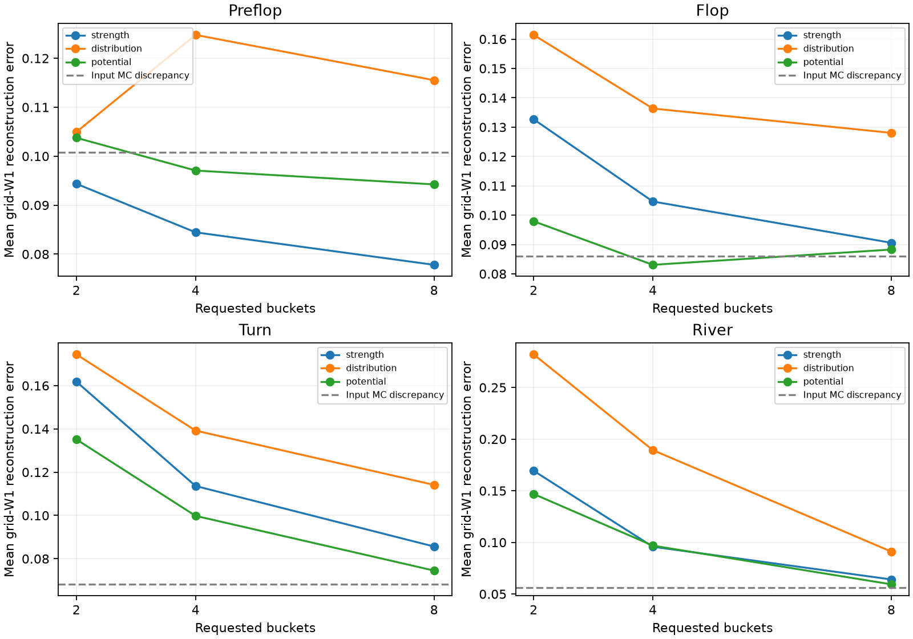

# Phase 3: sampled CFR and heads-up Hold'em

Acceptance gate, declared before implementation/training: external- and
outcome-sampling MCCFR with unbiased-update sanity checks on exact toy games;
heads-up fixed-limit before no-limit; hand-strength/expected-strength and
potential-distribution card abstractions with k-means/earth-mover comparisons and
measured information loss; explicit no-limit action abstraction/off-tree mapping;
reproducible checkpoints/resumption, multiprocessing, memory/runtime reports,
and tests. Report training budgets and weaknesses without inferring full-game
exploitability from an abstraction. Finish with three interview Q&As. Do not start
Phase 3.5 until this gate and the trained-agent prerequisite are met.

Phase 2 full-tree exact results are in `phase2-solvers.md`. Larger games cannot
materialize their entire tree in memory. MCCFR samples parts of the tree while
correcting sampling probabilities so regret updates have the intended expectation.
External sampling enumerates the updating player's actions and samples chance and
the opponent. Outcome sampling follows one explored trajectory and uses importance
weights; it is cheaper per pass but can have much higher variance.

Initial step: derive/test sampled updates before Hold'em training. Use explicit
NumPy Generator objects and fixed seed lists; no global RNG. Freeze policies for
each target-player traversal and defer regret writes until it completes. Keep
reference validation outputs out of all strategy/checkpoint inputs. No training
result or full-game strength claim exists at this planning checkpoint.

Primary method reference:
[Lanctot et al., Monte Carlo Sampling for Regret Minimization in Extensive Games](https://mlanctot.info/files/papers/nips09mccfr.pdf).

Compute policy: benchmark small pilots first. Choose bounded local experiments;
flag any proposed run likely to exceed a few hours and offer a cheaper alternative
before launching it. No C++/Rust core without the user's explicit approval.

## Sampled-update math checkpoint

`training/mccfr.py` contains own two-player external/outcome sampling. One iteration
updates player 0 then player 1 with a frozen policy during each pass. External
sampling uses standard simple two-player averaging at opponent nodes; this is not
a general multiplayer averaging implementation. Outcome sampling averages at the
updating player's visited nodes with importance correction. Exploration epsilon
is explicit and must be positive; the initial default is 0.6. No variance-reduction
baseline or clipping of importance weights is used.

For outcome sampling, let q(h) be behavior reach, pi_-i(h) opponent/chance reach,
and pi_i(h) own reach. The backward suffix already includes target/behavior tail
likelihood ratios. Only the sampled action has estimated value `suffix/q(a|h)`;
its strategy-weighted mean estimates the node value. Regret multiplies their
difference by `pi_-i(h)/q(h)`. Average mass is `pi_i(h)*sigma(I,a)/q(h)`. These
formulas require full target-action exploration and can have very high variance.
Chance is sampled on-policy, so its tail likelihood ratio is one.

Tests enumerate all external Kuhn chance/opponent sampling combinations and all
outcome-sampled terminal trajectories. Both uniform and nonuniform strategies
match analytically derived regrets; the nonuniform cases check own-reach exclusion
and behavior-policy importance corrections. Additional tests check exact seed
reproduction and a modest learning improvement over uniform. These checks precede
Hold'em training and do not constitute a trained Phase 3 Hold'em agent.

## Checkpoint contract

Own checkpoints use an explicit JSON format identifier, exact training config,
source metadata, method/exploration settings, counters, accumulated regrets and
average mass, and complete PCG64 state. Writes use a temporary file, fsync and
atomic replacement. No pickle, solver-export converter, or reference strategy
loader is used. The loader requires the own format and matching config and rejects
invalid/nonfinite accumulators. Resumption tests for both methods reproduce all
regrets, average masses, counters and random state bit for bit after split versus
uninterrupted training. This prevents accidental reference artifact loading; it
is not an authenticity guarantee against deliberately forged own-format files.

## Fixed-limit adapter domain

The first Hold'em adapter is heads-up fixed-limit: blinds 1/2, street bet sizes
2/2/4/4, four-bet cap (including the preflop big blind), and player stacks 200/200.
Stacks must exceed the maximum possible capped contribution (48 chips at these
settings). This excludes short-limit-all-in completion/reopening rules rather
than incorrectly applying no-limit rules to them. It is a fully funded capped
limit model; no claim of support for arbitrary short-stack fixed-limit games.

The adapter uses the own engine for all cards, transitions and payouts. A fresh
uniform full deck is sampled per target pass; future cards remain inaccessible
to policy keys. Sharing the sampled chance world across own branches correlates
samples without changing their expectation. Public-only observation-to-key
builders prevent access to opponent holes, burns and remaining deck. The exact
initial key retains own cards and complete public action history. Card abstraction
and no-limit action abstraction are separate subsequent steps.

## Recorded compute pilot (partial Phase 3)

`make train-mccfr-pilot` runs the committed config with three independent seeds
per method/game and two spawned workers. Each worker trains its own table; there
are no shared asynchronous regret updates. Reports: [JSON](../results/mccfr-pilot.json)
and [CSV](../results/mccfr-pilot.csv). Clean source: `16c8554`.

| Game | Method | Iterations per seed | Exact exploitability range | Training seconds range | Maximum traced peak MiB |
| --- | --- | ---: | ---: | ---: | ---: |
| kuhn | external | 10,000 | 0.00466966–0.00635913 | 3.408–3.700 | 0.449 |
| kuhn | outcome | 10,000 | 0.0127924–0.0380382 | 3.197–3.265 | 0.019 |
| leduc | external | 10,000 | 0.288315–0.300673 | 11.562–13.624 | 1.363 |
| leduc | outcome | 10,000 | 1.14782–1.18485 | 5.343–5.640 | 0.896 |
| limit | external | 100 | not measured | 4.007–4.208 | 8.643 |
| limit | outcome | 100 | not measured | 0.242–0.249 | 0.547 |

Exploitability uses the same ante-chip convention as Phase 2 for Kuhn/Leduc.
Ranges describe these three seeds, not confidence intervals. Outcome sampling is
cheaper per pass here but converges less at this iteration budget; no universal
algorithm ranking follows. Leduc outcome tables still missed up to 26 of 936
information sets; evaluation used uniform actions at unseen sets. Every pilot gate
passed, but the limits were modest smoke targets, not a solved-game criterion.

Total elapsed time was 43.88 seconds. Tracemalloc measures allocations during
training, not entire-process RSS, and adds overhead. Worker timings include
concurrent execution; they are not isolated throughput benchmarks. The raw report
records environment, worker count, thread settings, counters and checkpoint sizes.

Fixed-limit external runs created 10,953–11,248 information sets after only 100
iterations; outcome runs created 801–876. Exact-card tables have sparse coverage.
These checkpoints demonstrate training/resumption infrastructure, not a useful
Hold'em strategy, a win rate, or full-game exploitability. Card abstraction and
no-limit action abstraction remain to be implemented before the Phase 3 gate.

Own checkpoints are retained under `results/runs/mccfr-pilot-checkpoints/` (ignored
large artifacts); JSON/CSV record each path, byte size and SHA256. The command
recreates them. They contain only own sampled training state. No reference solver
artifacts are inputs. Existing resume tests verify the two methods bit for bit.

Current fast gate: 353 tests, lint and strict types. Phase 3 is ongoing; the later
external postflop solver milestone has not begun.

## Card-feature and clustering contract (implementation checkpoint)

`abstraction/potential.py` estimates current conditional showdown share against a
uniform opponent and nested distributions of conditional equity at every future
board length. Preflop includes current equity plus flop/turn/river distributions;
flop includes current plus turn/river; turn includes current plus river; river
has only a point estimate of current equity. Inner opponent/runout Monte Carlo
adds measurement noise. In particular, river never turns repeated estimator noise
into a fictitious distribution of future potential.

The feature RNG is derived from explicit feature settings/seed and canonical own
hole/public board cards via SHA256/PCG64. All 24 suit permutations are considered;
preflop canonicalization produces 169 classes. The remaining dealer deck and
actual opponent holes are never inputs. Known-card order is irrelevant for a
conditional-equity feature; past bucket recall will use the original observed
board prefixes. Features for bucket-count ablations share the same measurement
seed and samples. This mapping is deterministic, but its equity estimates are not
exact. Held-out empirical reconstruction error must report its measurement noise.

`abstraction/clustering.py` implements Euclidean histogram k-means and grid W1
(earth-mover) k-medians. For an equity grid from 0 to 1, W1 equals the sum of
absolute CDF differences divided by bins-1. Coordinatewise median CDFs remain
monotone and define valid representative histograms. Occupied clusters are
reported separately from requested counts; empty clusters are not fabricated.
A single seeded initialization is not guaranteed globally optimal.

A distribution-aware final-street histogram is distinct from potential-aware
marginal distributions through all future streets. The implementation preserves that
distinction rather than calling mean equity or only final distributions fully
potential aware. This is an original small implementation inspired by
[Ganzfried and Sandholm (2014)](https://ojs.aaai.org/index.php/AAAI/article/view/8816),
not a replication of its system or its reported playing strength. Our later key
builder will retain past abstract buckets instead of deliberately introducing
imperfect recall.

These features concatenate current and future-street marginal distributions; they
do not encode their full joint trajectory or the paper's recursive abstraction.
That dependence is an additional approximation. No replication claim is made.

## Predeclared card-abstraction experiment

`make build-card-abstraction` fits 2/4/8 buckets per street, using 80 training and
40 test states per street. Canonical train/test states are disjoint. States come
from uniform physical draws with rejection of duplicate suit-canonical states;
this is a finite coverage experiment, not uniform sampling of canonical classes
or equilibrium-reach weighting. Seeds and all nested sample counts are fixed in
`configs/card-abstraction.json` before the run.

Compare fixed-width current-strength buckets, final-distribution histogram k-means,
and all-future-marginal W1 k-medians. Keys keep every previous abstract bucket and
public betting action. Exact hole/public board identities are intentionally
projected into buckets; this loss is part of the restricted strategy class.

Evaluate current-equity MSE and mean blockwise W1 reconstruction error on the test
states against a separate, higher-budget OWN Monte Carlo feature measurement.
The config calls this `reference_features`; it is not an external solver or an
exact answer. Report low/high-budget input disagreement alongside quantized error.
That disagreement is not a rigorous lower bound or confidence interval, and errors
include measurement noise, finite fitting data, binning and quantization. More
buckets need not improve every held-out metric. No exploitability guarantee follows.
Model artifacts save own feature settings, centroids, occupied counts and source
provenance. Tests cover format rejection, round trips, card symmetry, transport
geometry and abstract recall. The experiment gate checks finite valid outputs;
there is no pretense that this small pilot finds an optimal abstraction.

## Recorded card-abstraction pilot

Clean source `3e917b7` generated 480 unique canonical states across four streets,
with disjoint 80/40 train/test splits, nine own model artifacts and 36 metric rows
in 3.00 seconds. Reproduce with `make build-card-abstraction`.
[Report](../results/card-abstraction.json), [table](../results/card-abstraction.csv),
[known-card/features dataset](../results/card-abstraction-dataset.json), and
[model artifacts](../results/card-models/) retain the complete configs/provenance.

At eight requested buckets, mean blockwise W1 reconstruction error was:

| Street | Strength | Final distribution | Future potential | Input MC discrepancy |
| --- | ---: | ---: | ---: | ---: |
| Preflop | 0.077811 | 0.115520 | 0.094238 | 0.100732 |
| Flop | 0.090586 | 0.128044 | 0.088281 | 0.086068 |
| Turn | 0.085636 | 0.114125 | 0.074512 | 0.068164 |
| River | 0.064092 | 0.091071 | 0.059375 | 0.056250 |

These are feature-space errors on this finite sample, not loss in game value.
Final-distribution k-means optimizes squared histogram distance on its selected
final-street feature; this table measures W1 across all included marginals. Its
weaker score here is not proof it is a generally worse poker abstraction. The
potential model does not beat strength buckets on every street. On the flop,
eight potential buckets did not improve on four; no monotonicity is claimed.

Only five of eight strength buckets were occupied in the preflop training set;
all eight potential/distribution buckets were occupied. Do not equate requested
counts with populated abstractions. Averaging prototypes can denoise noisy input,
so a reconstruction score below the gray input-discrepancy line is possible; that
line is not an irreducible error floor. Tiny fitting data, one initialization,
finite nested samples, uniform-opponent assumptions, missing joint future-street
dependence, and unweighted unique-state sampling limit the interpretation.

No model was selected by poker win rate. Subsequent bounded training will compare
strength and potential buckets before interpreting their effect on strategies.
An integration test verifies bit-identical abstracted limit resumption with an
empty rebuilt cache; deterministic feature seeds make cache contents irrelevant
to strategy updates. Current local gate: 367 tests plus lint/strict typing.

## Bounded abstracted fixed-limit training protocol

`make train-limit` compares own strength/potential eight-bucket models, both
sampling methods and three seeds, saving at iterations 10/100/500. The cost pilot
supports a minutes-scale local budget including tracing. No strength threshold
is declared for these small Hold'em runs; completion means valid finite own
training/checkpoints, not convergence in the full game. The exact-card pilot and
these runs have different policies/traversal patterns, so allocation differences
are not a controlled causal estimate of memory saved by abstraction.

`train_holdem.py --resume-dir PATH` resumes the newest own checkpoint for each
configured run. Keep the same config and model artifacts; it rejects mismatched
model SHA256 or core implementation hashes. The CLI was smoke-tested for both
models/methods: resumed accumulators, counters and PCG64 state matched uninterrupted
runs exactly. Source metadata is preserved at each checkpoint.

Reports separate timed training calls from session elapsed time/checkpoint
serialization. Tracemalloc starts after model loading; interval peaks reset before
training, excluding transient checkpoint serialization peaks. Retained allocations
are still included. Process-lifetime peak RSS includes imports, model loading and
checkpoint work. Spawned workers train independent seed tables, never share
asynchronous regret updates. CPU model, logical cores, thread settings, feature
cache statistics, checkpoint hashes and source/config provenance are recorded.
Entropy/nonuniform-row counts describe table updates and are not strength metrics.

## Local bet abstraction and translation

`abstraction/actions.py` defines rational half/pot/double-pot raises, optionally
including the minimum and all-in, with legal clamping/deduplication. Fractions
apply to the pot after calling, as increments above the current price. Raise-to
amounts remain total street commitments. Rounding is exact rational arithmetic,
halves upward; a short posted big blind uses the nominal price from call cost.

Local off-grid mapping accepts the public context BEFORE the proposed action.
Nearest mapping breaks ties downward. The optional randomized pseudo-harmonic
mapping uses explicit RNG and lower-neighbor probability
`(B-x)*(1+A)/((B-A)*(1+x))` for pot-normalized raise increments. Analytical tests
check endpoints, legality and the calling-frequency mixture identity. The formula
comes from [Ganzfried and Sandholm (2013)](https://www.cs.cmu.edu/~sandholm/reverse%20mapping.ijcai13.pdf).
This local implementation alone does not establish a full-game exploitability
benefit. In particular, an already applied off-grid wager changes the public
ledger; translating a number does not reconcile that history with a trained
abstract tree. Public shadow-state reconciliation and mapped-policy decoding are
still required before claiming a complete off-tree agent adapter. Real chip
accounting must stay in the actual engine, with mapping failures/fallbacks explicit.

## Recorded abstracted fixed-limit training

Clean source `7cbfcad` completed all 12 configured runs and 36 checkpoints. The
full command took 536.76 seconds on Apple M4 with two independent spawned workers.
[Raw report](../results/limit-training.json) and [table](../results/limit-training.csv)
record the own model and implementation hashes and every checkpoint's SHA256.

| Eight-bucket model | Sampler | Final iterations per seed | Information-set range | Timed training seconds range | Maximum traced training peak MiB |
| --- | --- | ---: | ---: | ---: | ---: |
| strength-8 | external | 500 | 70,511–72,120 | 134.23–140.57 | 56.51 |
| strength-8 | outcome | 500 | 2,037–2,361 | 35.84–41.98 | 3.03 |
| potential-8 | external | 500 | 67,671–71,964 | 133.27–139.09 | 56.18 |
| potential-8 | outcome | 500 | 2,071–2,594 | 32.62–41.66 | 2.56 |

The 36 own checkpoints occupy 213.63 MiB under
`results/runs/limit-training/checkpoints/`; they remain outside git and are
recreated by the command. Only completed iteration boundaries are saved. CLI
resumption requires the recorded core implementation as well as config/model
identity; use the report's source checkout for exact continuation after later
core changes. There is no claim that these 500-iteration strategies converged.

The report's process-lifetime RSS can include earlier jobs in the same reused
worker, in addition to imports/model/checkpoint allocations. It must not be read
as isolated per-run or per-method memory. The table uses traced training interval
peaks instead. Timings include tracing and concurrent local work. Counts and
nonuniform probabilities show that tables were updated; they do not measure
playing strength. No full-Hold'em exploitability or win rate was measured.

Fixed-limit implementation and bounded training now precede no-limit work. Phase 3
remains incomplete: no-limit training, complete off-tree policy reconciliation and
final acceptance reporting are still pending. Phase 3.5 remains gated.
