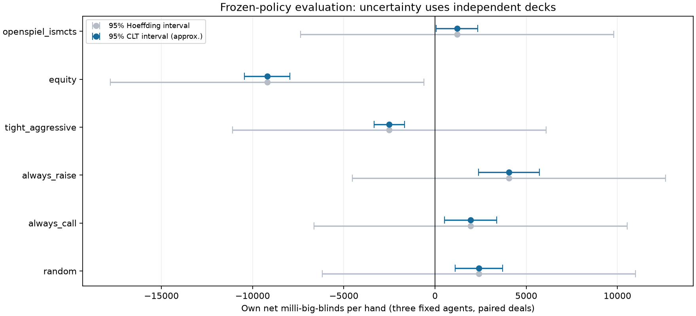

# Phase 4 — frozen-policy match evaluation (implementation)

Definition of done: fixed random/always-call/always-raise/TAG/equity opponents and
an OpenSpiel baseline; duplicate deals with seats exchanged; win rates in mbb/hand,
cluster-aware confidence intervals and a predeclared significance test; measured
variance reduction (a documented alternative to AIVAT); independent reference-rule
checks; reproducible configs/reports and three interview answers. Slumbot is a
separate conditional public-benchmark step, with permission/protocol checked first.
The timing pilot and local main study are complete and audited. Public API
benchmark preparation remains separate. No competitive playing-strength claim
has been established.

## Predeclared local experiment

`configs/match-evaluation.json` fixes the experiment before match outcomes. Primary
is the frozen own potential-8 external-sampling agent at 1,000 iterations for the
three existing seeds, without choosing favorable seeds or retraining on results.
This agent was weak in Phase 3.5's restricted games; the benchmark will measure its
actual behavior rather than assume it is strong. Both policies use full-pot/all-in
sizes with legal passive/fold choices, 200-chip equal stacks and 1/2 blinds (100bb).

Each independently sampled deck is replayed with the own agent in seat 0 and then
seat 1, fixed button 1 and reset stacks. Hole cards and public chance tape stay in
the same physical seats, so each policy receives both card/position roles. This is
simulation, with no real-money client or real-time assistance integration.

The timing pilot uses 32 duplicate decks on its own seed. The main budget is 1,000
fresh deck draws shared across opponents, three fixed agent policies and both seats. Pilot results
will estimate runtime before launching main compute; no favorable-outcome stopping
or seed replacement is allowed. Six opponent definitions are retained, including
any losses or wide intervals. Own uniform fallbacks are counted explicitly.

Baselines: uniform over matched concrete actions; check/call; largest legal raise
(all-in) then passive; a transparent tight preflop value chart plus postflop equity
heuristic; and a uniform-opponent equity/pot-odds heuristic. Equity sample budgets,
thresholds and seeds are fixed. Deterministic canonical-card equity estimates are
part of each frozen heuristic; they do not learn from match histories.

## Inference and variance

For each deal average the two exchanged-seat profits, then average the three fixed
agent policies within that deal. The independent statistical unit is the **deal**,
not each seat or training seed. The target is the equally weighted set of these
three fixed policies, not the population of possible trained agents. Per-seed
results are descriptive. Units: mean net chips/hand divided by big blind times
1,000 = milli-big-blinds/hand.

Report an approximate paired CLT 95% interval and a conservative bounded Hoeffding
interval. The predeclared primary test is two-sided mean-zero Hoeffding, corrected
with Bonferroni over six opponents. A positive estimate or narrow empirical CLT
interval alone is not the significance rule. Known payoff support is [-200,200]
chips/hand. Log tail bounds avoid reporting underflow as an exact zero probability.
These finite-sample guarantees require independent sampled deals and fixed N;
matching both seats/three agents does not multiply the independent sample count.

Duplicate pairing is the variance-reduction alternative to AIVAT here; no AIVAT
estimator is claimed. Compare empirical paired variance to the estimate obtained
by omitting cross-seat covariance. Pairing need not reduce variance. Tests include
exact cancellation for deterministic callbot self-matches, positive covariance
that increases variance, manual SE/unit conversions and familywise tail checks.

## OpenSpiel reference baseline and independence

Use OpenSpiel 2.0.2 **Python ISMCTS** with native `universal_poker` ACPC mechanics,
32 simulations, 16 world samples, one random rollout, UCT constant 200 chip units
and normalized visit counts. It is a small search baseline, not a GTO solver or a
claim of strong poker. The acting observation contains only own cards/public data;
a synthetic opponent hand constructs the native root. Search resamples compatible
opponent hands uniformly. It does not infer opponent ranges from action likelihood.

All search, rollout and world-sampling streams are explicit separate seeds. Early
prototype replay tests found native one-shot action ordering sensitivity and an
unseeded default world sampler in the Python wrapper. The chosen wrapper uses
OpenSpiel's public `set_resampler` hook with a seeded callback. Tests verify
fixed-input repeatability and invariance to the synthetic opponent hand; a failure
blocks scoring. No upstream or own C++ code is added or modified.

Native private-card dealing is grouped per player, versus the own interleaved
deal. Known cards are mapped explicitly. Native pot/all-in methods return
**total-hand raise targets**, converted to own street targets by subtracting prior
street commitments. Native has no explicit hidden burns, which does not change
the marginal conditional distribution of unseen board cards. Concrete legal menus,
nonterminal paid ledgers and net terminal payouts are checked on fixed-seed shared
full-world traces before scoring. These rules cover fully funded heads-up play
with equal stacks and this grid, not all 2–6-seat engine edge cases.

OpenSpiel's complete pinned Apache 2.0 license was read in
[Phase 3.5](solver_validation.md). The full additional ACPC license was read from
[upstream commit 6ae3e6e](https://github.com/jblespiau/project_acpc_server/blob/6ae3e6ec59b66139a9bd444ff7ba3c40271a565a/LICENSE):
CPRG/University of Alberta 2011 permission notice with a nonendorsement clause,
plus the RNG's 1997–2002 BSD three-clause notice. Preserve copyright/permission/
disclaimer and applicable nonendorsement notices; this is not labeled plain MIT.
License SHA256: `1d5b4504d396cec59bb5c9153c3725ae8eb80522bd3ddee76c26919eec09b56d`.
The inspected upstream commit is from 2020; OpenSpiel's install script clones that
dependency's master branch without exposing the wheel's exact bundled commit.
The OpenSpiel version/locked wheel is known; exact bundled ACPC source identity
is a provenance limitation, not an invented verified revision. The
[pinned upstream README](https://github.com/google-deepmind/open_spiel/blob/v2.0.2/open_spiel/games/universal_poker/README.md)
also cautions that this game has not been extensively reviewed by its team.

Reference search is an opponent inside evaluation only. It is never imported by
own agent/training/abstraction modules or used as own training data/strategy.

## Slumbot preparation — no game requests sent yet

The [official public API example](https://slumbot.com/sample_api.py) documents
anonymous sessions, `/slumbot/api/new_hand` and `/slumbot/api/act`, street raise-to
amounts and 50/100 blinds with 20,000 chips (200bb). The
[maintainer's October 12, 2026 reply](https://github.com/ericgjackson/slumbot2019/issues/49)
approves paced anonymous research with sequential requests and backoff on errors.
A small separately declared pilot can follow local validation; no large/multi-hour
session will start without flagging compute/sample tradeoffs. No account messages
or credentials are needed. The unrelated `slumbot.lol` terms are not this service.

A matched-depth own 200bb checkpoint must be trained from own self-play only before
this benchmark. Public protocol parsing/settlement and error handling must be
verified first. Do not copy/import the example implementation, disable TLS checks,
retry ambiguous non-idempotent actions blindly, hide incomplete hands or report a
small connectivity pilot as a competitive win-rate result. External server deals
are not client-seeded; retain sanitized raw responses and label live rerun limits.

## Local commands

Own checkpoints must exist (`make validate-solvers` recreates them from own
self-play). The pilot/main commands install the pinned optional reference/plot
extras and independently verify the configured 1,000 native-mechanics traces.

```sh
make check
make pilot-evaluation  # 32 decks/opponent, separate chance seed; ignored outputs
make evaluate-agents  # 1,000 fresh decks/opponent, all three fixed own policies
```

A failed rule/action/fingerprint check aborts scoring. A technical time-budget
abort keeps raw completed hands for diagnosis, does not infer from a partial
prefix and does not replace reviewed results. Worker processes are fresh, with
fixed RNG streams and no shared learning. Main data retain all per-hand profits,
counts and deck hashes so interval calculations can be audited separately.


## Timing pilot gate

The separately seeded pilot completed all six opponents and its 1,000-hand native
mechanics gate with zero payout disagreement. A second fresh-process run exactly
replayed all raw hand records, inference outputs and own lookup counts. See the
[retained pilot](../results/evaluation/pilot/pilot.json) and
[replay audit](../results/evaluation/pilot/reproducibility.json). The pilot projects
about seven minutes of serial worker time for the main budget; parallel wall time
and cache/startup costs differ. This is below the few-hour compute warning gate.
No pilot scores were used to change seeds, agents, sizes, thresholds or N.

The two displayed 95% intervals are pointwise, not simultaneous family intervals.
The predeclared family-adjusted test determines significance. Pilot intervals
have particularly low power; the fresh fixed-N main study below is the local
evaluation evidence.

<!-- EVALUATION_RESULTS_BEGIN -->
### Local duplicate-deal evaluation

**36,000 simulated hands**, six fixed opponents, 3 frozen own training seeds. The same **1,000 independently drawn decks** are reused across both seats, fixed agents and opponents; each comparison has N=1,000 independent clusters. It does not have one independent sample per hand or per training seed. Stakes: 100bb; matched full-pot/all-in grid.

| Opponent | mbb/hand | Approx. 95% CLT CI | Conservative 95% Hoeffding CI | Adjusted p bound | Paired variance ratio |
| --- | ---: | ---: | ---: | ---: | ---: |
| random | +2400.6 | [+1100.4, +3700.8] | [-6188.8, +10990.0] | 1 | 0.505 |
| always_call | +1953.5 | [+517.9, +3389.1] | [-6635.9, +10542.9] | 1 | 0.192 |
| always_raise | +4051.6 | [+2373.4, +5729.8] | [-4537.8, +12641.0] | 1 | 0.418 |
| tight_aggressive | -2508.6 | [-3349.9, -1667.3] | [-11098.0, +6080.8] | 1 | 0.729 |
| equity | -9201.3 | [-10447.1, -7955.6] | [-17790.7, -611.9] | 0.174 | 0.511 |
| openspiel_ismcts | +1206.8 | [+63.9, +2349.7] | [-7382.6, +9796.2] | 1 | 0.457 |

Predeclared six-opponent family test: **0/6 positive advantages and 0/6 nonzero means pass** the conservative Bonferroni–Hoeffding criterion. Pointwise approximate CLT intervals suggest differences, but they are not the predeclared primary significance rule. Failure of that test does not establish zero advantage; its worst-case bound has low power at this N. Point-estimate losses occur against tight_aggressive, equity. The small ISMCTS opponent is a limited search baseline, not an equilibrium strategy or competitive poker benchmark.

Estimated paired/covariance-omitted variance ratios: **0.192–0.729**. This is the documented variance-reduction alternative to AIVAT; no AIVAT estimator or independent unpaired-match experiment is claimed. All raw hand records, own fallback counts, seed results and failures are retained.



Reproduce with `make evaluate-agents`; `make report-evaluation` re-audits and renders existing raw results without replaying matches. See this document for policy definitions, reference license/rule checks and limitations. No real-money client is used.
<!-- EVALUATION_RESULTS_END -->


## Local main acceptance and interpretation

The match command completed from clean `7b076d2` in 353.92 seconds on the recorded
Apple M4/Python 3.11.17 environment. All six opponents completed 1,000 shared decks
and 6,000 hands each, with zero action projection/shadow failures. Independent
native controls covered 1,000 hands / 2,824 actions, including 324 showdowns and
676 folds, with zero payout discrepancy. These are sampled matched-grid traces,
not exhaustive rules coverage.

[Raw main report](../results/evaluation/matches.json) and
[record audit](../results/evaluation/record-audit.json) retain source/config/dependency
hashes and all 36,000 raw hand rows. The audit independently reconstructs deck
hashes, verifies every deal/policy/seat combination, recomputes pooled inference
exactly and reconciles lookup totals. The same 1,000 chance tapes are reused across
opponents; no overall confidence calculation treats 36,000 hands as independent.

[Actual lookup coverage](../results/evaluation/lookup-coverage.csv) is measured on
the own policies' played decisions, not Phase 3.5 reference reach. A saved average
row can still be uniform, so a match is not a quality certificate. Differences
between global-deal evaluation and narrow conditional spot comparisons do not
contradict each other.

The positive approximate CLT intervals and the stricter nonsignificant primary
results answer different inference questions. Hoeffding uses the entire known
[-200,200] payoff support and ignores empirical variance reduction; its pointwise
intervals are conservative, and Bonferroni further controls six comparisons. No
opponent passes the predeclared corrected test. This does not establish equality
of strategies or erase the observed unfavorable TAG/equity results. Do not swap
the primary test after seeing this pattern.

The OpenSpiel opponent uses just 32 simulations and uniform compatible-hand
resampling on a 100bb full-pot/all-in abstraction. A positive point estimate
against it is not a claim to beat OpenSpiel CFR, GTO Hold'em or professional bots.
The local data do not measure unrestricted exploitability or real-money returns.

Local code gate at this checkpoint: Python 3.11 **433 passed**; Python 3.12
**427 passed, 6 optional-reference skips**. Ruff and strict mypy passed. Hosted CI
has not run. Figures were inspected. Generated resume drafts are in
[verified-claims.md](../results/evaluation/verified-claims.md); they describe the
measurement system and preserve the unfavorable/nonsignificant outcomes.

## Three interview questions

**Why aren't 36,000 hands 36,000 independent samples?** Each of 1,000 decks is
reused for two seats, three fixed agents and six opponents. I average within deck
and calculate each matchup's uncertainty over those independent deck clusters.
Bonferroni remains valid even though opponent comparisons share chance tapes.
The training seeds define fixed policies, not a sampled training population.

**Why can the approximate interval exclude zero while the primary test fails?**
The CLT interval uses observed paired variance and an asymptotic approximation.
The bounded Hoeffding test protects against worst-case payoff distributions,
then controls six tests. It has less power here. I preregistered that criterion,
report both and do not choose the more favorable inference after seeing results.

**What makes the external baseline check credible, and what doesn't it prove?**
The policy receives only own/public observations; synthetic opponent cards are
resampled with an explicitly seeded callback. Fresh-process replay and private-card
invariance tests passed, while independent native action/ledger/payout traces
matched. Its small search budget and uniform ranges make it a limited opponent;
beating its point estimate would not establish equilibrium quality or competitive
poker strength. No reference outputs enter own training or strategy weights.


## Separate public-pilot design, declared before API outcomes

`configs/slumbot-pilot.json` fixes **100 hands**, anonymous access, at least one
second between sequential requests, a 30-minute/1,000-request technical cap and
strict TLS. This is a small protocol/translation pilot, not a high-power strength
benchmark. The sample size, first seed and thresholds are fixed before any game
request; no outcome-based replacement or favorable-prefix stopping is allowed.
A technical/ambiguous POST failure aborts the session and retains incomplete-hand
status instead of silently dropping a possible loss or blindly replaying an action.

`configs/slumbot-own-training.json` separately fixes own-only global 200bb self-play:
potential-8, external sampling, three seeds and 1,000 iterations. Public primary
is seed 20261115, chosen in advance, not the best observed seed. The production
API has 20,000 chips with 50/100 blinds, exactly matching the trained 400 chips at
1/2 in depth. The existing public-history translator handles actual chip sizes;
o server/reference strategy probabilities or outcomes enter own training.

These results must not be pooled with the 100bb matched-grid local study. Slumbot
can use off-grid sizes, its current strategy/version/dealer are server controlled,
and the client cannot set deal seeds. Retained sanitized responses permit replay
of accounting/statistics, while another live run need not reproduce the same
cards/actions. Prefix failures do not receive a complete-sample inference claim.

The matched-depth own training completed all three predeclared 1,000-iteration
runs. Public primary remains the first seed, not a selected winner. The CLI dry
preflight checks both positions with synthetic own deals, without consuming live
RNG state or making a game request. Offline fake-server tests cover street-total
bets, terminal/fold accounting, token sanitization, missing outcomes, no retries
on ambiguous requests and no inference from a favorable but incomplete prefix.

```sh
make train-slumbot       # own-only 200bb self-play; no game requests
make preflight-slumbot   # load/check matching-depth policy; no game requests
make benchmark-slumbot   # explicit live, paced 100-hand public simulation pilot
```

Each live attempt receives a unique UTC-named report and sanitized event archive;
prior failed attempts are not overwritten. Tokens stay out of persisted logs.
Only confirmed server net winnings become outcomes. Fold settlements are checked
independently from public chip flow; synthetic showdown results never replace
server outcomes. Per-decision lookup/translation diagnostics are retained. Server
version/deal independence are unverified, so pilot intervals are conditional on
stated IID assumptions, not finite-sample guarantees about an opaque service.
Recorded statistics/settlements can be checked without network access using
`uv run --locked python scripts/benchmark_slumbot.py --replay-report REPORT.json`.

The user selected **Bayesian opponent modeling and bankroll/risk analysis** for
Phase 5. Those follow this evaluation step. Adaptive learning will use own
simulated opponents, keeping all external reference/benchmark outputs out of
strategy training.

<!-- PUBLIC_PILOT_BEGIN -->
### Public Slumbot protocol pilot

The predeclared **100-hand** anonymous 200bb pilot completed with **-345.50bb net** (**-3,455 mbb/hand**). The approximate IID 95% interval is [-11,315, 4,405] mbb/hand; the much wider conditional-IID Hoeffding interval is [-57,779, 50,869]. Both contain zero. Server independence is unverified: this is an API and translation pilot, not evidence of a winning agent.

All 100 settlements replay offline, including 95 independently checked fold settlements. The remaining showdown outcomes use server net winnings; no opponent-card showdown verification is claimed. Saved average rows were found at 141/155 decisions (91.0%); 11 unseen and 3 unaveraged rows used fallback. There were no shadow/depth failures, 0 decisions with clipped raises and 0 with unavailable raise mass. However, 73/155 decisions had nonzero history-size approximation, and 55/141 decoded distributions had nonzero output-grid approximation. Legal translation does not preserve strategy or EV.

The server controls deals and its unreported policy version, so the live outcomes cannot be reproduced from client seeds. Sanitized logs reproduce recorded accounting and statistics. No API results train or update the agent; this pilot remains separate from open-source solver validation and the 100bb duplicate study.

Recorded evidence: `results/slumbot/public-pilots/pilot-20261103T072514.940829Z.json`. Re-render and verify without network: `uv run --locked python scripts/render_public_pilot.py --report results/slumbot/public-pilots/pilot-20261103T072514.940829Z.json`.
<!-- PUBLIC_PILOT_END -->
