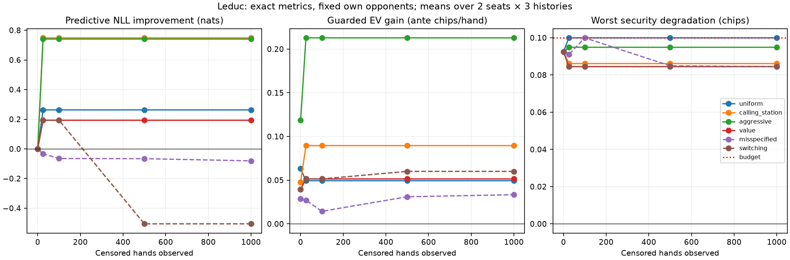
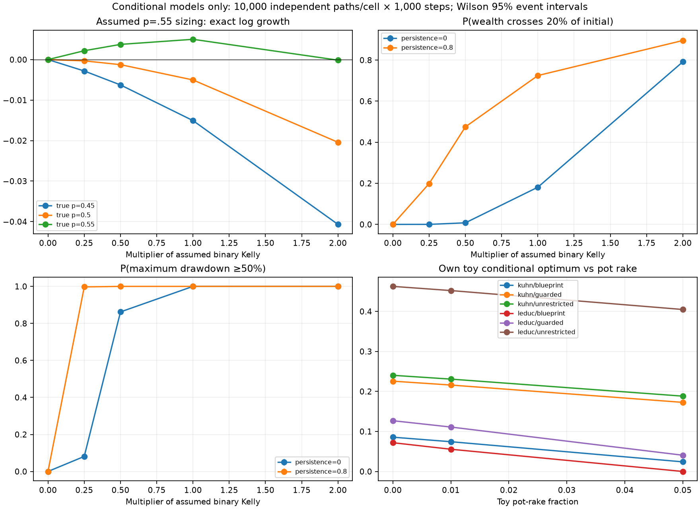

# Phase 5 — Bayesian opponents and conditional bankroll risk

The user selected these two extensions on November 2, 2026. This definition of
done and the versioned configs precede implementation and all extension results.
All learning uses own simulated policies; reference/benchmark outputs are excluded.
At preregistration, no extension results existed.

## Acceptance criteria

1. Exact finite-hypothesis Bayesian inference on own Kuhn and Leduc. Evidence
   contains own card, public board and public actions, never opponent cards.
   Marginalize all compatible hidden deals, including folded hands. Deliberately
   censor showdown cards/payoff from the learner to isolate public-action learning.
   Verify likelihoods by independent small-tree enumeration and manual examples;
   identical public evidence must produce identical updates despite hidden cards.
2. Distinguish a root mixture of opponent policy types from averaging local action
   probabilities. Convert root mixtures to behavioral policies using each type's
   own realization reach. Verify cross-play EV linearity and a counterexample to
   naive local interpolation. All responses obey information-set constraints.
3. Own CFR+ supplies the fixed blueprint. Best respond to the posterior predictive
   opponent. Limit the root-level mixture with the blueprint using a predeclared
   **0.1 ante-chip per-hand degradation budget relative to blueprint security**.
   Security means minimum exact expected payoff over all opponent strategies.
   For base/candidate securities s0/s1, choose lambda <= budget/(s0-s1) when s1<s0.
   Concavity of minimum payoff gives security(mixture) >= (1-lambda)s0+lambda*s1.
   Recheck the actual mixed policy with exact best response to tolerance 1e-10.
   This is a conservative budget, not zero-cost safe exploitation, and only holds
   in these complete exact games. It is not the gift-budget algorithm in the paper.
4. Fixed configs/seeds/checkpoints; both seats; own uniform/calling/aggressive/value
   types; misspecified and switching opponents. Report posterior weights, held-out
   exact predictive log scores, exact cross-play EV and worst-case security for
   blueprint, unrestricted response and guarded response. No monotone-learning or
   profitable-exploitation threshold: failures are results. Predictive scores use
   the same fixed blueprint logging policy at every checkpoint to avoid changing
   the scoring distribution. Sampling uncertainty across three histories is
   descriptive, not population certainty or Hold'em strength.
5. Bankroll: exact bounded-return expected log-growth optimizer; known binary
   Kelly control; fractional sizing, pot-rake sensitivity and model uncertainty.
   Simulations track finite-horizon threshold crossing and maximum drawdown.
   Fractional wealth >0 is not literal ruin; fixed-stake absorbing ruin is a
   separate process, checked against finite-horizon dynamic programming and the
   eventual gambler's-ruin formula. Report Monte Carlo uncertainty and assumptions.
6. Risk experiments use explicitly synthetic binary laws plus own toy strategies
   against own scripted opponents. No positive real-world edge is assumed from
   earlier non-significant evaluation point estimates. Fees are a specified toy
   pot-rake model; no casino schedule or financial recommendation is implied.
7. One offline command reproduces configs, raw tables, plots and report markers;
   tests cover hidden-card censoring, mixture semantics, security certificates,
   Kelly boundaries, ruin timing and sample dependence. Quality gates on 3.11/3.12;
   methods/limitations, verified claim drafts and three interview Q&As per extension.

## Sources and scope

Read November 2, 2026, as mathematical background; no code/data copied:

- Ganzfried & Sun, [Bayesian Opponent Exploitation in Imperfect-Information Games,
  v6](https://arxiv.org/html/1603.03491v6). Our finite categorical type model is
  narrower than their continuous Dirichlet treatment; no paper replication claim.
- Ganzfried & Sandholm, [Safe Opponent Exploitation](https://www.cs.cmu.edu/~sandholm/safeExploitation.ec12.pdf).
  Our explicit nonzero degradation allowance is weaker than guaranteed game-value
  safety and does not implement their gift-based construction.
- Kelly, [A New Interpretation of Information Rate (1956)](https://bpb-us-w2.wpmucdn.com/u.osu.edu/dist/7/36891/files/2017/07/Kelly1956-1uwz47o.pdf).
  Expected log growth assumes a specified return law; optimality does not remove
  estimation error, finite-horizon loss or model drift.
- Karger & Lynch, [MIT 6.042 Lecture 26 (2000)](https://courses.csail.mit.edu/6.042/past-devel/archive/spring00/archive/lectures/L26.pdf),
  fixed-stake absorbing random walk. It differs from fractional sizing.

The exact-game scope makes the inference and safety arithmetic fully auditable.
It does not attach an unvalidated model or bankroll recommendation to the sparse
Hold'em prototype. Larger-game adaptation remains future work after these checks.

## Implementation and mathematical conventions

A categorical prior covers four explicitly scripted, full-support own policies.
The simulator censors each completed hand before it reaches the learner. A record
has observer seat/card, board and betting histories; no opponent card or payout.
For a hypothesis h, sum chance(z) × opponent-own-reach_h(z) over every compatible
terminal z. Observer action probabilities and own-card probability are common
factors and cancel in posterior odds. Folded and showdown hands use the same
censoring rule. Log-space updates avoid numerical underflow; impossible evidence
raises an error rather than silently resetting the prior.

The posterior is over a **single stationary type for the entire match**. At a
specific information set, its behavioral prediction reweights types by their
own action reach. For a single future hand this is the root-mixture conversion
in `policies.py`; it includes within-hand action evidence without multiplying the
same evidence twice. After the hand, the complete transcript updates the prior
once. A finite stationary family is intentionally misspecified for the local
calling/value mixture and for a value-to-aggressive switch after hand 500.
No forgetting/change-point detector is added after seeing those outcomes.

Own CFR+ blueprints train for the predeclared counts, without reference output.
Collection uses the guarded response frozen between checkpoints. Predictive NLL
is an exact expectation over the same blueprint-generated public-transcript law
at every checkpoint, conditional on own card. Own actions remain in that law for
normalization; their entropy is common to prior/posterior comparisons. At the
switch checkpoint 500, evaluation uses the new type while observations still
come from the previous type. This deliberately exposes adaptation lag.

Exact best response chooses one action per information set after summing over
hidden states. A worst-case security value is not a realized per-hand floor or
NashConv/2. Reported EV gains hold against the specified scripted opponent only.
Gains against the CFR blueprint include exploitation already available from the
prior; they do not isolate the incremental EV benefit of learning.
The exploitation fraction is chosen using the lower bound in the acceptance
criteria, then checked again against an exact opponent best response. The bound
can be conservative; unrestricted response is retained as a diagnostic tradeoff.

Risk uses net return X in [-1,1] per maximum-loss unit. Optimize E[ln(1+fX)] for
0<=f<=0.95 by the monotone derivative E[X/(1+fX)]. Nonpositive mean selects f=0.
Synthetic p=.55 sizing is held fixed while true p and return persistence vary.
The sticky Markov process retains its previous outcome with probability rho,
otherwise independently resamples; stationary marginal returns stay unchanged.
Expected log growth per step stays the same while drawdown probabilities change.
Independent **paths**, not steps or cells, are the interval unit. Fraction cells
reuse paths; they cannot be pooled as independent observations.

The toy risk input is selected in advance: first history seed, seat zero,
aggressive opponent, final checkpoint, both games and all three policies. Exact
terminal returns include optional winner-paid pot rake on **every** pot, including
folds; ties share the fee. This uncapped toy schedule and continuous bankroll
scaling are assumptions, not a live poker cash-game model. The own risk-profile
format/provenance is checked, and a reference-strategy format is rejected.

For fixed-stake ruin controls, exact finite-horizon absorbing-chain probabilities
are compared with Monte Carlo at family alpha .001 (Hoeffding over three controls).
Eventual ruin is reported separately; an unabsorbed path at the horizon is not a
ruin. All Monte Carlo event probabilities include path-level Wilson 95% intervals,
including zero observed events. Marginal expected terminal log wealth is also
checked with a bounded independent-path Hoeffding tolerance at family alpha .001,
using the full path range; this remains valid for dependent steps within a path.

## Bayesian interview questions

**Why can't I count observed raises as independent samples of an opponent's type?**
Their chance to reach a node depends on earlier actions and hidden cards.
I sum over compatible deals and the type's full action likelihood, then update
once per completed transcript. Root mixtures use realization reach at each node.

**What is actually safe about the exploitation?**
Only a specified expected degradation relative to the own blueprint's worst-case
value is certified in complete Kuhn/Leduc. An episode-level mixture gives a
concavity bound, checked by exact best response. It can sacrifice up to 0.1 chip
per hand, and it gives no safety guarantee for the abstracted Hold'em agent.

**Why can more data hurt predictions?**
A stationary finite family can confidently choose the wrong approximation to a
misspecified or changing opponent. I predeclare these stress cases and keep their
negative prediction gains; posterior confidence is conditional on the model.

## Bankroll interview questions

**Why doesn't optimal Kelly sizing guarantee a good bankroll path?**
It optimizes expected log growth under an assumed law. Finite-horizon losses,
drawdowns, parameter uncertainty and return dependence remain. I vary these
assumptions and report threshold probabilities rather than recommending stakes.

**How do fractional threshold crossing and risk of ruin differ?**
With f<1 and X>=-1, every wealth multiplier is positive, so finite-horizon literal
bankruptcy cannot occur. A 20%-of-initial threshold is a different event.
Fixed-unit stakes can hit zero; their absorbing walk has separate exact controls.

**Why use independent paths for intervals?**
Returns within a sticky path are correlated, and fraction comparisons reuse
randomness. Each cell's complete paths are independent. I compute event intervals
at that level and never multiply the effective sample size by steps or cells.

<!-- EXTENSIONS_BEGIN -->
### Selected quantitative extensions

Own finite-type Bayesian models: **72,000 censored toy hands**, **360 exact checkpoint profiles**. Each table cell is the final-checkpoint mean over both seats and three training histories. Positive NLL improvement means better held-out public-transcript prediction under a fixed blueprint logging policy. EV gains are exact **ante chips/hand versus the same own scripted opponent**, relative to the own CFR+ blueprint.

| Game | Opponent scenario | NLL improvement (nats) | Guarded EV gain | Unrestricted EV gain |
| --- | --- | ---: | ---: | ---: |
| kuhn | uniform | +0.0441 | +0.0738 | +0.3101 |
| kuhn | calling_station | +0.4407 | +0.1103 | +0.1517 |
| kuhn | aggressive | +0.4961 | +0.1479 | +0.2185 |
| kuhn | value | +0.0979 | +0.0456 | +0.1398 |
| kuhn | misspecified | +0.0622 | +0.0438 | +0.1352 |
| kuhn | switching | -0.0040 | +0.0161 | +0.0697 |
| leduc | uniform | +0.2628 | +0.0493 | +1.6662 |
| leduc | calling_station | +0.7489 | +0.0895 | +0.8345 |
| leduc | aggressive | +0.7410 | +0.2128 | +1.9847 |
| leduc | value | +0.1930 | +0.0514 | +1.0290 |
| leduc | misspecified | -0.0808 | +0.0333 | +0.6661 |
| leduc | switching | -0.5055 | +0.0600 | +1.2003 |

The model improves predictions on included stationary types but can worsen them under misspecification or drift. A root-level exploitation mixture is certified to lose at most **0.1 chip/hand of blueprint worst-case security in these exact games. This permits some degradation; it is not a Hold'em guarantee or a game-value safety claim.

Conditional bankroll study: **120 cells**, 10,000 independent paths per cell, 1,000 steps/path. In the synthetic binary p=.55 model with sizing chosen at that assumed edge, persistence 0: threshold crossing 18.1%; persistence 0.8: threshold crossing 72.5%. The specified uncertainty set gives a robust fraction of **0**. All fixed-stake Monte Carlo controls match finite-horizon exact ruin probabilities within the predeclared reported tolerance. Fractional threshold crossing is not literal bankruptcy. Return laws, fees, stationarity and stake scaling are model assumptions; no positive real-world edge or bankroll recommendation follows.

`make analyze-extensions` reproduces both studies, posterior audit, tables and figures offline. No external solver or public benchmark outputs enter learning. See [methods, limitations and interview answers](phase5-extensions.md).
<!-- EXTENSIONS_END -->

## Measured-return follow-up, specified before its simulation

The original risk scope also calls for measured returns. The separate versioned
`configs/empirical-bankroll.json` specifies **all five own scripted baselines**,
with no favorable-opponent selection. It excludes OpenSpiel and Slumbot outcomes.
Use the original 1,000 shared-deck blocks per opponent, retaining all three frozen
own policies and both seats inside each six-hand block. Resampling blocks retains
within-deal dependence; simulated blocks are draws from this fitted empirical law,
not a fresh independent validation of the mean or the original agent's strength.

Report the measured cluster mean/variance, half/full plug-in Kelly and a separate
confidence-robust fraction. For each opponent, a one-sided Bonferroni–Hoeffding
lower mean uses alpha .05 over five opponents and cluster support [-200,200]
chips per hand. Under normalized support [-1,1] and mean at least m, concavity
bounds log growth below by the endpoint binary law with p=(1+m)/2. Optimize that
worst law; when the lower mean is nonpositive the fraction is zero. This is a
conditional confidence construction, not a recommendation or an inferred edge.

Fees of 0/5/10 bb per 100 hands are **illustrative fixed-cost sensitivities**.
They do not claim to reproduce a real site's pot-dependent rake schedule.
Original gross returns, fee-adjusted means, uncertainty and adverse matchups all
remain visible. Since no positive edge passed the primary evaluation test even
before fees, a positive fitted return after these costs cannot establish that an
edge survives realistic rake. Do not infer live poker profitability from these
simulations. The toy pot-rake study is a separate specified fee experiment.
