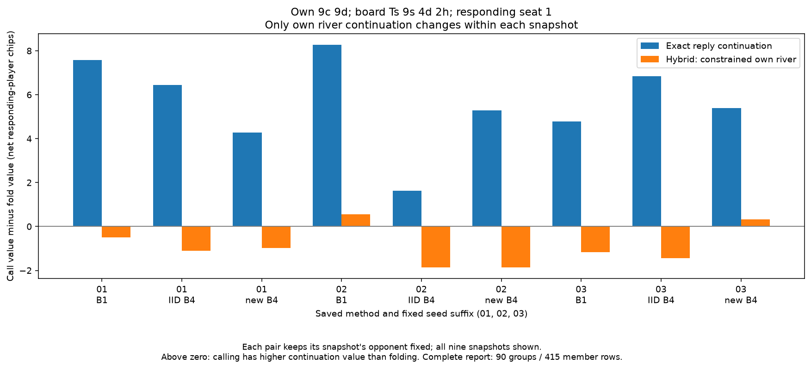

# Why can a river continuation change a turn decision?

November 10, 2026. Issue #4 comment 6776137714 registers this saved-data contrast
before measuring the new action values. Keep all nine primary profiles, both
seats, every previously ranked top-five group and every exact member.

For the same fixed saved opponent, compare the own exact best reply, the own
information-constrained reply, and a hybrid with exact pre-river rows but
constrained river rows. Compute conditional action values using the existing
own function. The hybrid changes only the responding player's river strategy;
opponent probabilities stay identical.

Check all three root values against the audited source, all policies legal,
unchanged opponent and pre-river rows, unchanged inputs, finite values, complete
group/member inventory and identical opponent/chance support within 1e-12.
Root tolerances stay at 1e-9 chips. Unsupported rows remain present with no
preferred action; supported ties use the first legal maximizer.

These are continuation contrasts against a fixed opponent. They can explain
why changing later choices changes an earlier action's value. They do not
measure the benefit of retraining, isolate extra-information-only row losses,
or establish poker advice. Keep the failed strength gate and all seeds, caps,
defaults and historical source/data unchanged. No learner or native reference
is constructed; no reference strategy enters the calculation.

The final decision report must be hash-checked and pinned before execution.
The prospective summary hash comes from the retained complete initial report;
require the safeguarded final report to reproduce those exact bytes. If it
does not, investigate rather than changing the prospective hash. All local and
both hosted checks must pass before merge.

## Implementation checkpoint

The report entrypoint reuses the completed decision panel/archive loader, own
scoring context and conditional-action helper. It validates the exact/restricted/
hybrid roots against the audited source, fixes opponent rows, checks that the
hybrid changes only own river rows, and retains all 90 groups / 415 exact members.

Thirteen checks pass in 0.52 seconds. A fictional two-decision example has a
stop payoff of 1, continuation payoff of 4 with a good later choice, and 0 with
a bad later choice. It verifies both target signs and that own past reach is
excluded from counterfactual support. These are constructed continuation
profiles, not CFR training or equilibrium results. Failure tests cover changed
roots, nonfinite values, prefix/river/opponent/mask/trio changes, unsupported/tied
choices, unitless support errors below the chip tolerance, and no overwrite.
Ruff, formatting and strict typing pass. Actual saved-poker values and full
local/hosted checks remain pending.

## Retained support-scope failure and correction

The first complete saved-data attempt, source e92d0cc, fails before completing
any contrast. Its helper compared support at both actors' information sets.
Only the responding player's chance-times-opponent support must remain fixed;
the other player's support legitimately changes when the responding strategy
changes. A separate Kuhn fixture reproduces zero change at the responding
player's rows and a 1/6 change at the other player's rows.

The original source, raw failure log, independent fixture and four passing
initial suites remain retained in results/private-prefix/continuations-initial-
e92-failure. The initial suites (2,317 base / 2,373 optional per environment)
missed this valid two-player case. The added regression tests it explicitly.

The correction checks the same 1e-12 tolerance on responding-player information
sets. Opponent-policy identity remains checked across every opponent row.
All original profiles, groups, members, roots, chip tolerances, seeds, caps and
thresholds stay fixed; no model source changes. Fourteen focused checks now
pass in 0.45 seconds. The corrected saved-data reproduction and full checks
follow; no continuation result is claimed at this checkpoint.

## Recorded result — November 10

The corrected constructor-blocked replay completes all eighteen responses,
ninety previously ranked groups and 415 exact members in 356.912653 seconds.
All three continuation roots match the audited source exactly; the maximum
responding-player support discrepancy is zero. Every input policy stays
unchanged. All 415 selected members have positive counterfactual support.

Here, support means chance times the **other player's** reach. It excludes
the responding player's earlier action probabilities. Positive support is
not a claim that the saved strategy actually reaches that row or that training
visited it.

Of the 415 selected member records, 31 are turn records and 384 are river
records. Changing only own river continuation changes the preferred action
in 10 of those 31 selected turn records. These are dependent records selected
from the earlier largest-loss groups, not a percentage of all played hands.

### The recurring pocket-nines example

The table shows **call value minus fold value, in net responding-player chips**.
Positive values favor calling over folding; negative values favor folding over
calling. Each exact/hybrid pair keeps its own saved opponent fixed. The nine
snapshots have their respective saved opponents, so differences between methods
are not controlled cross-play comparisons.

| Seed | Saved method | Exact continuation | Constrained river hybrid |
| --- | --- | ---: | ---: |
| 20261301 | B1 | 7.583328 | -0.487731 |
| 20261301 | IID | 6.451725 | -1.103193 |
| 20261301 | stratified | 4.272927 | -0.980783 |
| 20261302 | B1 | 8.262801 | 0.553870 |
| 20261302 | IID | 1.625753 | -1.854670 |
| 20261302 | stratified | 5.278776 | -1.853926 |
| 20261303 | B1 | 4.781521 | -1.170857 |
| 20261303 | IID | 6.850217 | -1.439026 |
| 20261303 | stratified | 5.399375 | 0.332727 |

Seven of the nine examples change from fold under the constrained-river hybrid
to call under the exact continuation. The two cases that already favor calling
are retained: B1/20261302 and stratified/20261303. In this singleton turn group,
restricted and hybrid call/fold values coincide; the full report retains all
legal actions and all other selected groups.

For the unfavorable new seed 20261302, folding is -18 chips. Calling is
-19.853926 with constrained river play and -12.721224 with the exact reply
continuation. The saved near-always-fold policy is consistent with the former;
better later choices make calling preferable against this fixed opponent.



This gives a concrete continuation mechanism within the known restricted game.
It does not show a causal benefit from retraining a new feature, an unavoidable
abstraction floor, general Hold'em strength, or universal advice to call with
pocket nines. The newly derived per-row action values use own mathematics and
controlled fixtures; they are not a new independent native audit. Their source
strategies and root metrics were independently audited in the original study.

## Verification and reproduction

Both final base environments pass 2,318 tests, 47 skipped and 148 deselected,
in 384.99 / 371.81 seconds. Both optional environments pass 2,374 tests,
148 deselected, in 416.41 / 404.64 seconds. Fourteen focused continuation
checks pass, including the support-domain regression. The renderer passes
lint, formatting, strict typing and visual inspection.

From a clean research checkout, use fresh destinations for the full data-only
reproduction and the optional figure:

```sh
.venv/bin/python scripts/contrast_private_prefix_continuations.py --output results/runs/continuations-local
.venv/bin/python scripts/render_private_prefix_continuations.py --report results/runs/continuations-local --output results/runs/continuations-figure-local
```

To view the committed illustration without any replay:

```sh
open results/private-prefix/continuations-figure/call-versus-fold.png
```

Cross-runtime data reproduction and final hosted CI are separate checks and
must be recorded before merging.

## Next question and three explanations

Before another training experiment, locate which river distinctions produce
conflicting continuation actions in the saved information groups. Separate
coarse probability bins from aggregation of different opponent-combo identities,
and keep undertraining as an alternative explanation. The existing full-tree
control already shows that these groups can support stronger policies on the
known games; a large saved gap is not proof of an unavoidable representation
floor. Any new representation needs observable-only, menu/owner/perfect-recall
tests and a new prospective comparison, followed by the unchanged admission,
compute and fresh-case gates before strength/default claims. No future run or
work window is scheduled by this next decision.

1. **Why can a later strategy change an earlier decision?** The earlier action
   value includes all later choices. Holding the opponent fixed lets this
   contrast isolate that continuation change.
2. **What did the failed support test teach?** Only the responder's
   chance-times-opponent support stays fixed. The other actor's counterfactual
   support includes the responder's changing reach. The added two-player
   fixture distinguishes those cases.
3. **Does this prove a stronger trained agent?** No. These are controlled values
   for saved strategies. The new sampling candidate still fails its declared
   primary strength gate.
