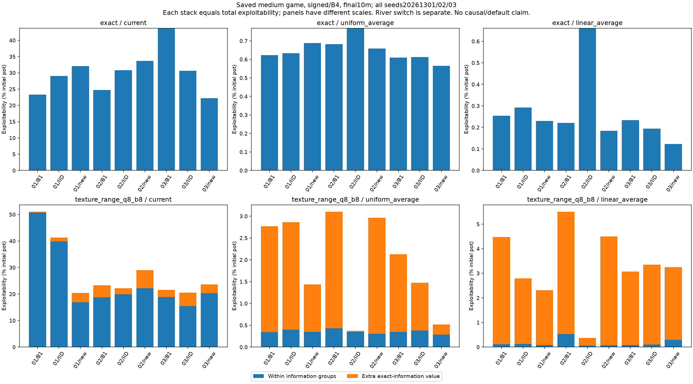

# Saved-policy diagnosis after the failed private-prefix primary

November10,2026; issue4 comment6774698163. This is a post-hoc diagnostic
registered after the complete own negative result and before decomposition
tables. It uses the complete independently checked study. No new training,
seed, threshold, scientific cap, agent default or fresh/global admission changes.
The[versioned panel](../configs/private-prefix-diagnosis.json) binds the own
artifact SHA and frozen model source.

## Question and fixed panel

Locate where the B4/signed primary loses value. Include both known games, both
encodings, all3fixed seeds, all3readouts and all3work labels. Each of108candidate
coordinates retains B1 and same-batch IID controls:324 method points,216 paired
contrasts,108 method groups and72 paired groups. No seed or unfavorable row may
be dropped. A final-work medium-game figure includes both encodings, all three
readouts, all three seeds and all three methods.

Exact exploitability equals within-partition gain plus extra exact-information
value, checked at absolute1e-9chips. Stack only those two components. Preserve
signed roundoff. The exact-prefix river-row switch is a separate diagnostic;
it is neither an additive part of this stack nor the agent's actual EV loss.
Record actual work/updates, initialization/sample counters when available, and
whole versus post-warm row/river coverage. Missing coverage for current policies
stays missing. Warm support is not learned coverage.

## Execution and acceptance

1. Validate the completed432-profile/1152-fixed native receipt, exact own SHA,
   raw journal and whole900-second receipt before analysis. Fully replay the
   bound own archives/source/admission with learner/reference constructors
   blocked. Preserve original source/data and require the frozen model hash.
2. Reject an incomplete/duplicate panel, nonfinite metrics, incorrect additive
   identity or changed config/source. Paired differences use the existing own
   metric helper; comparing a record to itself remains zero.
3. A repository command regenerates numeric tables and the specified figure in
   a fresh destination. Base mode can omit plots. Tests cover grid and identity
   failures, missing/nonfinite values, self-zero and no-overwrite behavior.
4. Record source/config/input hashes, runtime, actual checks and outcomes. Run
   applicable local base/optional checks and both hosted jobs before merging.

This is descriptive evidence from three fixed seeds with dependent checkpoints
and reused controls. Means/ranges are not confidence intervals. A component can
locate a vulnerability without proving its cause or an irreducible abstraction
floor. If update counts differ, a future matched-update comparison would be a
separate prospective experiment, not a conclusion from this panel. Do not rerun
unchanged training until it looks favorable. Do not load reference outputs into
learning.

Next decision: select a controlled follow-up question from the complete saved
panel. No diagnostic outcomes are asserted at this prospective checkpoint.


## Implementation checkpoint

The experiment-specific CLI reuses frozen poker replay, gap, native-schema and
source helpers. It projects validated saved records into the fixed tables and
figure; it adds no training algorithm or reference-policy use and changes no
`src/` model code. Fictional report fixtures check324/216points,108/72groups,
independent expected positive/negative gaps, self-zero, grid/type/nonfinite/
identity failures, missing seeds, no-overwrite-before-replay and optional PNG
output. Focused base11pass1skip2.31s; optional12pass10.37s; strict typing and
Ruff pass. These are software fixtures, not diagnostic results.

Run from the frozen model source cohort:

```sh
.venv/bin/python scripts/diagnose_private_prefix.py
.venv/bin/python scripts/diagnose_private_prefix.py --no-plots --output results/runs/private-prefix-diagnosis-local
```

The first command fully replays the bound own/native evidence once, with learner
and reference constructors blocked, then writes fresh324method/216paired points,
108/72three-seed groups and the fixed component figure. The second regenerates
numeric tables only, without Matplotlib. Existing complete/partial output
directories are preserved. Full local/hosted checks and actual outputs remain
to be recorded.

## Recorded result — November 10

The complete saved-policy replay finished in 352.852 seconds on Python 3.11.17 /
NumPy 2.4.6. It produced all 324 method points, 216 paired points, 108 method
groups and 72 paired groups. Learner and reference constructors were blocked.
The frozen model source and own/native archives passed the required checks.
No new poker training ran.

On the declared medium-game compressed, signed, B4, final-work linear-average
panel, the three-seed means are below. All values are percentages of the initial
pot; lower exploitability is better.

| Method | Total | Within information groups | Extra exact-information value |
| --- | ---: | ---: | ---: |
| B1 | 4.354032 | 0.243207 | 4.110824 |
| IID | 2.172684 | 0.094215 | 2.078469 |
| stratified | 3.350775 | 0.150998 | 3.199777 |

The candidate's excess over IID is concentrated in the extra-information
component: 1.121308 percentage points, versus 0.056783 within the information
groups. This locates the saved vulnerability. It does not establish that the
representation alone caused the difference: the information groups are the same
for IID and stratified training, and their resulting policies differ.

The unfavorable seed 20261302 remains visible. Its candidate total is 4.494858%,
compared with IID's 0.375287%; its extra-information components are 4.419087%
and 0.319562%. The other two seeds slightly favor the candidate. Three fixed
seeds do not supply a general confidence claim.

The controls matter. With exact information, the candidate's linear-average
mean is 0.178634% versus IID's 0.382574%, and extra-information value is zero by
construction. In the compressed game, uniform averages have means 1.637990%
(candidate) and 1.568496% (IID). Current policies are much worse: 24.343992%
and 28.011637%. A favorable current-policy difference does not rescue the failed
linear-average primary. Every readout remains in the saved tables.

Whole support is 100% because initialization visits every row. Candidate
post-warm support on the primary is only 65.22%, 59.33% and 61.37%; those
fractions describe visited rows, not their strategic importance. Candidate
update counts are 78,688 / 77,619 / 82,650; IID counts are 80,741 / 91,694 /
79,859 at approximately the same ten-million-node budget. Equal work does not
imply equal updates.

The separate exact-prefix river-switch mean is 4.606100% for the candidate and
2.577545% for IID. It can exceed total exploitability because it compares a
different reply continuation. It is not an extra stack segment or the agent's
actual EV loss.



The [numeric tables and manifest](../results/private-prefix/diagnosis/) retain
all games, encodings, checkpoints, readouts, seeds and controls. The figure
shows all final-work medium-game seeds; panels use different vertical scales.

## Checks and next decision

Both local base runtimes passed 2,278 tests, with 47 skipped and 148 deselected.
Both optional runtimes passed 2,334 tests, with 148 deselected. Logs include
before/after runtime assertions; local checks and hosted CI are separate.
The frozen model source is unchanged.

Next, inspect the saved information groups and action continuations behind the
largest extra-information loss, keeping all three seeds and IID controls. This
can identify a concrete distinction to test. A causal training comparison would
need a new prospective protocol, matched compute/update controls and its own
gates. No further long trajectory starts in this work window.
