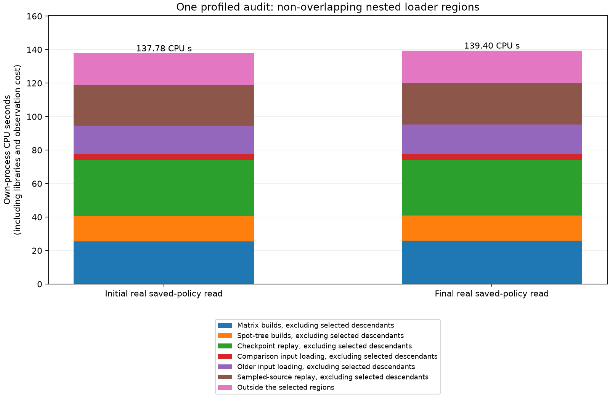

# Locate CPU work inside saved-input loading

Registered November 15, 2026 in [issue #4](https://github.com/jimmy-sim/poker-ai/issues/4#issuecomment-6891701494)
before implementation or collection.
This follows [PR #73](https://github.com/jimmy-sim/poker-ai/pull/73) and its
[coarse CPU result](coarse-reader-cpu.md#recorded-result--november-14-2026).

## Question

The previous two real reader calls used 294.714306 seconds of process CPU.
The three selected operations explained 52.97%; 138.599270 seconds, or 47.03%,
lay outside them. Which input-loading and historical-replay branches account
for that remainder? These are saved old own cost stand-ins, not new training.

The older elapsed profile supplies low-frequency leads, not present CPU
measurements. Keep the three original boundaries and add three ordinary
functions:

| Category | Boundary |
|---|---|
| `matrix_build` | `MatrixTree.build` |
| `spot_tree_build` | `SpotTree.build` |
| `checkpoint_replay` | `learning_training.replay_snapshot` |
| `comparison_inputs` | `evaluation.compact_opponent_sources.load` |
| `legacy_inputs` | `evaluation.opponent_learning_sources.load` |
| `sampled_source_replay` | `evaluation.compact_fixed_inputs.replay_sources` |

The loaders can contain each other and the original operations. Use the
recorded call forest to subtract immediate selected children before adding
category totals. Keep inclusive CPU, selected-exclusive CPU, root union and
outside-selected CPU as distinct fields. They measure process/library CPU
observed during regions, including observation cost and library threads; they
are not instruction samples, pure function self time or a wall-time partition.
Keep floating residuals and the existing 1e-9 CPU-second arithmetic allowance.
No poker-score tolerance changes.

## Implementation and coverage

A private entry reuses the checked coarse collector under an explicit bounded
extension context. Preserve every prior 404 source file. The new entry and
[config](../configs/reader-load-cpu.json) should form a 406-file effective map;
verify that count and its exact fingerprint after implementation. This private
placement preserves the frozen all-src contracts and older readers.

Extend only the collector's category registry, target factory and owned-module
alias iterator. Do not replace its original contract, binding, qualification,
entry or output globals with a new family's permit. The new runner has its own
complete source binding, six-role qualification, output namespace and report.
Reject an already changed or nested extension and restore original objects on
success and failure. Prove that the old three-category collector still works
after the extension exits.

The existing alias iterator covers `poker_ai.*`. Add the owned `compact_cached`
package and submodules because its command module imports `load` directly.
Cover defining attributes, existing aliases and late imports; restore initial
alias objects and equivalent late aliases. Arbitrary hidden closures or native
references remain outside this declared coverage. Reject generator targets:
timing a factory call would miss work performed when its iterator advances.
The selected loader functions are ordinary calls.

Preload the same six targets and command aliases in both arms, before original
card hooks. Only the profiled arm records selected entry/exit events during the
original three reader calls. Keep serial main-thread coverage, process/thread
identity, full events, original results and primary exceptions. No global
per-function profiler or low-level clock callback is installed. Native workers
have no active selected capture.

## Fixed workload, limits and acceptance

Run **one control / profiled pair** through the unchanged original uncached audit:
tiny pre-read, shared recall-proof cache, disabled-reuse card wrappers, nested
original observers, initial and final mathematical reads, three native workers,
source/publication checks and original scalar verification all remain.
Common preloading does not reconstruct historical machine/process state.

The config pins 41 inputs: the preceding 37 plus the coarse raw manifest,
profiled source anchor, numeric summary and render manifest. Its SHA-256 is
`ddc766c5357cfabc831113d158f6a3e25df161a9f5bfacc3b3408848a15f44a3`.
Python 3.11.17 / NumPy 2.4.6, locked optional packages and the declared Darwin
CPU query/sleep-prevention utilities remain required. OpenSpiel 2.0.2 and its
pinned Apache-2.0 license remain comparison-only, under the existing installed
license check and read record. Reference strategies never enter the agent.

Limits remain **900 seconds per complete child, 1,800 seconds shared**, with
120 seconds of operator saving reserve and **4,096 selected calls** across all
three reads. Child startup, checks, original work, capture and final validation
remain charged. The unchanged supervisor excludes its own measurement-receipt
write from the child clock; parent orchestration and final pair verification
belong to the shared clock. Administrative canonical copies remain outside,
with original ignored outputs retained. One attempt; no favorable retry, subset,
smaller workload or cap extension. Preserve partial and failing outcomes.

Require complete original 432-profile, 1,152-condition, three-replay, worker,
card-counter and scalar identity against the historical original and both arms.
Require complete restored six-category capture and all original resources.
The original three per-read call inventories must also match the coarse archive:

| Read | Matrix | Spot-tree | Checkpoint |
|---|---:|---:|---:|
| Tiny software pre-read | 0 | 0 | 432 |
| Initial real read | 92 | 26 | 432 |
| Final real read | 92 | 26 | 432 |

Require every new category somewhere in the completed capture. The old elapsed
profile's two calls per added function supply a capacity lead, not an acceptance
count. A complete empty category for one read is legitimate; missing or partial
work is never reported as zero. All intervals must nest inside their reader and
selected parents with monotone clocks, supported identities and original
computed witnesses. Retain the base-family admission rejection.

Before collection, tests cover the bounded extension and its restoration,
private command aliases, nested six-category accounting, cross-family and
schema rejection, changed baseline counts, missing events, primary exceptions,
unsupported generators/threads, caps and partial retention. Full local bases,
relevant optional suites on both versions and both same-source hosted jobs must
pass with actual runtime/uv/PR-head evidence. Publish exact source qualification
and launch/retention operators before the single pair, then publish raw evidence
before analysis. Keep one PR and batch local work before the initial source push.

## Reporting and next decision

Report all three read inventories, nested inclusive and selected-exclusive CPU,
union/remainder, control/profiled read/body/worker/command clocks and provenance.
Do not add overlapping regions or worker CPU to explain wall time. One order
cannot isolate pure observation overhead or estimate runtime uncertainty.
Inspect the figure, verify portable saved-data extraction with poker execution
blocked, and compare numeric exports under actual Python 3.12.15 / NumPy 2.5.4.
That newer runtime qualifies software/data only, not real trajectory replay.
Final applicable local checks and both exact-head hosted jobs precede merge.

Use a complete result to choose the next measured target. If coverage fails,
retain unknown work and debug the instrument before selecting an optimizer.
No strategy, algorithm, seed, scientific cap, quality target or default changes.
The failed 933.89/900 forecast and old child-CPU discrepancy remain unresolved;
this diagnostic cannot admit a new Hold'em study or competitive-strength claim.

Continue issue #4 under the current request until interrupted. The chosen
priority is validation and training improvement before a Chipzen adapter.
This creates no future automation and authorizes no C++/Rust core or subagents.
Codex assists with implementation and reporting; personal hours and mastery
are not inferred.

## Source qualification — November 15, 2026

[PR #74](https://github.com/jimmy-sim/poker-ai/pull/74) source
`8453abd1c5e84604fb19a802f5d2b7c0e232bc71` binds 406 files, fingerprint
`07fd809ecd498154177624eedbf762b277225758f92a852dc5bed4f0499dc4d3`.
All prior 404 files and 41 scientific input pins remain unchanged.
Both full local bases pass 4,007 tests / 64 skipped / 150 deselected; both
relevant optional suites pass 519. Both hosted jobs in
[CI 43746058432](https://github.com/jimmy-sim/poker-ai/actions/runs/43746058432)
pass 4,007 tests with the recorded actual runtimes and matching complete tested
source tree. The [six-role receipt](../results/reader-load-cpu/checks.json)
retains full logs, interrupted initial bases, completed resumed bases, exact
runners and prepublished launch/retention operators. No timed audit has run at
this qualification checkpoint. An interruption is retained, never counted as
a successful test completion.

## Recorded result — November 15, 2026

The single pair completes in **409.6105099580018 / 413.1019390830188 seconds**
(control/profiled), with **823.8671735420066 seconds shared**, under the unchanged
900/1800 limits. Source qualification was published at `22e6cbf`; the
[39-file raw manifest](../results/reader-load-cpu/raw-manifest.json) and exact
original copies were published at `8d6d379` before analysis. The manifest itself
is the 40th retained file. All original 432 profiles, 1,152 fixed conditions,
three computed reads, worker/card inventories and base-admission rejection pass.
No learning or new policy was produced.

The capture contains **1,538 selected calls**, no hook/event errors, no remaining
aliases and restored descriptors/globals. The original three categories retain
their exact previous per-read counts. The added loaders each run once in each
real read; none runs in the tiny pre-read.

| Read | Matrix | Spot-tree | Checkpoint | Comparison inputs | Older inputs | Sampled-source replay |
|---|---:|---:|---:|---:|---:|---:|
| Tiny software pre-read | 0 | 0 | 432 | 0 | 0 | 0 |
| Initial real read | 92 | 26 | 432 | 1 | 1 | 1 |
| Final real read | 92 | 26 | 432 | 1 | 1 | 1 |

The two real reads use **137.775238 / 139.401896 process-CPU seconds**, totaling
277.177134. Subtracting selected descendants gives this non-overlapping view:

| Region | Selected-exclusive CPU seconds | Share of real-read CPU |
|---|---:|---:|
| Matrix construction | 51.360752 | 18.5299% |
| Spot-tree construction | 30.215716 | 10.9012% |
| Checkpoint replay | 66.284621 | 23.9142% |
| Comparison input loading | 7.382174 | 2.6633% |
| Older input loading | 34.724512 | 12.5279% |
| Sampled-source replay | 48.930237 | 17.6531% |
| Outside selected regions | 38.279122 | 13.8103% |



The selected regions cover **86.1897%** of real-read CPU. Input loading contains
other selected work: comparison-input inclusive CPU is 172.613391 seconds, while
only 7.382174 remains after selected descendants are subtracted. Adding that
inclusive number to the rows above would count work twice. The tiny read is
reported separately and is not included in these percentages.

[Full-precision summary](../results/reader-load-cpu/report/summary.json),
[reader clocks](../results/reader-load-cpu/report/readers.csv),
[inclusive/exclusive regions](../results/reader-load-cpu/report/regions.csv),
[worker clocks](../results/reader-load-cpu/report/workers.csv) and
[body/nearby-child clocks](../results/reader-load-cpu/report/bodies.csv) retain the
other boundaries. The three parallel workers take about 124.74 seconds each in
control and 124.45 seconds each in the profiled arm. Their parallel clocks cannot
be added to explain elapsed time. The complete-command difference is not pure
wrapper overhead, and this one order supplies no uncertainty estimate. Compared
with the older capture, these are different observations of unchanged work,
not a measured optimization. The historical 21–22 child-user discrepancy remains
unresolved; current real-read helper-user deltas stay about 0.23–0.24 seconds.

### Saved-data check and next decision

The report blocks real archive reads, child/supervisor calls, all six selected
operations, scoring/replay and learner/native construction. All five numeric
exports match byte-for-byte under actual Python 3.12.15 / NumPy 2.5.4. This is a
saved-data check, not a new mathematical replay on that runtime. The figure was
visually inspected.

The first export check failed on one derived CSV residual: Python 3.11 and 3.12
built-in floating summation produced 1.4210854715202004e-14 versus 0 seconds. The
summary and other four exports were identical. The initial renderer, failed
output and drafts are [retained](../results/reader-load-cpu/report/initial-export-failure/failure.json).
Using `math.fsum` for that posthoc selected-exclusive-minus-union sum makes the
exports deterministic across the two tested versions. It does not clamp raw
values, change the instrument, rerun the capture or alter the existing allowance.
The [final export check](../results/reader-load-cpu/report/replay312.json) and
[renderer](../results/reader-load-cpu/report/render.py.txt) record the correction.

Matrix construction is a measured 18.53% of real-read CPU. Source inspection
shows its depth-consistency check rescans all nodes for each information group.
The next candidate is a linear-work grouped check, first proving the same
accept/reject behavior and constructed arrays before any performance claim.
This profile does not measure that individual loop or prove its potential
savings. Historical replays also remain substantial and must not be skipped.
Any optimizer still needs separate source-bound correctness and complete cost,
forecast and published admission before new trajectories. The 933.89/900 forecast
remains failed; competitive full-game strength remains unestablished.

Final local checks pass 519 relevant optional tests on each Python version,
lint/formatting for 906 files, strict typing for 760 source files and commit
hooks. All 378 focused relative links, five images, heading anchors and fences
pass. The saved-data CLI equals the full report, and all raw/original hashes
remain exact. [Local verification](../results/reader-load-cpu/report/local-verification.json)
records these checks. Both exact-report-head GitHub jobs must pass before merge.

To inspect the saved result after updating the checkout:

```sh
.venv/bin/python scripts/profile_reader_loads.py --show --output results/reader-load-cpu/pair
open results/reader-load-cpu/report/selected-cpu.png
```

The first command checks and prints saved records; it starts no fresh capture.

## Three questions

**Why retain the original counters?** Their per-read inventory checks that the
new view still observes the same named work, rather than losing calls while
assigning more time to parent regions.

**Why include private command aliases?** Replacing a defining function does not
replace an earlier imported copy. The actual reader entry must be covered and
restored, including on exceptions.

**Does assigning the remainder fix the runtime limit?** It supplies a target.
An optimizer still needs its own correctness and complete cost/forecast checks;
no hash receipt replaces a required mathematical replay.
