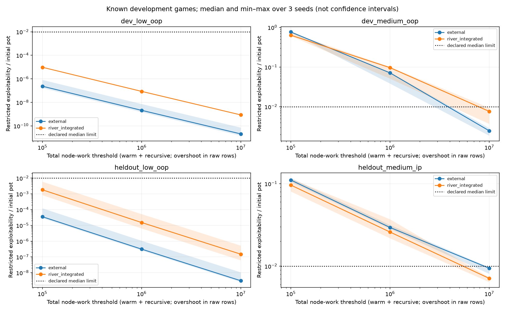
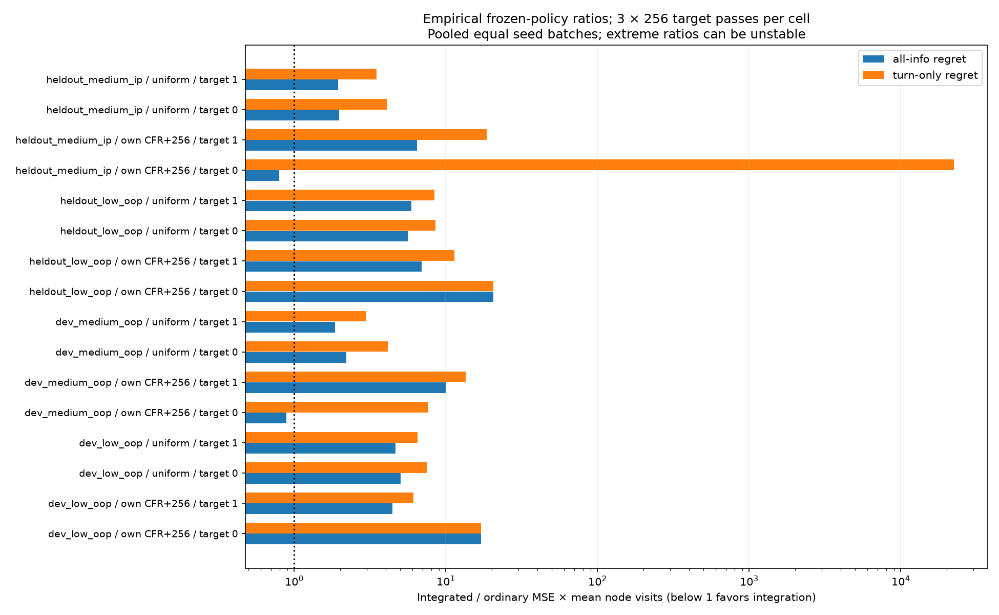

# Issue #2 fixed-work comparison

## Session acceptance, before experiment outcomes

This November 4 session resumes the experiments deferred by PR #7. The unchanged
prospective config is `configs/river-integration-study.json`; all four games are
known development evidence. No fresh hold-out or global Hold'em claim follows.

Definition of done for this block:

1. Implement and test a bounded runner for both frozen-policy update error and
   learning at the published total-node thresholds. Include the 2*N initial
   expectation, complete-iteration overshoot, runtime and initial-only rows.
2. Commit the checked runner before the main experiment. Retain every prescribed
   seed/variant/budget and any cap failure. Never select the best seed or prefix.
3. Freeze own policies and hash source/config/lock/game/policy artifacts. Recompute
   exploitability with OpenSpiel's independent native value/best-response code,
   used only after training. Its outputs must never enter an agent.
4. Derive tables and learning/error plots from the saved report. Report all
   performance gates, missing cells, numerical discrepancies and limitations.
5. Pass applicable local checks and hosted CI; update the issue, PR and work log.
   Stop at the resulting evidence/report milestone, even if the hypothesis fails.

The two-hour study cap includes setup, frozen panels, own controls, checkpoint
serialization and metric evaluation. Independent post-training audit/report time
is recorded separately. Frozen panels use unweighted single-target increments;
their MSE*mean visits describes IID frozen-pass averaging, not adaptive training.
The two methods consume different random tapes and iteration counts at equal work.

## Run and inspect

```sh
make study-river-integration      # Full own study, native audit, then report
make report-river-integration    # Replay reviewed policies/audit; no training
uv run --locked pytest -q tests/test_river_study.py tests/test_river_sampling.py
```

The full command writes under ignored `results/runs/river-integration-reproduction/`.
It refuses to overwrite a previous run. Select another preserved directory with
`make study-river-integration RIVER_OUTPUT=results/runs/river-reproduction-2`.
The report command regenerates the reviewed tables/plots from committed raw data.
Both commands return nonzero for a failed candidate performance gate, after
retaining the complete report. Numerical/audit failures stop before publication.

The runner freezes each own policy and saves an own sampler/RNG checkpoint at
each work threshold. Large checkpoints live in ignored `results/river-integration/runs/study/`
for the original local run and under the selected run directory for reproductions;
their SHA256 receipts are in the raw rows. Small frozen policy exports are
published with the report and suffice to replay every reported value and best
response without a checkpoint download. Checkpoints are reproducible, not remote
downloads promised to exist.

## Metric conventions and comparison limits

- **Restricted exploitability:** NashConv/2, in net chips per hand, divided by the
  spot's initial pot. Zero is equilibrium in this finite game, not in full Hold'em.
  The best response chooses one action per information set across hidden worlds.
- **Work:** actual recursive visits, including terminal/chance nodes, plus 2*N
  initialization equivalents. Complete iterations can overshoot a threshold by
  less than 2*N; raw rows retain the actual work. Full CFR+ uses 2*N per iteration
  as a separate diagnostic control, not an equal-work treatment.
- **Frozen error:** squared L2 of the entire sampled regret/averaging increment
  minus its full-tree expectation, including zero increments at unvisited rows.
  Regret error has units chips squared; averaging error has units squared update
  mass. Turn-only regret restricts the sum to unrevealed-river information sets.
  Both opponents and private cards remain sampled. No strict variance dominance
  or convergence theorem is inferred from integration.
- **Cost ratio:** equal-sized seed batches are pooled before dividing integrated
  MSE by ordinary MSE; multiply by the pooled mean-visit ratio for the frozen IID
  averaging efficiency diagnostic. A ratio below one favors integration. Zero
  baseline error gives an unavailable ratio. Per-seed means, within-batch sample
  standard deviations and pass counts remain in the raw panel.
- **Uncertainty:** three fixed seeds provide descriptive min–max ranges, not
  confidence intervals. The same seed labels do not provide matched random tapes;
  target/policy cells also reuse labels. There is no independent fresh-game test.
- **Coverage:** positive average mass includes the exact initial expectation.
  Initial-only row counts and reach-weighted subsequent visits are reported
  separately. The predeclared 95% average-row gate must not be read as 95% later
  exploration.
- **Time:** cumulative per-run times include initialization and preceding
  checkpoint/report overhead. Setup, frozen panels and total study time are
  separate. Quality checks and report development ran concurrently on the host;
  elapsed times are observations under that load, not controlled speed benchmarks.
- **Independent check:** OpenSpiel 2.0.2 native EFG value/best response, Apache-2.0,
  [previously read and recorded](solver_validation.md#solvers-versions-and-licenses),
  evaluates frozen own policies only. It shares our exported mechanics; it checks
  arithmetic/information-set alignment, not an independently implemented engine.
  No reference strategy or value enters the own learner.

## Observed results, November 4

The complete study ran from clean **`aebed7b`**, with the original protocol and
training implementation unchanged during execution. It retained **72 sampled
learning snapshots, 8 own full-CFR+ controls, and 96 frozen-panel seed cells**
(24,576 frozen target passes). No cap failure, omitted cell or best-seed selection
occurred. Total study time was **972.029 seconds**; the independent post-training
audit took **3.126 seconds** on the Apple M4/Python 3.11.17 environment
with NumPy 2.4.6 and Numba 0.68.1. Concurrent checks affect timing interpretation.
The raw sandboxed CPU-model query was unavailable; the supplemental
[hardware observation](../results/river-integration/hardware.json) records an
approved local model query after the run without changing original provenance.

All 80 own frozen policies passed native value/exploitability checks, with maximum
absolute error **9.95e-14 chips** against the declared 1e-9 tolerance. Own-policy
metric replay error was zero. All 72 original checkpoint/visit receipts and work
counters were checked locally. The audit source was committed/clean; rendering
records its own source and dirty state separately. Timing, provenance-bearing
checkpoint hashes and render manifests can change on a reproduction; fixed-seed
numerical metrics are the target on the recorded locked environment.

At **10 million node-work**, three-seed median exploitability / initial pot is:

| Known development game | Ordinary external | River-integrated | Lower median |
| --- | ---: | ---: | --- |
| dev_low_oop | 2.07960e-11 | 8.57631e-10 | Ordinary; both numerically tiny |
| dev_medium_oop | 0.00246273 | 0.00761239 | Ordinary |
| heldout_low_oop | 3.09139e-9 | 1.49820e-7 | Ordinary; both very small |
| heldout_medium_ip | 0.00943331 | 0.00710928 | Integrated |

Every final own full-tree control and both sampled methods pass their predeclared
development limits: full epsilon <=0.001 pots; sampled median <=0.01, worst
<=0.025; positive average-row coverage >=95%. Earlier work thresholds retain
their much larger errors in the raw report and curves. Passing these final limits
does not imply integration beats the ordinary control. The result is **mixed**:
the integrated final median is lower in one game and higher in three. In medium
OOP its median is 0.7612% of the pot versus ordinary 0.2463%; in medium IP it is
0.7109% versus 0.9433%. No statistical superiority or global upgrade is claimed.



The [runtime plot](../results/river-integration/report/learning-time.png) shows
the same measurements against observed cumulative run times. The methods have
different iteration counts and different linear-weighting/initialization
amortization at the same work. These adaptive learning differences cannot be
attributed solely to frozen-update variance.

The empirical frozen-panel all-info regret MSE is lower per pass in all 16
spot/policy/target groups (integrated/ordinary ratios **0.02393–0.6616**), but
**MSE times mean node visits is higher in 14/16 groups**, with ratios
**0.7957–20.5764**. Thus per-pass error reduction generally failed to compensate
for extra traversal work in this panel. These are finite-panel measurements,
not exact population variance estimates or a convergence theorem.



One turn-only cost ratio is extreme, about 22,314, for medium-IP own-CFR+256,
target 0. Its ordinary batches all have turn MSE 0.000286659 with essentially zero
observed within-batch SD; integrated batch means are 0.353121, 0.223626 and
0.000286659, with SDs 4.124, 3.573 and essentially zero. This is consistent with
rare-event under-sampling, but this panel does **not establish its cause** or a
reliable population ratio for that cell. The exact expected-update tests passed;
we neither discard the cell nor tune/increase its seeds after seeing the result.
Further moment/tail diagnosis would be a separate declared follow-up.

Coverage also needs qualification. Both methods have 100% positive average-row
coverage due to the initial expectation. In dev_low_oop, **368 rows remain
initial-only**, and subsequent uniform-reach coverage is only **80%**, even at
the final threshold. Other games retain their own initial-only counts in the
[complete table/CSV](../results/river-integration/report/tables.md). The positive
average-row gate must not hide this distinction.

Raw evidence: [study](../results/river-integration/study.json),
[frozen own policies](../results/river-integration/study-own-policies.json.gz),
[native audit](../results/river-integration/independent.json), and
[replayed summary](../results/river-integration/report/summary.json).
The earlier medium-IP held-out gate remains failed in its original experiment;
filenames containing `heldout` here are known development games. This study
does not repair that historical result or satisfy fresh validation issue #3.

## Verification and stopping point

Local full checks passed **594 tests on each of Python 3.11.17 and 3.12.15**,
plus lint, formatting, strict typing and hooks. The new study tests cover budgets,
warm-start charging, missing/duplicate grids, timeout retention, frozen-error
arithmetic, policy hashes, ratio pooling and native-audit corruption. Hosted
[pipeline CI](https://github.com/jimmy-sim/poker-ai/actions/runs/41799867893) passed
both Python jobs; final evidence-commit checks are attached to PR #8. Figures
were visually inspected. Rendering uses an optional plotting extra; baseline
checks do not require it.

This completes issue #2's bounded investigation. It establishes a checked
implementation and an honest fixed-work comparison, with no uniform efficiency
benefit. The ordinary default is retained. Stop here: new fresh games and a frozen
validation procedure belong to issue #3; scalable public abstraction is issue #4.
Neither new task nor global training ran in this block.

## Three review questions

1. **Why can lower MSE per pass lose at equal work?** An integrated pass traverses
   many rivers. In this panel its lower per-pass error usually fails to offset
   the additional node cost. Adaptive iteration weighting also changes at equal
   work, so actual learning curves are needed alongside frozen diagnostics.
2. **Why does a passed development gate not justify promoting the new sampler?**
   The ordinary control also passes, and has the lower final median in three
   games. These games were already observed; there is no fresh validation or
   measured global-agent upgrade.
3. **What do the coverage and extreme-ratio results teach?** Initial average mass
   can mask unvisited rows, and a small frozen sample can miss rare events. Keep
   initial-only coverage and per-seed variability, retain surprising cells, and
   qualify conclusions rather than selecting favorable evidence.
