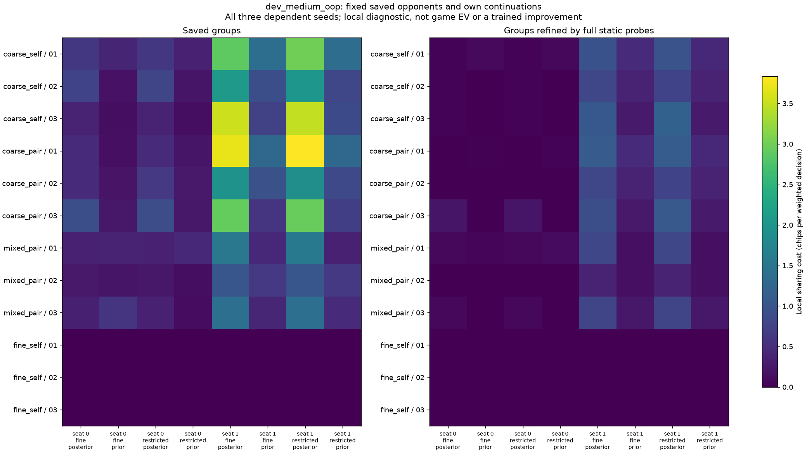

# Test range weights inside the saved river groups

Prospective issue #4 comment
[6799471551](https://github.com/jimmy-sim/poker-ai/issues/4#issuecomment-6799471551)
registers this read-only question before implementation or output. The
[config](../configs/river-range-reweighting.json) binds the complete
[saved-decision](own-opponent-decisions.md) and
[fixed-turn continuation](turn-continuations.md) reports. Their original
learning failure, source, seeds, caps and defaults remain unchanged.

**November 11 result:** range weights explain part of the river disagreement,
but not all of it. With the same compatible prior, some matched static groups
still prefer different actions because their frozen later responses differ.
This completes a local diagnosis; it does not deploy a feature or train a remedy.

## Question and fixed controls

The two important turn calls need finer river information against one saved
opponent. Do different betting-conditioned beliefs about the opponent's cards
account for action conflicts inside the shared river groups? Or do conflicts
remain after replacing those beliefs with the same compatible declared prior,
while keeping future action values fixed?

A **posterior** is a range updated by the observed public betting history. Here
it comes from integrating the same saved opponent's possible card combinations
and action probabilities, not from observing its actual private cards. The
compatible prior uses only the declared weights and known card removal. This
intervention is a local mechanism test; it does not define a new globally
consistent poker strategy.

The declared ranges are given at the spot root. The fixed earlier public prefix
sets that root's pot, stacks and board; this diagnostic updates weights only
from actions inside the enumerated spot. It does not infer a preflop range from
the historical prefix or from real opponents.

Retain both known games, all three seeds, all four methods, final10m primary
linear averages:24profiles and48responding-seat conditions. Each uses both
original own fine-best and restricted-best **river suffixes**, against its same
saved opponent:96suffix conditions. Compare actual posterior and compatible
prior in each:192local panels. These are **not**192new root values. Retain every
owned exact river row, legal action and compatible declared combo, including
unsupported cases. A top10display never selects the assessment.

For each local panel, report costs/conflicts under the saved declared partition
and its full-static-probe refinement: own full rank, ordered range compatibility
and ordered showdown relations. These are diagnostic controls, not deployed
features. Keep group denominators separate and retain signed changes.

## Mixture and weighting

At river information row I, group all hidden histories by the opponent's
declared combo. Evaluate each action using the frozen own suffix and saved
opponent future; check within-combo history consistency. Recompose the conditional
action value as the sum of posterior(combo|I) times that combo's continuation
value. The actual mixture must match the original own conditional-value
calculator within1e-9chips. Replacing only the weights with the compatible prior
keeps those same continuation values. Never maximize separately by hidden deal.

Use one fixed game/seat weighting: chance times both players' uniform-action
full reach, summed at own river infos and normalized **before** support filtering.
Compare the same positive actual-opponent-support rows in both range panels.
Do not renormalize after filtering; report the supported weight. Zero actual
support stays explicit and unranked. Saved own reach is separate: a counterfactual
decision can have positive support even when the saved own strategy avoids it.

Local sharing cost is sum(w_i max Q_i) minus max(sum(w_i Q_i)), summed over
groups. Its unit is chips per decision under this declared weighting. It is not
root EV, exploitability, additive game loss or gain after retraining. A strict
conflict means no legal action lies within1e-9chips of the best action in every
supported row of that group. Floating calculations use1e-9chip and1e-12unitless
checks; no new effect-size threshold is chosen after outcomes.

## Acceptance before interpreting results

- Complete24/48/96/192 inventories and all owned river rows/actions/compatible
  range entries. Bind prior config/manifest/summary, original own/native/archive
  hashes and current source. Replay original own math and verify saved reply
  fingerprints. Existing scientific source/data remain immutable.
- Check combo/history consistency, blocker zeros, actual/prior normalization,
  exact menu/range indices and mixture reconstruction on both target signs.
  Replies and conditional values respect own legal information. Unsupported
  rows are never used to invent a preference or improve coverage by filtering.
- Independent analytic/recursive terminal mixtures catch hidden-deal
  clairvoyance, wrong labels/weights, missing/duplicate rows, nonfinite values,
  zero support, identical-weight zero change and singleton zero cost/conflict.
  Refining groups cannot increase convex sharing cost beyond tolerance.
- Block learner/reference constructors; no imported reference strategy, new
  policy/feature deployment or agent/default change. New calculations have no
  new independent audit. A removed conflict is only a fixed-suffix local effect,
  not a proof that a posterior feature will improve learning or generalize.
- Separate900-second data-only command clock starts at thin entry before
  numerical imports and includes complete replay/analysis/writes; interpreter
  startup is excluded. Original7200/900learning/audit caps and gates stay fixed.
  Refuse existing output; retain each complete profile before advancing, plus
  partial/failure records. Preserve unfavorable results.
- Relevant full local bases, focused optional checks and both hosted source/
  final-artifact jobs pass before merge. A cached hash-checked terminal reader
  shows range order, compatible prior/posterior, own/public observations, action
  values, support and fixed-suffix/local-weight scope. No live game inputs.

## Status and next decision

Implementation checkpoint: 72 focused tests pass in8.44seconds. Independent
terminal sums check both target signs, hidden-history mixtures, declared range
order and own-prefix exclusion. Uniform UNIT policies in both own poker games
reconstruct all conditional river values/support and preserve fixed suffixes.
Cache/schema tests reject missing/duplicate rows, wrong weights/menus/groups,
nonfinite values, tampered publications and changed lazy-loaded detail bytes.
Actual partial-profile integration retains completed evidence after interruption;
learner/reference construction is blocked before input replay. Cached terminal
browsing distinguishes both own suffixes, actual versus prior weights and local
scope. Whole-repository lint/format/strict typing pass. These tests do not contain
a measured saved-policy range result or a deployed feature.

Full local checks now pass on source `42cd59f31324566b3286fc112e496438f5c484f4`,
scientific fingerprint
`987c636e258c4f866d22b23cbc6bc4349493bc0874b994ac5d0cbc8e258512bd`.
Both Python 3.11.17/NumPy 2.4.6 and Python 3.12.15/NumPy 2.5.4 pass 2,759 tests,
58 skipped and 149 deselected (484.87/472.25 seconds). Lint, 728-file formatting,
strict typing over 612 files, hooks and before/after clean source/runtime guards
pass. Focused optional checks pass 72 tests on each (10.36/9.65 seconds); this
is not the entire historical optional suite. Raw logs, launcher and indexed
receipts are retained in
[source-local evidence](../results/river-range-checks/source-local/summary.json).

[Initial hosted source run 43050870261](https://github.com/jimmy-sim/poker-ai/actions/runs/43050870261)
failed before either job ran any steps. GitHub's annotation said recent account
payments failed or a spending limit needs increasing; the account's actual
billing dashboard has not been inspected. Exact job metadata and annotations
are retained. After the user authorized public visibility and a retry,
[run 43052779450 attempt 2](https://github.com/jimmy-sim/poker-ai/actions/runs/43052779450)
passes both jobs on unchanged published `a682d91`: 2,759 passed, 58 skipped,
149 deselected and one retained historical roundoff warning each, in
675.02/944.82 seconds. Lint/format/types/hooks pass. The restored original runtime
passes 72 focused checks in 8.87 seconds. Exact source-bound metadata and decoded
logs are retained in [complete checks](../results/river-range-checks/complete/).
The complete comparison ran only after these required source checks passed.
No scientific cap, seed, check or gate was relaxed. CI duration is separate
from the registered data-only command's 900-second clock.

The [terminal exercise](terminal-river-lab.md) uses the already completed C6
cache; agent-run default/rank-2/navigation smoke checks pass and are retained
[separately](../results/river-range-checks/terminal-lab/receipt.json). They do not
measure a new range effect or record user practice.

## Complete measured panel

The original-runtime command finishes in **168.794338750 seconds**, including
original archive replay, local analysis and writes, below the unchanged 900s
cap. It retains all 24 profiles, 48 responding-seat conditions, 96 own-suffix
conditions and 192 local range panels. There are 44,160 profile/seat river-row
records, or 88,320 when counted under both suffixes, and 384 CSV control rows.
These are repeated known-game records, not independent hands or samples.

The largest source mixture/root/Q discrepancy is **8.526512829121202e-14 chips**
(limit 1e-9); the largest unitless support/normalization discrepancy is
**2.220446049250313e-16** (limit 1e-12). Source policies, trees and bound inputs
remain unchanged. Learner/reference constructors are blocked. The new local
calculations have no new independent native audit.

Both runtimes validate every cached detail and render all 96 game/seed/method/
seat/suffix selections, with n/p/s/o/g/t/r/q, invalid-key and invalid-rank controls.
The 3.12 check is cached-data validation, not bit-exact trajectory replay. Separate
cached report reruns on both runtimes reproduce all three numeric/text files
and both PNGs byte for byte; neither rerun trains or repeats original full math.
The figures were visually inspected. Providing and checking the browser does
not record personal practice or hours.

See the [complete 192 paired-control rows](../results/river-range-report/effects.csv),
[all-case tables](../results/river-range-report/tables.md),
[raw measurements](../results/river-range-reweighting/panels.csv) and
[measurement manifest](../results/river-range-reweighting/manifest.json).
Across the 192 paired control rows, prior replacement lowers local sharing cost
in 66, raises it in 10, and changes it by at most 1e-9 in 116. These descriptive
counts include both suffixes and grouping controls; they are dependent and are
not a success rate, statistical confidence interval or feature acceptance gate.

For the previously unfavorable `dev_medium_oop/20261302/mixed_pair`, responding
seat 1, fine own river suffix:

| Grouping control | Actual posterior cost | Compatible prior cost | Actual conflicts | Prior conflicts |
| --- | ---: | ---: | ---: | ---: |
| Saved partition | 1.026045948 | 0.635127679 | 34/774 | 19/774 |
| Full static probe refinement | 0.386738718 | 0.164204558 | 23/1,386 | 11/1,386 |

Costs are chips per weighted decision. They are not additive to the earlier
0.678209-chip root reply gap. The grouping denominators differ; do not interpret
23 versus 34 as a count on the same partition. The residual remains under the
prior and the richer static grouping, so changing weights alone does not account
for every disagreement in this frozen matchup.

The same mixed method's seat-1 fine-suffix static-control costs, retaining all
three seeds, are 0.816987394→0.161472457, 0.386738718→0.164204558 and
0.796510152→0.239938023. The complete tables retain the other seat, methods,
game and restricted suffix as well. Prior replacement can create disagreement:
in mixed seed 20261302, seat 0, the static-control cost rises from zero to
0.0002828928, with one conflicting group. No direction of change is suppressed.

## Two concrete mechanisms

These are display examples selected from the already identified unfavorable
case, not a substitute for the complete panel. The
[retained examples](../results/river-range-report/examples.json) include the
complete group membership and displayed source rows; the exact selection rule
is retained in the reporting execution record below.

**Range weights can matter.** Own `9c 9d`, board `Ts 9s 4d 2h`, at a river
fold/call decision where folding is −54 chips:

| River | Posterior weight on As Js | Call with actual weights | Call with 50/50 prior | Preferred with actual weights |
| --- | ---: | ---: | ---: | --- |
| 5d | 0.430152 | −27.939144 | 0 | call |
| 5h | 0.204068 | −118.372769 | 0 | fold |

The other declared hand is `Tc Td`. Own full rank, range compatibility, ordered
showdown relations and combo-specific action values match. Calling pays +200
against As Js and −200 against Tc Td in either row. Changing just their weights
therefore explains this particular conflict. The common prior makes both call
values zero. These are legal-information mixtures over hypothetical hands,
not an observation of the actual opponent hand.

**Future responses also matter.** In a static-matched group with own `Qh Kh`,
the river 9d versus 9h gives different raise values even with the same 50/50
compatible prior. Folding is −54 and calling is −162 in both rows, but
`raise_to 146` has prior-weight value −109.500 versus +91.438 chips. The preferred
actions are fold versus raise. Both declared hands beat this hand at showdown;
the frozen opponent's later responses affect the value of bluffing. This
remaining conflict does not disappear merely by removing posterior variation.
The fixed continuation need not be optimal under the substituted prior.

## Reading the plots and reproducing the report



Each row is a method and seed (01/02/03 mean 20261301/02/03); columns retain
both seats, both suffixes and both weight choices. Left uses saved groups;
right refines them with full static probes. Both panels share one color scale.
The [low-spot figure](../results/river-range-report/dev_low_oop.png) uses its own
scale. Brighter means greater local disagreement under the declared uniform
decision exposure, not worse measured win rate. Nonzero low-spot local costs
can occur at decisions the saved strategy rarely or never reaches; this does
not contradict its near-zero root vulnerability. Fine-self costs are zero
because its information groups are singletons, not because its saved play is
optimal.

From the project folder, browse the committed cache:

```sh
.venv/bin/python scripts/inspect_river_range_weights.py --interactive
```

Use r to switch the own suffix, n/p for groups, s for seeds, o for methods,
g for games, t for responding seats and q to quit. The browser initially shows
the saved partition's top-cost group; every group remains in the data.

With uv 0.13.5 installed, reproduce only the cached tables/plots into a new
ignored destination:

```sh
uv run --locked --extra research python results/river-range-checks/complete/render_report.py.txt --output results/runs/river-range-report-local
```

The `.py.txt` file is the exact retained one-off reporting execution record.
Its digest, input digest and output hashes are bound in the report receipt.
It validates all 384 original CSV rows, reads the full checked cache and formats
the 192 paired controls; it is not agent or training code. Postprocessing time
is separate from the original 900-second measurement command.

To reproduce the full measurement, use a clean isolated checkout of `a682d91`
and the original Python 3.11.17/NumPy 2.4.6 lock selection, then run:

```sh
uv run --locked --python 3.11.17 python scripts/diagnose_river_range_weights.py --output results/runs/river-range-local
```

Existing destinations are refused. Do not reset unrelated local results to get
a clean checkout. No new trajectories are admitted by either command.

## Next decision and limits

A range-only feature is not established as a complete repair. The next useful
question is which frozen opponent responses create the residual differences,
and whether those differences are stable or reflect training-specific behavior
on exact boards. Any new diagnostic or candidate needs a prospective contract;
a candidate needs its own learning and source-bound admission.

The local prior intervention is not a globally consistent strategy. Off-path
actions and responses stay at their frozen values and may not be optimized for
that prior. These two known games and three dependent seeds do not establish
general Hold'em strength. Original learning gates, including the failed overall
superiority condition, and the agent default remain unchanged. Complete artifact
checks and both hosted final jobs are required before merge. Codex assists;
human practice/time are recorded only when actually reported.
