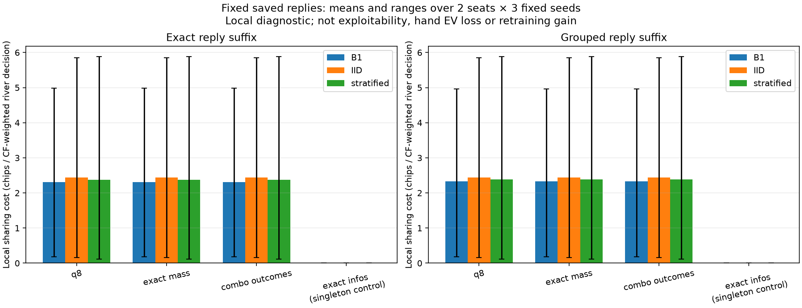

# Which river distinctions are missing?

Prospective saved-policy diagnostic, registered November 10, 2026 in issue #4
comment 6788998129 before implementation or new feature measurements.

The continuation report shows how weak later choices can make an earlier call
unattractive. This step asks whether finer static range distinctions separate
conflicting river decisions. It does not train a feature or establish a remedy.

## Fixed comparison and acceptance

Keep all nine original medium-game primary snapshots: B1, IID B4 and the failed
private-prefix B4 candidate, all three seeds, signed regrets, final ten-million
node work and linear averages. Include both seats and every responding river
exact information row, including unsupported rows. Do not select only the earlier
largest-loss examples. The [config](../configs/river-refinement-diagnosis.json)
binds the existing complete own report, model source and panel config.

For each fixed saved opponent, retain conditional own legal action values under
both the existing exact and restricted own reply suffixes. Check the roots
against the previously audited inputs at 1e-9 chips. Responding-player support
is chance times opponent reach, excluding own past reach; the two suffixes must
agree in support within 1e-12. Opponents can differ between saved snapshots.

Refine each existing information group through four fixed diagnostic probes:

1. The original q8 group, unchanged.
2. Append exact rational blocked/loss/tie/win static-prior masses. This isolates
   probability-bin precision.
3. Also append the canonical ordered per-combo blocked/loss/tie/win relations.
   This isolates distinctions lost by pooling combination identities.
4. Use each exact information row separately as a zero-sharing-cost control.

Only own observed cards and the fixed declared prior enter the static probes.
They do not use the actual opponent deal, future cards, betting-conditioned
beliefs or reference strategies. They are diagnostic partitions, not admitted
agent encoders; no trained perfect-recall or compression claim follows.

For each suffix and seat, normalize counterfactual support across all responding
river rows to weights w. Report
`sum_i w_i max_a Q_i(a) - sum_groups max_a sum_i w_i Q_i(a)`.
Every grouped row must have the same legal actions and owner. This local sharing
cost has units of **chips per counterfactual-weighted river decision**. Decisions
overlap across histories: the score is not root EV loss, exploitability, an
additive hand loss or predicted improvement after retraining. All-zero support
has zero cost and must be labeled as no supported evidence.

Also report all/supported/unsupported row and group counts, and the number of
original parent groups with no common action within 1e-9 chips of each supported
member's maximum. Count an original parent once even if several refined
subgroups conflict. Refinement cannot decrease group counts or increase local
cost/unresolved-parent count; exact singletons have zero cost. Verify that q8
and exact masses induce the same partition wherever attainable rational masses
make q8 injective. Do not manufacture a bin-precision effect.

## Reproduction and safeguards

Publish config/source before measuring saved poker. Validate bound archives,
frozen model/source/native receipts and every original policy fingerprint, with
learner/reference constructors blocked. Retain every profile/group/member and
partial progress in deterministic JSON/gzip. Refuse existing destinations and
retain failures. The whole saved-data diagnostic, including loading and writing,
has a 900-second cap; this creates no new trajectory admission or native run.

Tests use independent hand-computed weighted conflicts, ties/zero support,
monotonic refinements, equal aggregate mass with different combo identities,
observable-card invariance and malformed/duplicate/owner/menu/nonfinite cases.
Run relevant local base/optional checks and both hosted jobs before merge;
repeat the saved-data calculation on the second runtime and compare numeric
outputs byte for byte. Existing scientific model source remains unchanged.

Results and the next decision will be recorded here and in the learning journal.
The existing sampled strength failure remains; finer probes need prospective
causal training comparisons before any strength/default/fresh/global claim.

## Recorded result — November 10

The source-checked run finishes in 294.563466 seconds on Python 3.11.17 / NumPy
2.4.6. Python 3.12.15 / NumPy 2.5.4 reproduces all twelve numeric files byte for
byte in 266.377378 seconds. Both stay below the fixed 900-second diagnostic cap.
This is saved-data reproduction, not a training trajectory replay.

All nine snapshots and eighteen responding seats are retained. Each has 1,656
own river information rows, giving 29,808 dependent member records across the
panel. All have positive counterfactual support; that does not establish played
hand frequency or training visitation. Exact/restricted roots match the audited
source with maximum error zero; responding support discrepancies are also zero.
New per-row values and costs use own mathematics, not a new native per-row audit.
No learner or reference constructor ran.

**Neither static refinement adds a group or changes a local cost/conflict count
in any response, under either reply suffix.**

| Responding seat | Original q8 | Exact masses | Ordered combo outcomes | Exact singletons |
| --- | ---: | ---: | ---: | ---: |
| 0 | 864 | 864 | 864 | 1,656 |
| 1 | 774 | 774 | 774 | 1,656 |

These group counts per snapshot are identical across the nine fixed snapshots.
The zero-cost singleton control is a property of this local score, not a newly
trained exact agent or an accepted strategy.

With two equally weighted declared combos, attainable static masses are 0, 1/2
or 1. q8 already distinguishes those values, explaining why precision adds nothing
here. Ordered identities could split equal-mass cases; the complete observed
original groups show no such split in this restricted game. A fictional fixture
tests that the implementation detects such a split when it exists.

The following means average two seats and three fixed seeds. All three static
probes have the same value in each row; exact singletons have zero. Units are
chips per counterfactual-weighted river decision.

| Saved method | Exact reply suffix | Grouped reply suffix |
| --- | ---: | ---: |
| B1 | 2.312335981 | 2.326990666 |
| IID B4 | 2.434898121 | 2.435098044 |
| Private-prefix B4 | 2.379271912 | 2.381316680 |

**Do not rank agent strength with this table.** Saved opponents, continuations
and normalized decision weights differ between snapshots. This local score is
not the original exploitability metric: IID's original strength result remains
better than the failed private-prefix primary despite these local means.
The complete 144-condition CSV retains each seed, seat, suffix and probe; its
24 aggregates are descriptive means/ranges, not confidence intervals. Both
rendered numeric tables reproduce byte for byte across runtimes.



Bars repeat across q8, exact masses and combo outcomes because the partitions
are identical. Colors identify saved training methods, not newly trained agents.
Black ranges cover six dependent seed/seat conditions. The rightmost zeros are
the singleton control only.

## Verification and next decision

The published runner source is `410faef1041c5afd02aab93cfee536e794d11ca2`.
Before execution, both base suites passed 2,348 tests (47 skipped, 148 deselected),
both optional suites passed 2,404 (148 deselected), and hosted CI 42974764735
passed both Python jobs. Frozen scientific model source remains the same
274-file SHA a5a2e28. Source receipts, logs, all twelve numeric files and the
second-runtime manifest are retained in results/river-refinement/. The reader
replays every archived row into the complete summary and rejects changed or
incomplete receipts. Final base checks pass 2,362 tests on each runtime (48 skipped,
148 deselected), and optional checks pass 2,419 each (148 deselected). Focused
checks pass 44 with one plot skip in base and 45 with plotting installed.
Final hosted CI remains required before merge; logs and results are separate
from the earlier source checks that preceded saved-data execution.

From a clean checkout, use fresh destinations:

```sh
.venv/bin/python scripts/diagnose_river_refinement.py --output results/runs/river-refinement-local
.venv/bin/python scripts/report_river_refinement.py --report results/runs/river-refinement-local --output results/runs/river-refinement-figure-local
```

Use `--no-plots` on the second command if Matplotlib is unavailable. To inspect
the committed figure without replaying the archives:

```sh
open results/river-refinement/report/static-probes.png
```

Do not spend a training sweep merely increasing mass precision or adding this
ordered outcome vector: they leave the known-game partition unchanged. Other
card-history distinctions, action-conditioned range weights and learning effects
remain possible explanations. The full-tree q8 control already permits stronger
known-game policies, so saved conflicts do not establish an unavoidable floor.

A justified next question is whether an own q8 learner becomes harder to exploit
when its **own training opponent** uses exact own-card/public-board information.
That needs a new prospective matched-work comparison and mixed-information game
correctness tests before training admission. It does not permit reference
strategy imports, hidden opponent cards or changes to the old experiment.
No stronger/default/fresh/global admission follows this diagnostic.

1. **Why did finer probabilities do nothing?** In this two-unit-combo game, q8
   already separates every attainable mass. This does not mean eight bins always
   suffice for larger ranges.
2. **Did combo identities help?** Not within these original groups: no new split
   exists. A synthetic equal-mass/different-identity fixture does split, so this
   is not caused by implementing the two probes as the same function.
3. **Does zero singleton cost prove a perfect agent?** No. A singleton has no
   other row to disagree with. This diagnostic never trains or deploys it.
