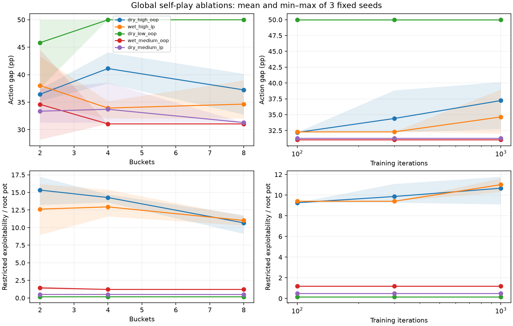
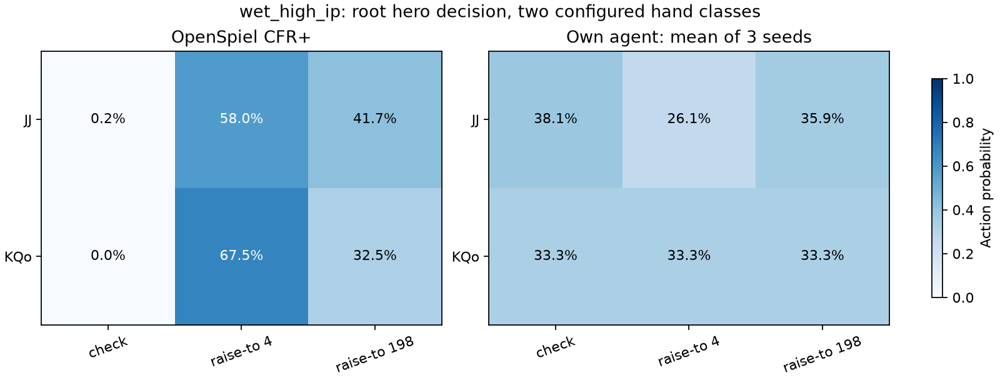

# External solver validation — Phase 3.5

**Definition of done:** gated exact-game agreement, five fully specified postflop
spots, independently solved reference policies and best responses, weighted action
gaps/node frequencies/common-opponent EVs, bucket/iteration ablations, reproducible
tables/plots, license records, verified claim drafts and interview answers.
Prerequisites were met before execution: [Phase 2](phase2-solvers.md) results and
[trained Phase 3 agents](phase3-verification.md). Tier A passed before Tier B began.

The full pipeline passed locally from clean `0f6aa40` in 590.77 seconds on the
recorded Apple M4/Python 3.11.17 environment. Reference solving plus comparisons
used 296.83 seconds. Raw reports preserve exact revisions, dirty flags, source and
input hashes, dependency lock hash, versions, runtime and hardware. Timings are
observations on this machine, not general performance promises. A later rerun's
manifest supersedes these timings without changing the protocol.

**Main finding:** toy-game implementation agreement is excellent; the bounded
Hold'em agent remains far from the postflop reference. Read the generated results
below together with the diagnosis and limitations. No competitive playing-strength
claim follows from this milestone.

## Reproduce and inspect

```sh
make validate-solvers
make check
```

Install uv 0.13.5 as in the README. The command uses locked optional
`solver-validation`, `validation` and `research` extras. It reruns Tier A first,
then fresh **own global self-play**, then postflop controls/reference solves/all
135 comparisons, followed by report rendering. Failed numerical/convergence gates
abort before reviewed outputs are replaced. Work products/checkpoints stay under
ignored `results/runs/solver-validation-build/`; small reviewed evidence lives in
[`results/solver-validation/`](../results/solver-validation/manifest.json).
The own checkpoints can be recreated by the command; no download or external
solver output is needed for own training. `make setup` alone does not install
optional reference libraries.

- [Raw Tier A](../results/solver-validation/tier-a.json),
  [raw Tier B](../results/solver-validation/postflop.json),
  [own training](../results/solver-validation/agent-training.json).
- [Per-spot summary CSV](../results/solver-validation/postflop-summary.csv),
  [diagnosis CSV](../results/solver-validation/diagnosis.csv),
  [ablation figure](../results/solver-validation/ablation-gaps.png).
- Each `*-seed*-nodes.json.gz` contains every primary information set's private
  combo/hand class, public node/state, legal concrete actions, both probability
  vectors, reference reach, lookup status and continuation EV gaps against both
  common opponents. Its `node_frequencies` groups bet/check/fold/call/raise by
  public decision node. Zero-reach conditionals are `null`, not fabricated zeros.
- `*-reference.json.gz` contains tagged comparison-only final reference policies,
  keys, action menus, convergence and spot/EFG hashes. Reference and node artifacts
  are listed with SHA256 in the reports/manifests. They are never agent inputs.

The renderer generates the diagnostic/Tier A tables and claim drafts below from
raw reports. The one command also replaces the marked README/writeup result
blocks. Timing/provenance fields vary between runs; fixed-seed numerical results
are the reproducibility target on the recorded locked environment. Hosted CI has
not run. Local Python 3.11: **419 passed**; Python 3.12: **416 passed, 3 skipped**
(optional native-reference/evaluator dependencies absent). Ruff and strict mypy
passed on both. Figures were visually inspected.

## Solvers, versions and licenses

| Component | Version/license | Role and obligations |
| --- | --- | --- |
| OpenSpiel | 2.0.2, Apache License 2.0 | Independent CFR variants on toy games; native EFG parser, CFRPlusSolver, expected returns and best response on spots. License/notice and applicable modification attribution obligations; patent grant and warranty disclaimer. No source copied into own core. |
| Treys | 0.1.8, MIT, copyright 2013 Will Drevo | Independent showdown rankings for card-world payout controls only. Preserve copyright/permission notice on redistribution; warranty disclaimer. |

The complete pinned [OpenSpiel license](https://github.com/google-deepmind/open_spiel/blob/v2.0.2/LICENSE)
was read and checked against the installed distribution's license. Both SHA256s:
`cfc7749b96f63bd31c3c42b5c471bf756814053e847c10f3eb003417bc523d30`.
The complete Treys installed `treys-0.1.8.dist-info/LICENSE` was also read before
this milestone's card-world controls. Installed wheels retain their notices.
OpenSpiel's native library is a comparison reference, not a replacement for the
own Python mechanics/training core. TexasSolver and postflop-solver were not used.
No Gambit implementation is used; EFG is the interchange format only.

No PioSOLVER, GTO Wizard or other commercial solver data are imported, copied or
used for training. Production `agents`, `training` and `abstraction` packages do
not import the comparison package/OpenSpiel; an AST test enforces that import
boundary. Agent loading requires the own MCCFR checkpoint format and compatible
encoder/model fingerprints; reference artifacts have a different rejected format.
These checks prevent accidental mixing, not maliciously forged file authentication.
Reference probabilities/values/gaps never enter own strategy lookup or training.

## Tier A: exact-game credibility gate

[`solver-validation-tier-a.json`](../configs/solver-validation-tier-a.json)
declares tolerances before execution: exploitability agreement 1e-8 ante chips,
unweighted mean information-set strategy L1 1e-6, independent mapped-policy BR
agreement 1e-10, plus final convergence and Kuhn value limits. All four variants
use alternating updates, target 0 then 1, frozen pass, no averaging delay. Kuhn
runs through 10,000 iterations; Leduc through 1,000. Exact full-tree CFR has no RNG;
ten separate seeded policy/BR checks supplement the deterministic trajectories.

Exploitability is **NashConv/2**, in ante chips/hand. Kuhn player-zero value error
uses -1/18. Leduc has no asserted analytical game-value target here; both
implementations' profile values are compared instead. Final strategy L1 averages
information sets equally; checkpoint-level raw data include value and BR gaps.
The initial gated run from `9245bf7` passed before Tier B; the complete pipeline
reproduced the gate. Agreement near machine precision establishes implementation
agreement on these exact games, not zero residual exploitability or Hold'em skill.

<!-- SOLVER_VALIDATION_TIER_A_BEGIN -->
| Game | Variant | Iterations | Own exploitability | Ref. exploitability | Mean strategy L1 | Kuhn value error |
| --- | --- | ---: | ---: | ---: | ---: | ---: |
| kuhn | cfr | 10,000 | 0.00011332446 | 0.00011332446 | 0 | 7.9627065e-06 |
| kuhn | cfr_plus | 10,000 | 9.632757e-06 | 9.632757e-06 | 0 | 3.5556146e-09 |
| kuhn | linear | 10,000 | 8.6115641e-06 | 8.6115641e-06 | 0 | 3.5976097e-09 |
| kuhn | discounted | 10,000 | 2.3872325e-05 | 2.3872325e-05 | 0 | 4.2622052e-09 |
| leduc | cfr | 1,000 | 0.01181781 | 0.01181781 | 0 | — |
| leduc | cfr_plus | 1,000 | 0.00025715162 | 0.00025715162 | 0 | — |
| leduc | linear | 1,000 | 0.0048261327 | 0.0048261327 | 1.1067718e-17 | — |
| leduc | discounted | 1,000 | 0.00014346789 | 0.00014346789 | 9.5723021e-18 | — |
<!-- SOLVER_VALIDATION_TIER_A_END -->

## Tier B: fully specified restricted games

Each versioned [`configs/spots/`](../configs/spots/dry_high_oop.json) file declares
both weighted physical-combo ranges, board, 200/200 starting stacks, 1/2 blinds,
button, exact public action prefix, remaining stacks/pot, actor/hero and bet grid.
There are **five turn subgames**, each with two combos per player and all 44 legal
rivers for each of four private pairs: 176 worlds/spot. Dry/wet describes the flop.
This does not cover a full 169-class matrix or complete flop game.

| Spot | Board | P0 range | P1 range | Pot / remaining stacks | Hero / root SPR |
| --- | --- | --- | --- | --- | --- |
| dry_high_oop | As 7d 2c 9h | AhAd, KdQd | AcKh, JsTs | 4 / 198 each | P0 OOP / 49.5 |
| wet_high_ip | Jh Th 8s 8h | AhKh, Qc9c | JcJd, QhKd | 4 / 198 each | P1 IP, checked to / 49.5 |
| dry_low_oop | Ks 7d 2c 9h | KhKd, AhQh | KcQc, JsTs | 324 / 38 each | P0 OOP / 0.1173 |
| wet_medium_oop | Qs Js 8d 3s | AsKs, ThTd | QhQd, KcTc | 36 / 182 each | P0 OOP / 5.0556 |
| dry_medium_ip | Ad 9c 4s 6h | AhAc, KhQh | AsKd, 9d9h | 108 / 146 each | P1 IP, checked to / 1.3519 |

All listed combos have weight one. Product priors are conditioned on known-board
and mutual card removal, then renormalized. Public prefix actions do **not** infer
endogenous ranges. Future rivers and opponent cards stay hidden in decision keys.
The engine replays every prefix and verifies its declared public root.

Both policies use a **full-pot/all-in grid**, plus legal passive/fold actions;
there is no separately included minimum raise or arbitrary raise-count cap.
Sizes may clamp/deduplicate at stack bounds. A full pot means raise increment
above the call price equal to pot after calling. Concrete action menus are checked
for identity, not silently projected. All 135 comparisons had zero projection
mass and no changed shadow ledger. This excludes off-tree mapping as an explanation
*inside these games*, not in arbitrary no-limit play. Phase 3's separate off-grid
stress audit showed explicit fallback failures and remains a limitation.

The own policy ablation is **global uniform-deal self-play**, not training on the
spots or solver outputs. [`solver-agent-ablation.json`](../configs/solver-agent-ablation.json)
fixes external sampling, potential buckets 2/4/8, seeds
20261115/20261116/20261117 and checkpoints 100/300/1,000. Nine runs completed all
27 checkpoints with node/time budgets and isolated worker processes. Primary is
**8 buckets at 1,000 iterations**, declared before comparisons, not whichever
configuration happened to look best. The three checkpoints share each run's
trajectory; three seed ranges are descriptive, not confidence intervals.

The reference uses OpenSpiel 2.0.2 native deterministic CFR+ on an exact exported
spot tree. Configured iteration schedule: 64/256/1,024/4,096/16,384. Require
exploitability at most **0.001 root pots** at **two successive scheduled
checkpoints**; retain the latest policy. This strengthened stability control was
declared after a reference-only cost pilot and before main agent comparisons.
Final achieved iteration counts/convergence are in the raw report. Every parsed
node's chance/actions/payoff and the information-set bijection are checked.

**Independence boundary:** the EFG mechanics/export are own project code. OpenSpiel
independently parses, solves and best-responds to that game. It is not an
independent full postflop-engine implementation. Separate controls checked all
880 passive card worlds with Treys; Phase 1 supplies million-hand evaluator and
independent PokerKit engine evidence with its documented exceptions. Own/native
cross-play expectation error was at most 1.066e-13 chips across this run's profiles.

## Metrics and EV conventions

For each exact information set, action MAE is sum of absolute probability
differences divided by **that set's legal-action count**. Average using the final
reference profile's joint reach, including chance; normalize across all compared
decision information sets. Report overall and by street. Padding is excluded.
Units are probability points (100 times this is percentage points), not L1 or
necessarily total variation. Thus unlike branching factors affect normalization.
Reference weighting can de-emphasize states the own policy reaches more often;
restricted best response and the EV decomposition complement this metric.

Range frequencies and per-node/per-class continuation EVs use the **same reference
conditional range beliefs** for both policies. That isolates policy differences
at the node; these are not each policy's endogenous realized node ranges. Node
exports contain physical combos and hand classes; only configured combos are
covered. Root class EVs instead condition on the declared range marginal.

Four exact profiles are evaluated: (reference, reference), (own, own),
(own P0, reference P1), and (reference P0, own P1). For each hero, compare own versus
reference while fixing **the same opponent**, once reference and once own. Signed
positive gap favors own; the two gaps can have opposite signs because an
equilibrium policy need not maximally exploit the own opponent. Values are net
original-hand chips; fixed prefix costs cancel in EV differences. Enumeration
covers every configured private pair/river, so these are exact restricted-game
expectations up to rounding, not sampled win rates. Native best response measures
own profile exploitability in this exact range/action game; both players' policies
are included, not only the hero.

## Diagnose before attributing to compute

Implementation controls passed: all 120,947 exported nodes aligned with the native
parser, all 880 passive private-card/river controls matched Treys/expected payouts,
hidden-card tests passed, concrete action grids/ledgers matched, common-opponent
EVs matched native expectations, and self-comparisons gave zero gaps. Tests also
verify that an exact performance-difference decomposition sums back to total EV.
These checks substantially narrow bug hypotheses; they do not prove absence of
all engine, abstraction or training defects outside this scope.

<!-- SOLVER_VALIDATION_DIAGNOSIS_BEGIN -->
| Turn subgame | Ref. policy change (pp) | EV deficit accounted for at fallback nodes | Action gap: 100 → 1,000 iters (pp) |
| --- | ---: | ---: | ---: |
| dry_high_oop | 0.021 | 92.9% | 32.19 → 37.23 |
| wet_high_ip | 0.626 | 94.7% | 32.28 → 34.64 |
| dry_low_oop | 0.222 | 69.9% | 49.98 → 49.98 |
| wet_medium_oop | 0.120 | 99.7% | 31.05 → 31.05 |
| dry_medium_ip | 0.140 | 100.0% | 31.29 → 31.29 |

Fallback shares use the exact performance-difference identity, averaged across the three primary seeds. They are an EV accounting decomposition, not a causal estimate for extra training. Reference policy changes use the final reference reach weights.
<!-- SOLVER_VALIDATION_DIAGNOSIS_END -->

- **Sparse/unaveraged strategy:** fallback decisions account for about 70–100% of
  the mean hero EV deficit, using candidate reach in the exact accounting identity.
  This differs from their share of reference-reach action gaps. For example,
  very low-reference-reach unseen decisions can still cost EV under own play.
  `matched` only means a saved average row has positive mass; it can remain uniform.
- **Iterations:** 100→1,000 iterations did not consistently improve spot action
  gap/exploitability. Several curves stay flat; two high-SPR spot gaps increase.
  The measurements support poor coverage/poor current policies, not a claim that
  more compute alone would solve the gaps. Global training and conditional spot
  solving optimize different range distributions, so spot improvement is not a
  monotonic consequence of global self-play iterations.
- **Buckets:** 2/4/8 changes coverage and the metrics, with no universal winner.
  More buckets reduce these high-SPR restricted exploitabilities but do not yield
  small gaps. The models are not nested and coverage changes with capacity; this
  experiment does not identify a pure irreducible abstraction-loss floor.
- **Off-tree sizes:** not a cause within the matched grid; broader translation
  remains unvalidated strategically and is not included in these gap numbers.
- **Reference convergence:** two converged checkpoints and at most 0.626 pp
  reference-policy change are small beside 31–50 pp agent action gaps. With fixed
  final reach weights, the triangle inequality bounds action-gap sensitivity to
  the preceding reference policy by that reported policy change. Residual epsilon
  is still reported, not called exact GTO.



## Limitations and what the numbers prove

This is a transfer comparison on five narrow turn games, not unrestricted
Hold'em exploitability, general solver equivalence, a full preflop solution or a
winning-agent result. The reference knows the declared fixed ranges; the frozen
global own policy does not re-solve for them. They need not equal global self-play's
endogenous conditional ranges. The agent's card abstraction, small iteration
budget and explicit uniform fallbacks are material limitations. The action grid
excludes many real bet sizes. Large SPR permits losses of many root pots; a value
above one in the exploitability/pot column is possible and is not a win rate.

Equilibria can differ in action probabilities while retaining similar EV; action
agreement alone is neither necessary nor sufficient for good play. Native BR is
independent of own solver updates, while mechanics/export remain shared. The
passive Treys check does not independently validate all betting rules. Three
fixed seeds and five selected spots do not support population confidence bounds.
All seeds/configurations and non-improving results are retained without choosing
the best seed or replacing the predeclared primary.

## Resume-ready drafts generated from verified reports

<!-- SOLVER_VALIDATION_CLAIMS_BEGIN -->
# Verified claim drafts

- Implemented four exact CFR variants for Kuhn and Leduc; matched OpenSpiel 2.0.2 exploitability within 1.39e-16 ante chips/hand at the tested equal iteration budgets. This is implementation agreement, not zero remaining exploitability.
- Built a reproducible external-solver comparison across 5 restricted turn subgames; measured 36.84 percentage points mean action-frequency gap versus OpenSpiel CFR+ (equal spot weighting, three fixed agent seeds, reference-reach-weighted node MAE). The agent had higher restricted exploitability in 5/5 spots and lower hero EV versus the reference opponent in 5/5; this is not a full-game win-rate claim.
- Verified every exported node in 120,947 restricted-game tree nodes against OpenSpiel's parser and 880 passive private-card/river worlds against independent Treys showdown ranks and expected payouts. The exported mechanics are project code, so parser/solver agreement alone is not an independent full-engine validation.
<!-- SOLVER_VALIDATION_CLAIMS_END -->

## Three interview questions

**Why isn't matching action frequencies enough?** Equilibria can use different
mixtures, and reference reach may hide own-reached mistakes. I also evaluate both
policies against the same two opponents and compute independent restricted-game
best responses. Those measure consequences rather than superficial agreement.

**Why can exact CFR match while the Hold'em policy is weak?** The toy gate checks
updates, averaging and BR on small exact games. The Hold'em policy is sampled,
abstracted and sparsely trained under different global ranges. Its explicit
fallbacks account for most of the measured EV deficit; tested bucket/iteration
changes do not establish that extra compute alone fixes this.

**How independent is this validation, and how did you avoid leakage?** OpenSpiel's
parser/CFR+/BR are independent, but my EFG mechanics are shared and I disclose that.
Treys and Phase 1 PokerKit controls address separate mechanics risks. Reference
artifacts have a distinct format and remain inside comparison/reporting code;
own self-play only consumes own configs/models/checkpoints, never solver outputs.

<!-- SOLVER_VALIDATION_RESULTS_BEGIN -->
### Reproduced external-solver comparison

Exact-game CFR variants matched OpenSpiel 2.0.2 within **1.39e-16 ante chips/hand** exploitability at matched iterations.

Five **turn subgames**, two physical combos per player, matched full-pot/all-in actions. Primary own agent: eight potential buckets, 1,000 global self-play iterations, three fixed seeds. Entries below are seed means; raw reports include seed ranges, node frequencies, hand-class EVs and all ablations.

| Turn subgame | Action gap (pp) | Turn / river (pp) | Own exploit. / pot | Hero EV gap vs ref. / pot | Trained-policy reach |
| --- | ---: | ---: | ---: | ---: | ---: |
| dry_high_oop | 37.23 | 37.23 / 37.83 | 10.6715 | -0.5874 | 58.3% |
| wet_high_ip | 34.64 | 34.64 / 37.24 | 11.0141 | -0.2263 | 58.3% |
| dry_low_oop | 49.98 | 49.98 / 34.15 | 0.1650 | -0.0930 | 8.3% |
| wet_medium_oop | 31.05 | 31.19 / 30.81 | 1.2075 | -0.3209 | 5.1% |
| dry_medium_ip | 31.29 | 44.44 / 24.92 | 0.4896 | -0.1930 | 0.0% |

Action gap is reference-reach-weighted per-node action MAE, in percentage points. Exploitability is NashConv/2; EV compares the hero policy against the same reference opponent. Pot-normalized EV gaps use root-pot units. These are exact restricted-game expectations, not measured full-game win rates.

Own restricted exploitability exceeds the reference in 5/5 spots; hero EV against the same reference opponent is lower in 5/5. Trained-policy coverage spans 0.0–58.3% of reference decision reach; the rest uses explicit uniform fallbacks. Three training seeds do not establish a population confidence interval.



Reproduce: `make validate-solvers` (minutes on the recorded Mac; optional solver/evaluator/plot dependencies are installed from the lockfile). No commercial solver data are used. See this document for methodology, licenses, convergence, diagnostics and limits.
<!-- SOLVER_VALIDATION_RESULTS_END -->
