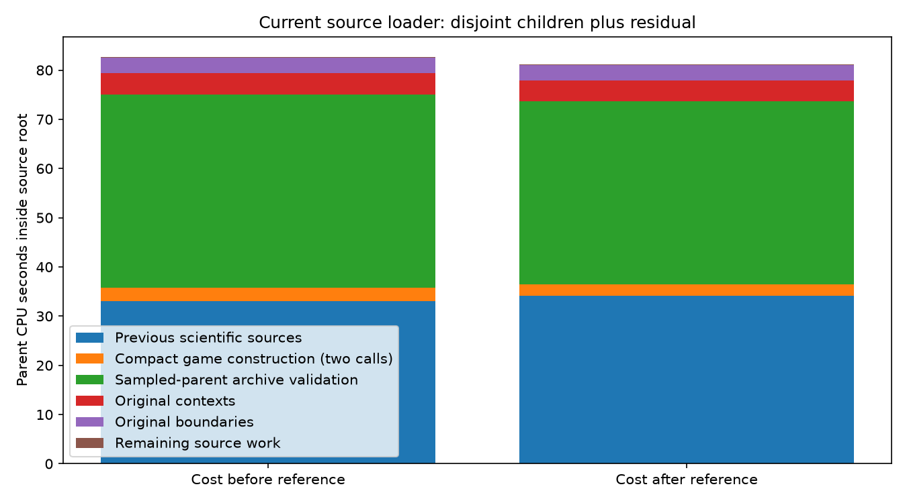
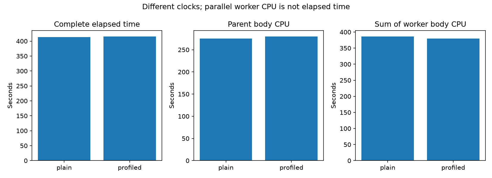

# Follow the work inside source loading

The [complete reader measurement](reader-phase-cpu.md) puts about 78–79 parent
CPU seconds per cost read in source loading. That includes building and checking
scientific inputs, not just reading files. This follow-up asks which named stages
inside that boundary account for the work.

The [plan](https://github.com/jimmy-sim/poker-ai/issues/4#issuecomment-6918554952)
was published before implementation. The corrected collector completed all six
source checks before the new own-only proof and complete comparison. The retained
qualification history below includes the original rejected proof and parser fix.

## What the complete comparison found — November 17

Source loading spends most of its parent CPU in two places: validating the
sampled-parent archive and checking earlier scientific sources. Together they
account for 87.5% / 87.9% of source CPU in the two instrumented cost reads.
These are checks and calculations, not simply reading bytes from disk.

The table reports parent CPU seconds. Its rows are disjoint components of source
loading; add them once to recover the source total.

| Stage inside source loading | Before reference | After reference |
| --- | ---: | ---: |
| Earlier scientific sources | 33.108 | 34.101 |
| Compact game construction (two calls) | 2.614 | 2.343 |
| Sampled-parent archive validation | 39.248 | 37.223 |
| Original contexts | 4.429 | 4.266 |
| Original boundaries | 3.163 | 3.108 |
| Remaining source work | 0.123 | 0.117 |

The source totals are **82.684 / 81.157 CPU seconds**. Work outside the source
root is **56.672 / 53.054**, giving complete-read parent CPU of **139.356 / 134.211**.
The first software read correctly records no source root. Plain-arm selected
zeros mean the timers were disabled, not that source work disappeared.



The complete ordinary/instrumented commands take **413.958874 / 415.107845 seconds**;
the enclosing CLI takes **832.062314**, within the unchanged 900-second child and
1,800-second outer limits. Parallel worker CPU is a separate quantity, not elapsed
time to add to these values.



All three reads, 432 profiles, 1,152 fixed conditions and three reference workers
remain. Complete scalar/calculated-replay results agree exactly; all 14 selected
source calls are present and temporary aliases are restored. The maximum
OpenSpiel scalar discrepancy is **1.8474111129762605e-13 chips**, below 1e-9.
OpenSpiel 2.0.2 remains Apache-2.0 and comparison-only; no reference actions are
exported or used in training.

The [own proof](../results/source-phase-cpu-v2/software-raw-manifest.json) was
public before fresh reference use, and the [27 raw pair files](../results/source-phase-cpu-v2/pair-raw-manifest.json)
were public and [verified](../results/source-phase-cpu-v2/pair-published-verification.json)
before analysis. [CSV and JSON exports](../results/source-phase-cpu-v2/pair/report/summary.json)
reproduce byte for byte on both actual runtimes with 50 numerical entry points
blocked: zero forbidden calls and all raw inputs unchanged. [Reproduction and
visual-review receipts](../results/source-phase-cpu-v2/report-checks/raw-and-figure-review.json)
retain those checks; both plots were inspected.

One ordered pair does not establish stable observer overhead, a causal speedup
or production costs. The two reads are dependent checks of the same known input
family, not independent poker-strength samples. No training or strategy changes
occurred. The failed 912.54/900-second forecast and 2.390%/1% accuracy result stay
failed. The next question is which work inside archive validation and earlier
source checking can be reduced while preserving every mathematical check.
Final software/report checks remain before merge.

## Explore the saved result

From the project root, open the committed figure:

```sh
open results/source-phase-cpu-v2/pair/report/source-children.png
```

To recreate the saved report in a fresh ignored folder:

```sh
.venv/bin/python scripts/profile_source_phases_v2.py report \
  --output results/source-phase-cpu-v2/pair \
  --report-output results/runs/source-phase-local
```

Choose another report-output name if that folder already exists. This reads saved
evidence and renders plots; it does not train or run a reference solver.

## What is measured

The original three complete reads stay intact. The software read has no selected
source root. Each cost read enters `compact_suit.cli.load` once, enclosing these
six sequential calls:

| Stage | Calls in each source root |
| --- | ---: |
| Previous scientific sources | 1 |
| Compact game construction | 2 |
| Sampled-parent archive validation | 1 |
| Original contexts | 1 |
| Original boundaries | 1 |

The two roots plus their children give 14 selected calls overall, capped at 32.
Children plus the source residual must equal inclusive source CPU. Source CPU
plus CPU outside that root must equal the complete read. Adding a root to its
children would count the same work twice.

Only the source module's selected aliases are temporarily observed. Two aliases
refer to modules; forwarding proxies select one member while delegating other
attributes to the unchanged original module. Reusable defining functions remain
untouched. Calls outside the active root are not timed. Ownership, ordered
inventories, clocks, restoration and separately saved event streams are checked.
All 439 preceding scientific files and historical inputs/results stay unchanged.

## Check the tool before using it

The observer passes 54 focused tests on both actual Python versions, including
proxy forwarding, defining-function identity, nested arithmetic, corrupt records,
process/thread ownership, partial output, late aliases and cleanup failures.
An actual archived fictional-game read agrees before/during observation and
correctly records zero source roots. It does not prove real cost-loader coverage.

The runner's initial unit suite found three inherited fixture assumptions: two
corruption tests erased already-empty software event streams, and one positive
check expected seven calls rather than fourteen. The corrected tests target the
first synthetic cost-shaped stream and the declared inventory. [The failed log
and exact code](../results/source-phase-cpu/qualification-history/initial-fixture-adaptation/manifest.json)
remain. A separate shared-cap fixture omitted the required arm order before it
could reach the clock check; [that failure](../results/source-phase-cpu/qualification-history/shared-cap-fixture/manifest.json)
is retained too. No runtime guard or scientific limit was relaxed.

A later self-review found a genuine parser edge case: boolean read-number lists
could compare equal to integer lists, and inner proof-cap metadata was not
explicitly checked. Five coherently updated metadata fixtures reproduce those
acceptances. The parser now rejects them while enforcing the original typed
inventories and 180-second limit. [The failing regressions](../results/source-phase-cpu/qualification-history/proof-metadata/manifest.json)
and [superseded partial checks](../results/source-phase-cpu/qualification-history/superseded-before-metadata-fix/manifest.json)
remain. The earlier chat interruption's [partial records](../results/source-phase-cpu/qualification-history/interrupted-local/interruption.json)
remain separate. Neither cohort completed a qualifying role or ran a scientific
measurement. All 118 focused tests now pass on each runtime.

Formal use requires full source qualification, an own-only proof, the complete
pair and final checks. The own proof separates actual archived software replay from
nested forwarding fixtures. Fixtures are not real source-loader timing or new
independent poker mathematics.

## Keep the original experiment

One ordinary/instrumented complete cost-audit repetition retains all startup,
source/license/publication checks, three original reads, 432 profiles, 1,152
fixed conditions, three reference workers, current normalization/recall caching,
restoration, validation and final writes. Exact complete calculated results must
match. Source qualification and own evidence are published before new reference
construction; complete raw evidence is published before analysis.

Limits stay 180 seconds for the own proof, 900 per complete child and 1,800
shared, with 120 seconds only for retaining a failure. Real replay stays on
Python 3.11.17/NumPy 2.4.6. The newer runtime can check software and saved data;
it does not establish bit-exact real-trajectory replay. OpenSpiel 2.0.2 remains
a pinned Apache 2.0 comparison reference whose outputs cannot enter training.
Its installed license must be read and recorded before fresh use.

This step introduces no optimizer, cache or new trajectory. One ordered diagnostic
pair cannot replace the production forecast or establish stable overhead, causal
speedup or playing strength. The 912.54/900-second budget and 2.390%/1% accuracy
failures remain.


## Qualified source — November 16

[All six source checks and tested operators](../results/source-phase-cpu/checks.json)
qualify revision `f784551`: local bases pass 5,004 tests each (67 skipped,
150 deselected), local optional suites pass 1,909 each, and both hosted jobs pass
the same base inventory. Actual Python 3.11.17/NumPy 2.4.6 and Python
3.12.15/NumPy 2.5.4, every uv runtime choice and the entire tested checkout tree
match. Hosted test times are 1,281.09 / 1,009.46 seconds; the existing historical
rounding warning remains. No new source-child proof or measurement has run.

The nine exact tested operators, installed reference-license receipts, partial
qualification histories and report-guard setup checks are retained. The next
step verifies this publication before the single own-only proof.


November 16 — The fresh own-only proof follows verified public six-role source
qualification. Its complete CLI finishes in 5.927510875000735 seconds, under
the fixed 180-second cap. The actual archived software replay is identical
before/during observation and records zero source roots. Two separately labeled
synthetic forwarding reads give 14 selected root/child calls, with full restoration.
[All raw proof files](../results/source-phase-cpu/software-raw-manifest.json)
and source-publication verification are retained before fresh reference use.
This does not claim real cost-loader coverage or new independent poker math.
Public-boundary verification remains before the single complete audit pair.


November 16 — Publication verification rejects the fresh proof: its parser
incorrectly requires an inner cap exactly180s, while the supervisor correctly
subtracts startup from the unchanged180s outer allowance (recorded inner cap
179.9989877909975s). Calculations/restoration completed, but this proof is not
accepted for admission. A mistakenly attempted pair was blocked by the same
guard before any child measurement or reference construction; its complete
failure is [retained](../results/source-phase-cpu/pair-raw-manifest.json). No
source-child timing result follows. Correct the remaining-budget parser, retain
negative cases, and fully qualify the corrected source before further collection.
No scientific cap, seed, tolerance or earlier outcome is changed.


## Startup-adjusted allowance correction — November 16

The [prospective correction](https://github.com/jimmy-sim/poker-ai/issues/4#issuecomment-6941037776)
keeps the rejected proof and blocked pair unchanged. A separate corrected entry
and config use `results/source-phase-cpu-v2`; all 442 predecessor scientific
files remain unchanged. The new parser accepts finite numeric inner allowances
with `0 < cap <= 180` and requires the complete child duration below that cap.
The fixed outer180-second limit remains. For example, startup can legitimately
leave 179.9989877909975 seconds; requiring exactly180 rejects valid evidence.

All78 corrected-runner tests pass on actual3.11.17/NumPy2.4.6 and3.12.15/NumPy2.5.4
(34.24/31.21s), including fractional/exact allowances, invalid/exhausted limits
and a CLI-calculation/publication round-trip. Full strict typing passes812files.
A launcher preflight verifies published own evidence inside the complete outer
clock; rejected or interrupted checks start no child and retain their clock.
These are software checks, not a new formal proof or real cost-loader result.
Full new local/hosted qualification remains before any revised collection.
No scientific cap, seed, tolerance, policy, dependency or CI behavior changes.


## Corrected source qualified — November 17, 2026

[All six corrected-source checks](../results/source-phase-cpu-v2/checks.json) qualify `5496ef1`: both local bases
pass 5,081 tests (68 skipped, 150 deselected), both optional suites pass 1,987,
and both hosted base suites pass. Actual Python/NumPy, all uv runtime choices
and each complete tested checkout tree match. All 442 preceding scientific
files remain unchanged; the revised source map contains 444 files.

The ten tested administrative tools are published with the receipts. Six
process cases, five preflight cases, four retention cases and ten synthetic
publication cases pass. Preflight means checking the published own proof before
starting a comparison. Exhausting that check's allowance now refuses launch;
the initial late-launch/cleanup failure and corrected refusal remain in the
[fixture archives](../results/source-phase-cpu-v2/checks/fixture-archives.json). Static report-guard
setup covers 50 numerical entry points on each runtime; saved-data report
reproduction is still required after collection.

This qualifies the corrected measuring tool. A fresh own-only proof must be
published and verified before the single complete comparison. The original
rejected proof and blocked pair remain unchanged.


November 17 — The corrected own-only command completes in 6.215336457997182 seconds
under the fixed 180-second outer cap. Its actual child allowance is
179.9991310000005 seconds. The actual archived software replay agrees exactly
before/during observation and has zero source roots; separately labeled forwarding
fixtures record 14 selected calls and full restoration. [All 13 raw files](../results/source-phase-cpu-v2/software-raw-manifest.json)
are retained before any fresh reference. Public-boundary verification is next;
this is not real cost-loader coverage or new independent poker mathematics.


November 17 — The revised published own proof passes the corrected parser. Both
complete audit arms finish under the original limits and record exact complete
scalar/calculated-replay identity. [Every raw pair file](../results/source-phase-cpu-v2/pair-raw-manifest.json)
is retained for publication before timing analysis. No source-stage conclusion
or production admission is drawn yet.
