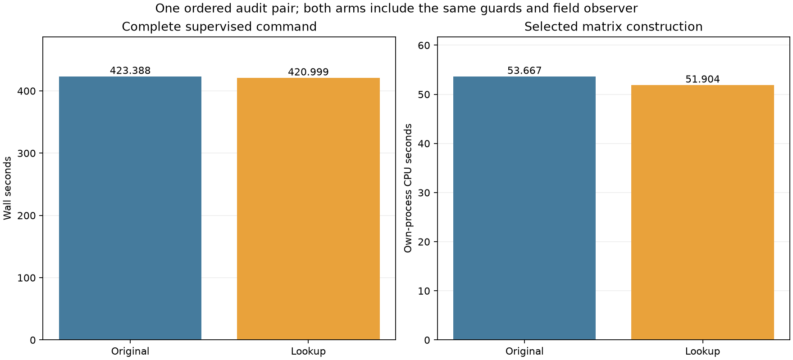
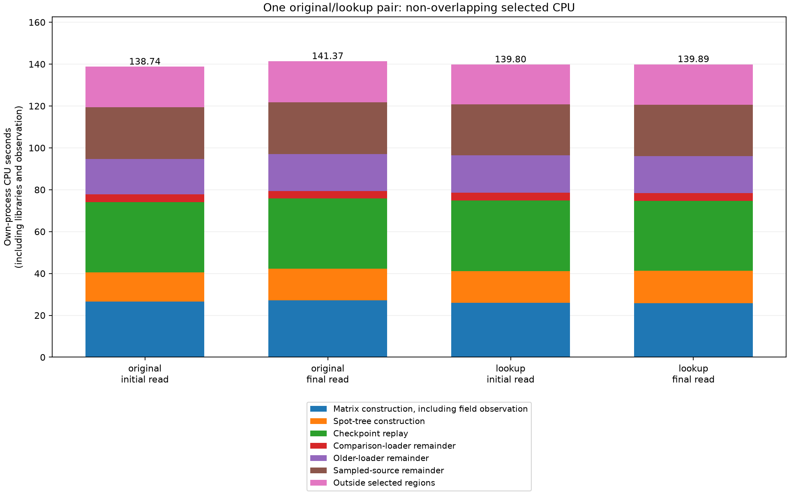

# Compute card-suit normalization with a fixed lookup

Registered November 15, 2026 in [issue #4](https://github.com/jimmy-sim/poker-ai/issues/4#issuecomment-6903489482),
before implementation or measurement. [PR #76's capture](matrix-phases.md#recorded-cpu-result--november-15-2026)
locates 44.433599 of 52.715310 matrix CPU seconds in information/key creation.
That is a target for investigation, not a measured saving from this candidate.

## Question and completion criteria

The original normalization considers all 24 suit permutations. Each repeatedly
computes `4 * (card // 4) + permutation[card % 4]`. Test a private fixed 24-by-52
translation table, keeping the original sorted tuples and lexicographic minimum.
Compute every permutation on every request. This is not a card-result cache.

Done means checked private support/runner, complete source qualification and a
published own software proof, one original/lookup full-audit pair, retained raw
success/partial/failure, portable data-only tables/plot, final local/hosted checks,
work log and plain-English journal. Diagnostic pass requires all correctness,
coverage, field and counter checks, lower complete-command wall **and** lower
selected exclusive matrix CPU. No prior failure or acceptance rule is changed.

## Exact private scope

Preserve all 412 prior source files; expect 415 effective files after adding
entry/support/config. [The config](../configs/suit-lookup.json) seals inputs,
software cases, immutable table hash and caps before new code or results.
The 24 rows follow the original `SUIT_PERMUTATIONS` order. Validate all 1,248
builtin integer entries independently against rank/suit arithmetic.

Primitive supported calls may use the private kernel. Unsupported types/keywords
or changed captured card-validation/permutation dependencies execute the captured
original. Preserve validation order, exceptions, input immutability, output types,
sorting and minimum semantics. No sorting/coercion of the input cache key, result
memoization, RNG, feature/payoff/policy cache or reference-strategy input exists.
Restore earlier and late owned aliases even on primary failure. Main PID/thread
only; reject nesting and changed hooks. Reference workers use original code and
no private hooks. Their common imports/startup still belong to complete clocks.

Both modes install the same private eligibility/dependency/counter observation:
control calls the original arithmetic; candidate uses the table when supported.
Record requests, original/private evaluations, fallbacks, errors, restoration and
alias inventory, with a ten-million-request safety ceiling per child. This is
algorithm request accounting, not timed per-frame/per-node profiling. Cost is
relative to this instrumented control, not an unwrapped historical command.

## Qualification and own software proof

Tests cover every entry, all preflop pairs, valid/invalid/unsupported/keyword
behavior, suit and input permutations, changed dependencies, counters, PID/thread,
restoration/primary failure, source/schema/clock/cap refusal and partial retention.
Complete immutable exact-head local bases and relevant optional suites on both
Python versions, then both hosted roles with actual Python/NumPy/uv and full
tested-tree proof. Publish all six receipts and exact launch/save operators.

One complete 180-second own software proof follows that publication: all 1,248
table entries, all 1,326 unordered two-card preflop pairs, and 1,024 valid cases
for each board lengths 3/4/5 (3,072 total), from software-only PCG64 seed 20261502.
There are 4,398 valid hand cases. Historical game seeds/RNG streams stay unchanged.
The fixed call catalog additionally checks invalid and unsupported behavior;
record expected software exceptions separately from failed real collection.
Compare the five original builder encodings on the pinned small fixture/model
with the same complete field observer. Construct no learner/reference or new
trajectory. Publish complete or failing own proof before any actual audit.

## One complete original/lookup pair

Only a usable published software proof permits the one pair, in that fixed order.
Keep uncached original card-result wrappers, shared recall cache, fictional tiny
pre-read, initial/final own mathematical reads, all three original native workers,
source/publication/scalar checks and writes. All 432 profiles, 1,152 conditions, three
computed reads/worker/card/source/scalar identities and original uncached card
request/computation counters must match. Both arms must match all 184 pinned
original constructor field vectors. The full-field observer is the same in both.

Retain the existing six sparse global regions: 1,538 calls per arm, 3,076 combined
below 4,096. Do not add PR #76's 920 phase intervals to this pair or install a
global per-frame/per-node profiler. Record complete process/library CPU clocks;
respect nesting and never add parents, children or parallel workers twice.

Whole child 900 seconds each, shared command 1,800, failure-saving reserve 120.
Charge table initialization/imports, source/check/proof validation, all original
stages, observation, extraction, final verification and writes. Operator origin
begins immediately before Python launch. One attempt, no favorable retry, subset,
changed seed/cap/gate, or use of failure-saving time to make a pass. Retain ignored
originals and exact raw/admin copies, including partial failures. Failed outer
administration never yields a usable proof. Publish raw before posthoc analysis.

Archive execution uses actual Python 3.11.17/NumPy 2.4.6 and locked extras, CPU query and
temporary idle control. Python 3.12/NumPy 2.5.4 is software/saved-data only.
OpenSpiel 2.0.2 remains comparison-only under its recorded pinned Apache 2.0 license;
its strategy outputs never enter the agent. No commercial solver input is used.

## Reporting and boundaries

Report all values/counters/field identities, total/body/read/worker clocks,
inclusive/exclusive region CPU and old/current scope limitations. Inspect plots
and verify portable numeric exports with actual poker execution blocked. Retain
export failures. Explicit legacy 3.11 sequential CPU association may reproduce
frozen-parser bookkeeping within its existing 1e-9 CPU-second arithmetic allowance;
no raw/poker/tolerance/gate change or recapture follows from reporting differences.

Final relevant local and both exact-report-head hosted jobs precede a
history-preserving merge. One coherent PR through required publication stages;
batch related changes, keep issue/work log/journal current, actual dates and
truthful AI attribution. Preserve unrelated user bytes and source history.
No subagents, future automation, C++ or Rust core is authorized here. The active
user instruction continues work until stopped; it sets no new scientific caps.

A diagnostic pass is one ordered historical cost case, not population runtime,
peak memory, competitive full-game strength or production/default admission.
The old grouped-depth/card-cache timing failures, 933.89/900 production forecast
failure and 2.390%-versus-1% accuracy failure remain. A separately qualified
production family, prescribed full original end-to-end proof, all three own
publications before any fresh native construction, all three native costs,
original conservative forecast and checked published admission still precede
real trajectories. PR #76 is merged with final hosted and main verification retained in its
[closing receipts](../results/matrix-phases/final-ci/manifest.json).

## Three questions

**Why can the table preserve the result?** It stores each original integer
translation for the same 24 permutations and 52 card IDs; sorting and minimum
remain unchanged. Exhaustive entry checks and original-output comparisons test it.

**Why keep the original control instrumented?** Both arms pay the same guards,
counters and field observer. The resulting claim is relative to that control;
it is not a measurement of an unwrapped production implementation.

**Would a faster point prove stronger poker?** No. Software/cost admission and
later strategy-quality evidence are separate. All production and learning gates
remain in force, including unfavorable historical outcomes.


## Recorded own software proof — November 15, 2026

After qualification publication `89be152`, the one formal software proof passes.
The complete outer command takes **5.307256125001004 seconds**; its registered
command takes 5.236114416999044 and its supervised child 3.0092819170095026,
all under the complete 180-second budget. No interruption or retry occurs.

All 1,248 table entries and all 4,398 valid cases agree exactly across original
and lookup, with input/type checks. Each arm completes all 17 fixed behavior
cases. Expected invalid-call exceptions have their own precise retained receipts;
they are not failed actual audits. All five complete matrix-field vectors agree.
The main valid/builder scope records 10,970 requests per arm: original evaluates
10,970 with the original function; lookup evaluates 10,970 with the table. Both
have zero fallbacks/errors there; fixed unsupported/error calls are separate.

[The proof](../results/suit-lookup/software/proof.json), [child record](../results/suit-lookup/software/child/child.json)
and [raw manifest](../results/suit-lookup/raw-software-manifest.json) retain 57
raw/administrative files and exact ignored originals; the manifest is the 58th.
Publish them before the actual pair. This proof constructs no learner/reference
and performs no new trajectory study. It validates the private implementation,
not performance, full production-family admission or stronger poker.


## Recorded complete pair — November 15, 2026

After own proof publication `0b4203c`, the one original/lookup pair completes
successfully. Its outer command takes 850.8070003750036 seconds and its registered
shared command 850.7695943330182, under 1,800. Both supervised children finish
under their unchanged 900-second limits, without interruption or retry.

Both arms preserve all original 432-profile/1,152-condition/three-read identities,
worker/card/source/scalar checks, equal kernel request/fallback accounting and
all 184 pinned original constructor field fingerprints. The six global regions
record 1,538 calls per arm, 3,076 combined below 4,096. No five-phase recorder
is installed. [Raw pair](../results/suit-lookup/pair/pair.json), [outer clock](../results/suit-lookup/execution-pair/exit.json)
and [manifest](../results/suit-lookup/raw-pair-manifest.json) retain 53 exact
raw/administrative files and ignored originals; the manifest is the 54th.

Publish this evidence before posthoc CPU/cost analysis. Completion is a capture
and correctness result, not yet a diagnostic cost verdict or training admission.
No new policy/real trajectory study is trained, and comparison outputs remain
comparison-only. Scientific source, caps, seeds and old failed outcomes stay fixed.


## Recorded cost result — November 15, 2026

Raw publication `59ff388` precedes this analysis. The diagnostic passes its
predeclared conditions, with a small observed difference:

| Metric | Original | Lookup | Observed reduction |
| --- | ---: | ---: | ---: |
| Complete supervised command, wall seconds | 423.388326 | 420.999045 | 2.389281 (0.5643%) |
| Selected matrix construction, own CPU seconds | 53.666726 | 51.904056 | 1.762670 (3.2845%) |

All correctness/coverage, counters and full fields agree. Each arm records
918,104 canonicalization requests. Original evaluates all with the original
function; lookup evaluates all with the table, with zero original fallbacks or
errors in either complete arm. Native spawned workers keep the original code.
This is comparison against the equally instrumented control, not an unwrapped
production command. Full values and the three pass flags are in
[summary.json](../results/suit-lookup/report/summary.json).



The small wall difference should not be treated as a stable causal saving.
The unchanged parallel comparison workers also run about 1.65 seconds quicker
in the lookup arm. They overlap, so their times are not added into command wall
time. One fixed-order pair cannot separate the lookup from run variation,
cache/order effects or unrelated stage differences. No confidence interval,
population-runtime or peak-memory claim is established. The positive diagnostic
does not rescue the 933.89/900 forecast or accept a production/default family.



Blue is matrix construction, including full-field observation. Other colors are
non-overlapping selected operations or their remainders; pink is outside those
selected regions. Initial/final refer to reads of the same archived own policies,
not newly trained agents. The bar heights are CPU, not elapsed time or playing
strength. [Reader](../results/suit-lookup/report/readers.csv),
[region](../results/suit-lookup/report/regions.csv),
[worker](../results/suit-lookup/report/workers.csv),
[body](../results/suit-lookup/report/bodies.csv) and
[kernel](../results/suit-lookup/report/kernel.csv) tables retain the detail.

### Report verification and next decision

All six numeric exports match byte-for-byte under actual Python 3.12.15/NumPy
2.5.4, with canonicalization, tree/reader/scoring/replay, learner and native
execution blocked. This is saved-data parsing, not bit-exact real poker replay.
The first export attempt refused to overwrite an earlier report's generic log;
[it is retained](../results/suit-lookup/report/portability-attempt1/failure.json).
The corrected verifier uses a unique log name and preserves the earlier bytes.
No raw measurement, scientific source, threshold, seed, cap or actual pair is
changed or repeated. Matplotlib's temporary-font-cache notices remain in logs.
Both final relevant suites pass 909 tests (53.68/53.43 seconds); the two plots are
visually checked. Exact scripts, runtime/source guards and logs accompany them.

The next useful question is whether every request really needs all 24 suit
candidates. A new prospective mathematical factorization could first select
translations with the smallest private-card description, then compare boards
only among those ties. It needs its own exact proof, complete original field
checks and a new bounded cost comparison; this result does not admit it.
The current lookup remains a private diagnostic candidate. Full production
qualification, end-to-end proof, conservative costs and checked admission still
precede new trajectories, and strategy quality still needs separate evidence.

To inspect the published saved result, without collecting another audit:

```sh
.venv/bin/python scripts/check_suit_lookup.py --show --output results/suit-lookup/pair
open results/suit-lookup/report/costs.png
open results/suit-lookup/report/selected-cpu.png
```

Recreate the report in a new destination with the retained script and research
dependencies: `python results/suit-lookup/report/render.py.txt . NEW_OUTPUT_DIR`.
The script refuses an existing output directory and blocks poker execution.
