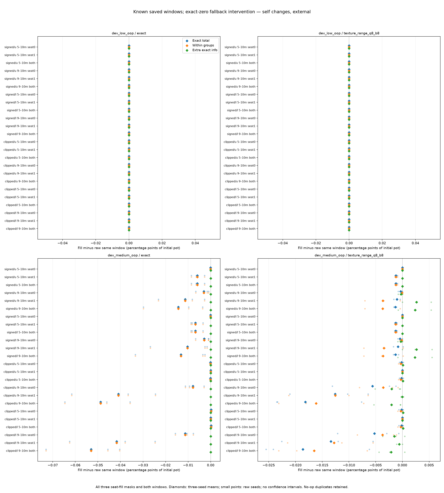

# Test whether zero-weight late-window fallbacks matter

Issue [#4](https://github.com/jimmy-sim/poker-ai/issues/4), November 9, 2026.
Prospective saved-policy follow-up to the completed averaging-history diagnosis.
Codex-assisted; human hands-on time not recorded. No intervention outcomes exist
when this plan and [configuration](../configs/window-fallback.json) are published.

## Question and definition of done

Late averages can have zero new mass at some information rows and use the
existing uniform legal fallback. That is not automatically a training problem:
the full clipped control has zero measured late exploitability despite only
38.424117% river uniform-reach mass coverage. Some such rows may be unreachable
under its own strategy. Does the fallback affect the saved sampled windows?

Done requires complete source-bound own/native receipts, every declared source,
all original raw-window controls, unchanged-row and full-control invariants,
seat/root/additivity identities, raw and mean tables, four inspected figures,
read-only replay and cross-version numerical reproduction, limits and three
interview answers, updated README/work log/journal and green final CI. A failed
correctness gate remains failed and is investigated before interpretation.

This is an offline policy intervention. It does not train or deploy a new agent,
choose a suffix, reset a learning clock, tune a fallback or revise a failed limit.
Only the exact zero-mass mask is changed; no near-zero threshold is introduced.

## Complete source and interventions

Pin the completed averaging-history config, correctness/admission, own header,
policy/mass archives and native receipt by SHA-256. Validate the complete upstream
replay and independent comparison before reading new intervention outcomes.
Keep all **128 suffixes** from the original 64 cases: both games/encodings,
full once and all external seeds, both regret rules and both average weights.
No case is selected by its score, missing mass, seed or observed effect.

Reconstruct each window's unnormalized mass from the retained cumulative
boundaries, and verify its original normalized policy. A row is eligible only
when that exact window mass sums to zero. For each window keep four policies:

1. Raw suffix, unchanged control.
2. Fill eligible seat-0 rows from the **same source case's own whole average**.
3. Fill eligible seat-1 rows from that own whole average.
4. Fill both seats' eligible rows from that own whole average.

That is **512 self profiles**. Keep every no-op/duplicate too. Positive-mass
rows, rows belonging to unselected seats, legal menus and information groups
remain bit-exact. The fill uses only previously saved own probabilities. It
does not read an actual hidden opponent hand or future board to choose an action.
Reference outputs never supply probabilities or learning targets.

## Checks and measurements

For each self profile use the frozen own scorer for player-zero EV, exact
exploitability, within-partition gain, extra exact-information value, river-only
diagnostic and both target response roots/achieved own reply hashes. Chips and
pot-normalized values stay separate. All 128 raw suffix controls must recover
their original policy hashes and scalar scores.

Record eligible/changed row counts by seat/street, uniform-information-reach
weight, and the maximum own realization reach at eligible decision histories.
Here own realization reach multiplies only that player's preceding action
probabilities, excluding chance and the opponent. A row can have positive
uniform-game reach yet zero reach under this strategy.

For **all 32 full-control windows**, every fill must preserve both players' own
realization reaches within 1e-12 and own exact/within/extra metrics plus EV within
1e-9 chips. In a consistent perfect-recall full average, zero own averaging mass
implies an unreachable own row; filling it cannot change the realized strategy.
Test this reasoning on explicit toy cases before applying the gate. If it fails,
stop and diagnose the averaging/recall/finite-precision assumption; do not relax
the gate, remove controls or label the difference a strength improvement.

For each window, the four self profiles form a complete 2×2 seat-fill panel.
An exact or restricted BR root depends on the opponent, so changing only the
responding player's rows leaves that root constant. Half-summed exact, within
and extra self metrics therefore obey the additive identity
`both - seat0 - seat1 + raw = 0`, at 1e-9 chips. Baseline EV can have interaction;
retain it separately rather than imposing an incorrect zero interaction gate.
The river-only metric is not included in that pure full-game BR identity.

For **raw and both-filled** policies only, hold each of the four original whole
opponent modes fixed, in the same game/encoding/traversal/seed group, for each
responding seat. That is **2048 target conditions**. Replace only the responder;
the opponent never inherits the fill. A both-filled candidate is equivalent to
its target-only fill in this match, which is checked explicitly. Reuse verified
original OWN replies to the fixed opponents; re-evaluate roots and achieved own
values, with constant-root and gain-change = negative-EV-change identities.

All 512 self profiles and 2048 fixed conditions require independent scalar
comparison with pinned OpenSpiel 2.0.2 / Apache-2.0, rechecking installed license
bytes against [the existing license record](solver_validation.md). No native
training or strategy export is allowed. The native game uses own exports;
agreement does not independently verify every engine rule.

## Gates, budget and retained outputs

Before measurement: publish this plan/config, implement meaningful asymmetric
hidden-action arithmetic, unreachable/reachable zero-mass, signs, all masks,
mutation/byte identity, serialization/grid/source and failure tests; complete
relevant base/optional local checks and both hosted code CI jobs. Real old-policy
adapter checks block new Hold'em training and reference strategy export.

This saved-policy diagnosis uses the existing separate **900s own /900s native**
convention, each including input replay and IO. It changes neither the original
trajectory study's 7200/900s caps nor its scientific gates. There is no new
trajectory forecast or learning sweep. Chip tolerance is 1e-9; unitless reach
tolerance is 1e-12; identities, masks and original unchanged bytes are exact.
Record clean source/config/lock hashes, dependency/runtime/hardware and wall/
parent/reaped-child CPU separately. Do not infer human work time.

Archive every own intervention policy with source/window/mask/whole-policy
bindings and own reply hashes. Reconstruct them independently from the pinned
upstream policy and raw masses on replay. Retain all failures/partials, refuse
overwrites, and publish complete own evidence before native comparison. Fresh
reproduction may retain immutable ignored own staging between stages.

Report all raw rows, source/control and per-window seat-fill accounting,
fixed-opponent EV/root/gain differences, full-control invariants, support and
arithmetic means of the three external seeds. No confidence intervals or
independence claim for shared policies, windows, modes or no-op fills. Four
fixed figures: self changes full; self changes sampled with raw seed points;
fixed-opponent changes full, both seats; the same sampled means, both seats.

## How to read the four figures

The two self-change figures compare each fill with the **same raw window**.
Each line label identifies the regret/average mode, late window and filled seat.
Blue shows the change in exact total exploitability, orange the within-group
component, green the extra exact-information component. Negative is a reduction;
positive is an increase. Diamonds show the full control or the three-seed mean;
small sampled points show each retained seed. There are no confidence bands.

**Illustrative example, not an outcome:** A total change of -0.2 means a reduction
of 0.2 percentage points of initial pot. It is not a 20% win probability. Within
and extra changes add to the total; they can move in opposite directions.

The other two figures hold an old **own whole-average opponent** fixed in each
column and change only the responding seat's rows. They show both-fill minus raw
unilateral within-group gain. Blue/negative means better own EV against that
same opponent; red/positive means worse. Both seats and all four opponents stay
visible. Those opponents are our saved policies, not native solver strategies.
OpenSpiel independently checks the scalar calculations instead of supplying play.

Colors within each heatmap share a symmetric scale; its minimum display range is
±1e-6 percentage points so numerical control noise stays neutral. Cell labels and
CSV values retain their actual numbers. This display choice changes no scientific
value, mask or tolerance. Full controls, sampled means and no-op duplicates have
the limits stated above; color intensity alone cannot compare separate figures.

## Interpretation and next decision

An effect isolates this specific fallback substitution on these saved windows.
It does not prove that fallback causes the whole training weakness, identify a
generally better averaging rule or admit a filled strategy. A null effect is
also useful: missing average mass can be harmless at unreachable rows. Keep
unfavorable effects and distinguish coverage from realized reach before choosing
a later training intervention. All implementation and outcomes are pending.

## Completed saved-policy intervention — November 9

The plan above preceded implementation and outcomes. Every 128 source window,
512 self profile, 128 raw control/panel and 2048 fixed target condition is retained.
All **32 full windows preserve own realization and the required values exactly**;
their maximum changes are zero. Missing uniform-game coverage at those rows is
compatible with harmless, unreachable own decisions.

Own archive replay has zero chip/unitless error. Own stage **285.478070s** under
900s includes 94.552135s upstream replay and 94.142837s intervention replay.
Independent stage **332.709628s** under 900s includes 193.038860s complete input
replay. All 512 self profiles, 2048 fixed conditions and 128 native panels pass;
maximum complete discrepancy **1.6342482922482304e-13 chips**, below 1e-9.
Fixed-difference discrepancy is at most 2.842170943040401e-14 chips. All 128
cached fixed-opponent/target identities are checked before reuse; no reference
strategy supplies probabilities or learning targets.

Base Python 3.12 replays the complete input/intervention chain with zero error
in **187.900927s**, validates the archived native receipt and reproduces all
**seven numerical files byte-for-byte**. Four final figures inspected. Times are
process measurements, with nested replay intervals, not human work hours.

Ordering: prospective `a860f9c`, checked code `815d470`, both
[code CI jobs](https://github.com/jimmy-sim/poker-ai/actions/runs/42596478622)
passed before check/reader notes `d170d93`; complete own publication `3fa97c4`
preceded native publication `e91f8f2`. Original source/config/data/seeds/caps and
the older failed performance limits remain unchanged.

### The declared whole-average fill has a small effect here

Medium range-mass sampled totals below are three-seed arithmetic means, in
**percent of initial pot**. Fill changes **both seats' eligible rows only**;
changes are percentage points, filled minus the same raw window. All separate
seat fills, encodings, games, seeds and opponents remain in the
[complete tables](../results/window-fallback/report/tables.md) and CSVs.

| Regret / average | Window | Raw total | Both filled | Change |
|---|---|---:|---:|---:|
| Signed / uniform | 5m–10m | 6.334095 | 6.332892 | -0.001204 |
| Signed / uniform | 9m–10m | 16.609958 | 16.608637 | -0.001321 |
| Signed / linear | 5m–10m | 6.719436 | 6.718195 | -0.001241 |
| Signed / linear | 9m–10m | 16.793465 | 16.792185 | -0.001280 |
| Clipped / uniform | 5m–10m | 2.541802 | 2.541634 | -0.000168 |
| Clipped / uniform | 9m–10m | 4.901764 | 4.883604 | -0.018160 |
| Clipped / linear | 5m–10m | 2.531900 | 2.531738 | -0.000161 |
| Clipped / linear | 9m–10m | 4.888556 | 4.869954 | -0.018602 |

For clipped/linear half-window means, within gain changes 1.510004→1.509719%
pot, while extra-information value changes 1.021896→1.022019%. A small mean
total reduction conceals opposing components. Two of three half-window seeds
worsen slightly: total changes +0.000136/-0.000655/+0.000034 percentage points
for seeds 20261301/2/3. The short window improves in each seed, but stays much
more vulnerable than the unchanged whole average's 2.501852% mean.

Across **all 96 sampled both-fill windows**, raw total changes range from
**-0.073002 to +0.000529 percentage points**. This is a descriptive range of this
one intervention, not a confidence interval, population result or bound on all
possible fallback choices. Positive results and no-op fills remain in the data.



### Missing mass is different from realized reach

The fill is not simply a no-op everywhere. For the first seed's medium
range-mass clipped/linear short window, **740 information rows** are eligible and
**544** actually change probabilities. They are river rows in this case. The
maximum own realization reach at an eligible river history is **0.006164**.
That multiplies only the player's earlier actions and excludes chance and the
opponent; it is not a measured hand frequency. The source has 1662 information
rows, which represent groups of situations rather than 1662 independent hands.

The full controls supply the important contrast: eligible rows can have positive
uniform-game exposure but zero reach under the strategy. Every full fill leaves
the realized policy and scalar results unchanged. A coverage deficit alone does
not establish an error, and changing many off-path probabilities need not change
EV substantially.

This particular fill does not recover a strong late-window strategy. It also
does **not** prove that every missing row or every alternative completion is
harmless: some whole-average rows already use the same uniform fallback, and
only one predetermined own completion was tested. The sampled learning cause
remains unresolved. A separately planned test of within-pass sampling variance,
with unchanged work limits and independent correctness/cost gates, is the next
useful direction; no optimizer or new agent is admitted by this diagnosis.

## Reproduce and inspect

These commands replay the complete saved chain without training or an installed
reference runtime, and open the retained figures:

```sh
.venv/bin/python scripts/report_window_fallback.py --no-plots --output results/runs/my-window-fallback-report
.venv/bin/python -m pytest -q -m 'not slow' tests/test_window_fallback*.py
open results/window-fallback/report/self-changes-external.png
open results/window-fallback/report/fixed-opponent-changes-external.png
```

At frozen revision `e91f8f2`, `make diagnose-window-fallback` repeats the complete
saved-policy own/native/report calculation into fresh ignored outputs, refusing
overwrites. Use uv 0.13.5 and an isolated clean checkout. Future added modules
do not alter the recorded source; read-only replay checks all original hashes.
Original trajectory training still belongs to its own frozen revision and caps.

## Limits and interview questions

All games, windows and seeds are already known development cases. There is no
new training, unseen-game validation, general win rate, convergence proof,
selected suffix/fallback deployment or default/fresh/global admission. Fills,
windows and average-weight readouts share source data and are not independent.
Fixed-opponent changes concern our old strategies; native scalar checks do not
turn those opponents into external GTO strategies. Own exports are shared by the
native game, so agreement does not independently validate every engine rule.

1. **Why can low coverage be harmless?** A row can be reachable under uniform
   play yet blocked by the player's own zero-probability earlier action. All 32
   full windows preserve realization and values exactly after the fill.
2. **Why not adopt the filled strategy?** The tested completion makes only a
   small change in the motivating case, can worsen individual outcomes, and
   remains a known-window intervention. Other completions and training causes
   remain unresolved; the old failed performance limit is not revised.
3. **Why fill each seat separately and hold opponents fixed too?** The four
   profiles check BR-root additivity without incorrectly forcing baseline EV
   interaction to zero. Fixed opponents then isolate conditional own EV changes.
   These checks validate the intervention's meaning, rather than identify a
   unique training cause or general strength improvement.
