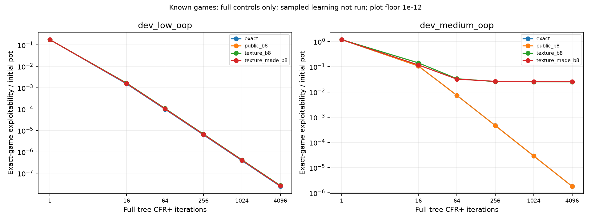
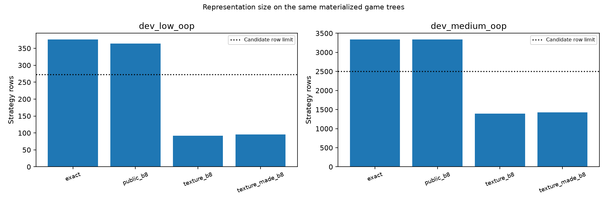

# Made-category full-control admission

Full-control admission: **False**; native audit **passed** (48 policies).

Sampled learning has not run. No fresh/global admission or default-agent change follows this result.

| Game | Representation | Final full exploitability (% pot) | Rows | Key bytes | Regret/average bytes |
|---|---|---:|---:|---:|---:|
| dev_low_oop | exact | 2.45451e-06 | 376 | 116160 | 12032 |
| dev_low_oop | public_b8 | 2.57713e-06 | 364 | 125226 | 11648 |
| dev_low_oop | texture_b8 | 2.66778e-06 | 92 | 41140 | 2944 |
| dev_low_oop | texture_made_b8 | 2.58098e-06 | 96 | 53544 | 3072 |
| dev_medium_oop | exact | 0.00018229 | 3336 | 968612 | 130560 |
| dev_medium_oop | public_b8 | 0.00018229 | 3336 | 1079292 | 130560 |
| dev_medium_oop | texture_b8 | 2.52252 | 1392 | 599592 | 54528 |
| dev_medium_oop | texture_made_b8 | 2.59366 | 1428 | 768326 | 55936 |

All snapshots are own full-tree CFR+ average strategies, trained separately per known game. Rows/storage are components, not total process memory. Zero abstract-recall violations and complete-grid/coverage/work checks are required. Native evaluation shares own exported mechanics; it is not an independent full-engine proof.

