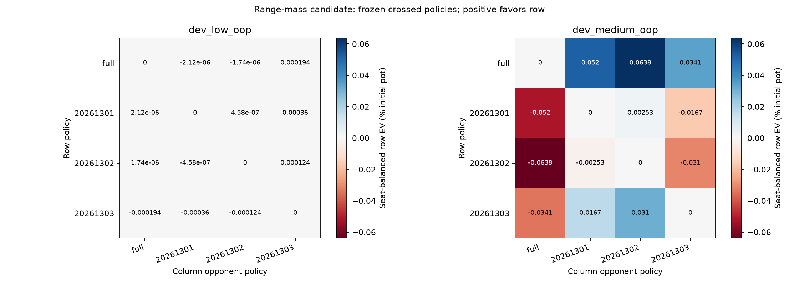
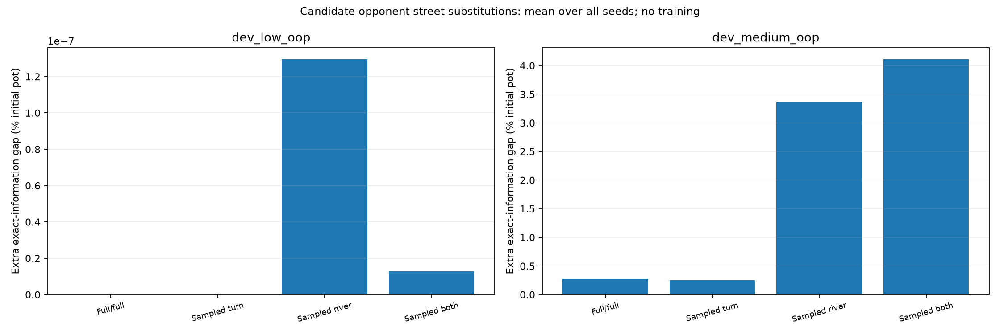

# Frozen-policy seat and street interventions

All effects below are percentage points of the initial pot, half-summed over responding seats and averaged across every sampled seed. Signed turn + river = change in the extra-information gap. Interaction is separate and is already shared between the two order-averaged effects.

| Game | Representation | Extra-gap change | Turn contribution | River contribution | Interaction |
|---|---|---:|---:|---:|---:|
| dev_low_oop | exact | 0 | 0 | 0 | 0 |
| dev_low_oop | public_b8 | 0 | 0 | 0 | 0 |
| dev_low_oop | texture_b8 | 1.504274e-08 | -0.00150163 | 0.001501645 | -0.003003255 |
| dev_low_oop | texture_made_b8 | 1.153957e-07 | 4.886193e-08 | 6.653378e-08 | 9.772387e-08 |
| dev_low_oop | texture_range_q8_b8 | 1.292777e-08 | -5.828366e-08 | 7.121143e-08 | -1.165673e-07 |
| dev_medium_oop | exact | 0 | 0 | 0 | 0 |
| dev_medium_oop | public_b8 | 0 | 0 | 0 | 0 |
| dev_medium_oop | texture_b8 | 3.918601 | -0.07149364 | 3.990094 | 0.3163504 |
| dev_medium_oop | texture_made_b8 | 3.526579 | -0.08425581 | 3.610835 | 0.4130329 |
| dev_medium_oop | texture_range_q8_b8 | 3.839358 | 0.366225 | 3.473133 | 0.7656095 |

All seeds and target seats remain in raw receipts. Repeated FF controls are not independent observations. Extra-information roots depend on the fixed opponent and partition, not the responder's saved baseline. Crossed EVs hold opponents fixed; seat-balanced EV is antisymmetric and diagonal zero, not universal playing strength.

These are frozen-policy interventions on known tiny games. Training update rules, work and traversal differ; the study does not identify a training-algorithm cause, guarantee retraining gains or deploy a hybrid. Exact responses respect hidden opponent cards. Native checks share exported mechanics and partitions.

