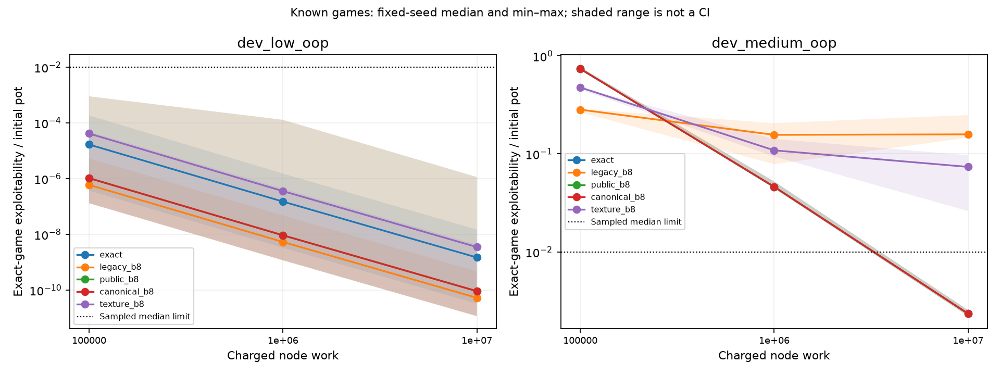
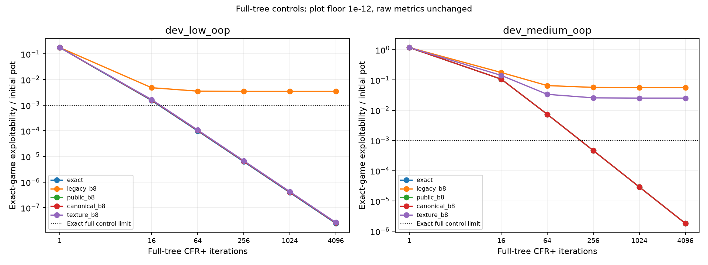
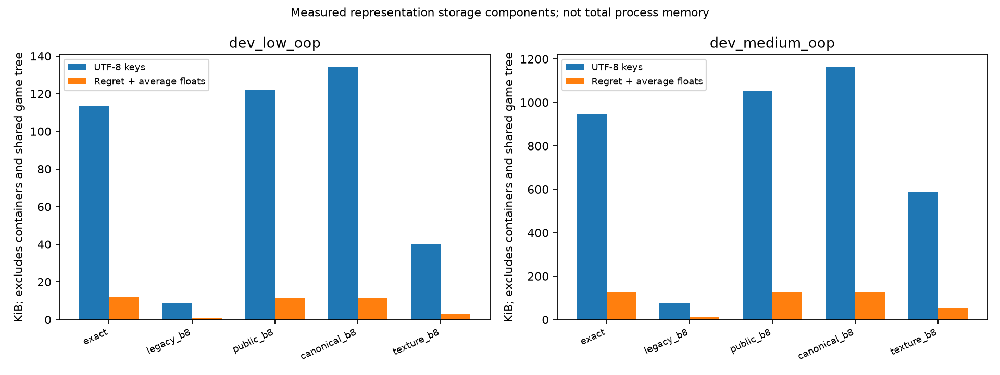
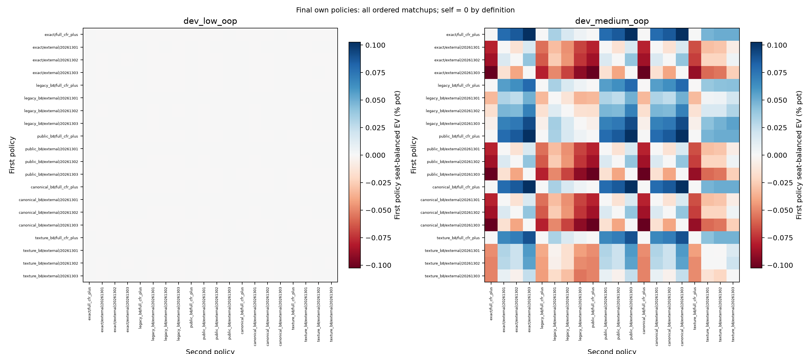

# Public-board comparison: known development games

Candidate development gate: **False**. Native audit: **passed**, 150 policies and 800 ordered final profiles.

All exploitability percentages are fractions of initial pot multiplied by 100. Rows are distinct strategy entries; smaller is not automatically stronger.

| Game | Encoding | Full epsilon % | Sample median % | Worst % | Rows | Rows/raw-public | Failed criteria |
|---|---|---:|---:|---:|---:|---:|---|
| dev_low_oop | exact | 2.45451e-06 | 1.47873e-07 | 1.49177e-06 | 376 | 1.0330 | none |
| dev_low_oop | legacy_b8 | 0.344045 | 5.26546e-09 | 4.67845e-08 | 32 | 0.0879 | none |
| dev_low_oop | public_b8 | 2.57713e-06 | 9.14195e-09 | 0.000114074 | 364 | 1.0000 | compression |
| dev_low_oop | canonical_b8 | 2.57713e-06 | 9.14195e-09 | 0.000114074 | 364 | 1.0000 | compression |
| dev_low_oop | texture_b8 | 2.66778e-06 | 3.50235e-07 | 4.30443e-07 | 92 | 0.2527 | none |
| dev_medium_oop | exact | 0.00018229 | 0.233819 | 0.254711 | 3336 | 1.0000 | none |
| dev_medium_oop | legacy_b8 | 5.64745 | 15.8299 | 24.8889 | 294 | 0.0881 | full_accuracy, sampled_median, sampled_worst |
| dev_medium_oop | public_b8 | 0.00018229 | 0.233819 | 0.254711 | 3336 | 1.0000 | compression |
| dev_medium_oop | canonical_b8 | 0.00018229 | 0.233819 | 0.254711 | 3336 | 1.0000 | compression |
| dev_medium_oop | texture_b8 | 2.52252 | 7.36974 | 9.68754 | 1392 | 0.4173 | full_accuracy, sampled_median, sampled_worst |

Only exact and the preselected texture candidate control admission. Criteria for other encodings are diagnostic.

The CSVs retain all seeds/checkpoints, collisions and their uniform-decision-reach mass, initial-only rows, initialized/subsequent coverage, work overshoot and memory counters. Key bytes and float-array bytes exclude Python containers and shared tree storage. RSS is a cumulative process high-water mark, not a per-representation memory saving.

Cross-play covers every ordered pair of final full/sample policies, including self. Seat-balanced advantage is (V(A0,B1)-V(B0,A1))/2; self is zero by definition. These own-policy matchups do not replace exact best responses or establish a global win rate.

Profiles use separate fresh solvers at the first study seed, repeated at the fixed iteration count; profile work is not added to learning checkpoints. Study wall time includes profiling/setup/serialization.

