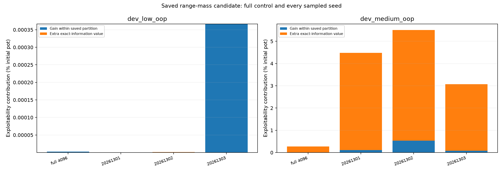
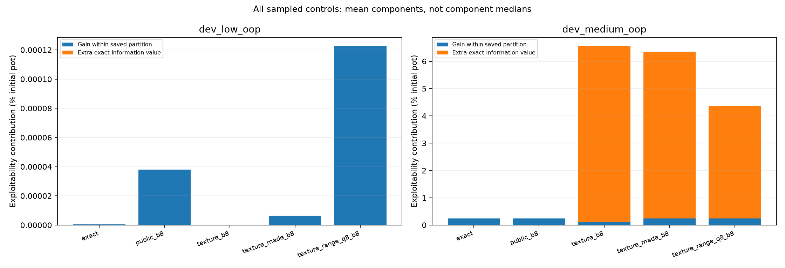

# Saved range-mass best-response diagnosis

Every number is % of initial pot. Exact exploitability = within-partition + extra-information gain, half-summed over seats. All seeds are retained below.

| Game | Representation | Training | Seed | Exact total | Within partition | Extra information |
|---|---|---|---:|---:|---:|---:|
| dev_low_oop | exact | sampled | 20261301 | 3.252994e-09 | 3.252994e-09 | 0 |
| dev_low_oop | exact | sampled | 20261302 | 1.491768e-06 | 1.491768e-06 | 0 |
| dev_low_oop | exact | sampled | 20261303 | 1.478731e-07 | 1.478731e-07 | 0 |
| dev_low_oop | exact | full | None | 2.454513e-06 | 2.454513e-06 | 0 |
| dev_low_oop | public_b8 | sampled | 20261301 | 1.161156e-09 | 1.161156e-09 | 0 |
| dev_low_oop | public_b8 | sampled | 20261302 | 9.141949e-09 | 9.141949e-09 | 0 |
| dev_low_oop | public_b8 | sampled | 20261303 | 0.0001140742 | 0.0001140742 | 0 |
| dev_low_oop | public_b8 | full | None | 2.577133e-06 | 2.577133e-06 | 0 |
| dev_low_oop | texture_b8 | sampled | 20261301 | 1.161156e-09 | 1.161156e-09 | 0 |
| dev_low_oop | texture_b8 | sampled | 20261302 | 3.502347e-07 | 3.203772e-07 | 2.985748e-08 |
| dev_low_oop | texture_b8 | sampled | 20261303 | 4.304426e-07 | 4.07567e-07 | 2.287569e-08 |
| dev_low_oop | texture_b8 | full | None | 2.667776e-06 | 2.665241e-06 | 2.53498e-09 |
| dev_low_oop | texture_made_b8 | sampled | 20261301 | 1.161156e-09 | 1.161156e-09 | 0 |
| dev_low_oop | texture_made_b8 | sampled | 20261302 | 3.192975e-06 | 3.192975e-06 | 0 |
| dev_low_oop | texture_made_b8 | sampled | 20261303 | 1.594959e-05 | 1.56034e-05 | 3.461871e-07 |
| dev_low_oop | texture_made_b8 | full | None | 2.580978e-06 | 2.580978e-06 | 0 |
| dev_low_oop | texture_range_q8_b8 | sampled | 20261301 | 1.161156e-09 | 1.161156e-09 | 0 |
| dev_low_oop | texture_range_q8_b8 | sampled | 20261302 | 1.025902e-06 | 9.871186e-07 | 3.878331e-08 |
| dev_low_oop | texture_range_q8_b8 | sampled | 20261303 | 0.0003667365 | 0.0003667365 | 0 |
| dev_low_oop | texture_range_q8_b8 | full | None | 2.57087e-06 | 2.57087e-06 | 0 |
| dev_medium_oop | exact | sampled | 20261301 | 0.2547113 | 0.2547113 | 0 |
| dev_medium_oop | exact | sampled | 20261302 | 0.2210446 | 0.2210446 | 0 |
| dev_medium_oop | exact | sampled | 20261303 | 0.2338194 | 0.2338194 | 0 |
| dev_medium_oop | exact | full | None | 0.0001822898 | 0.0001822898 | 0 |
| dev_medium_oop | public_b8 | sampled | 20261301 | 0.2547113 | 0.2547113 | 0 |
| dev_medium_oop | public_b8 | sampled | 20261302 | 0.2210446 | 0.2210446 | 0 |
| dev_medium_oop | public_b8 | sampled | 20261303 | 0.2338194 | 0.2338194 | 0 |
| dev_medium_oop | public_b8 | full | None | 0.0001822898 | 0.0001822898 | 0 |
| dev_medium_oop | texture_b8 | sampled | 20261301 | 7.369742 | 0.1198635 | 7.249879 |
| dev_medium_oop | texture_b8 | sampled | 20261302 | 9.687537 | 0.09696483 | 9.590572 |
| dev_medium_oop | texture_b8 | sampled | 20261303 | 2.609912 | 0.1275693 | 2.482343 |
| dev_medium_oop | texture_b8 | full | None | 2.522516 | 0.0001859351 | 2.52233 |
| dev_medium_oop | texture_made_b8 | sampled | 20261301 | 5.167665 | 0.1503502 | 5.017315 |
| dev_medium_oop | texture_made_b8 | sampled | 20261302 | 7.188975 | 0.4512041 | 6.737771 |
| dev_medium_oop | texture_made_b8 | sampled | 20261303 | 6.722857 | 0.1177379 | 6.605119 |
| dev_medium_oop | texture_made_b8 | full | None | 2.593658 | 0.000168654 | 2.59349 |
| dev_medium_oop | texture_range_q8_b8 | sampled | 20261301 | 4.480481 | 0.1110732 | 4.369408 |
| dev_medium_oop | texture_range_q8_b8 | sampled | 20261302 | 5.506634 | 0.5331421 | 4.973492 |
| dev_medium_oop | texture_range_q8_b8 | sampled | 20261303 | 3.07498 | 0.08540662 | 2.989573 |
| dev_medium_oop | texture_range_q8_b8 | full | None | 0.2716401 | 0.000174044 | 0.2714661 |

Mean component tables use arithmetic means across all sampled seeds; medians of components are not added. Full controls are separate 4096-iteration CFR+ training conditions, not matched-work samples. Tiny signed values within the chip tolerance are numerical roundoff.

These are fixed-opponent response opportunities, not measured retraining gains or a universal abstraction floor. Saved-prefix/reply-suffix street losses can include later opportunities. Counterstrategy examples are not deployed-agent frequencies or universal advice. Native checks share exported mechanics and partitions; no native actions are exported.

