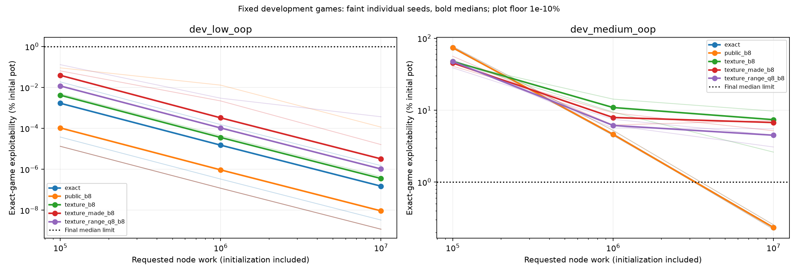
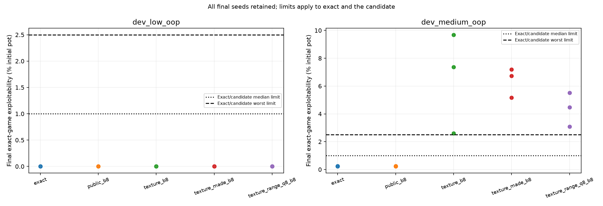

# Range-mass fixed-work sampled comparison

Development gate: **False**; native audit **passed** (90 own policies).

All policies and checkpoint/visit pairs replayed. No fresh/global/default admission follows.

| Game | Representation | Median final exploitability (% pot) | Worst seed (% pot) | Average coverage (min) | Subsequently sampled coverage (min) |
|---|---|---:|---:|---:|---:|
| dev_low_oop | exact | 1.47873e-07 | 1.49177e-06 | 100% | 80% |
| dev_low_oop | public_b8 | 9.14195e-09 | 0.000114074 | 100% | 80% |
| dev_low_oop | texture_b8 | 3.50235e-07 | 4.30443e-07 | 100% | 80% |
| dev_low_oop | texture_made_b8 | 3.19297e-06 | 1.59496e-05 | 100% | 80% |
| dev_low_oop | texture_range_q8_b8 | 1.0259e-06 | 0.000366736 | 100% | 80% |
| dev_medium_oop | exact | 0.233819 | 0.254711 | 100% | 97.601% |
| dev_medium_oop | public_b8 | 0.233819 | 0.254711 | 100% | 97.601% |
| dev_medium_oop | texture_b8 | 7.36974 | 9.68754 | 100% | 98.2855% |
| dev_medium_oop | texture_made_b8 | 6.72286 | 7.18898 | 100% | 97.7724% |
| dev_medium_oop | texture_range_q8_b8 | 4.48048 | 5.50663 | 100% | 98.1518% |

Exact and candidate require median <=1% pot and worst <=2.5% on each game at final work. All final controls require average coverage >=95% and zero recall violations. Every seed remains in the CSV. Three seeds are not a confidence interval.

Work includes exact initialization and actual recursive visits; a whole iteration crosses each requested budget. Profiles are separate solvers; setup/profiling/receipt persistence are included in study wall time. Uniform-reach initialized-average coverage is distinct from subsequent sampled coverage. Key/table bytes are components, not total memory; RSS is a process-lifetime high-water mark.

Exploitability is exact-game NashConv/2 divided by initial pot, not a match win rate. Native evaluation shares own exported mechanics and never trains the learner. Known tiny ranges and separate per-game training do not establish global Hold'em strength.

