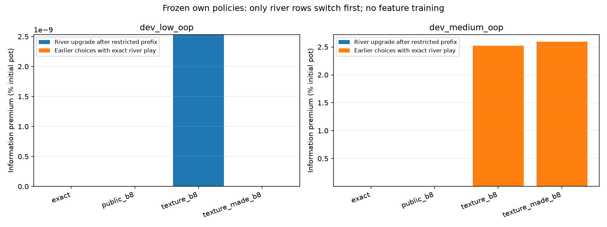
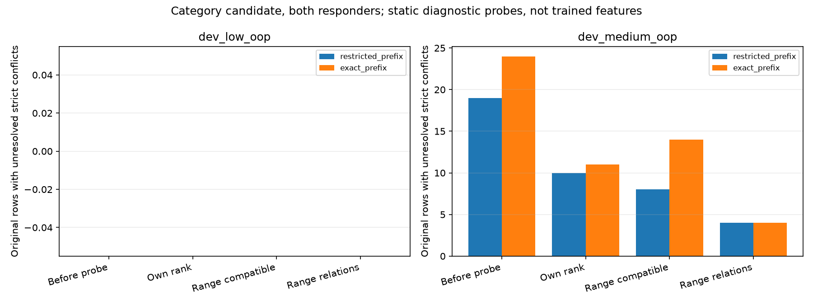

# Missing river distinctions

All gains below are half-summed across responding seats, as % initial pot. The first two switch components sum to the previous exact-information premium. The exact-prefix river upgrade is a separate panel, not an additional component.

| Game | Representation | Information premium | River upgrade, restricted prefix | Earlier readjustment | River upgrade, exact prefix |
| --- | --- | ---: | ---: | ---: | ---: |
| dev_low_oop | exact | 0 | 0 | 0 | 0 |
| dev_low_oop | public_b8 | 0 | 0 | 0 | 0 |
| dev_low_oop | texture_b8 | 2.5349796e-09 | 2.5349796e-09 | 0 | 2.5349796e-09 |
| dev_low_oop | texture_made_b8 | 0 | 0 | 0 | 0 |
| dev_medium_oop | exact | 0 | 0 | 0 | 0 |
| dev_medium_oop | public_b8 | 0 | 0 | 0 | 0 |
| dev_medium_oop | texture_b8 | 2.5223304 | 4.9240687e-05 | 2.5222812 | 3.9813926 |
| dev_medium_oop | texture_made_b8 | 2.5934896 | 1.3695024e-05 | 2.5934759 | 3.7745924 |

Probe counts refer to original merged rows still containing a strict reachable conflict after partitioning by one static signature. These are structural counts on known tiny ranges, not EV gains or trained-feature acceptance. Both prefix panels and all per-info records are retained. Native checks share own exported mechanics.

