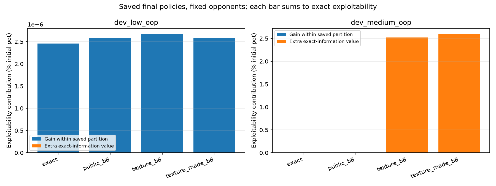
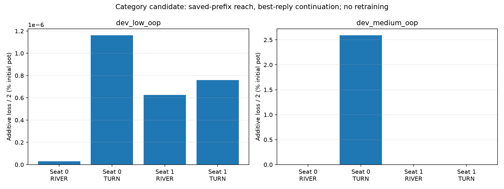

# Saved-policy best-response diagnosis

All numbers below are % of the initial pot. Exact = within-partition + extra-information response value (half-summed over seats).

| Game | Representation | Exact exploitability | Within partition | Extra information |
| --- | --- | ---: | ---: | ---: |
| dev_low_oop | exact | 2.4545131e-06 | 2.4545131e-06 | 0 |
| dev_low_oop | public_b8 | 2.5771334e-06 | 2.5771334e-06 | 0 |
| dev_low_oop | texture_b8 | 2.6677763e-06 | 2.6652413e-06 | 2.5349796e-09 |
| dev_low_oop | texture_made_b8 | 2.5809778e-06 | 2.5809778e-06 | 0 |
| dev_medium_oop | exact | 0.00018228985 | 0.00018228985 | 0 |
| dev_medium_oop | public_b8 | 0.00018228985 | 0.00018228985 | 0 |
| dev_medium_oop | texture_b8 | 2.5225163 | 0.00018593513 | 2.5223304 |
| dev_medium_oop | texture_made_b8 | 2.5936582 | 0.00016865398 | 2.5934896 |

These are best responses to fixed saved policies, not a prediction of retraining gains or competitive Hold’em strength. All exact-info losses are retained, including zeros; their per-seat sums equal unilateral gains. Native checks share own exported mechanics and information partitions. Tiny signed values near zero are floating-point roundoff.

